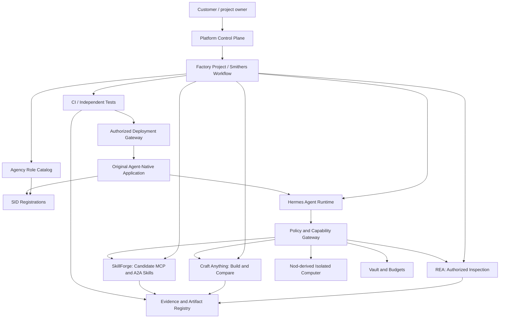
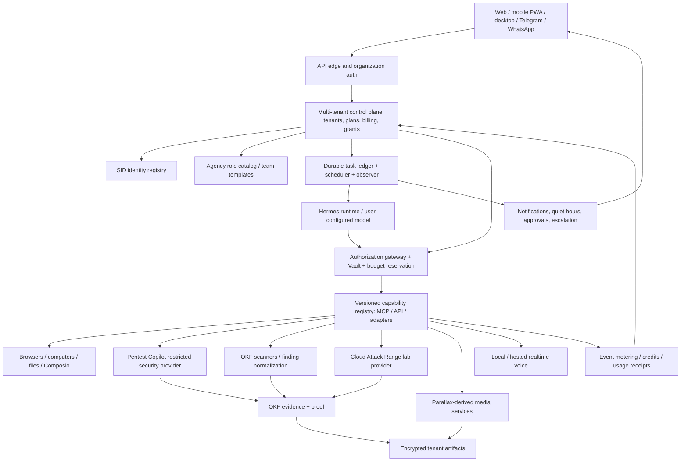

# Universal Agent Platform — Complete Commercial Master Blueprint v6

**Revision:** v6 — Built-in SID Agent Workforce, Elixir ephemeral processors, seven-language service ownership, design-quality gates, domain specialist registry, and NPC/embodiment policy  
**Date:** November 18, 2026  
**Status:** **ARCHITECTURE + IMPLEMENTATION DIRECTIVE**, not an implemented or deployed app.  
**Predecessor:** v5 retained *in full* as Part II below; this v6 Part I supersedes prior choices on built-in agent lifespan, foundation preference and registry/gate policy.  
**Foundation decision:** Start the authorized Apache-licensed subset of **`milind-soni/OpenMausBot`** as the preferred application/desktop seed, subject to build, rights and Hermes-parity acceptance gates. **Bot HQ** is reference/adapter source, not default shell. **Hermes** remains primary reasoning engine.  
**Product:** Original commercial agent-native Workspace + Platform Factory with Free/Basic/Pro/Teams/Enterprise, security/creative/labs/automation, built-in specialist agents spawned for work and retired after each task.  

**Audit header — Summary | Threat Model | Tests | Invariants | Diacritics**
- **Summary:** Convert vetted persona/skill collections into a marketplace of **versioned RoleTemplates**, install them as **SID principals**, supervise **ephemeral Elixir task workers**, and route all effects through a **Rust policy/capability kernel**. Add reproducible anti-slop, accessibility, professional-domain and production-readiness quality gates. Preserve all existing v5 scope.
- **Threat Model:** Prompt/package injection, unauthorized skills, cross-tenant SID impersonation, retained BEAM state, task replay, secret leakage, unsafe external actions, fake persona expertise, medical/smart-contract errors, biased or unsupported claims, unlicensed copied content, deceptive NPC identity, platform IP contamination, quality-gate gaming and supply-chain compromise.
- **Tests:** Every promoted template/skill has a pinned-source evaluation suite and evidence. Run worker lifecycle, leak/isolation, proof-of-work, real UI quality, code standards, financial/economic effects, NPC performance and domain evaluation scenarios in Part I. Older suites in v5 are retained.
- **Invariants:** A **template is not an agent**; a **SID persists**; an **Elixir worker is ephemeral**; **Hermes reasons**; **Rust authorizes**; a skill is untrusted content until reviewed; signed identity is not execution permission; grant revocation is effective at dispatch AND tool-call boundaries; memory is isolated; no generated product is considered finished without independently verified functional evidence.
- **Diacritics:** Preserve source/canonical Unicode. For the public commercial product use neutral role/service names; optional private/internal ritual correspondence must not alter API identifiers or canonical hashes.

## 0. Executive decision — what is being built

The platform launches with **built-in agent specializations**, not just a directory of links or downloadable prompt files. An organization may install, configure and assign a specialist (Rust Engineer, Art Director, Motion Director, QA Reality Checker, Move Contract Auditor, Medical Research Librarian, NPC Behavior Designer, Evidence Investigator, etc.). Installation creates a **real persistent SID-bound agent principal** with a per-tenant memory namespace, role and skill version pins, a runtime binding and independently scoped grants. A project task **spawns a short-lived Elixir supervised worker** that uses Hermes and permitted tools; completion/crash/cancellation tears down execution and ephemeral resources while preserving authoritative task results, permitted memory, SID lineage and approved artifacts. A new task resumes the *same SID*, not an anonymous replacement.

**Implement built-in agents as built-in templates + safe activation**, rather than shipping hundreds of constantly running bots or pre-minting identities for every user. Domain libraries are catalog candidates and sources of skill content; they are not automatically trustworthy or installed by the act of linking a repository.

### Locked decisions

| Decision | Explicit rule |
|---|---|
| Foundation | OpenMausBot OSS is preferred for v6 app/harness/desktop starting point, after rights and runtime parity gates. Bot HQ stays selectively reusable. |
| Identity | SID is stable tenant-scoped principal identity; legacy `sid/0.1` hashes preserved; a neutral next-version identity must be verified before issuance. |
| Agent runtime | Hermes is primary model/agent reasoning. Neither Nod's Pi engine nor OpenMausBot's other drivers become a mandatory second reasoning master. |
| Rust | Sole authoritative enforcement boundary for capability grants, scope, quota, signed execution leases, SID validation and lifecycle authority. |
| Elixir | Per-job agent **worker process** supervisor and team runtime; worker does not own the permanent SID identity record or customer credential store. |
| Julia | Optional numerical simulation, high-performance memory calculations and evaluation analytics, bounded by service contracts. |
| Go | Networking, I/O, streaming, mesh/transport and provider gateways. |
| Python | Model/tool adapters, SkillForge generation helpers, REA/research and evaluation toolchains. |
| Clojure | Symbolic reasoning, contract/policy explanation and deterministic evaluation DSL; never bypasses Rust's action decision. |
| Move | Sui on-chain capability/economic/settlement objects where required; not a substitute for off-chain tenant policy. |
| TypeScript | Existing OpenMausBot UI/desktop compatibility and frontend; not the target policy-authority core. |
| Skill packs | Pinned, reviewed, integrity-checked and loaded progressively, not untrusted shell scripts sourced in the worker. |
| Quality | Hard functional gates plus evidence-backed design review; design originality is a human-reviewed rubric, not a magic score from one model. |
| Licensing | OSS licenses, third-party data rights, asset licenses and OpenMausBot `enterprise/` restrictions reviewed individually before redistribution. |
| Medical/security | Research and analysis roles are limited to supported authorized uses; no unlicensed clinical professional status or unauthorized testing. |

---
## 1. Authoritative agent lifecycle — persistent SID, disposable worker
### 1.1 Objects that must never be conflated

| Object | Stored in / owner | Lifetime | Meaning |
|---|---|---|---|
| `SourceRepository` | Source Registry / PostgreSQL | Until archived | A candidate source and its pinned SHA, licensing, trust audit, dependencies |
| `PersonaBlueprint` / `RoleTemplateVersion` | Role Registry | Versioned and immutable | Reusable instructions, competence scope, artifact rules, review criteria; **not** a live person or process |
| `SkillPackVersion` | Skill Registry | Versioned | Declarative metadata, tool contracts, examples, tests; never a blanket grant |
| `QualityGatePack` | Quality Registry | Versioned | Testable acceptance criteria, required evidence and reviewer independence |
| `AgentIdentity` (SID) | SID Registry | Stable across jobs | Persistent independent agent principal and lifecycle/provenance record |
| `AgentInstallation` | Tenant Agent Registry | Until removed/revoked | Binds SID to role, pinned skills, model policy, memory namespace, billing and deployment preferences |
| `AgentWorkerLease` | Rust enforcement kernel + job ledger | **Seconds/minutes/hours per task** | Short-lived, signed authority for one task/sandbox and its allowed tools |
| `ElixirAgentProcess` | Elixir supervision tree | **Only while working** | BEAM task process that drives task state, calls Hermes and receives typed tool replies |
| `HermesSession` | Hermes adapter/session store | Per task or approved continuation | Reasoning context; not the principal or authorization authority |
| `MemoryNamespace` | Provenance memory service | Retained by policy | Per-SID facts, observations, learned procedures and source visibility |
| `Task / WorkReceipt` | Durable job/evidence ledger | Retained by policy | Truth of what ran, failed, was approved, verified, charged and published |
| `NPCEmbodiment` (optional) | Game/twin integration | While active/placed | World/scene instance referencing a SID; a visual NPC is not automatically an on-chain citizen |

**Identity rule:** The user requests an identity per built-in specialist *instance*. A catalog entry is shipped as a template. When a customer activates it, SID issuance gives a stable principal. When work begins, spawn an Elixir worker **under that principal**, not a new SID each time. On exit destroy the worker and leased execution sandbox, not the principal. A deliberate re-birth/transfer is a separately authorized lifecycle operation, never side-effect of task completion.

### 1.2 State machines

```text
Role template: DISCOVERED -> QUARANTINED -> AUDITED -> PACKAGED -> EVALUATED
             -> APPROVED -> PUBLISHED -> DEPRECATED -> RETIRED

SID installation: CREATED -> ACTIVE -> PAUSED -> REVOKED -> ARCHIVED
                      ^       |
                      +-------+ (authorized resume before revocation)

Task: CREATED -> AUTHORIZED -> QUEUED -> LEASED -> RUNNING
                   |            |                 |
                   |            +-> CANCELLED     +-> WAITING_APPROVAL
                   |                              +-> CHECKPOINTED
                   +-> DENIED                     +-> SUCCEEDED
                                                  +-> FAILED
                                                  +-> UNCERTAIN
                                                  +-> CANCELLED

Elixir process: NOT_RUNNING -> SPAWNING -> ALIVE -> DRAINING -> TERMINATED
                                       |                     ^
                                       +-> CRASHED -> RECONCILE +
```

The task ledger is authoritative and survives process death. Elixir's DynamicSupervisor manages **per-task** GenServer processes, with per-SID concurrency policy. Rust issues fenced work leases, validates every external effect and monitors revocation. Do not use an in-memory GenServer mailbox as the only durable task queue. For database persistence choose one durable queue authority per job class (Oban or a compatible selected queue), transactional outbox, idempotency and crash recovery; test the exact selected deployment.

### 1.3 End-to-end spawn-and-teardown protocol

1. **Install a built-in specialist:** Organization selects a reviewed immutable role version; UI shows provenance, requested tools, skill versions, risk class, privacy and estimated costs. No secrets are in the template.
2. **Issue SID:** Rust validates tenant, issuer/signature and uniqueness; SID identity service issues identity with a separate `AgentInstallation`, memory policy and no default privileged grants. Preserve any existing signed historical `sid/0.1` bytes; new neutral profile is a versioned migration with golden fixtures.
3. **Assign task:** Smithers, a human or authorized automation submits typed `TaskIntent` and acceptance tests under this SID. Do not let a persona self-assign privileged mandates.
4. **Admission:** Rust checks tenant, role/version compatibility, risk, explicit owner grants, time/budget, dependencies, tool schemas and workload limits. A role's name cannot override this policy.
5. **Lease & spawn:** Rust atomically issues `lease_id`, `epoch`, `budget_cap`, `expiry` and exact resource constraints; Elixir coordinator claims job and uses `DynamicSupervisor.start_child` to create a per-task worker. The worker bootstraps **one** approved SID+role+skill snapshot.
6. **Execute:** Elixir asks Hermes to plan and reason. Hermes requests typed tools; Rust approves each action with exact arguments and capability reference; isolated provider executes it; receipts/errors return to the durable ledger. Julia/Go/Python/Clojure/Move are used through separately authenticated services only if the task genuinely needs them.
7. **Checkpoints:** At every external side effect/long task, checkpoint progress, artifact digests, budget, outstanding action IDs and lease epoch. Never write raw bearer secrets or hidden internal reasoning to portable checkpoints.
8. **Evaluate:** Run objective unit/integration/domain/quality tests. Independent reviewer SID + CI runner, not only the generating worker, must verify necessary gates. Failed reviews may produce bounded repair subtasks.
9. **Finalize:** Update ledger, artifacts and allowed memory with provenance; reconcile cost, obtain needed publication approval, mark `SUCCEEDED/FAILED/UNCERTAIN`; revoke the lease.
10. **Tear down:** Elixir child stops, sandbox/container is destroyed or positively quarantined, working secret handles cleared, ephemeral volumes removed, sessions revoked; verify termination and reaper status. If teardown fails, block reassignment and alert operator.
11. **Resume future work:** Rehydrate **same SID** in a new task with approved memory, pinned/new reviewed role versions, a fresh lease, new Hermes context and no inherited ephemeral credentials.

### 1.4 Independent failure modes

- **BEAM crash**: orphan-reaper detects dead process, expires lease, reconciles uncertain effects, requeues only idempotent work or invokes human reconciliation; SID and durable artifacts remain.
- **Worker kill mid-purchase/post/send**: no automatic blind retry. Record `UNCERTAIN`, query provider receipt/idempotency key before deciding outcome.
- **Policy grant revoked during run**: Rust rejects next tool call immediately and signals Elixir to stop; long-running providers must expose cancellation or enforce lease expiry in isolated executor.
- **Model/provider outage**: pause/resume with checkpoint; fallback provider requires capability compatibility, price and data-policy approval.
- **Duplicate queue delivery**: compare task+epoch+action idempotency key; only one active leased executor may commit effects.
- **Sandbox teardown fails**: quarantine machine/VM, revoke egress and credentials, record incident; do not claim completed cleanup.
- **Agent role updated**: in-flight task pins its role/skill/evaluation digests. New tasks use reviewed versions after migration and owner consent.

### 1.5 Minimal neutral task execution contract (proposed, not deployed)

```json
{
  "schema": "platform.agent-task/1.0",
  "tenant_id": "tenant_sample",
  "sid": "sid:sample:agent_123",
  "installation_id": "installation_123",
  "task_id": "task_abc",
  "role_version_digest": "sha256:ROLE_DIGEST",
  "skill_pack_digests": ["sha256:SKILL_DIGEST"],
  "intent": {"operation": "project.build.review", "artifact_ref": "artifact_123"},
  "capability_grant_ref": "grant_from_policy_service",
  "risk_class": "READ_DRAFT",
  "lease": {"id": "lease_123", "epoch": 1, "expires_at": "2026-11-19T01:00:00Z"},
  "limits": {"max_wall_seconds": 1800, "max_model_usd": "2.00", "max_external_effects": 0},
  "evidence_required": ["test_report", "source_digest", "review_decision"]
}
```

All IDs above are documentation placeholders; runtime code must validate genuine signed tokens/grants. A `grant_ref` in a request alone is **not** authority to execute it.

### 1.6 Recommended implementation boundaries

| Proposed module | Technical interface / protection |
|---|---|
| Rust `identity-policy-kernel` | gRPC/HTTP typed authorization; SID verifier; entitlements, capability grants, lease epoch, sandbox grants, action receipts |
| Elixir `agent-workforce-runtime` | OTP Application + supervisors; per-task GenServer; durable queue claim/recovery; Elixir worker invokes Hermes via authenticated gateway; no key vault master secret |
| Python `hermes-tool-bridge` | Typed Hermes/SkillForge adapters; isolated Python runners and allowed domain tools; versioned schema contracts |
| Julia `memory-simulation-compute` | Numerical/statistical jobs, embeddings/features and simulation; accepts scoped tasks with resource limits |
| Clojure `symbolic-review` | Symbolic reasoning and explainable policy proposals; generates evidence but never mints Rust grants |
| Go `transport-computer-gateway` | Concurrent I/O, messaging, screen/session streaming, mesh and provider connectors |
| Move `onchain-operations` | Customer-authorized Sui actions, proof/escrow/ownership where chosen; audited transactions, exact cost/recipient approval |
| TypeScript `desktop-web-ui` | OpenMausBot OSS-derived UI, approved desktop clients and compatibility adapters; all writes through policy API |

**Do not force seven live language processes for every task.** Every task is supervised by Elixir, with Rust admission/policy; domain services are called only when declared and necessary. This preserves the seven-role architecture while avoiding unnecessary infrastructure, overhead or debugging complexity.
## 2. Built-in workforce catalog: persona, skill and gate composition
### 2.1 Five separate catalog entities

1. **Persona** = behavioral operating instructions and expected deliverables, not an executable or trusted identity. Example: *Motion Director*.
2. **Skill** = typed methods / reference procedures / domain knowledge with declared side effects and tests. Example: `storyboard.render` or `sui_move.test`.
3. **Evaluation suite** = independent objective/subjective rubric and fixtures. Example: visual regression + accessibility audit + editorial design review.
4. **Quality gate** = enforceable workflow condition that blocks promotion when required evidence is missing or failing.
5. **SID agent installation** = distinct persistent principal adopting approved versions of a persona+skills+gates, spawned temporarily for each assigned task.

A large repo or dataset may supply more than one class, but **no class inherits a higher trust level merely from being in the same repo**. Some supplied links are curated lists, not installable packages. Some include copyrighted character likenesses, medical contexts, dangerous security examples or executable scripts; review assets, data consent, privacy and licenses before inclusion.

### 2.2 Initial built-in roles (recommended product launch roster)

| Role family | Built-in roles | Skill sources to evaluate | Required independent gates |
|---|---|---|---|
| Architecture/engineering | Solution Architect, Backend Engineer, Frontend Engineer, Code Reviewer, QA Reality Checker | Owned Agency Agents fork, proagents, language skill packs | Contract tests, tests & CI, security checks, maintainability |
| Rust kernel | Rust Systems Engineer, Rust Security Reviewer | rewrite-rs, leonardomso, BeautifulRust | fmt, clippy, unsafe review, unit/fuzz/stress tests |
| Elixir workforce | OTP Supervisor Engineer, Distributed Job Engineer | georgeguimaraes/elixir-agent-tools | failure recovery, observer/queue replay, concurrency tests |
| Julia computing | Julia Performance Engineer, Numerical Scientist, Memory Analyst | JuliaGenAI, Krastanov | reproducible numeric fixtures, profiling and drift checks |
| Clojure symbolic | Clojure Domain Modeler, Rule Reviewer | iwillig, chaploud, nWave | spec/Malli contracts, REPL/CI checks, explainability |
| Python tools | Python Integration Engineer, Data Research Analyst | polyglotdev, fgmacedo | typing, ruff, pytest, packaging/sandbox tests |
| Go gateways | Go Networking Engineer, Distributed Systems Reviewer | spf13, mythicalhacker, samber | race detector, timeouts, load tests, observability |
| Move/Web3 | Sui Move Engineer, Smart Contract Security Auditor, DeFi Risk Analyst | MystenLabs, cryptoskills, Solidity kits (chain-specific only) | Sui Move tests/Prover as applicable, invariants, sandbox/testnet transactions, external audit for high stakes |
| Distinctive product design | Brand Director, Editorial UI Designer, UX Architect, Motion Director, Reality Checker | no-slop-design, anti-slop packs, GSAP, Front-End-Checklist | moodboard/design brief, identity system, responsive/accessibility tests, captured UI artifacts and independent editorial review |
| Factory delivery | Product Lead, Researcher, SkillForge Engineer, DevOps/Release Manager | Smithers, REA, Craft Anything, agency-agents, superpowers | scope/right-to-build, live build/test, signed releases, rollback |
| NPC/game | Game Architect, NPC Behavior Designer, Dialogue Writer, Economy Balancer, World Animator | NPCsh, OpenNPC, RoleLLM, game skill packs | persona stability, safe interaction, performance, world-state consistency, provenance |
| Music | Music Producer, Sound Designer, Original Score Composer | music-studio, music-skill, scenario-labs | original-rights check, playable/editable media, mix levels, game-loop seam, audio accessibility |
| Healthcare/life science | Medical Research Librarian, Clinical Evidence Reviewer, Bioinformatics Analyst | AWS HCLS, medical research skill collections | source citations, evidence grading, patient privacy, no independent clinician impersonation |
| Claims investigations | Evidence Investigator, Hypothesis Challenger, OSINT Analyst | curated research roles, adversarial review and eval packs | primary-source checking, alternate explanations, no unsupported claims or invented citations |
| Security operations | Authorized Security Analyst, Pentest Reviewer, Incident Responder | Pentest Copilot, OKF, curated security skills | authenticated scope, isolated execution, evidence validation, findings review |

**Important:** Solidity/EVM skill packs can inform general auditing methodology, but they do not substitute for **Sui Move-specific object, transaction and type rules**. Likewise a medical literature persona is not a physician and must not be presented as licensed medical care. A 'conspiracy investigator' is implemented as an evidence-based investigative role, not an engine to declare allegations true.

### 2.3 Team presets (shipped as templates, activated as individual SIDs)

| Team preset | SID-backed members (each one ephemeral worker per task) | Gate |
|---|---|---|
| Premium SaaS Product | Product Lead, UX Architect, Brand Guardian, Motion Director, Frontend, Backend, QA Reality Checker, Security | Working app + visual QA + perf/accessibility + tenant isolation |
| Agent-Native Platform Factory | Smithers Coordinator, Researcher, Systems Architect, Engineer, SkillForge Builder, QA, Release Reviewer | Independent agent can use deployed MCP/A2A tools |
| Sui Move Contract Team | Move Engineer, Security Auditor, Economic Reviewer, Test Engineer | Testnet proof, invariant/fuzz reviews, transaction approvals |
| Game/NPC Studio | World Builder, NPC Behavior Designer, Dialogue Writer, Animation Designer, Game QA | Deterministic scenarios, personality stability, performance/rights |
| Music Studio | Producer, Composer, Sound Designer, Mix/Master Reviewer | Original editable score, mix QA, usage rights |
| Evidence Research Desk | Investigator, Skeptical Reviewer, Citation Auditor | Source-grounded report, uncertainty/alternative hypotheses |
| Medical Literature Research | Evidence Librarian, Bioinformatics Analyst, Clinician-In-The-Loop Reviewer | High-quality citations, health privacy, professional sign-off where required |

### 2.4 Declarative reviewed role manifest (example)

```yaml
apiVersion: platform.roles/v1
kind: RoleTemplate
metadata:
  role_id: design.motion-director
  version: 1.0.0
  source_references: ["greensock/gsap-skills", "emilkowalski/skills"]
  source_sha_lock: "PINNED_AT_INGESTION"
  license_state: "NOT_APPROVED_UNTIL_AUDITED"
  template_digest: "GENERATED_AT_BUILD"
spec:
  title: Motion Director
  risk_class: READ_DRAFT
  allowed_work: ["motion.plan", "prototype.render", "motion.review"]
  denied_work: ["payment.execute", "deployment.publish", "secret.read"]
  skill_versions: ["motion.score/v1", "design.system-review/v1"]
  quality_gates: ["design.intentionality/v1", "a11y.motion/v1", "release.completeness/v1"]
  required_artifacts: ["MOTION.md", "recorded_demo.webm", "accessibility_report.json"]
  runtime: {reasoning: "Hermes", worker: "ElixirOTP", authority: "Rust"}
```

A signed SID is issued to a **tenant installation of this role**, not from this YAML file alone. Initial ship seeds templates under disabled or trial states until tests and rights are approved.
## 3. Full new candidate source registry with exact names and links
**Scope:** This section adds the entire user-supplied *persona/skill/quality* corpus to the cumulative v5 platform source manifest. The v5 manifest (OpenMausBot, Bot HQ, Hermes, Nod, SID, Smithers, Agency Agents, REA, Craft Anything, SkillForge, Parallax, security stack, providers and all earlier links) is retained verbatim in Part II. The new references below are **intake candidates, not approved dependencies**. Do not advertise a precise role count, test coverage, license, current branch or install command without a pinned source audit. The handful spot-checked publicly on November 18, 2026 are identified separately; none have been imported, executed or production-tested here.

**Source acceptance statuses:** `USER_SUPPLIED_UNVERIFIED` → `PUBLIC_LOCATED` → `PINNED_SHA` → `LICENSE_APPROVED` → `STATIC_AUDITED` → `SANDBOX_EVALUATED` → `PUBLISHED`. A repo can fail or be replaced at any gate; a meta-catalog or paper is a discovery source rather than runnable skill content. When source URLs relocate, use verified redirects and preserve old provenance.
### Identity & general workforce
| Full source repository | Proposed use | Verification state |
|---|---|---|
| [`cryptonomicsed-byte/card-protocol`](https://github.com/cryptonomicsed-byte/card-protocol) | identity, business cards, role templates, catalog UX | User-supplied; source/license audit pending |
| [`cryptonomicsed-byte/helixmain`](https://github.com/cryptonomicsed-byte/helixmain) | identity, business cards, role templates, catalog UX | User-supplied; source/license audit pending |
| [`msitarzewski/agency-agents-app`](https://github.com/msitarzewski/agency-agents-app) | identity, business cards, role templates, catalog UX | User-supplied; source/license audit pending |
| [`adamoutler/gemini-agency-agents`](https://github.com/adamoutler/gemini-agency-agents) | identity, business cards, role templates, catalog UX | User-supplied; source/license audit pending |
| [`Arlandaren/proagents`](https://github.com/Arlandaren/proagents) | identity, business cards, role templates, catalog UX | User-supplied; source/license audit pending |

### Anti-slop & design
| Full source repository | Proposed use | Verification state |
|---|---|---|
| [`agshinrajabov/no-slop-design`](https://github.com/agshinrajabov/no-slop-design) | brand/design standards, negative patterns, finish reviews | Public documentation located; still unaudited |
| [`miqdadbadjuber/anti-slop`](https://github.com/miqdadbadjuber/anti-slop) | brand/design standards, negative patterns, finish reviews | User-supplied; source/license audit pending |
| [`soheilmomeniii/no-slop`](https://github.com/soheilmomeniii/no-slop) | brand/design standards, negative patterns, finish reviews | User-supplied; source/license audit pending |
| [`Mo-Awadalla/anti-slop`](https://github.com/Mo-Awadalla/anti-slop) | brand/design standards, negative patterns, finish reviews | User-supplied; source/license audit pending |
| [`iCodeCraft/anti-slop`](https://github.com/iCodeCraft/anti-slop) | brand/design standards, negative patterns, finish reviews | User-supplied; source/license audit pending |
| [`misbahsy/anti-ai-slop`](https://github.com/misbahsy/anti-ai-slop) | brand/design standards, negative patterns, finish reviews | User-supplied; source/license audit pending |
| [`the-hooman-loop/anti-slop-kit`](https://github.com/the-hooman-loop/anti-slop-kit) | brand/design standards, negative patterns, finish reviews | User-supplied; source/license audit pending |
| [`drunkrhin0/antislop`](https://github.com/drunkrhin0/antislop) | brand/design standards, negative patterns, finish reviews | User-supplied; source/license audit pending |
| [`jhuse25/anti-slop-design-skills`](https://github.com/jhuse25/anti-slop-design-skills) | brand/design standards, negative patterns, finish reviews | User-supplied; source/license audit pending |
| [`kjmagnan1s/anti-slop`](https://github.com/kjmagnan1s/anti-slop) | brand/design standards, negative patterns, finish reviews | User-supplied; source/license audit pending |
| [`dkneeland/agentic-guardrails`](https://github.com/dkneeland/agentic-guardrails) | brand/design standards, negative patterns, finish reviews | User-supplied; source/license audit pending |
| [`Nutlope/hallmark`](https://github.com/Nutlope/hallmark) | brand/design standards, negative patterns, finish reviews | User-supplied; source/license audit pending |
| [`Leonxlnx/taste-skill`](https://github.com/Leonxlnx/taste-skill) | brand/design standards, negative patterns, finish reviews | User-supplied; source/license audit pending |
| [`pbakaus/impeccable`](https://github.com/pbakaus/impeccable) | brand/design standards, negative patterns, finish reviews | User-supplied; source/license audit pending |

### Motion & creative tooling
| Full source repository | Proposed use | Verification state |
|---|---|---|
| [`greensock/gsap-skills`](https://github.com/greensock/gsap-skills) | motion direction, graphics, animation, video authoring | User-supplied; source/license audit pending |
| [`frankxai/awesome-motion-design-agent-skills`](https://github.com/frankxai/awesome-motion-design-agent-skills) | motion direction, graphics, animation, video authoring | User-supplied; source/license audit pending |
| [`emilkowalski/skills`](https://github.com/emilkowalski/skills) | motion direction, graphics, animation, video authoring | User-supplied; source/license audit pending |
| [`remotion-dev/skills`](https://github.com/remotion-dev/skills) | motion direction, graphics, animation, video authoring | User-supplied; source/license audit pending |
| [`LottieFiles/motion-design-skill`](https://github.com/LottieFiles/motion-design-skill) | motion direction, graphics, animation, video authoring | User-supplied; source/license audit pending |

### Product quality & release gates
| Full source repository | Proposed use | Verification state |
|---|---|---|
| [`thedaviddias/Front-End-Checklist`](https://github.com/thedaviddias/Front-End-Checklist) | front-end checks, launch readiness, agentic definition of done | Public documentation located; still unaudited |
| [`fractal-nyc/software-engineering-go-launch-checklist`](https://github.com/fractal-nyc/software-engineering-go-launch-checklist) | front-end checks, launch readiness, agentic definition of done | User-supplied; source/license audit pending |
| [`Moai-Team-LLC/agentic-product-standard`](https://github.com/Moai-Team-LLC/agentic-product-standard) | front-end checks, launch readiness, agentic definition of done | User-supplied; source/license audit pending |

### Smart contracts & Web3
| Full source repository | Proposed use | Verification state |
|---|---|---|
| [`andresdefi/cryptoskills`](https://github.com/andresdefi/cryptoskills) | Solidity/Move/EVM research and audited development skill candidates | User-supplied; source/license audit pending |
| [`0xlayerghost/solidity-agent-kit`](https://github.com/0xlayerghost/solidity-agent-kit) | Solidity/Move/EVM research and audited development skill candidates | User-supplied; source/license audit pending |
| [`mystic0xx/awesome-solidity-smart-contracts-skills`](https://github.com/mystic0xx/awesome-solidity-smart-contracts-skills) | Solidity/Move/EVM research and audited development skill candidates | User-supplied; source/license audit pending |
| [`giladHaimov/Smart-Contract-AI-Audit-Skill`](https://github.com/giladHaimov/Smart-Contract-AI-Audit-Skill) | Solidity/Move/EVM research and audited development skill candidates | User-supplied; source/license audit pending |
| [`DarkNavySecurity/web3-skills`](https://github.com/DarkNavySecurity/web3-skills) | Solidity/Move/EVM research and audited development skill candidates | User-supplied; source/license audit pending |
| [`sanbir/solidity-auditor-skills`](https://github.com/sanbir/solidity-auditor-skills) | Solidity/Move/EVM research and audited development skill candidates | User-supplied; source/license audit pending |
| [`pashov/ai-web3-security`](https://github.com/pashov/ai-web3-security) | Solidity/Move/EVM research and audited development skill candidates | User-supplied; source/license audit pending |
| [`pashov/skills`](https://github.com/pashov/skills) | Solidity/Move/EVM research and audited development skill candidates | User-supplied; source/license audit pending |
| [`marchev/awesome-ai-web3-security`](https://github.com/marchev/awesome-ai-web3-security) | Solidity/Move/EVM research and audited development skill candidates | User-supplied; source/license audit pending |
| [`daoism-systems/solidity-audit-skills`](https://github.com/daoism-systems/solidity-audit-skills) | Solidity/Move/EVM research and audited development skill candidates | User-supplied; source/license audit pending |
| [`nuwrldnf8r/smart-contract-audit-skill`](https://github.com/nuwrldnf8r/smart-contract-audit-skill) | Solidity/Move/EVM research and audited development skill candidates | User-supplied; source/license audit pending |
| [`dilukangelosl/web3-ai-skills`](https://github.com/dilukangelosl/web3-ai-skills) | Solidity/Move/EVM research and audited development skill candidates | User-supplied; source/license audit pending |
| [`jiayaoqijia/cryptoskill`](https://github.com/jiayaoqijia/cryptoskill) | Solidity/Move/EVM research and audited development skill candidates | User-supplied; source/license audit pending |
| [`LollyTim/solidity-evm-skill`](https://github.com/LollyTim/solidity-evm-skill) | Solidity/Move/EVM research and audited development skill candidates | User-supplied; source/license audit pending |
| [`mrheyday/agentic-solidity-foundry-skill`](https://github.com/mrheyday/agentic-solidity-foundry-skill) | Solidity/Move/EVM research and audited development skill candidates | User-supplied; source/license audit pending |

### Personas, roles & NPC
| Full source repository | Proposed use | Verification state |
|---|---|---|
| [`NPC-Worldwide/npcsh`](https://github.com/NPC-Worldwide/npcsh) | personality structure, roleplay datasets, benchmark research and engines | Public documentation located; still unaudited |
| [`Neph0s/awesome-llm-role-playing-with-persona`](https://github.com/Neph0s/awesome-llm-role-playing-with-persona) | personality structure, roleplay datasets, benchmark research and engines | User-supplied; source/license audit pending |
| [`tencent-ailab/persona-hub`](https://github.com/tencent-ailab/persona-hub) | personality structure, roleplay datasets, benchmark research and engines | User-supplied; source/license audit pending |
| [`anthropics/evals`](https://github.com/anthropics/evals) | personality structure, roleplay datasets, benchmark research and engines | User-supplied; source/license audit pending |
| [`InteractiveNLP-Team/RoleLLM-public`](https://github.com/InteractiveNLP-Team/RoleLLM-public) | personality structure, roleplay datasets, benchmark research and engines | User-supplied; source/license audit pending |
| [`choosewhatulike/trainable-agents`](https://github.com/choosewhatulike/trainable-agents) | personality structure, roleplay datasets, benchmark research and engines | User-supplied; source/license audit pending |
| [`LISK819129/OpenNPC`](https://github.com/LISK819129/OpenNPC) | personality structure, roleplay datasets, benchmark research and engines | User-supplied; source/license audit pending |
| [`agent-persona/personas-pipeline`](https://github.com/agent-persona/personas-pipeline) | personality structure, roleplay datasets, benchmark research and engines | User-supplied; source/license audit pending |
| [`jvanheerikhuize/Agent-Roles`](https://github.com/jvanheerikhuize/Agent-Roles) | personality structure, roleplay datasets, benchmark research and engines | User-supplied; source/license audit pending |
| [`wonsukchoi/domain-experts`](https://github.com/wonsukchoi/domain-experts) | personality structure, roleplay datasets, benchmark research and engines | User-supplied; source/license audit pending |
| [`tkr520521/ai-persona-skills`](https://github.com/tkr520521/ai-persona-skills) | personality structure, roleplay datasets, benchmark research and engines | User-supplied; source/license audit pending |
| [`aivrar/ai-character-engine`](https://github.com/aivrar/ai-character-engine) | personality structure, roleplay datasets, benchmark research and engines | User-supplied; source/license audit pending |
| [`ChiefGyk3D/department-of-internal-arguments`](https://github.com/ChiefGyk3D/department-of-internal-arguments) | personality structure, roleplay datasets, benchmark research and engines | User-supplied; source/license audit pending |

### Game development & simulation
| Full source repository | Proposed use | Verification state |
|---|---|---|
| [`gamedev-skills/awesome-gamedev-agent-skills`](https://github.com/gamedev-skills/awesome-gamedev-agent-skills) | game engineering, AI NPCs, simulation and testing | User-supplied; source/license audit pending |
| [`MengTo/Skills`](https://github.com/MengTo/Skills) | game engineering, AI NPCs, simulation and testing | User-supplied; source/license audit pending |
| [`abagames/agentic-gamedev-skills`](https://github.com/abagames/agentic-gamedev-skills) | game engineering, AI NPCs, simulation and testing | User-supplied; source/license audit pending |
| [`ThiagoFdaSLopes/game-dev-skills`](https://github.com/ThiagoFdaSLopes/game-dev-skills) | game engineering, AI NPCs, simulation and testing | User-supplied; source/license audit pending |
| [`jammaru/jev-lab`](https://github.com/jammaru/jev-lab) | game engineering, AI NPCs, simulation and testing | User-supplied; source/license audit pending |
| [`SnapdragonGameStudios/mindsand-engine`](https://github.com/SnapdragonGameStudios/mindsand-engine) | game engineering, AI NPCs, simulation and testing | User-supplied; source/license audit pending |

### Music & media
| Full source repository | Proposed use | Verification state |
|---|---|---|
| [`ghsau/music-studio`](https://github.com/ghsau/music-studio) | music composition, editable MIDI/stems, audio/video/3D workflow candidates | User-supplied; source/license audit pending |
| [`owoevan-dev/music-skill`](https://github.com/owoevan-dev/music-skill) | music composition, editable MIDI/stems, audio/video/3D workflow candidates | User-supplied; source/license audit pending |
| [`scenario-labs/skills`](https://github.com/scenario-labs/skills) | music composition, editable MIDI/stems, audio/video/3D workflow candidates | User-supplied; source/license audit pending |

### Medical & scientific research
| Full source repository | Proposed use | Verification state |
|---|---|---|
| [`aipoch/medical-research-skills`](https://github.com/aipoch/medical-research-skills) | evidence synthesis, biomedical research methods, clinical-dialogue evaluation | User-supplied; source/license audit pending |
| [`awslabs/hcls-agent-skills`](https://github.com/awslabs/hcls-agent-skills) | evidence synthesis, biomedical research methods, clinical-dialogue evaluation | User-supplied; source/license audit pending |
| [`JuneYaooo/awesome-medical-ai-skills`](https://github.com/JuneYaooo/awesome-medical-ai-skills) | evidence synthesis, biomedical research methods, clinical-dialogue evaluation | User-supplied; source/license audit pending |
| [`AQ-MedAI/MedResearcher-R1`](https://github.com/AQ-MedAI/MedResearcher-R1) | evidence synthesis, biomedical research methods, clinical-dialogue evaluation | User-supplied; source/license audit pending |
| [`JarvisUSTC/DoctorAgent-RL`](https://github.com/JarvisUSTC/DoctorAgent-RL) | evidence synthesis, biomedical research methods, clinical-dialogue evaluation | User-supplied; source/license audit pending |

### Rust language skills
| Full source repository | Proposed use | Verification state |
|---|---|---|
| [`rewrite-rs/skills`](https://github.com/rewrite-rs/skills) | idiomatic systems engineering and unsafe/FFI/reliability review | User-supplied; source/license audit pending |
| [`leonardomso/rust-skills`](https://github.com/leonardomso/rust-skills) | idiomatic systems engineering and unsafe/FFI/reliability review | User-supplied; source/license audit pending |
| [`morganlinton/BeautifulRust`](https://github.com/morganlinton/BeautifulRust) | idiomatic systems engineering and unsafe/FFI/reliability review | User-supplied; source/license audit pending |
| [`huiali/rust-skills`](https://github.com/huiali/rust-skills) | idiomatic systems engineering and unsafe/FFI/reliability review | User-supplied; source/license audit pending |
| [`udapy/rust-agentic-skills`](https://github.com/udapy/rust-agentic-skills) | idiomatic systems engineering and unsafe/FFI/reliability review | User-supplied; source/license audit pending |
| [`Newmcpe/rust-coding-skill`](https://github.com/Newmcpe/rust-coding-skill) | idiomatic systems engineering and unsafe/FFI/reliability review | User-supplied; source/license audit pending |
| [`po4yka/rust-skills`](https://github.com/po4yka/rust-skills) | idiomatic systems engineering and unsafe/FFI/reliability review | User-supplied; source/license audit pending |
| [`full-stack-skills/rust-skills`](https://github.com/full-stack-skills/rust-skills) | idiomatic systems engineering and unsafe/FFI/reliability review | User-supplied; source/license audit pending |
| [`Jeffallan/claude-skills`](https://github.com/Jeffallan/claude-skills) | idiomatic systems engineering and unsafe/FFI/reliability review | User-supplied; source/license audit pending |
| [`actionbook/rust-skills`](https://github.com/actionbook/rust-skills) | idiomatic systems engineering and unsafe/FFI/reliability review | User-supplied; source/license audit pending |

### Elixir language skills
| Full source repository | Proposed use | Verification state |
|---|---|---|
| [`georgeguimaraes/elixir-agent-tools`](https://github.com/georgeguimaraes/elixir-agent-tools) | OTP supervision, Ecto, Phoenix, Oban expertise | User-supplied; source/license audit pending |

### Julia language skills
| Full source repository | Proposed use | Verification state |
|---|---|---|
| [`JuliaGenAI/julia-agent-skills`](https://github.com/JuliaGenAI/julia-agent-skills) | Julia packages, numerical kernels, optimized memory/simulation | User-supplied; source/license audit pending |
| [`Krastanov/JuliaLLMAgentSkills`](https://github.com/Krastanov/JuliaLLMAgentSkills) | Julia packages, numerical kernels, optimized memory/simulation | User-supplied; source/license audit pending |

### Sui Move skills
| Full source repository | Proposed use | Verification state |
|---|---|---|
| [`MystenLabs/skills`](https://github.com/MystenLabs/skills) | Move programming, objects, invariants, testnet deployment | Public documentation located; still unaudited |
| [`MystenLabs/sui-dev-skills`](https://github.com/MystenLabs/sui-dev-skills) | Move programming, objects, invariants, testnet deployment | Public documentation located; still unaudited |

### Go language skills
| Full source repository | Proposed use | Verification state |
|---|---|---|
| [`mythicalhacker/go-mastery`](https://github.com/mythicalhacker/go-mastery) | network/IO services, idiomatic Go, concurrency, testing | User-supplied; source/license audit pending |
| [`spf13/go-skills`](https://github.com/spf13/go-skills) | network/IO services, idiomatic Go, concurrency, testing | User-supplied; source/license audit pending |
| [`saisudhir14/claude-skills`](https://github.com/saisudhir14/claude-skills) | network/IO services, idiomatic Go, concurrency, testing | User-supplied; source/license audit pending |
| [`samber/cc-skills-golang`](https://github.com/samber/cc-skills-golang) | network/IO services, idiomatic Go, concurrency, testing | User-supplied; source/license audit pending |
| [`madflojo/go-style-agent-skill`](https://github.com/madflojo/go-style-agent-skill) | network/IO services, idiomatic Go, concurrency, testing | User-supplied; source/license audit pending |

### Python language skills
| Full source repository | Proposed use | Verification state |
|---|---|---|
| [`polyglotdev/best-practice-skills`](https://github.com/polyglotdev/best-practice-skills) | tools, typing, profiling, package QA | User-supplied; source/license audit pending |
| [`fgmacedo/agent-skills`](https://github.com/fgmacedo/agent-skills) | tools, typing, profiling, package QA | User-supplied; source/license audit pending |

### Clojure language skills
| Full source repository | Proposed use | Verification state |
|---|---|---|
| [`iwillig/clojure-skills`](https://github.com/iwillig/clojure-skills) | symbolic logic, functional techniques, REPL and contract checks | User-supplied; source/license audit pending |
| [`iwillig/agentic-engineering-with-clojure`](https://github.com/iwillig/agentic-engineering-with-clojure) | symbolic logic, functional techniques, REPL and contract checks | User-supplied; source/license audit pending |
| [`chaploud/clojure-skills`](https://github.com/chaploud/clojure-skills) | symbolic logic, functional techniques, REPL and contract checks | User-supplied; source/license audit pending |
| [`nWave-ai/nWave`](https://github.com/nWave-ai/nWave) | symbolic logic, functional techniques, REPL and contract checks | User-supplied; source/license audit pending |

### Multi-language & process collections
| Full source repository | Proposed use | Verification state |
|---|---|---|
| [`jscraik/Agent-Skills`](https://github.com/jscraik/Agent-Skills) | meta-skill discovery, TDD, review, planning | User-supplied; source/license audit pending |
| [`VoltAgent/awesome-agent-skills`](https://github.com/VoltAgent/awesome-agent-skills) | meta-skill discovery, TDD, review, planning | User-supplied; source/license audit pending |
| [`sickn33/agentic-awesome-skills`](https://github.com/sickn33/agentic-awesome-skills) | meta-skill discovery, TDD, review, planning | User-supplied; source/license audit pending |
| [`obra/superpowers`](https://github.com/obra/superpowers) | meta-skill discovery, TDD, review, planning | User-supplied; source/license audit pending |
| [`mattpocock/skills`](https://github.com/mattpocock/skills) | meta-skill discovery, TDD, review, planning | User-supplied; source/license audit pending |
| [`kodustech/awesome-agent-skills`](https://github.com/kodustech/awesome-agent-skills) | meta-skill discovery, TDD, review, planning | User-supplied; source/license audit pending |
| [`JackyST0/awesome-agent-skills`](https://github.com/JackyST0/awesome-agent-skills) | meta-skill discovery, TDD, review, planning | User-supplied; source/license audit pending |
| [`Mindrally/skills`](https://github.com/Mindrally/skills) | meta-skill discovery, TDD, review, planning | User-supplied; source/license audit pending |

### 3.1 Named non-GitHub / unspecified sources
- **KudoAI/ai-personas** — User reports migrated to Codeberg. **MIGRATION LOCATION REQUIRES VERIFICATION.**
- **Jev (optional decision checker)** — Nod integration documentation / provider. **VERIFY CURRENT INTEGRATION AND TERMS; NOT A POLICY AUTHORITY.**
- **Animaxxing skills (unspecified fork)** — Motion skill family mentioned by user. **DISCOVERY ONLY, NO VERIFIED URL.**

### 3.2 Intake algorithm (must be implemented before broad import)

1. **Discover:** Accept canonical URL and recorded submitter. Check actual existence, default branch, size, recent activity, tags, license and whether upstream is a fork/mirror/list or executable package.
2. **Pin:** Freeze commit SHA, subdirectory path, file inventory, content SHA-256, dependency lockfiles, license attribution and network retrieval evidence. Record archived state if repository disappears.
3. **Rights & risk:** Separate upstream repo license from each asset/data/character/stem/font; check redistribution, commercial use, model training/data privacy and trademark constraints. Fail closed on missing commercial rights; allow *reference-only* status if integration rights are not established.
4. **Classify:** Determine persona, skill/tool, data/reference, evaluation, quality gate, runtime provider, dangerous security sample, or mere catalog. Do not execute arbitrary scripts or `npx` installs on the main platform. Quarantine untrusted examples and explicit injection attempts.
5. **Normalize:** Parse `SKILL.md`, persona Markdown/JSON/YAML, MCP manifests and quality rules into separately versioned typed contracts. Keep raw original in evidence storage and normalized digest independently.
6. **Audit:** Static scan, secret/credential scan, license scan, executable script inspection, dependency and supply-chain scan, dangerous capability classification, sandbox simulation and prompt-injection adversarial tests.
7. **Resolve conflicts:** Rank source authority by task/domain, apply deny rules externally, document which guidance wins, de-duplicate near-identical skill text. No 1000-skills-in-system-prompt strategy.
8. **Review:** Independent technical + domain reviewer signs result. A model may suggest but cannot self-approve own privileged tools, financial capabilities, medical claims or production deployment.
9. **Publish:** Signed immutable skill/role/gate version with explicit supported runtime, expected outputs, tests and lifecycle. Existing installations receive reviewable updates, not silent mutable prompts.
10. **Evaluate continuously:** Periodic replay against benchmarks and real measured tasks, regression/trust/drift detection, deprecation, user reporting and emergency revocation.

**Supply-chain invariants:** External prompts do not gain system-message precedence; Markdown is treated as imported **data** until trusted by explicit signed policy. Third-party `SKILL.md` instructions cannot trigger unrestricted downloads, credential access, shell installation, network scanning or dynamic permissions by themselves. The host maintains an allowlist of tool schemas and verified execution implementations. No blanket skill autoload by folder name.
## 4. No-slop high-end design quality system — personas, rules, tangible artifacts
### 4.1 Purpose: distinctiveness plus completeness, not visual uniformity

The quality system should intentionally prevent the generic output mode identified by the user: repeated default typefaces, interchangeable card grids, standard purple/blue gradients, template hero sections, unexplained fade-up animations, meaningless glass effects, empty features, disconnected screenshots, decorative dashboards that do not work, and a premature “good enough” release. **Avoiding a pattern must be a reasoned design decision**: a data-heavy enterprise table may be more usable than an ornate layout; respecting reduced motion and mobile performance beats visual spectacle.

### 4.2 Built-in design personas and responsibilities

| SID role template | Required work | Can't self-approve |
|---|---|---|
| Creative Director | Positioning, references, anti-repetition, signature system | Final creative sign-off |
| Brand Guardian | Type, palette, layout rhythm, voice, consistency and licensed assets | Logo/IP/licensing gate |
| UX Architect | Customer journeys, task hierarchy, failure and permission states | Accessibility gate |
| UI Designer | Responsive visual system and component-level finishing | Functional backend proof |
| Motion Director / Whimsy Injector | Intentional motion grammar, choreography, timing, affordances | A11y and motion performance gate |
| Content Editor | Purposeful, domain-appropriate content and empty/error copy | Claim accuracy gate |
| Reality Checker | Independent proof-of-completeness challenge, evidence requirements | Own acceptance tests cannot be waived by producer |
| Security & Accessibility Reviewer | Security, focus, assistive technology, keyboard, privacy and reduced-motion | Cannot waive independent blocked findings |

### 4.3 Required `DESIGN.md` before implementation

`DESIGN.md` must specify intended customer and job-to-be-done; comparative references with URLs/rights; visual concept and at least two discarded directions; brand tokens and custom type selections; spacing/grid grammar; component structure; photographic/illustration/media style; interaction philosophy; motion grammar/timing/interruptibility/reduced motion; supported devices; accessibility targets; signature detail; prohibited default patterns; budget for images/fonts/performance; and screenshot acceptance frames for mobile/tablet/desktop. Preserve original images as licensed references, not copied UI/source.

### 4.4 Design evidence deliverables (cannot be replaced by generated prose)

- `RESEARCH.md`: cited references and what each reference teaches; not a pasted moodboard without decisions.
- `MOODBOARD.md`: sourced reference board and visual intent; private references must comply with rights/privacy.
- `DESIGN.md`: visual/motion/design-system decisions and rationales.
- `TOKENS.json`: semantic colors, typography, spacing, radii, elevations, states, dark/light modes where supported.
- `MOTION.md`: state transitions, choreography, interaction inputs, durations/easings, reduced-motion behavior and fallback.
- `COMPONENT_INVENTORY.md`: interactive/visual components plus states, owner, status, ARIA and responsiveness.
- `UI_QA/`: actual screenshots and recordings from a **running product** (mobile/tablet/desktop, light/dark if supported, reduced motion, key critical flows).
- `AUDIT_DESIGN.json`: provenance, automated checks, reviewer identity, subjective critique and acceptance outcome.
- `ACCESSIBILITY_REPORT.md`: tested keyboard navigation, screen reader flows, contrast, reduced motion and WCAG targets.
- `RELEASE_EVIDENCE/`: live URL/build SHA, smoke tests, CI, screenshots, Lighthouse-equivalent measurements and operator sign-off.

### 4.5 Explicit quality gates

| Gate | Machine-testable proof | Independent human/qualified review |
|---|---|---|
| `DESIGN-01: Intentionality` | Design tokens, versioned spec, documented alternatives | Is signature language coherent and useful? |
| `DESIGN-02: Anti-default` | Detect obvious uncustomized template patterns, redundant UI and repeated components | Are defaults chosen intentionally rather than accidental? |
| `DESIGN-03: Function` | UI tests against live APIs, no disabled-only promised features, full loading/error states | Is every advertised feature usable? |
| `DESIGN-04: Motion` | Recorded interaction flows, prefers-reduced-motion, performance budget | Does motion explain state and improve navigation? |
| `DESIGN-05: Accessibility` | Automated plus manual keyboard/assistive checks; contrast/focus | Are critical workflows genuinely accessible? |
| `DESIGN-06: Responsive` | Visual regression across defined devices, overflow/focus tests | Is the layout good at all supported sizes? |
| `DESIGN-07: Content` | Spellcheck, actual labels, localization scaffolding, link validation | Is copy credible, appropriate and distinctive? |
| `DESIGN-08: Brand rights` | Font/image/license manifest, assets hashes | Are assets legally reusable and non-deceptive? |
| `DESIGN-09: Performance` | Budgeted CPU/GPU/network, motion timeline, LCP/INP/CLS where applicable | Does enhancement justify cost for the target users? |
| `DESIGN-10: Ship-complete` | CI/tests, screenshot diff, observability, rollback proof | Reality Checker independently approves GO/NO-GO |

**Blocking rule:** Hard functional/security/a11y/legal failures block shipping. A subjective visual-rubric objection requires a recorded independent review and revision path, not arbitrary automatic denial based on an “AI look” classifier. Never optimize by forcing a single signature font, glass style, animation stack or rigid design vocabulary onto every product.

### 4.6 Sample design review rubric

Score 0–5 with screenshot/video evidence: (1) concept originality and intentionality, (2) typographic hierarchy, (3) readable color and spacing, (4) distinctive coherent component language, (5) meaningful motion and interaction clarity, (6) product completeness, (7) functional responsiveness, (8) brand/product fit. Suggested review threshold: no scored category under 3 and mean >= 4 **plus** all hard gates passed; revise by customer/brand context. This threshold is a proposed policy and must be calibrated with real expert reviews; a numeric score never substitutes for actual user tests.

### 4.7 AI persona quality and ethics

Test internal consistency, predictable task behavior, grounded memory recall, role boundaries, willingness to admit uncertainty, diverse style without stereotyping, tool use fidelity and professional scope. Do not claim personas are sentient, credentialed clinicians, or real historical people. Avoid impersonation, discriminatory selection, or personality manipulation. Source datasets such as `persona-hub` or `anthropics/evals` may be research/evaluation assets rather than deployable runtime roles; review dataset terms separately.
## 5. Domain-specialist gates: blockchain, science, medicine, games, music, NPCs
### 5.1 Web3 / Sui Move and Solidity separation

**Sui Move build path** — compile from a concrete package manifest; typed object/ability/ownership checks; transaction/entry-function policy; negative tests for unauthorized shared-object use, capability forgery, overflow/underflow, dynamic-field access, package upgrade and replay; testnet/localnet deployment; gas/budget ceiling; independent reviewer; unsigned test output never promoted to production signed evidence. Rust kernel requires user-approved network, wallet, object refs, transaction target, max gas and economic effects before signing. External skills teach patterns but do not provide private keys or sign transactions.

**Solidity/EVM path** — use Solidity-specific Foundry/Slither-like tooling where actually installed; unit/property/fuzz/invariant and fork tests, explicit chain ID, upgrade/proxy storage review, access/reentrancy/economic-model checks, oracle/bridge assumptions, threat model, deployment playbooks and independent pre-launch audit for high-value contracts. Do not run EVM skills as if they proved correctness of Sui Move.

**Economic scoring:** verified exploit resistance, authorized operation, replay safety, unit precision, governance invariants, transaction receipts and independent evidence, not only “no lint failures.” DeFi and contract skills are high-risk inputs; skill publication requires static/supply-chain review and code/execution isolation.

### 5.2 Medical / scientific roles

Medical and clinical-sounding personas are restricted to *literature, research and data analysis* unless an explicitly validated, licensed, supervised clinical workflow has been separately established under applicable law and regulatory requirements. Show provenance and date for evidence; compare research quality, identify uncertainty and contraindications only as sourced analysis, and never invent paper citations, guidelines, patient details or credentials. Protected health information follows consent, data minimization, access logging and retention rules. Human clinical sign-off is mandatory for clinical outputs where relevant. The system does not confer professional accreditation by assigning a role title.

Science roles need reproducibility requirements: datasets and licenses, statistical analysis plans, versioned code and environments, negative findings, confidence/uncertainty, provenance, limitations, and independent replication. “Novel discovery” is a proposal until validated. Explicitly label speculative physics, history, and conspiracy-related hypotheses; evaluate disconfirming evidence and never manufacture consensus or primary-source support.

### 5.3 Game worlds, embodied agents, and Gaussian-splat twins

Keep three separate objects: **SID principal**, **NPC persona version**, and **world entity instance**. A game/twin entity may reference a persistent SID when it truly has independent policy/memory/state; decorative NPCs can remain non-SID actors. An appearance is never authority or personhood. Visitor/citizen/worker status is a separate policy decision; a quality score cannot automatically issue economic rights, chain privileges or visa status.

- `NPC_SPAWN_GATE`: asset rights, persona consistency, world constraints, dialogue safety, pathfinding and interactions, accessibility, CPU/GPU/VRAM budget, scene teardown, behavior evaluation and memory scope.
- `NPC_BEHAVIOR_GATE`: test repeated scenes for goal continuity, changing relationships, honest refusals, adversarial prompts, world-state conflicts, user consent and no impossible knowledge.
- `NPC_MOTION_GATE`: bone/rig animation or scene-native motion; purposeful locomotion, gaze, turn-taking, expressive language, interaction latency; motion remains accessible and performant. GSAP/Remotion/Lottie are appropriate to *web/video surface* as needed, not automatically a 3D skeletal animation solution.
- `NPC_ECONOMY_GATE`: no wallet/escrow/market access merely from being visually spawned. Move interaction requires separately issued approvals and custody controls.
- `NPC_TEARDOWN_GATE`: delete/disconnect transient simulation process, release GPU/scene resources, preserve authorized audit/memory, stop scheduled actions, validate no orphaned subscription or network session.

### 5.4 Music and media production

Require original creation or appropriately licensed material; preserve source/version credits and usage restrictions, especially copyrighted songs and character likeness. Music production agents should output editable arrangements (MIDI/notes/stems where supported), key/tempo metadata, coherent structure, sound levels, export validity, synchronized cues, accessible captions where relevant, platform target and rights checks. Human auditory review remains the decisive artistic acceptance gate. Never assert that a model can reproduce copyrighted music or a commercial production pipeline merely because a skill references popular music tools.

### 5.5 Agentic Platform Factory integration

Smithers owns **project-level** workflows and release gates; Elixir worker supervisor owns **task-level agent** processes. Smithers receives events from the same durable ledger, never launches unmanaged local shell workers bypassing the Rust authority. Agency Agents supplies template content, SkillForge produces candidate executable capabilities; REA investigates references with provenance; Craft Anything helps build/review; Nod-derived computer providers execute authorized GUI tasks; OpenMausBot supplies approved workspace/desktop/harness UI. Every generated feature must expose real API/MCP/A2A contract, validated tenant authorization, task lifecycle, test evidence, source rights and rollback. Only the policy gateway can issue effects; Jev-style judgment is advisory.

### 5.6 Seven-language conformance targets

| Language | Executable acceptance tests |
|---|---|
| Rust | Signed lease verification, SID signature validity, atomic action authorization, idempotency, policy denial and revocation race |
| Elixir | Child starts with scoped role, bounded concurrency, checkpoint and kill/recovery, no cross-task state, tear-down proof |
| Julia | Determinism under pinned versions/seed, numeric tolerance fixtures, memory ACL checks, bounded compute resource usage |
| Go | Stream reconnection, timeout, message ordering, network egress policy and channel/provider backpressure |
| Python | Tool schema parity, dependency sandbox, typed model adapter errors, test/coverage, no arbitrary source skill execution |
| Clojure | Rule reproducibility, explanation artifacts, conflicting-policy negative tests, rejects side-effect attempts |
| Move | Signed transaction controls, local/testnet tests, Sui object ownership and economic invariants; no unauthorized mainnet effects |

A task invoking only Rust+Elixir+Hermes should not require startup of Julia/Move/Clojure/Go/Python unless those service functions are needed or already provide shared infrastructure. Versioned Protobuf/JSON golden fixtures must compare cross-language canonical semantics, especially SID and ledger hash functions. Keep TypeScript UI backward-compatibility until selected adapters are safely migrated.
## 6. User experience — built-in agents and specialist teams
The original OpenMausBot-based app receives these real screens/components, not placeholder cards:

| Surface | Behaviors and evidence |
|---|---|
| `Agent Marketplace` | Filter by role/domain/language/risk; show real installable template versions, license, source, skill inventory, test status; distinguish reviewed vs experimental |
| `Agent Detail` | Role purpose, boundaries, skill/grant preview, evaluation results, sample artifacts, model/provider compatibility, cost estimates |
| `Activate Agent` | Tenant authorization, SID issuer, installation config, scoped memory and credential options, per-role model selection, trial task |
| `Workforce Composer` | Team recipes, per-SID grants, handoff edges, limits, review independence, estimated compute spend |
| `Agent Task Board` | QUEUED/RUNNING/WAITING_APPROVAL/SUCCEEDED/FAILED/UNCERTAIN, worker lease epoch, cancel/resume, artifact proof |
| `Live Execution` | Real Hermes events, approved tool traces, sandbox/desktop status, operator takeover where consented, receipts and cost so far |
| `SID Identity Panel` | Identity verification and lineage, installation history, key/revocation status, role version changes and memory namespaces |
| `Skill Registry` | Approved versions, rights, compat, test suite, requested scopes and optional source citations; publish/revoke flow |
| `Design Studio Quality Board` | Reference boards, DESIGN.md, motion reviews, screenshots, accessibility, brand rights, independent approval |
| `Domain Specialist QA` | Sui Move tests, scientific replication, game scene replay, medical research evidence, audio export review |
| `NPC Embodiment Panel` | Persona, SID binding (optional if non-agent NPC), scene/rig and behavior tests, visa/policy entitlements where authorized |
| `Operator Console` | Misbehaving skill/source quarantine, runner kill, orphan/secret audit, costs, quality exception requests, version rollback |

Every screen has real empty/loading/error/success/permission states, keyboard navigation, responsive layouts and audit status. The Agent Marketplace supports catalog discovery without inadvertently auto-running any downloaded code. Customers choose whether their persistent SID remains enabled, paused, revoked or deleted subject to retention. A spawned BEAM worker is not shown as an always-running autonomous life when no task is active.

### 6.1 Data storage (authoritative)

Use PostgreSQL as transactional system of record for tenants, SID installations, roles, versions, workers, tasks, grants, ledger and approvals. Signed artifacts/screenshots/audit evidence reside in object storage with content hashes and scoped access. Search/vector indexes are *derived* projections with deletion and ACL propagation. Encrypt tenant secrets using KMS/HSM where applicable; give sandboxes short-lived secret broker handles only when explicitly authorized. Domain caches must invalidate on role update or grant revocation. All events carry `tenant_id`, `sid`, source/version refs, correlation, policy revision, and signed/hashed evidence link.

### 6.2 API/agent tools (proposed)

- `catalog.sources.search`, `catalog.sources.audit`, `catalog.sources.pin`
- `catalog.roles.list`, `catalog.roles.review`, `catalog.roles.publish`
- `agents.install`, `agents.sid.verify`, `agents.pause`, `agents.revoke`, `agents.role.upgrade`
- `tasks.submit`, `tasks.cancel`, `tasks.status`, `tasks.artifact.read`
- `workers.spawn` (internal Rust-authorized), `workers.reconcile`, `workers.terminate` (internal admin), `workers.health`
- `skills.inspect`, `skills.test`, `skills.review`, `skills.publish`, `skills.revoke`
- `quality.design.validate`, `quality.motion.validate`, `quality.domain.validate`, `quality.release.review`
- `teams.create`, `teams.run`, `teams.handoff`, `factory.project.release`
- `npc.persona.evaluate`, `npc.world.spawn` (approved only), `npc.world.teardown`

The listed names are **proposed new contracts**, not confirmed current APIs in OpenMausBot, SID or Smithers. Every exported tool has JSON/OpenAPI schema, side effects, required grants, retry semantics, deadlines and measured test evidence. Tools authorizing security operations or health workflows require separate specialist policy and human oversight.

### 6.3 Recommended platform monorepo overlay

```text
platform/
  apps/
    web/                           # Original branded OpenMausBot-based frontend
    desktop/                       # Licensed OSS desktop integration, consented host control
    operator/                      # Admin, audit, licensing, review consoles
  services/
    rust-kernel/                   # SID validation, policy, execution grants, lease fencing
    elixir-workforce/             # DynamicSupervisor and per-task specialist GenServers
    hermes-gateway/               # Hermes planning, streaming, delegation and model selection
    source-catalog/               # Repo intake, SHA, licenses, scan results
    role-registry/                # Versioned personas and install state
    skill-registry/               # Signed packs, tool manifests, progressive loading
    gate-registry/                # Compulsory review suites, evidence and exception workflow
    julia-computation/            # Numerical memory and simulations
    go-gateway/                   # Network, transport, streams, channel events
    python-toolkit/               # SkillForge and optional domain adapters
    clojure-symbolic/             # Logic and rule explanation service
    move-contracts/              # Optional Sui assets, proofs, scoped transactions
    memory/                      # Per-SID facts, learned procedures and retention
    identity/                    # Legacy SID verifier and new versioned issuance
    billing/                     # Original multi-tenant credits and provider metering
    computer/                    # Nod/OpenMausBot-derived isolated providers
    creative/                    # Parallax and visual/audio workflow adapters
    security/                    # Pentest + OKF and security knowledge
    simulator/                   # Customer authorized labs and NPC/test scenes
  packages/
    contracts/                    # Versioned schemas and canonical fixtures
    policies/                     # Mandatory grants, quality gates, escalation rules
    skill-packs/                  # Signed imported skill versions (not unreviewed raw repo dumps)
    role-packs/                   # Built-in role manifests and team recipes
  tests/
    agent-lifecycle/
    tenant-isolation/
    quality-and-design/
    polyglot-conformance/
    domain-competence/
    hermes-compatibility/
    factory-acceptance/
  catalog/
    source_registry.csv           # Intake sources, not automatic dependencies
    verified.lock.json            # Only sources with exact SHA/license/test status
    source-audit-evidence/
```
## 7. Detailed build checklist — all new v6 work (new requirements, unchecked)
**Tracking rule:** Do not check a box because a similar file exists upstream. Completion requires code in our implementation branch, exact build/test command, environment and artifact receipt, reviewer approval and a linked release gate. Each row is an **implementation requirement**, not a claim of work already finished. This list is **additive** to all previous v5/v4/v3/v2 items and does not waive their E2E tests.
### 7.1 A. Base and rights
- [ ] **V6-01-01** Pin OpenMausBot OSS SHA and inventory source, tests, assets, internal licenses and `enterprise/` references.
- [ ] **V6-01-02** Confirm legal use and strip `enterprise/`, upstream trademarks/mascot and unrelated copied assets.
- [ ] **V6-01-03** Build clean OSS desktop/web/server from reproducible scripts; capture failures before edits.
- [ ] **V6-01-04** Run Hermes adapter end-to-end: streaming, tools, delegation, cancellation, reconnection and policy interception.
- [ ] **V6-01-05** Inventory Bot HQ components, keeping only proven value absent from selected OpenMausBot base.
- [ ] **V6-01-06** Freeze architectural ownership: Rust policy, Elixir runtime, Hermes reasoning, one queue and one billing ledger.
- [ ] **V6-01-07** Create source and third-party notices, SBOM, asset/font rights manifests and license-audit CI.
- [ ] **V6-01-08** Implement real original brand/tenant shell, with accessible responsive UI and production error states.
- [ ] **V6-01-09** Document upstream fork strategy, update policy, backports, rollback and non-OSS exclusions.
- [ ] **V6-01-10** Gate foundation choice on real evidence; block production if Hermes or isolation parity fails.

### 7.2 B. Source catalog and ingestion
- [ ] **V6-02-01** Import all user-supplied GitHub links into SourceRepository registry as unverified candidates; retain names and URLs.
- [ ] **V6-02-02** Normalize original owner/repo casing, redirect/mirror state, upstream lineage and fork relationships.
- [ ] **V6-02-03** Identify meta-list vs executable agent skill vs dataset vs standalone software before rendering install UI.
- [ ] **V6-02-04** Validate direct source/commit access; record 404, private, archived and authentication failures honestly.
- [ ] **V6-02-05** Pin commit/branch and generate SHA-256 file manifest; reject mutable branch-only publish references.
- [ ] **V6-02-06** Inspect LICENSE/NOTICE, bundled assets/fonts/stems, dependency licenses and commercial-use restrictions.
- [ ] **V6-02-07** Apply quarantine, malicious prompt detection, executable script analysis and secret scan to all imports.
- [ ] **V6-02-08** Enforce separated source trust statuses and independent reviewer signature for promotion.
- [ ] **V6-02-09** Add scheduled re-audit/revocation alerts for vulnerable packages or compromised source origins.
- [ ] **V6-02-10** Implement tenant policy filtering of catalog contents by domain, supported tools and risk class.
- [ ] **V6-02-11** Report source not auditable as unavailable rather than synthesizing a fake role implementation.

### 7.3 C. Role and persona normalization
- [ ] **V6-03-01** Define RoleTemplate JSON schema with stable ID, version, source SHA, digest, rights, title and risk class.
- [ ] **V6-03-02** Parse Markdown persona repositories into role fields without granting tool permissions.
- [ ] **V6-03-03** Distinguish canonical original text from derived normalized role instructions and record provenance.
- [ ] **V6-03-04** Split specialist roles from skill pack lists and evaluation datasets, avoiding role explosion.
- [ ] **V6-03-05** Implement deduplication, conflict-resolution and compatibility checks across overlapping persona collections.
- [ ] **V6-03-06** Author the initial built-in launch roster: architecture, frontend/backend, QA, security, Rust/Elixir/Julia/Move/Go/Python/Clojure, creative and research.
- [ ] **V6-03-07** Create role preview and owner-approved custom roles, with immutable versions and upgrade diffs.
- [ ] **V6-03-08** Bind each role to objective expected artifacts, sample task plans and required independent reviewers.
- [ ] **V6-03-09** Prevent unsafe persona instructions from overriding system policy, source trust or privacy limits.
- [ ] **V6-03-10** Provide role translation for Hermes and optional supported runtime adapters without leaking cross-tenant identity.

### 7.4 D. SID issuance and persistence
- [ ] **V6-04-01** Checkout and rerun existing `sid/0.1` golden fixtures; preserve historical bytes and hash chains.
- [ ] **V6-04-02** Implement audited neutral identity schema migration only with explicit old/new lineage and issuer signatures.
- [ ] **V6-04-03** Create SID per activated specialist instance, not per prompt, per source repo, or per short-lived job.
- [ ] **V6-04-04** Separate tenant, user, SID, installation, RoleTemplateVersion and Hermes model selection records.
- [ ] **V6-04-05** Implement signature, revocation, issuer trust, recovery, ownership binding and transfer protocol.
- [ ] **V6-04-06** Enforce SID uniqueness and prevent client-supplied cross-tenant SID impersonation.
- [ ] **V6-04-07** Associate SID with isolated memory namespace, allowed skills, versioned policies and audit history.
- [ ] **V6-04-08** Implement SID pause/resume/revoke/archive while no worker is active and during active jobs.
- [ ] **V6-04-09** Test role upgrades and Hermes provider switching without changing persistent SID.
- [ ] **V6-04-10** Implement deletion/privacy requests with memory/cache/index propagation and evidence-retention exceptions.

### 7.5 E. Rust policy and worker admission
- [ ] **V6-05-01** Implement authoritative typed ActionIntent, ResourceScope, Grant, Budget and Lease contracts.
- [ ] **V6-05-02** Validate exact target, tool schema digest, effect class, tenant, actor and risk at dispatch.
- [ ] **V6-05-03** Issue short-lived signed task leases with monotonic epoch and revocation reference.
- [ ] **V6-05-04** Enforce concurrency ceilings, task wall time, CPU/RAM/GPU spend, cloud spend and event budget.
- [ ] **V6-05-05** Re-check grants at every privileged tool call within isolated executor, not only at start.
- [ ] **V6-05-06** Implement one-use action permits and replay/idempotency protection for external effects.
- [ ] **V6-05-07** Implement human approval for money, publication, production changes, security testing and clinical data.
- [ ] **V6-05-08** Keep model-based policy suggestions strictly advisory; log deny/uncertain states.
- [ ] **V6-05-09** Implement portable lease verification across Rust/Elixir/Go/Python with golden fixtures.
- [ ] **V6-05-10** Prove that dead/expired/revoked workers cannot execute new tools or retrieve Vault secrets.

### 7.6 F. Elixir ephemeral agents and durable work
- [ ] **V6-06-01** Create OTP supervision tree with dedicated worker registry and DynamicSupervisor.
- [ ] **V6-06-02** Implement per-task GenServer startup with the exact SID, immutable role+skill digest and signed lease.
- [ ] **V6-06-03** Choose one durable queue/ledger integration; implement claim, fencing and transactional outbox.
- [ ] **V6-06-04** Implement controlled per-SID concurrency and backpressure; do not share one global worker context.
- [ ] **V6-06-05** Bind Hermes session IDs to task, SID, tenant and epoch; isolate model traces and tool scopes.
- [ ] **V6-06-06** Checkpoint task state and receipts before/after non-idempotent effects.
- [ ] **V6-06-07** Implement restart, graceful cancel, crash recovery and UNCERTAIN reconciliation without blind retry.
- [ ] **V6-06-08** Implement spawn timeouts, stuck-child reaping, VM/container cleanup and proven tombstones.
- [ ] **V6-06-09** Ensure Elixir process exit removes ephemeral memory/secret handles and closes provider connections.
- [ ] **V6-06-10** Preserve SID, approved memory, task receipts and long-term learning after worker termination.
- [ ] **V6-06-11** Exercise 1, 10, 100 concurrent jobs in staging with tenant isolation and queue fairness.
- [ ] **V6-06-12** Expose truthful worker state, idle/teardown status, metrics, traces and operator kill controls.

### 7.7 G. Hermes and tool adapters
- [ ] **V6-07-01** Map OpenMausBot ACP Hermes adapter to actual Hermes gateway and tool semantics.
- [ ] **V6-07-02** Prove Hermes tool calling, delegation and Composio/MCP discovery against real permitted providers.
- [ ] **V6-07-03** Implement independent policy authorization of model-proposed tool intents.
- [ ] **V6-07-04** Use progressive, per-role skill context loading with token/resource budgets.
- [ ] **V6-07-05** Store skill loader source/digest and any prompt injection attempts in audit events.
- [ ] **V6-07-06** Provide typed action results and evidence references to the model; avoid success hallucinations.
- [ ] **V6-07-07** Test model swapping and runtime restart without leaking other SIDs conversation state.
- [ ] **V6-07-08** Unify Nod-derived browser tasks with OpenMausBot computer providers; no duplicate masters.
- [ ] **V6-07-09** Enforce Vault-brokered logins and explicit consent for local host controls.
- [ ] **V6-07-10** Test degraded model/tool provider failures, no implicit paid fallback and accurate error UI.

### 7.8 H. Seven-language domain service boundaries
- [ ] **V6-08-01** Implement versioned Protobuf/JSON contracts with shared canonical fixtures across seven languages.
- [ ] **V6-08-02** Build Rust admission/lease and policy conformance suite.
- [ ] **V6-08-03** Build Elixir OTP lifecycle/concurrency/failover suite.
- [ ] **V6-08-04** Build Julia numerical simulation and memory analytics with seed/tolerance reproducibility.
- [ ] **V6-08-05** Build Go networking/streaming adapters with deadlines, backpressure and egress controls.
- [ ] **V6-08-06** Build Python Hermes/tool, evaluation and SkillForge SDK adapters with isolated dependency resolution.
- [ ] **V6-08-07** Build Clojure symbolic policy-reasoning/evaluation adapter that cannot mint grants.
- [ ] **V6-08-08** Build Move testnet contract/proof adapter with transaction review and separate mainnet authority.
- [ ] **V6-08-09** Keep TypeScript web and desktop UX functional while services evolve.
- [ ] **V6-08-10** Prove a simple Rust+Elixir+Hermes task needs no unused domain services running.

### 7.9 I. SkillForge and reviewable skills
- [ ] **V6-09-01** Trace exact implemented SkillForge paths in omokoda-smithers and document missing capabilities.
- [ ] **V6-09-02** Define SkillPackVersion, ToolDescriptor, expected side effects, input/output schema and tests.
- [ ] **V6-09-03** Generate tool contracts from genuine checked-in APIs rather than guessed endpoint names.
- [ ] **V6-09-04** Run generated skills in isolated unit/integration fixtures with real backend and negative tests.
- [ ] **V6-09-05** Block scripts that download/execute from unreviewed repositories at runtime.
- [ ] **V6-09-06** Create signed capability packs with version, license, SHA, transitive deps and bounded grants.
- [ ] **V6-09-07** Provide SkillForge candidate queue, independent code review and publish/revoke/rollback.
- [ ] **V6-09-08** Enforce skill dependency compatibility with SID role and Hermes runtime version.
- [ ] **V6-09-09** Implement skill-drain strategy for in-flight tasks using older versions.
- [ ] **V6-09-10** Prove a separately spawned SID agent can invoke one published SkillForge tool end to end.

### 7.10 J. High-end distinctiveness and anti-slop
- [ ] **V6-10-01** Install approved design-role templates, independent Creative Director and Reality Checker.
- [ ] **V6-10-02** Ingest no-slop-design and selected anti-slop skills as reviewed design guidance.
- [ ] **V6-10-03** Require project-specific DESIGN.md and cited visual research before implementation.
- [ ] **V6-10-04** Require real moodboard, alternatives considered, typography/asset licensing and coherent tokens.
- [ ] **V6-10-05** Create motion grammar and recorded prototype; ensure reduced-motion and motion cancellation.
- [ ] **V6-10-06** Build reusable UI QA screenshot/recording harness for mobile, tablet, desktop and relevant themes.
- [ ] **V6-10-07** Detect and flag unintentional starter template defaults without banning necessary enterprise patterns.
- [ ] **V6-10-08** Run accessible focus, contrast, keyboard and assistive technology evaluations.
- [ ] **V6-10-09** Run real critical-task UI E2E and verify all states, not only happy path static screenshots.
- [ ] **V6-10-10** Use independent design critique with objective rubric and documented exceptions.
- [ ] **V6-10-11** Implement NO-GO if inaccessible, incomplete, illegally sourced or not actually functional.
- [ ] **V6-10-12** Calibrate scoring against human reviews; avoid universal mandatory font/card/motion language.

### 7.11 K. Language-specific coding gate packs
- [ ] **V6-11-01** Publish one curated, pinned Rust skill profile and real rustfmt/clippy/test checks.
- [ ] **V6-11-02** Publish one Elixir OTP profile and Mix/ExUnit failure-supervision checks.
- [ ] **V6-11-03** Publish one Julia profile with tests, profiling and numerical deterministic fixtures.
- [ ] **V6-11-04** Publish one Move profile anchored to current Sui packages and object-model tests.
- [ ] **V6-11-05** Publish one Go profile with tests, race detection, lint and load checks.
- [ ] **V6-11-06** Publish one Python profile with typing, ruff, pytest, dependency audit.
- [ ] **V6-11-07** Publish one Clojure profile with REPL/Malli/Kaocha or chosen actual test tool.
- [ ] **V6-11-08** Test that role routing never loads irrelevant or contradictory language skills by default.
- [ ] **V6-11-09** Implement per-project language skill version selection and rollback.
- [ ] **V6-11-10** Collect tool outputs and reviewer sign-off instead of accepting skill claims as passing tests.

### 7.12 L. Blockchain and financial-risk domain
- [ ] **V6-12-01** Distinguish Sui Move objects and Solidity/EVM accounts/storage in templates, tools and test fixtures.
- [ ] **V6-12-02** Implement contract provenance, spec, economic rules and threat model acceptance artifacts.
- [ ] **V6-12-03** For Sui use localnet/testnet with object ownership and capability/access invariants.
- [ ] **V6-12-04** For Solidity use actual approved Foundry/analysis tooling and independent invariant/fuzz tests.
- [ ] **V6-12-05** Enforce independent security review of access, reentrancy/ownership/economic and upgrade risks.
- [ ] **V6-12-06** Block model tool access to production signing keys; use isolated custody and human approvals.
- [ ] **V6-12-07** Test max-gas/transfer/recipient/network approval gates and idempotency.
- [ ] **V6-12-08** Publish immutable source/artifact hash and deployment evidence chain.
- [ ] **V6-12-09** Require owner/operator signoff for mainnet and value-at-risk thresholds.
- [ ] **V6-12-10** Show unresolved audit findings as blockers, never auto-promote on passing unit tests alone.

### 7.13 M. Research, medicine and claims
- [ ] **V6-13-01** Build dedicated Evidence Investigator, Hypothesis Challenger and Citation Auditor roles.
- [ ] **V6-13-02** Require primary sources and explicit uncertainty/alternative explanations for contested claims.
- [ ] **V6-13-03** Test source fidelity and hallucinated-citation rejection.
- [ ] **V6-13-04** Implement Medical Research Librarian role with no unsupported clinician credential claims.
- [ ] **V6-13-05** Enforce patient-data access/consent, encryption, retention and audit policies.
- [ ] **V6-13-06** Use applicable professional review for clinical-impact outputs and block unsafe automation.
- [ ] **V6-13-07** Implement scientific reproducibility pack: datasets, notebooks, statistical checks, exact environments.
- [ ] **V6-13-08** Run adversarial roleplay showing research personas refuse to invent support or assert unsupported conclusions.
- [ ] **V6-13-09** Prevent model self-evaluation from overwriting independent scientific gate outcomes.
- [ ] **V6-13-10** Test deletion/export/consent revocation for research data and sensitive records.

### 7.14 N. Games, NPCs and embodied simulation
- [ ] **V6-14-01** Normalize NPC persona from SID identity from world entity instance and related rights.
- [ ] **V6-14-02** Implement optional persistent SID issuance only when NPC is independent, not for every decorative game object.
- [ ] **V6-14-03** Ingest approved game-dev skill packs with engine/version compatibility and asset licensing.
- [ ] **V6-14-04** Implement conversation and persona-stability evaluation under repeated varied scenarios.
- [ ] **V6-14-05** Implement scene simulation tests for needs/jobs/relationships without assuming human consciousness.
- [ ] **V6-14-06** Test locomotion/animation/interaction latency on actual target devices and VRAM budgets.
- [ ] **V6-14-07** Implement explicit world policy, audience rating, content/safety and user consent controls.
- [ ] **V6-14-08** Separate visitor/citizen/worker policy identity from visual character quality.
- [ ] **V6-14-09** Test no-wallet/no-economic-access defaults and explicit Move transaction authorizations.
- [ ] **V6-14-10** Implement scene unload worker teardown, unsubscribed events and approved long-term memory persistence.

### 7.15 O. Music, media and creative studio
- [ ] **V6-15-01** Normalize Music Producer, Original Composer, Sound Designer and Mix Reviewer role templates.
- [ ] **V6-15-02** Audit music-studio/music-skill/scenario-labs source and referenced external providers.
- [ ] **V6-15-03** Produce original/editable MIDI or score/stems where claimed; validate exported file formats.
- [ ] **V6-15-04** Test soundtrack duration, loop seams, loudness, clipping, caption/description and sync cues.
- [ ] **V6-15-05** Implement rights/consent and non-infringement review for melodies, voices and media assets.
- [ ] **V6-15-06** Connect Parallax creative media jobs through platform billing and evidence registry.
- [ ] **V6-15-07** Test failed generation/retry cleanup and no hidden paid model fallback.
- [ ] **V6-15-08** Enforce human listening/review, not merely model assurance of mix quality.
- [ ] **V6-15-09** Support provenance for asset prompts, models, versions and output digests.
- [ ] **V6-15-10** Test game scene + generated audio playback sync and high-latency degraded scenarios.

### 7.16 P. Factory and release quality
- [ ] **V6-16-01** Use Smithers project-level workflow while keeping Rust/Elixir task ownership authoritative.
- [ ] **V6-16-02** Connect reviewed REA research source to evidence-backed software requirements.
- [ ] **V6-16-03** Connect Craft Anything build/check tooling within permissioned project workspaces.
- [ ] **V6-16-04** Staff project with independent SID specialist team and task-scoped Elixir workers.
- [ ] **V6-16-05** Generate actual API/MCP/A2A capabilities using SkillForge against real services.
- [ ] **V6-16-06** Run expert brand/Reality Checker/security release reviews with non-bypassable gates.
- [ ] **V6-16-07** Implement task cancellation, restart and artifact/version preservation during build.
- [ ] **V6-16-08** Deploy one original agent-native reference application after approved release.
- [ ] **V6-16-09** Have unrelated SID agent discover and complete real workflow against deployed app.
- [ ] **V6-16-10** Validate backups, rollback, incident and cost accounting before release declared complete.

### 7.17 Q. Marketplace, multi-tenancy and product tier
- [ ] **V6-17-01** Design authentic role/skill marketplace with no auto-executing third-party pack imports.
- [ ] **V6-17-02** Support one-click installation with explicit SID issuance and owner-controlled grants.
- [ ] **V6-17-03** Add transparent skill/source/quality/eval provenance and version history to role cards.
- [ ] **V6-17-04** Provide teams and personas across all five tiers with enforceable quotas and real metering.
- [ ] **V6-17-05** Meter active worker seconds, LLM tokens, storage, bandwidth, provider costs and paid tool effects.
- [ ] **V6-17-06** Provide per-organization wallet/credit and approvals without enabling unapproved billing.
- [ ] **V6-17-07** Implement app interface responsive/mobile/desktop with secure pairing where supported.
- [ ] **V6-17-08** Provide user control for pause, revoke, terminate active task, delete retained data per policy.
- [ ] **V6-17-09** Enforce tenant isolation on memory, search indexes, logs, caches, credentials and sandbox mounts.
- [ ] **V6-17-10** Test plan downgrades, expired subscriptions, BYOK, hard spend caps and revocation mid-task.

### 7.18 R. Security, operations and release
- [ ] **V6-18-01** Deploy trusted build chain, dependency SBOM, reproducible deployment and signing/attestation.
- [ ] **V6-18-02** Implement prompt-injection and malicious skill boundary tests in CI.
- [ ] **V6-18-03** Test SSRF, secrets leakage, tenant impersonation, schedule abuse, privilege escalation and sandbox escape.
- [ ] **V6-18-04** Implement telemetry with PII redaction, runtime metrics, task status and cost variance.
- [ ] **V6-18-05** Implement backup/restore and replay recovery for SID, task, ledger, catalog and quality evidence.
- [ ] **V6-18-06** Implement source compromise/revoke flow, active-grant cancellation and emergency response.
- [ ] **V6-18-07** Run load tests with many dormant SIDs and bounded simultaneous Elixir workers.
- [ ] **V6-18-08** Test BEAM network partitions and policy-kernel unavailability; fail closed on privileged effects.
- [ ] **V6-18-09** Complete service SLOs, support playbooks, rollback proofs and signed production release record.
- [ ] **V6-18-10** Block customer launch if real E2E critical paths remain untested or any hard gate fails.

## 8. End-to-end acceptance matrix — additional v6 tests
Each test must generate: source/role SHA, tenant/SID, deployment/test environment, commands or replayable steps, assertions, artifact links, independent grader, timestamps, CI job ID, failure logs and decision. **Tests are proposed and not reported as executed.** Older v5 tests remain required.
### SID and lifecycle
- [ ] **V6-E2E-001** Activating two copies of the same RoleTemplate in different tenants issues separate verified SID identities, no memory crossover. **Pass evidence:** reproducible run logs, policy/identity receipts and independent test decision.
- [ ] **V6-E2E-002** Completing job terminates Elixir process and sandbox while same SID identity and allowed memory persist. **Pass evidence:** reproducible run logs, policy/identity receipts and independent test decision.
- [ ] **V6-E2E-003** New task for same SID starts fresh process with fresh lease/credentials and allowed retained memory. **Pass evidence:** reproducible run logs, policy/identity receipts and independent test decision.
- [ ] **V6-E2E-004** Kill worker during external action; mark UNCERTAIN and reconcile without duplicate charge/post. **Pass evidence:** reproducible run logs, policy/identity receipts and independent test decision.
- [ ] **V6-E2E-005** Lease expiry + revocation prevents tool effects even if worker remains alive. **Pass evidence:** reproducible run logs, policy/identity receipts and independent test decision.
- [ ] **V6-E2E-006** Changing role version does not mutate historical SID or in-flight task snapshot. **Pass evidence:** reproducible run logs, policy/identity receipts and independent test decision.
- [ ] **V6-E2E-007** Queue redelivery and epoch fencing prevent two workers from applying same effects. **Pass evidence:** reproducible run logs, policy/identity receipts and independent test decision.
- [ ] **V6-E2E-008** Role catalog entry cannot invoke a privileged tool without explicit installed SID grant. **Pass evidence:** reproducible run logs, policy/identity receipts and independent test decision.
- [ ] **V6-E2E-009** Worker teardown failure quarantines resource and emits operator incident. **Pass evidence:** reproducible run logs, policy/identity receipts and independent test decision.

### Persona and skills
- [ ] **V6-E2E-010** A reviewed language role loads only declared compatible pinned skill versions. **Pass evidence:** reproducible run logs, policy/identity receipts and independent test decision.
- [ ] **V6-E2E-011** Malicious external SKILL.md prompt tries to access Vault; deterministic policy blocks and audits. **Pass evidence:** reproducible run logs, policy/identity receipts and independent test decision.
- [ ] **V6-E2E-012** Meta-catalog repo is never offered as an executable agent without a real artifact. **Pass evidence:** reproducible run logs, policy/identity receipts and independent test decision.
- [ ] **V6-E2E-013** Upstream role update creates diff and does not silently mutate installed workforces. **Pass evidence:** reproducible run logs, policy/identity receipts and independent test decision.
- [ ] **V6-E2E-014** A signed SID with revoked tool grant cannot use tool even if skill documentation asks for it. **Pass evidence:** reproducible run logs, policy/identity receipts and independent test decision.
- [ ] **V6-E2E-015** Independent QA agent evaluates task artifact without self-approval. **Pass evidence:** reproducible run logs, policy/identity receipts and independent test decision.
- [ ] **V6-E2E-016** Role label “Doctor” does not grant clinical credential or record access. **Pass evidence:** reproducible run logs, policy/identity receipts and independent test decision.
- [ ] **V6-E2E-017** Quarantined license-unknown pack is not published or installed. **Pass evidence:** reproducible run logs, policy/identity receipts and independent test decision.

### Design quality
- [ ] **V6-E2E-018** Creative Studio creates original reference-backed DESIGN.md, TOKENS.json and MOTION.md before implementation. **Pass evidence:** reproducible run logs, policy/identity receipts and independent test decision.
- [ ] **V6-E2E-019** Generic template output without design decisions fails review even if screenshots look clean. **Pass evidence:** reproducible run logs, policy/identity receipts and independent test decision.
- [ ] **V6-E2E-020** Accessible static product with no decorative motion passes when motion is unnecessary, and rationale recorded. **Pass evidence:** reproducible run logs, policy/identity receipts and independent test decision.
- [ ] **V6-E2E-021** Screen-reader/keyboard core flow and reduced-motion mode work on actual running frontend. **Pass evidence:** reproducible run logs, policy/identity receipts and independent test decision.
- [ ] **V6-E2E-022** Mobile narrow viewport, desktop and dark mode screenshots show real data and error states. **Pass evidence:** reproducible run logs, policy/identity receipts and independent test decision.
- [ ] **V6-E2E-023** Dead UI button or fake success leads to NO-GO despite passing visual score. **Pass evidence:** reproducible run logs, policy/identity receipts and independent test decision.
- [ ] **V6-E2E-024** Motion Director submits running recording with state choreography and performance budget. **Pass evidence:** reproducible run logs, policy/identity receipts and independent test decision.
- [ ] **V6-E2E-025** Unlicensed font/image or trademark fails rights gate. **Pass evidence:** reproducible run logs, policy/identity receipts and independent test decision.

### Languages and contracts
- [ ] **V6-E2E-026** Rust and Elixir independently validate same canonical lease and SID signature fixtures. **Pass evidence:** reproducible run logs, policy/identity receipts and independent test decision.
- [ ] **V6-E2E-027** Go provider cannot bypass Rust when stream/event arrives late or duplicated. **Pass evidence:** reproducible run logs, policy/identity receipts and independent test decision.
- [ ] **V6-E2E-028** Julia computation receives only scoped memory and reproduces deterministic fixture. **Pass evidence:** reproducible run logs, policy/identity receipts and independent test decision.
- [ ] **V6-E2E-029** Clojure generated policy explanation cannot override Rust DENY. **Pass evidence:** reproducible run logs, policy/identity receipts and independent test decision.
- [ ] **V6-E2E-030** Python tool adapters reject malformed arguments and unapproved shell command. **Pass evidence:** reproducible run logs, policy/identity receipts and independent test decision.
- [ ] **V6-E2E-031** Sui Move workflow tests object/permission invariants on localnet/testnet, with no unapproved mainnet signing. **Pass evidence:** reproducible run logs, policy/identity receipts and independent test decision.
- [ ] **V6-E2E-032** Idle task requiring only Hermes never starts seven unnecessary domain services. **Pass evidence:** reproducible run logs, policy/identity receipts and independent test decision.

### Domain outputs
- [ ] **V6-E2E-033** EVM-specific security skill cannot be falsely marked Sui Move conformance. **Pass evidence:** reproducible run logs, policy/identity receipts and independent test decision.
- [ ] **V6-E2E-034** DeFi contract with intentional auth bug fails audit despite compilation success. **Pass evidence:** reproducible run logs, policy/identity receipts and independent test decision.
- [ ] **V6-E2E-035** Medical literature answer includes verifiable citations and clearly scoped non-clinician role. **Pass evidence:** reproducible run logs, policy/identity receipts and independent test decision.
- [ ] **V6-E2E-036** Evidence Investigator is challenged to endorse unsupported claim and instead reports uncertainty and counterevidence. **Pass evidence:** reproducible run logs, policy/identity receipts and independent test decision.
- [ ] **V6-E2E-037** Original music job exports valid editable files with provenance and independent listening assessment. **Pass evidence:** reproducible run logs, policy/identity receipts and independent test decision.
- [ ] **V6-E2E-038** NPC retains personality traits across repeated bounded game scenarios without sharing personal user memory. **Pass evidence:** reproducible run logs, policy/identity receipts and independent test decision.
- [ ] **V6-E2E-039** Embodied NPC unload reaps scene process/GPU resources, retains permitted state and blocks unauthorized wallet operations. **Pass evidence:** reproducible run logs, policy/identity receipts and independent test decision.
- [ ] **V6-E2E-040** Clinical protected record not accessible to unrelated medical role SID. **Pass evidence:** reproducible run logs, policy/identity receipts and independent test decision.

### Platform Factory and SaaS
- [ ] **V6-E2E-041** Smithers assigns design/backend/security/QA workers; each runs under separate SID and Elixir task lease. **Pass evidence:** reproducible run logs, policy/identity receipts and independent test decision.
- [ ] **V6-E2E-042** SkillForge-generated API/MCP operation is executed by unrelated SID and returns genuine backend receipt. **Pass evidence:** reproducible run logs, policy/identity receipts and independent test decision.
- [ ] **V6-E2E-043** Build/release gate blocks deployment when critical security or completeness check fails. **Pass evidence:** reproducible run logs, policy/identity receipts and independent test decision.
- [ ] **V6-E2E-044** OpenMausBot desktop and web reflect true worker idle/running statuses and support cancellation. **Pass evidence:** reproducible run logs, policy/identity receipts and independent test decision.
- [ ] **V6-E2E-045** Per-tenant plan quota rejects over-limit worker before spawn and does not charge failed admission. **Pass evidence:** reproducible run logs, policy/identity receipts and independent test decision.
- [ ] **V6-E2E-046** Service restarts during 20 concurrent tasks; exactly-once external effect protection remains valid. **Pass evidence:** reproducible run logs, policy/identity receipts and independent test decision.
- [ ] **V6-E2E-047** Supervised worker cannot read other tenant credentials/cookies or outputs. **Pass evidence:** reproducible run logs, policy/identity receipts and independent test decision.
- [ ] **V6-E2E-048** Production release test proves OpenMausBot OSS rights boundary and no enterprise code in build artifacts. **Pass evidence:** reproducible run logs, policy/identity receipts and independent test decision.
- [ ] **V6-E2E-049** Operator revokes compromised skill; in-flight effects cease and notifications/audit published. **Pass evidence:** reproducible run logs, policy/identity receipts and independent test decision.
- [ ] **V6-E2E-050** Backup restore replays SID histories and tasks but does not restore expired grants or unsafe leases. **Pass evidence:** reproducible run logs, policy/identity receipts and independent test decision.

## 9. Build sequence, approvals, and definition of fully finished
| Milestone | Delivery | Hard exit criteria |
|---|---|---|
| M0: rights/source freeze | OpenMausBot audited OSS base, SID source, selected roles, first 7 language skills, source catalog | License and source SHAs pinned; Hermes parity baseline; no enterprise code |
| M1: identity/authority | Rust SID/tenant validator, policy gateway, grants, budget/lease protocol | Unit/contract + negative auth tests; revocation works |
| M2: ephemeral worker | Elixir durable task ledger/OTP processes, Hermes adapter, full teardown and recovery | SID remains stable; worker exits; no orphan/duplicate effect |
| M3: vetted roles | Agency Agents roles, 7-language specialist defaults, design + QA agents, reviewable marketplace | One-click install issues SID; scoped skills load; unsafe imports quarantined |
| M4: no-slop quality | Design research/spec/tokens/motion, live UI evidence, independent Reality Checker and release workflow | UI functional/accessibility/performance + originality review with real artifacts |
| M5: specialist domains | Sui Move, EVM audit, game/NPC, media/music, scientific/medical research packs | Each domain passes scoped independent tests/rights/security |
| M6: factory and business | Smithers/REA/Craft/SkillForge integration + 5-plan billing and deployable services | Independent SID can operate generated app, durable task and proper metering |
| M7: launch | Pen tests, user acceptance, DR, rollback, incident playbooks, rights signoff | All promised features actual, tested, documented, monitored and supported |

### Quality gate authority chain

1. The **source reviewer** verifies exact source/license/asset provenance.
2. The **role compiler** produces a candidate immutable RoleTemplate+SkillPack and test manifest.
3. The **domain reviewer** verifies task competence, cited support and side-effect classification.
4. The **Rust policy authority** enforces actual tenant/effect grants; no role/gate can override it.
5. The **independent QA / Reality Checker** verifies actual artifacts, tests, performance and completeness.
6. The **human release approver** reviews high-risk changes, brand rights, security and GO/NO-GO.
7. The **operator** can revoke/rollback published packs and can audit all worker executions.

**No stub contract:** A public selectable agent, integration, role, quality gate or media workflow must be real and demonstrate completion on a supported environment. Do not claim built, tested, reviewed, or deployed based on this document. Reject fake receipts, generated screenshots without running implementation, model-only audit scores and hypothetical provider availability. If implementation is partial, surface it as preview/internal disabled rather than customer-ready.

### Coding agent execution directive (single integrated instruction)

> Starting from an exact source-pinned and legally usable OpenMausBot OSS subset, implement the platform's Rust SID/policy kernel, Elixir per-task ephemeral specialist workers, Hermes execution adapter, source/role/skill/gate registries and approved 7-language domain services. Preserve all v5 functionality and checklists. Import the supplied source candidates only after source, rights and security audit; create real SID-backed built-in workforce installations and version-pinned skills. Require objective domain tests, screenshot/recording-backed design quality, independent Reality Checker and strict release gates. Keep Rust policy and tenant identity authoritative; preserve SID across worker termination. Implement, test, fix, deploy to authorized staging and collect evidence; never invent success or execute production/monetary actions without authorized grants. Deliver the working app and traceable release evidence, not a paper-only demo.

### Residual risks and outstanding source audits

- Exact current GitHub HEAD and licenses for most newly supplied repositories remain **unverified**. The full inventory is a candidate *intake list*, not an all-approved source lock.
- `sid/0.1` application-specific historical schema must not be forcibly repurposed as a universal new identity record. Its upgrade path requires source audit, signature/issuer validation and lineage-preserving fixtures.
- OpenMausBot's Apache OSS code does not license its `enterprise/` source for our hosted product; trademark/mascot restrictions apply. The selected foundation must still pass a live Hermes parity and multi-tenant isolation bakeoff.
- Claims about numbers of personas, domain tests or protocols in third-party repos came from user-supplied descriptions unless a current pinned source audit proves them. Avoid treating these as verified service capabilities.
- Domain-specialist prompts cannot grant medical accreditation, prove scientific discovery, guarantee secure smart contracts, or establish independent agent personhood.

---

# Part II — Complete retained Master Blueprint v5 (verbatim, for traceability)

**Precedence:** v6 Part I supersedes v5 where decisions conflict, specifically the **preferred OpenMausBot OSS foundation**, SID-instantiated built-in agents, ephemeral Elixir worker lifecycle, Rust policy core and mandatory persona/skill/quality-gate system. All nonconflicting v5, v4, v3, v2 and baseline requirements/checklists/tests remain required and are included below without deletion.
# Universal Agent Platform — Complete Commercial Master Blueprint v5

**Revision:** v5 — OpenMausBot integration and evidence-gated foundation evaluation  
**Date:** November 18, 2026  
**Primary new source:** [`milind-soni/OpenMausBot`](https://github.com/milind-soni/OpenMausBot) (clone URL: `https://github.com/milind-soni/OpenMausBot.git`)  
**Predecessor:** v4 Agent-Native Platform Factory, incorporated **verbatim** as Part II of this standalone document. That includes the v3 and v2 specifications and all their older checklists and tests.  
**Product:** One original agent-native commercial SaaS and supported local/self-hosted deployments; Free, Basic, Pro, Teams and Enterprise; full Platform Factory, specialist teams, creative/security modules, persistent SID identities, and Hermes-centered reasoning.  
**Status:** **DESIGN / BUILD DIRECTIVE ONLY.** This release of the blueprint is not a completed application. It does not prove that the upstream code has compiled, the systems are integrated, or a subscription service has launched.

**Audit header — Summary | Threat Model | Tests | Invariants | Diacritics**

- **Summary:** Keep the working v4 architecture. Add OpenMausBot as a high-priority **alternative UI/desktop/harness foundation and source of portable teams, driver normalization, bounded MCP control, headless CLI orchestration, desktop and computer adapters, communication channels, voice, and approvals**. Choose a final foundation using a measured bakeoff, not a popularity or README comparison.
- **Threat Model:** Cross-tenant bot impersonation; shadow agent runtimes; poisoned team imports; unrestricted local desktop control; cross-bot cookies and credential bleed; unapproved app or shell actions; agent-driven escalation through MCP/CLI; unsafe auto-routing; event stream duplication; insecure desktop pairing; OAuth scope creep; enterprise-license violations; source-asset/trademark confusion; delayed or duplicated side effects; recovery after crash and revocation.
- **Tests:** Retain the prior baseline and factory acceptance suites and add `MAUS-E2E-*` reproducible integration and negative tests. A published upstream feature is not counted as passing in our platform until exercised on our chosen commit, OS and target deployment.
- **Invariants:** **Hermes = required reasoning runtime; SID = identity without implicit authorization; Agency Agents = role templates; Smithers = factory workflow; OpenMausBot = source/adapter or possible UI/harness foundation, not a second source of tenant authority; Nod = trusted automation design source, not a second master scheduler; one Policy/Trust kernel; one durable task ledger; one billing ledger.** No credential, sandbox, approval or agent data crosses tenant boundaries. No OpenMausBot `enterprise/` code may be used in our commercial hosted product without the required agreement. Every source asset and third-party dependency has its own rights review.
- **Diacritics:** Public commercial product names remain neutral, as requested for the external platform. Preserve exact source names, original third-party attributions, and any existing signed Unicode/hash content. No identity or receipt normalization by display-layer rewriting.

## Read-this-first decisions

1. **Do not automatically replace Bot HQ.** `nickvasilescu/bot-hq` remains the provisional web/Hermes seed. `milind-soni/OpenMausBot` becomes a real competing foundation; its desktop, team packages, harness drivers and MCP/CLI interfaces can also be selectively reused. The bakeoff defines when to switch.
2. **Build a new, independently owned commercial control plane.** Neither Bot HQ, Nod nor OpenMausBot is accepted as the final SaaS tenant, authorization, billing or deployment authority without contract and isolation proofs.
3. **Never run duplicate live masters** for agent planning, grants, job leases or workspace state. Hermes executes reasoning. The platform controls grants and schedules. Smithers coordinates projects. Runtime drivers are adapters, not substitute policy engines.
4. **Respect source rights.** OpenMausBot's upstream [`LICENSING.md`](https://github.com/milind-soni/OpenMausBot/blob/main/LICENSING.md) explicitly excludes `enterprise/` from Apache-2.0 and requires a production license or partner agreement for its enterprise features and hosted/white-label use of those features. Independently implement our own enterprise services if no agreement is made. The upstream name/mascot is trademarked.
5. **Apply documented platform constraints.** Current OpenMausBot README describes desktop builds for macOS/Windows/Ubuntu and a Linux Wayland local-control safety gate. Do not advertise the unsupported local-control configuration as working. Test against pinned releases and distinguish screenshots, GUI preview, and actual mouse/keyboard actions.
6. **No fake completeness.** Every production-selectable module must have working code, durable state, real upstream integration where applicable, independent tests, operator documentation, and cost/revocation evidence.

## Source and verification basis

The current revision was prepared by directly reopening the v4 file and reading public GitHub documentation for OpenMausBot as of the date above. The following source entry points were accessible: [`README.md`](https://github.com/milind-soni/OpenMausBot/blob/main/README.md), [`LICENSING.md`](https://github.com/milind-soni/OpenMausBot/blob/main/LICENSING.md), [`CONTRIBUTING.md`](https://github.com/milind-soni/OpenMausBot/blob/main/CONTRIBUTING.md), and [`apps/docs/content/docs/providers/index.mdx`](https://github.com/milind-soni/OpenMausBot/blob/main/apps/docs/content/docs/providers/index.mdx). The README identifies implementation areas including `server/drivers/`, `server/harness/`, `server/index.ts`, `server/tts/`, `electron/`, and `src/` and describes an HTTP/SSE harness.

**Verification boundary:** GitHub's connected-account checkout was unavailable, and the container could not resolve GitHub for `git clone`. The full current source tree, exact SHA, build outputs, bundled CUA code, test passes and live Hermes tool delegation have therefore **not** been independently audited in this revision. Paths are source-audit targets based on upstream documentation, not a claim that every feature has been verified in the running release. Prior v4/v3 audits remain separately labeled. A future implementing agent must pin, clone, inspect, build and run these checks; a URL alone is not a lockfile.

---

# Part I — v5 OpenMausBot integration (authoritative on conflicts)

## 1. Final product scope — unchanged, with new operations layer

The Universal Agent Platform has **two commercial products in one infrastructure** and a shared set of specialist modules:

- **Agent Workspace:** Hermes-powered individual and team agents, SID identities, Agency Agents role marketplace, model selection, persistent memories, Nod-derived Trust/Vault/automation, computer/browser sessions, channels, voice, connected apps, tasks, schedules, original UI and local/desktop clients.
- **Agent-Native Platform Factory:** Smithers-managed project intake and milestones, specialist deployment, authorized REA investigation, Craft Anything implementation, SkillForge generation of real MCP/A2A capabilities, QA/security evaluation, CI/deployment, independent SID-agent handoff.
- **Optional specialist surfaces:** Pentest Copilot security workspace, OKF scanning/evidence and proof verification, PayloadsAllTheThings knowledge retrieval, Cloud Attack Range authorized labs, Parallax-derived Creative Studio, voice/video/media providers.
- **Commercial control plane:** Tenants/organizations, users, plans and credits, per-agent installation, policy, approvals, secrets, artifacts, audit, health, metering and deployment authority.

**OpenMausBot is added primarily to the agent-operations substrate:** local desktop, multi-bot/channel UI, driver protocol normalization, team bundle format, CLI/MCP remote orchestration and voice/connected-app implementation options. These features should benefit both the Workspace and the Factory, not create a third incompatible agent platform.

## 2. Complete cumulative source manifest — every named GitHub repository with link

The table below is the **current v5 source-of-consideration list**. **Required** means required for the architecture, not necessarily wholesale source copying. **Candidate** means choose after license, performance and compatibility tests. Prior v4 keeps its more detailed per-repo evidence register in full in Part II.

| ID | Full repository name and link | Purpose / final ownership | Adoption status |
|---|---|---|---|
| R01 | [`nickvasilescu/bot-hq`](https://github.com/nickvasilescu/bot-hq) | Provisional web application, Hermes chat/agent UX | Foundation seed; head-to-head gate |
| R02 | [`NousResearch/hermes-agent`](https://github.com/NousResearch/hermes-agent) | **Primary** reasoning and agent runtime | Required |
| R03 | [`n8n-io/nod`](https://github.com/n8n-io/nod) | Vault/Trust/memory/proactivity/computer patterns | Required design basis; selected reuse only |
| R04 | [`cryptonomicsed-byte/sid`](https://github.com/cryptonomicsed-byte/sid) | Permanent independent agent identity | Required; actual repo source pin |
| R05 | [`cryptonomicsed-byte/agency-agents`](https://github.com/cryptonomicsed-byte/agency-agents) | Preferred specialist role/team templates | Required role source; fork audit pending |
| R06 | [`msitarzewski/agency-agents`](https://github.com/msitarzewski/agency-agents) | Original role catalog/provenance and upstream updates | Reference |
| R07 | [`bugbasesecurity/pentest-copilot`](https://github.com/bugbasesecurity/pentest-copilot) | Scoped, authorized security specialist tools | Specialist service candidate |
| R08 | [`cryptonomicsed-byte/okf-security-pipeline`](https://github.com/cryptonomicsed-byte/okf-security-pipeline) | Scanner, findings and evidence receipts | Specialist service; local ZIP previously audited |
| R09 | [`bugbasesecurity/PayloadsAllTheThings`](https://github.com/bugbasesecurity/PayloadsAllTheThings) | Curated security reference data, no automatic execution | Knowledge candidate |
| R10 | [`bugbasesecurity/cloud-attack-range`](https://github.com/bugbasesecurity/cloud-attack-range) | Disposable customer-authorized cloud benchmarks | Lab candidate |
| R11 | [`nickvasilescu/parallax`](https://github.com/nickvasilescu/parallax) | Image/video/audio Creative Studio candidate | Source audit gate |
| F01 | [`cryptonomicsed-byte/omokoda-smithers`](https://github.com/cryptonomicsed-byte/omokoda-smithers) | Factory project coordinator; SkillForge source candidate | Repo implementation audit gate |
| F02 | [`storytold/craft-anything`](https://github.com/storytold/craft-anything) | Evidence-based build/compare/check adapter | Factory candidate |
| F03 | [`morluto/rea`](https://github.com/morluto/rea) | Authorized research/reverse-engineering investigation candidate | **Exact intended REA lineage unconfirmed** |
| N01 | [`milind-soni/OpenMausBot`](https://github.com/milind-soni/OpenMausBot) | **New:** competing foundation; desktop, teams, harness, MCP/CLI, voice and computers | High-priority bakeoff; OSS-only source boundary |
| N02 | [`milind-soni/openmausbot-teams`](https://github.com/milind-soni/openmausbot-teams) | Portable Markdown/YAML team-format reference | Optional interoperability schema; verify license |
| S01 | [`swisskyrepo/PayloadsAllTheThings`](https://github.com/swisskyrepo/PayloadsAllTheThings) | Security dataset upstream | Reference |
| S02 | [`msitarzewski/agency-agents-app`](https://github.com/msitarzewski/agency-agents-app) | Optional catalog/installer interface ideas | Candidate |
| S03 | [`agentsea/agentdesk`](https://github.com/agentsea/agentdesk) | Virtual computer provider candidate | Candidate |
| S04 | [`trycua/cua`](https://github.com/trycua/cua) | Computer use and local device adapter | Candidate; separately audit Spaces/runtime licensing |
| S05 | [`firecracker-microvm/firecracker`](https://github.com/firecracker-microvm/firecracker) | Optional microVM hardening backend | Candidate |
| S06 | [`google/gvisor`](https://github.com/google/gvisor) | Optional sandbox isolation backend | Candidate |
| S07 | [`pipecat-ai/pipecat`](https://github.com/pipecat-ai/pipecat) | Streaming voice and turn-taking | Candidate |
| S08 | [`SYSTRAN/faster-whisper`](https://github.com/SYSTRAN/faster-whisper) | Speech recognition provider | Candidate |
| S09 | [`hexgrad/kokoro`](https://github.com/hexgrad/kokoro) | Speech generation provider | Candidate |
| S10 | [`OHF-Voice/piper1-gpl`](https://github.com/OHF-Voice/piper1-gpl) | Optional GPL speech alternative | Conditional licensing gate |
| S11 | [`ComposioHQ/composio`](https://github.com/ComposioHQ/composio) | Connected-app tools/provider adapter | Candidate/provider terms apply |
| S12 | [`microsoft/playwright`](https://github.com/microsoft/playwright) | Browser automation provider | Candidate |
| S13 | [`n8n-io/n8n`](https://github.com/n8n-io/n8n) | Optional external workflow adapter; **not Nod** | Optional; separate license |
| S14 | [`nickvasilescu/grokbot-clone`](https://github.com/nickvasilescu/grokbot-clone) | Historical alternative/reference; no protected art or branding | Optional-only; avoid redundant merge |

**Additional named services that are NOT repositories to copy:** TypeSafe Jev (optional decision/routing-model checker; inspect service terms and documented Nod integration), Orgo/Boat/cloud computers, Stripe billing, Composio managed service, hosted model providers, ElevenLabs/Fish Audio, AWS/Azure/GCP. Never manufacture GitHub repo identifiers for service names. **No permission to use OpenMausBot enterprise source is implied by including a link.**

## 3. Foundation decision: Bot HQ vs. OpenMausBot vs. original hybrid

**Provisional selection:** Continue from Bot HQ for existing Hermes web UI. Independently test OpenMausBot's Apache-licensed UI/harness/desktop and team systems. Choose one web shell and one canonical orchestration event model for production. The original multi-tenant control plane is mandatory regardless of choice.

### 3.1 Evidence-gated comparison

| Category (weight) | Bot HQ | OpenMausBot | Mandatory validation |
|---|---|---|---|
| Hermes API/ACP and tool delegation (15) | Prior Hermes-native seed | ACP Hermes listed in provider docs | Real chat, MCP tools, delegation, connector routing, cancel/resume |
| Tenant/agent isolation cost (15) | Requires SaaS refactor | Local one-owner harness requires SaaS refactor | Separate orgs/agents; no cookies/secrets/records cross scope |
| Rewrite effort / existing web fit (12) | Likely lower for earlier architecture | Potentially lower for messaging/team UI | Source diff and estimates from a reproducible integration spike |
| Team import/export and shared operations (10) | Needs adapters | README documents team packages | Install, pause, revoke, export, rollback and provenance |
| Desktop and local computer maturity (10) | More original work anticipated | README documents multi-OS packaged desktop | Signed/reproducible builds and supported OS safety behavior |
| Runtime/provider extensibility (8) | Hermes-first | Driver registry / ACP | Canonical stream, tool results, error cases, provider disconnect |
| Durable task and scheduler recovery (8) | Shared platform service required | Schedules/trigger patterns; durability must be tested | Worker crash, lease fencing, missed runs, duplicate prevention |
| Tests/CI maintainability (7) | Review checkout | README/Contributing indicate tests | Real baseline test report on pinned SHA |
| Accessible original UI product fit (5) | Replace protected branding | Replace upstream names/mascot | Usability and rights audit |
| Licensing + third-party asset provenance (5) | Review license/assets | Apache OSS; enterprise restricted | Legal gate and source manifest |
| Migration/operational complexity (5) | Established v4 direction | Re-platforming risk | Staged user data and agent/task migration proof |

**Weights total 100.** Score each criterion **0–5 only after the prescribed test is completed** and calculate `sum(weight × score/5)`. Do not pre-fill a winner. A score **cannot override a failed hard gate**: commercial rights, secret isolation, Hermes action parity, critical security defects, or dependable task persistence. Record the environment, SHA, commands, logs and evaluator for every score.

### 3.2 Selection paths

- **A — Bot HQ base (current provisional):** preserve Hermes web/session integration and select OpenMausBot portable teams, desktop adapter, MCP/CLI and provider driver patterns after independent audit. Lowest planned disruption if Bot HQ parity passes.
- **B — OpenMausBot OSS base (switch only after wins):** retain its open-source UI, harness and supported desktop, replace owner-global state and authentication, wire Hermes with verified tool parity, then add SID, Nod-derived Trust, Smithers and the commercial control plane. Never depend on restricted `enterprise/` source for hosting.
- **C — Original hybrid shell:** preserve only compatible, legally reusable components and reimplement a cohesive web/desktop UI. Prefer if both upstream bases are too tightly bound to local-owner assumptions or restricted assets.

**One authoritative launch shell.** A split deployment may offer web and desktop clients, but both must speak the same tenant-scoped API and canonical events. No permanently competing task stores or divergent role/permission systems.

## 4. OpenMausBot capability map — what to keep, adapt and reject

| Upstream documented feature | Reuse decision | Required adaptation / non-negotiable proof |
|---|---|---|
| Local harness process and provider driver registry | **Adapt** | Normalize Hermes events; remove host-owner/global assumptions; per-agent lease, lifecycle and backend auth |
| HTTP command + SSE stream | **Adapt** | Tenant/SID scoped event cursors, reconnect, backpressure, durable replay, redacted payloads |
| Multi-bot chat UI / channels | **Reuse concept or permitted UI components** | SID agents, organization/project channels, granular membership, independent transcripts, no accidental shared workspace |
| Room auto-routing via Jev/other model | **Advisory only** | Router selects a candidate agent, not a new privilege; deterministic allowlist fallback and routing evidence |
| Portable team bundle import/export | **High-value reuse** | Safe YAML/Markdown parsing, signed/pinned manifests, no embedded keys, paused routines, explicit consent for requested tools |
| Team sharing/publishing | **Adapt** | Visibility/access checks, license/attribution screening, versioning, review and no secrets/history export |
| Team MCP stdio server | **Adapt behind authenticated gateway** | Bounded allowlist only, tenant resource scope, no grant issuance, no arbitrary credentials/settings/computer control |
| `openmausbot` headless CLI | **Adapt via service account** | Job-scoped noninteractive auth, CI proofs, artifact digests, timeout/cancel and no raw host admin tokens |
| Local macOS/Windows/Linux Electron shells | **Evaluate / reuse allowed parts** | Original branded builds, code-sign/notarize, signed updates, secure cloud pairing, local consent and no hidden tracking |
| Cloud/Local VM/CUA host control | **Adapt to universal computer providers** | Per-SID isolation, explicit host consent, safe OS matrix, egress guard, VNC/stream ownership, kill switch |
| Composio connected-app marketplace | **Adapter** | Per-user/tenant/agent OAuth grants, scope previews, credential Vault, revoke and billing metadata |
| Shell/file approval cards | **Adapt with stronger Trust** | Exact action args, side-effect classification, approval TTL, single-use grant and executor revalidation |
| Voice, TTS, calls and dictation | **Adapter candidates** | Provider BYOK/metering, turn audio quality, device permission, interrupt handling and rights review |
| Scheduled routines, webhooks and events | **Adapt** | One shared task scheduler, webhook signatures and dedupe, independent leases and safe background permissions |
| Provider switching / model picker | **Selective UI reuse** | Hermes remains required core; extra ACP drivers optional and do not bypass policy |
| One-owner `~/.openmausbot` file paths | **Reject in hosted mode** | Tenant/agent namespaced secure data and schema migration; local mode separate from hosted authority |
| OpenMausBot's own enterprise modules | **Do not import by default** | Requires upstream enterprise licensing/partner agreement; build our own tenant/admin/plan services |
| Upstream brand, mascot and marketing assets | **Replace** | Original logo and UI assets; notices and trademarks reviewed before distribution |

### 4.1 Source-level extraction gates (documented upstream paths)

| Upstream area | Audit question | Proposed destination (our original code) |
|---|---|---|
| `server/drivers/` | How do CLI/ACP drivers start, stream, interrupt, recover and expose tools? | `services/runtime-adapters/openmaus-compat/` |
| `server/harness/` | How are bots/instances mapped, events sequenced and statuses recovered? | `services/hermes-gateway/` and `services/agent-registry/` |
| `server/index.ts` | Which HTTP APIs have authorization, rate limits and effectful behavior? | `services/api-edge/` typed endpoints |
| `src/` | Which components are original, responsive, accessible and separable? | `apps/web/` UI; **no duplicate state authority** |
| `electron/` | OS permission, IPC, keys, updates, host control and pairing? | `apps/desktop/` local companion |
| `server/tts/` | Which voices are supported, costed, interrupted and licensed? | `services/voice/` provider registry |
| `docs/mcp-server.md` | Which bounded orchestration tools are actually exposed? | `services/team-control-mcp/` |
| `docs/headless-cli.md` | Which headless commands, exit codes and artifacts are contractually stable? | `tools/platform-cli/` |
| `docs/team-sharing.md` + team format | Are packages source-traceable, safe to parse and roundtrip? | `services/team-templates/` |
| `docs/computer-use-integration.md` | Where is GUI permission mediated and enforced? | `services/computers/`, `services/authorization/` |
| `docs/decision-model.md` | Is Jev only routing/semantic checking? | `services/advisory-routing/` |
| `third_party/cua-driver/` | Which precise binaries/assets/licenses are included? | `THIRD_PARTY_NOTICES.md` and sourced provider adapters |
| `LICENSING.md`, `enterprise/LICENSE` | Which content is Apache and which is separately restricted? | `SOURCE_MANIFEST.lock.json` and license CI |
| `pnpm-lock.yaml`, `package.json`, `CONTRIBUTING.md` | Can pinned OSS-only tests/builds run cleanly? | Reproducible build pipeline and baseline report |

**Source audit rule:** Do not hardcode these README-based paths into production scripts until a pinned checkout confirms their current existence and exact interfaces. Prefer copying *contracts and tests* over copying a large runtime subsystem without understanding its lifecycle.

## 5. Canonical ownership, not competing systems

| Domain | Final system of authority | OpenMausBot/Nod/others provide |
|---|---|---|
| Customer accounts, tenant membership, entitlements | Original platform control plane | Reusable UI concepts; no owner-global inheritance |
| Agent ID and lifecycle | SID registry and installation ledger | Bot profile UX and team templates |
| Specialist skills and roles | Agency Agents + reviewed SkillForge registry | Team import / share package format |
| Agent reasoning and model execution | Hermes | Optional compatible driver and stream adapters |
| Project workflow and acceptance | Smithers on shared task state | Team dispatch MCP/CLI and local chat UX |
| Durable work queue, leases, scheduling | Platform scheduler/task ledger | Nod and OpenMaus scheduling patterns; one system only |
| Authorization and human approvals | Deterministic Policy/Trust gateway | Nod and OpenMaus permission UI; Jev advisory |
| Credentials/OAuth | Tenant-scoped Vault and connector manager | Upstream credential entry patterns, Composio adapter |
| Computer/browser execution | Universal computer isolation/lease service | OpenMaus CUA/cloud/VM, Nod browser and other provider adapters |
| Voice/calls | Unified voice service | OpenMaus TTS/call patterns, Bot HQ voice, chosen providers |
| Channels, chats, UI | Original web/desktop API and event model | Bot HQ/OpenMaus UI candidates |
| Factory building and research | Craft Anything/REA behind Smithers and policy | OpenMaus headless team operations |
| Testing, security evidence | CI + OKF + security tools | Upstream tests and runtime event evidence |
| Commercial plans, spend, billing | Platform entitlements/usage ledger/Stripe | No OpenMaus enterprise imports by default |

### 5.1 Canonical request lifecycle

```text
User / approved schedule / verified webhook
  -> authenticated tenant + user + SID + workspace resolution
  -> SID-linked specialist role and installation
  -> Hermes job/session via versioned runtime adapter
  -> model-proposed typed ToolIntent
  -> deterministic entitlement + permission + exact-args validation
  -> optional Jev semantic flag (never overriding a deny)
  -> explicit human/operator approval if needed
  -> reserved credits + short-lived one-use grant
  -> agent/tool/computer worker revalidates grant and sandbox scope
  -> real execution + provider receipt / UNCERTAIN reconciliation
  -> durable event outbox + redacted stream + audit + usage settlement
  -> Smithers/customer UI receives authoritative result
```

**All clients, including the OpenMaus-derived desktop app, MCP gateway and CLI, use the same path for effects.** Any alternate direct shell/desktop/computer/API execution route is disabled or sandboxed behind the enforcement gateway.

## 6. Required typed contracts and data model additions

All examples below are **proposed v5 contracts**, not upstream wire formats. Use versioned JSON Schema/Protobuf/OpenAPI and golden cross-language fixtures. Client-supplied IDs never grant authority.

### 6.1 `runtime.driver/1.0`

Required fields: `driver_id`, `driver_version`, `protocol` (`hermes-native` or `acp`), `agent_installation_id`, `session_ref`, `model_ref`, `capabilities`, `capability_schema_hashes`, `running_host_ref`, `lifecycle_status`, `tool_namespace`, `stream_cursor`, `workspace_grant_ref`, `lease_epoch`, `supported_interrupts`, `restart_policy`. Provide methods `probe`, `createSession`, `startTurn`, `subscribeEvents`, `interrupt`, `checkpoint`, `resume`, `closeSession`, `shutdown`. Unsupported features must return structured `UNSUPPORTED` rather than a simulated success.

### 6.2 `runtime.turn-event/1.0`

Envelope: `{schema, event_id, tenant_id, sid, installation_id, session_id, turn_id, sequence, occurred_at, type, payload_ref_or_redacted, correlation_id, artifact_refs, effects_ref}`. Events include `turn.started`, `output.delta`, `tool.proposed`, `approval.requested`, `tool.started`, `tool.completed`, `turn.completed`, `turn.failed`, `turn.cancelled`. Sequence scoped per turn and retained for reconnect; every subscriber re-checks authorization.

### 6.3 `workforce.team-package/1.0`

Envelope: `{schema, manifest_digest, source_url, upstream_sha, issuer_signature_ref, license, name, description, roles[], channels[], workflows[], requested_tools[], requested_connectors[], paused_schedules[], assets[], import_policy}`. Explicitly **exclude** bearer tokens, private keys, browser cookies, chat history, personal memory, pre-approved grants, live sessions and owner-global paths. Import generates **new SID identities** and separate installations. No imported role inherits the original publisher's authority.

### 6.4 `workforce.channel/1.0`

Envelope: `{tenant_id, channel_id, project_id, display_name, member_sid_ids[], member_user_ids[], policy_ref, storage_namespace_ref, channel_memory_visibility, artifact_acl, routing_policy, current_lead_sid, event_cursor, retention_policy}`. Channel membership does not automatically grant filesystem, MCP, cloud account or secrets access.

### 6.5 `computer.lease/1.0`

Envelope: `{lease_id, tenant_id, sid, provider, provider_instance_id, sandbox_id, browser_profile_id, allowed_domains[], network_policy_ref, file_volume_ref, granted_tools[], user_takeover_state, ttl, max_cost_minor, granted_action_refs[], revoke_epoch}`. Separate **preview-only** capture from actual control, and distinguish hosted VM, isolated local VM and physical host desktop. Host desktop requires explicit local consent and an OS-specific safety test.

### 6.6 `team.control-intent/1.0`

Envelope: `{operation_id, tenant_id, project_id, invoking_principal, target_sid, action, args_digest, task_id, policy_ref, budget_reservation_ref, correlation_id}`. Bounded actions: `team.list`, `channel.list`, `team.deploy`, `task.assign`, `task.status`, `task.cancel`, `agent.interrupt`, `result.export`. Any endpoint that changes deployment, secrets, grants or computer control requires separately scoped capability and approval. Default MCP surface excludes such actions.

### 6.7 `desktop.pairing/1.0`

Envelope: `{device_id, tenant_id, user_id, attested_key_ref, platform, client_version, server_origin, allowed_services[], pairing_challenge, expires_at, revocation_epoch}`. Pairing uses a challenge, secure transport, device-bound credentials where available, rotation, user-visible device list and instant revocation. A desktop connection cannot silently acquire unrelated tenants' bot lists or admin scopes.

### 6.8 `voice.session/1.0`

Envelope: `{session_id, tenant_id, sid, participant_ids, provider_id, speech_model, stt_model, microphone_grant_ref, recording_consent, audio_stream_ref, interaction_state, duration_limit, cost_reservation, retention_policy}`. Handle barge-in, input mute, interruptions, STT uncertainty, failed synthesis, provider swap, supported languages and local privacy. A voice command requesting a high-risk effect still requires the required trustworthy confirmation.

### 6.9 `provider.oauth-binding/1.0`

Envelope: `{binding_id, tenant_id, user_id, sid_allowed[], connector_id, external_subject_hash, encrypted_token_ref, scopes[], resource_limits[], expiry, revocation_status, provenance}`. Authorize both the connected account and the specific action. The mere existence of a workspace OAuth connection cannot let every bot send mail or change a repository.

### 6.10 `factory.team-execution/1.0`

Envelope: `{project_id, plan_digest, Smithers_workflow_ref, team_package_digest, sid_installations[], task_graph_ref, evidence_refs[], acceptance_ref, release_grant_ref}`. All subteams remain managed by the same task ledger. An OpenMaus headless CLI process is a **worker** with a lease, not a second project authority.

## 7. Deep integration: agent teams and the Platform Factory

### 7.1 Portable team lifecycle

`DISCOVER -> REVIEW_SOURCE -> VALIDATE_SCHEMA -> QUARANTINE -> REQUEST_SCOPES -> APPROVE_TEMPLATE -> ISSUE_SID -> INSTALL_HERMES -> CREATE_CHANNELS -> ACTIVATE_MANUALLY -> MONITOR -> UPGRADE/REVOKE`.

Use your `cryptonomicsed-byte/agency-agents` role catalog as the preferred skills/persona source. Convert role definitions into signed/versioned internal templates. Consider OpenMaus team Markdown/YAML as an **import/export interoperability layer**, not the source of identity or security policy.

Upon import, store source provenance and a digest; show tools and connected-app requests; create each agent with its own SID and runtime installation; assign separate memory, workspace, model and budgets; leave schedules paused and tool permissions off until explicitly granted. Template updates are reviewed deltas. A template can be shared; existing SID identity and memories are not copied into the recipient's new agent.

### 7.2 Team runtime coordination

- **Smithers** creates factory project stages and task graphs.
- **Agency Agents** supplies roles, work criteria and review specialties.
- **SID** names each independent agent principal across role/model changes.
- **Hermes** handles agent reasoning, delegation and tool calls.
- **OpenMaus-derived team control/MCP/CLI** offers operator tools for creating channels, assigning bounded work, watching team status and exporting artifacts. It acts through the existing platform API.
- **Nod-derived task semantics** support durable sessions, scheduled/proactive work, Vault and memory provenance.
- **Policy/Trust** separately authorizes tools, accounts, filesystem changes, deployments and costs.

Example: a factory-generated video service has a streaming engineer, backend engineer, identity specialist, security reviewer, media tester and release agent. Smithers assigns scoped tasks. Each agent produces versioned artifacts and receives independent test outcomes. A separate customer SID agent later publishes a real video using a generated, tested MCP operation. A successful chat reply is not acceptance evidence.

## 8. Deep integration: runtime adapter and Hermes compatibility

OpenMausBot documentation lists Hermes as an ACP-compatible engine, but **Hermes compatibility is not equivalent to a working cross-platform adapter**. First test its native CLI/ACP integration in the pinned checkout, including whether delegated subagents and Composio/MCP tools propagate correctly. Do not mark it compatible just because the chat sends messages.

**Required test fixture:** One SID agent on Hermes reads its workspace, enumerates only approved MCP operations, creates a draft using an approved tool, requests and receives approval for an exact write, runs the write once, returns a provider receipt, survives a reconnect and restart, and is interrupted safely. Repeat with connector disconnected, user grant revoked, and unauthorized tenant ID. Record structured events and traces. If ACP lacks needed features, build a Hermes-native adapter first; optional ACP compatibility is a separate feature.

**Driver design:** Have a `RuntimeDriver` interface and a stateful installation actor per SID. Convert native model/provider messages into stable `TurnEvent` records. Do not bury provider-specific behavior in UI. Support partial text, tool calls, approvals, final outputs, errors and artifacts. Reconcile stream restarts from a server cursor, not from guessing what an agent did. A model/provider switch changes runtime state, not the agent's SID or previously issued permissions.

## 9. OpenMaus MCP and headless CLI — controlled interfaces

Upstream README describes an stdio MCP server with bounded operations and a headless `openmausbot` CLI. The documented MCP surface deliberately does **not** include grants, deletion, credential management or computer lifecycle. Preserve that conservative scope.

Our adaptation must expose least-privilege task and team operations under authenticated platform service identities. Each call carries tenant/project/SID scope, schema version, auditing and idempotency rules; every mutating call enforces the policy gateway. A headless CI worker receives a task-scoped token, not production administrator login or persistent local owner keys. Output is a signed/digested artifact manifest with executable exit status; a generated transcript claiming success does not count as a completed build.

CLI success criteria: noninteractive launch, `--json`/stable machine output (or new equivalent), timeout, progress events, secure shutdown, task cancellation, actual file export, no secret logging, resume/reconcile, repeated-call behavior and cross-OS command quoting. Test exact upstream commands against the pinned build before promising compatibility.

## 10. Desktop and computer orchestration

### 10.1 Execution profiles

| Profile | Safe baseline | Allowed effect examples | Gates |
|---|---|---|---|
| Hosted isolated browser | Ephemeral profile, per-SID container | Authorized web research, draft creation, permitted posting | Domain allowlist, Vault broker, screen capture ACL, TTL, costs |
| Hosted Linux VM | Per-job sandbox, stronger VM boundary | Build/test application, operate approved tools | Network/FS limits, snapshot lifecycle, evidence, kill switch |
| Local user-owned VM | User-controlled virtualized workspace | Local development and controlled GUI work | Explicit pairing, isolation, filesystem boundaries |
| Local physical desktop (CUA) | **Off by default** | User-confirmed local device operation | OS-specific consent, visible session, instant stop, no silent remote takeover |
| Preview/screenshot-only | View-only permission | Show current screen/task progress | Separate permission; may not imply control rights |

OpenMausBot currently documents macOS, Windows and Ubuntu desktop packaging. Its README explicitly marks Ubuntu Wayland local host control as disabled pending safety work. Use source-verified matrix per version and target OS; don't generalize to Linux desktop environments. Windows preview-only capture and control have different reported support, so test each separately.

### 10.2 Remote pairing and local-first mode

- A self-hosted instance can use local UI/harness and customer-provided runtimes without requiring hosted model inference, subject to setup and resource needs.
- A commercial cloud account can pair a supported desktop only via short-lived invitation/device challenge, visible consent, mutual secure transport, revocable service grants and device-specific audit.
- **No hidden remote takeover.** Device stays user-owned, grants can be paused/revoked, and local CUA requires explicit per-device enabling.
- Hosted tenants cannot access local `~/.openmausbot` data or another machine's transcripts by knowing a bot name or channel ID.
- Where CUA is unsupported, show a real disabled state and offer a permitted hosted/local VM provider instead.

## 11. Connected applications, secret handling, approvals and Jev

### 11.1 Vault/OAuth

OpenMausBot's documented local 'configured' secret flags and Composio integrations are useful UX examples. For commercial SaaS, use per-tenant encryption keys or key hierarchy, customer/subaccount OAuth consent, scoped tokens, encrypted references, expiry/revoke audit, data minimization and connector-specific action policies. Never put raw credentials in a template, model prompt, MCP response, browser log, event, support ticket or artifact manifest.

A connector can be discoverable but not invocable by every agent; a role may request an app but permission comes from an explicit grant. External apps may impose their own provider restrictions, pricing, OAuth verification and commercial terms.

### 11.2 Approval authority

- All proposed actions have typed intent, exact target, input digest, side-effect class, budget reservation and audit correlation.
- Deterministic policies and human/operator authorization decide consequential actions. Jev or any decision model can choose routing or flag ambiguity, **never issue the grant**.
- Approval is bound to exact arguments, scope, TTL, plan and epoch; executor revalidates just before action. A changed URL, repo, email recipient, payment amount, cloud account or shell command requires fresh approval.
- Revocation immediately blocks new operations and unconsumed grants. Cancel running operations when feasible; reconcile any external result that may already have happened.
- Untrusted webpage text, team metadata, skill packages, tool responses and imported messages cannot speak as the user or reconfigure policy.

### 11.3 Automatic routing

A channel may nominate a lead SID or route candidate tasks using Jev/another small model. Enforce the same channel membership, capability, budget and policy for every selected agent. On uncertainty, route to approved lead or request human selection—not an agent with broader privileges. Track `suggested_sid`, `selected_sid`, `route_evidence_ref`, `policy_version`, `fallback_reason` and cost.

## 12. Voice, calls and channels

Build one shared voice gateway from the strongest permitted Bot HQ, OpenMausBot, Nod and chosen external provider components. Features include STT, TTS, local/billed provider selection, interruption and mic control, per-agent voice configuration, stream synchronization, consent for recording and per-call budgets. Review model usage, service terms, speech assets and speaker data privacy.

Channels are scoped by tenant/project, not just a local chat folder. Channel role invitations, bot membership, participant visibility, responder selection, shared workspace paths and artifact accesses are independently enforced. The same SID can appear in multiple approved channels without automatically copying secrets or customer memory between them. Sharing a team template copies role *definitions*, not live private conversations.

## 13. Commercial licensing and packaging hard gates

| Source/asset | Allowed baseline or decision | Unresolved commercial review |
|---|---|---|
| OpenMausBot OSS code outside `enterprise/` | Apache-2.0 stated by upstream; comply with license and notices | Exact file boundaries, third-party dependencies, SBOM, version changes |
| OpenMausBot `enterprise/` | **Excluded from import** absent relevant enterprise/partner agreement | License negotiation if interested in upstream hosted features |
| OpenMausBot name/mascot/trademarks | **Not ours to reuse by default** | Choose wholly original product branding and art |
| CUA packaged driver / fonts / sidecars | Third-party licenses, separate notices and provenance | Audit all copied binaries, redistribution rights and platform builds |
| Bot HQ source/UI assets | Prior blueprint license/branding gate | Remove/replace assets with unclear or protected provenance |
| Nod and other OSS dependencies | Own licenses, not automatically covered by our license | Source-specific commercial rights, attribution and compatibility |
| Agency Agents/team definitions | Import text, not an executable grant | Attribution, package licenses, generated outputs rights |
| Cloud computers/voice/models | Paid provider services, not freely redistributable | Commercial API terms, user consent, usage and provider restrictions |

**Hard legal release rule:** Run an OSS-only OpenMausBot build excluding `enterprise/`, inspect the compiled dependency graph and feature flags, and verify our deployed products do not load restricted enterprise code indirectly. Legal review must approve attribution notices, hosted-use terms, assets and redistribution. Do not infer that the Apache repository license grants trademark rights or upstream enterprise hosting rights.

## 14. Unified monorepo and source ownership changes

Keep the v4 repo layout and add the following **proposed** paths without reintroducing parallel orchestration authority:

```text
universal-agent-platform/
  SOURCE_MANIFEST.lock.json           # exact upstream SHAs, file lists and licenses
  THIRD_PARTY_NOTICES.md              # redistributable notices and asset audit
  docs/decisions/ADR-005-foundation.md # Bot HQ vs OpenMaus bakeoff, evidence
  docs/integrations/openmausbot.md    # extraction compatibility and migration
  docs/deployment/desktop-matrix.md   # supported OS capabilities by pinned release
  docs/security/team-imports.md       # poison/bundle/auth controls
  apps/
    web/                             # one original user experience; one store
    desktop/                         # optional adapted Electron/local client
    operator/                        # hosted security, tenants, billing, incidents
  services/
    api-edge/                        # original tenant/identity-aware APIs
    hermes-gateway/                  # Hermes sessions + canonical streaming
    runtime-adapters/               # Hermes-native, ACP compatibility if proven
    agent-registry/                 # SID + installations + agent state
    team-templates/                 # Agency Agents + portable bundles
    channels/                       # membership, transcripts and routed work
    team-control-mcp/               # bounded, authenticated external orchestration
    scheduler/                      # ONE authoritative scheduler and lease ledger
    authorization/                  # ONE deterministic Trust/policy engine
    vault/                          # tenant-scoped secret storage/use
    connector-gateway/              # OAuth/MCP/Composio, scoped grants
    computers/                      # hosted/local sandbox + local CUA policy
    voice/                          # STT/TTS/calls and cost/provider adapters
    factory/                        # Smithers project orchestration, same tasks
    skillforge/                     # review/test/publish versioned real MCP actions
    evidence/                       # OKF receipts, artifact integrity and testing
  packages/contracts/
    identity/ runtime/ teams/ channels/ actions/ computers/ desktop/ voice/
  tools/
    platform-cli/                   # headless scoped worker and operator CLI
    source-audit/                   # licenses, SBOM, upstream source comparison
  tests/
    contract/ integration/ security/ e2e/ recovery/ desktop/ cost/
```

**Keep adapters in versioned packages rather than permanently forking every upstream.** Vendor actual Apache-licensed code only if it passes a provenance audit and is necessary. Runtime provider specs and tests should be independently maintained with compatibility fixtures.

## 15. Development sequence and dependencies

| Phase | Deliverable | Exit gate |
|---|---|---|
| G0 | Acquire/pin OpenMausBot OSS checkout; run license/source/build audit | SHA, report and `enterprise/` exclusion proof |
| G1 | Bot HQ vs OpenMaus foundation bakeoff | Measured hermes, security, runtime, UI/desktop results; signed ADR |
| G2 | Canonical platform contracts and customer isolation | Tenant/SID scoped API, task/event/policy/usage schemas and tests |
| G3 | Hermes-native driver, optional verified ACP | Tool discovery/delegation, stream/reconnect/revoke/cancel and model switch tests |
| G4 | Agency Agents + portable team package | End-to-end import → new SID instances → paused workflows → approved deploy |
| G5 | Channels/MCP/CLI/Smithers factory integration | Real task dispatch, artifact export, worker lease and recovery |
| G6 | Nod/OpenMaus-derived Trust/Vault/computers | No cross-tenant leakage; exact approvals; supported OS computer matrix |
| G7 | Desktop, voice and connected apps | Multi-OS supported builds, revocable pairing, provider and consent tests |
| G8 | Product surfaces, original branding and monetization | Real Free/Basic/Pro/Teams/Enterprise entitlements, costs, upgrade/downgrade |
| G9 | Existing v4 security/creative/simulation/factory suites | Independent agent-native video application E2E and specialist module pass |
| G10 | Production readiness | Full regression suites, security review, legal clearance, migration/backup/restore and real staging |

**Schedule reality:** Phase durations depend on source findings, coding capacity, provider access and live budgets. Do not promise a fixed launch date or call milestones complete before evidence exists.

## 16. Five-tier commercial integration, with OpenMausBot additions

| Feature | Free | Basic | Pro | Teams | Enterprise |
|---|---|---|---|---|---|
| Hermes + selected BYOK/local model | Supported where configured | Supported | Supported | Supported | Supported |
| Agent installations | Small capped set | Expanded | Expanded | Team quotas | Contract quota |
| Role/team templates | Starter catalog | Curated templates | Custom roles | Shared departments | Governance + private catalogs |
| Multi-bot channels | Limited personal rooms | More rooms | Routed teams | Multi-member rooms | Org policy and audit |
| OpenMaus-compatible team import | Review/limited | Standard | Custom | Shared & review gates | Enterprise policy and provenance |
| Local computer provider | User-owned, explicitly enabled | Same | Same | Governed per member | Managed device governance |
| Hosted computers | BYOK or tightly capped trial | Metered | Metered | Pooled budgets | Dedicated options |
| Desktop companion | Supported clients when tested | Yes | Yes | Device access management | Managed deployment options |
| Headless CLI/MCP | Limited read/task | User-scoped tasks | Team tasks | Service accounts, approvals | Policy-controlled audit and SSO options |
| Voice/connected apps | BYOK/local starter | Metered | Advanced | Shared governance | Custom controls |
| Factory mode | Explore/template preview | Small project quota | Real project builds | Team factory | Managed pipelines and dedicated environments |

**Pricing is NOT committed.** Set real amounts only after measuring cloud computers, GPU/video, voice and active lab unit economics. Guard every managed cost with reservation, hard quota and a user-visible spending cap; no silent paid fallback on Free.

## 17. Success criteria: why this is not just a copy of OpenMausBot

The combined product must prove something beyond a chat app with several bots:

1. Any deployed agent has a **stable SID identity**, independent of role template, model/CLI, tenant admin account and current computer.
2. A customer can import/assemble a team and **review requested permissions** before any specialist is created or activated; each agent receives separate scopes and memory.
3. The same team works in desktop, hosted web, CLI and MCP with **one authoritative task history**.
4. Smithers can run an original platform build and independent QA agents can validate actual APIs, databases, source files and deployable artifacts.
5. SkillForge-generated MCP operations can be discovered and executed by **independent** agents, with real backend effects and authoritative receipts.
6. Nod-derived Vault and Trust plus OpenMaus permission UI prevent user account, host computer and cloud money misuse at executor level.
7. Local-first users can run supported parts without mandatory managed inference, while hosted users get tenant-aware controls and explicit metering.
8. The resulting commercial system has **original branding, lawful source provenance, documented license separation, real subscriptions, real data recovery and measurable performance**.

---

## 18. Implementation checklist — v5 OpenMausBot expansion

Everything starts unchecked. Completion requires PR/commit reference, baseline and new test result, reviewer, release version and deployment evidence. A checkbox in this Markdown is a **plan**, not a claim of implementation.


### 18.A — Source acquisition, licenses, third-party rights and build inventory

**Acceptance record:** CI artifact + source SHA + security review + owner signoff; all are initially incomplete.

- [ ] **MAUS-A-01** Obtain the exact `milind-soni/OpenMausBot` Git checkout, recording remote HEAD, selected tag/commit SHA and checkout tree hash.
- [ ] **MAUS-A-02** Verify the OSS Apache-2.0 license, NOTICE and `LICENSING.md` against the pinned commit; record discrepancies.
- [ ] **MAUS-A-03** Build an allowlist that explicitly excludes `enterprise/`, enterprise loaders, adapters, schemas and packaged assets without proper license.
- [ ] **MAUS-A-04** Verify the upstream OSS-only build without `enterprise/`; store CI logs and binary/component scan results.
- [ ] **MAUS-A-05** Create immutable file-by-file provenance for all OpenMausBot code copied or rewritten into our platform.
- [ ] **MAUS-A-06** Run SBOM generation for npm/pnpm, native CUA binaries, Electron app dependencies, downloaded archives and installed models.
- [ ] **MAUS-A-07** Review `third_party/cua-driver/` notices, fonts, binary redistribution terms and source-reproduction hashes.
- [ ] **MAUS-A-08** Audit images, mascots, trademarks, screenshot assets, voice samples, marketing text and exported brand elements; replace with original assets.
- [ ] **MAUS-A-09** Confirm the legal status and exact SHA of `milind-soni/openmausbot-teams` before importing its format or content wholesale.
- [ ] **MAUS-A-10** Check the user's Agency Agents fork against its upstream license and third-party role content; record license inheritance and changes.
- [ ] **MAUS-A-11** Record every hosted provider's commercial redistribution/API terms independently of the GitHub source code's license.
- [ ] **MAUS-A-12** Keep Source Manifest fields: URL, owner, checkout SHA, license, reused files, changes, SBOM, CI status, reviewer and rollback owner.
- [ ] **MAUS-A-13** Run automated license policy checks on every PR, production build and release artifact; block when restricted source is present.
- [ ] **MAUS-A-14** Create legal review signoff specifically for hosted/white-label source usage and enterprise feature replacement.
- [ ] **MAUS-A-15** Record unused upstream source as reference only, with zero runtime dependency and an explicit reason for exclusion.

### 18.B — Foundation bakeoff, scoring and architecture decision

**Acceptance record:** CI artifact + source SHA + security review + owner signoff; all are initially incomplete.

- [ ] **MAUS-B-01** Clone and reproduce clean baseline builds for Bot HQ and OpenMausBot on pinned commits in separately isolated environments.
- [ ] **MAUS-B-02** Document all runtime prerequisites, model accounts and third-party service costs without hardcoded personal credentials.
- [ ] **MAUS-B-03** Run the same Hermes session and tool-use fixture against both candidates on the same machine and provider version.
- [ ] **MAUS-B-04** Test tool discovery, delegation, Composio relay, MCP execution, streaming, cancellation, restart and recovery equivalently.
- [ ] **MAUS-B-05** Measure per-session latency, initialization time, peak memory, CPU and browser resource consumption at defined loads.
- [ ] **MAUS-B-06** Measure UI usability for multi-agent channels, agent installation, live tool progress, approvals and role switching.
- [ ] **MAUS-B-07** Benchmark desktop capabilities by OS instead of treating an Electron build as proof of full local computer support.
- [ ] **MAUS-B-08** Compare refactor depth for tenant isolation, schema migration, session state and per-agent authorization boundaries.
- [ ] **MAUS-B-09** Compare package integrity, dependency vulnerability posture, CI quality and release process of both repositories.
- [ ] **MAUS-B-10** Inventory conflicts in app state, task ledger, scheduler, provider registry, memory and credential storage.
- [ ] **MAUS-B-11** Compare original branding and accessibility work needed in each candidate, including asset rights and mobile usability.
- [ ] **MAUS-B-12** Perform an event replay and data migration spike from each candidate to the canonical platform domain model.
- [ ] **MAUS-B-13** Use the defined 100-point weighted scorecard, with published measured evidence and a named independent evaluator.
- [ ] **MAUS-B-14** Apply non-negotiable security, license, task durability and Hermes compatibility gates regardless of score.
- [ ] **MAUS-B-15** Record formal foundation ADR showing selected seed, rejected alternatives, assumptions, migration path and rollback plan.
- [ ] **MAUS-B-16** Prevent later code merges from reintroducing the rejected candidate's conflicting global state or policy path.

### 18.C — Hermes / ACP drivers and canonical event interoperability

**Acceptance record:** CI artifact + source SHA + security review + owner signoff; all are initially incomplete.

- [ ] **MAUS-C-01** Inspect `server/drivers/` on the pinned OpenMausBot checkout and list every supported driver and protocol variant.
- [ ] **MAUS-C-02** Locate documented Hermes ACP adapter and run its real startup, authentication and session-termination paths.
- [ ] **MAUS-C-03** Build a canonical `RuntimeDriver` contract with feature capability probing and explicit `UNSUPPORTED` errors.
- [ ] **MAUS-C-04** Map Hermes message chunks, tool-use messages, model exceptions and final results to immutable `TurnEvent` schema.
- [ ] **MAUS-C-05** Run a delegated subagent task that invokes two genuine approved MCP tools; inspect propagation of tool names and grants.
- [ ] **MAUS-C-06** Test connected-app discovery from Hermes through OpenMaus-compatible adapter with multiple account scopes.
- [ ] **MAUS-C-07** Implement turn cancellation, interruption and step fencing so a canceled task cannot resume with prior grants.
- [ ] **MAUS-C-08** Verify event order on slow, disconnected, duplicate and interleaved provider streams; use monotonic sequence numbers.
- [ ] **MAUS-C-09** Persist event cursor/offset and provide stream replay after web or desktop client reconnect without duplicate effects.
- [ ] **MAUS-C-10** Make runtime crash/restart recovery distinguish replayable messages from `UNCERTAIN` side effects.
- [ ] **MAUS-C-11** Support provider/model switch without changing stable SID, installed role digest or approved workspace boundaries.
- [ ] **MAUS-C-12** Implement tool schema version negotiation and reject a plugin with unexpected input schema or hidden side effects.
- [ ] **MAUS-C-13** Implement feature matrix for ACP, Hermes-native gateway and optional other drivers; do not advertise untested parity.
- [ ] **MAUS-C-14** Add authenticated scoped local-driver pairing and no ambient shell when connecting a remote hosted agent.
- [ ] **MAUS-C-15** Capture runtime cost and token/use metrics with provider attribution and budget reservation prior to paid calls.
- [ ] **MAUS-C-16** Write conformance fixtures and golden traces comparing expected vs. actual runtime event states.

### 18.D — SID identity, instance lifecycle, role continuity and A2A

**Acceptance record:** CI artifact + source SHA + security review + owner signoff; all are initially incomplete.

- [ ] **MAUS-D-01** Preserve existing `sid/0.1` canonical hashes and verification fixtures; do not rewrite old identities during migration.
- [ ] **MAUS-D-02** Audit and implement proposed neutral versioned SID profile and verifiable issuer signature support as separate new contracts.
- [ ] **MAUS-D-03** Create an `AgentInstallation` for each role deployed to Hermes with distinct tenant, SID, runtime and memory references.
- [ ] **MAUS-D-04** Ensure a copied OpenMaus bot configuration does not clone another independent agent's SID or credential binding.
- [ ] **MAUS-D-05** Store cryptographically verifiable role-template and team-bundle digests separately from SID identities.
- [ ] **MAUS-D-06** Implement reissue/rotation/revocation and two-party owner transfer workflows where supported by policy.
- [ ] **MAUS-D-07** Require verified tenant ownership on SID lookup, agent lifecycle API, channels, devices, computer leases and billing.
- [ ] **MAUS-D-08** Test identity continuity after switching models, computer providers, desktop client and channel membership.
- [ ] **MAUS-D-09** Expose agent discovery through authenticated API, MCP and optional A2A Agent Cards without turning advertised skills into grants.
- [ ] **MAUS-D-10** Add state recovery for agent deletion, archival, suspension and role retirement, retaining permitted audit lineage.
- [ ] **MAUS-D-11** Run cross-tenant spoofing tests where caller swaps agent_id, SID, workspace_id, template digest or device key.
- [ ] **MAUS-D-12** Block an agent from approving its own privileged release, admin grant or payment simply by claiming a SID.

### 18.E — Agency Agents and OpenMaus portable team packages

**Acceptance record:** CI artifact + source SHA + security review + owner signoff; all are initially incomplete.

- [ ] **MAUS-E-01** Verify the user's exact Agency Agents fork source tree, license and specialist definitions; pin the selected SHA.
- [ ] **MAUS-E-02** Inspect OpenMaus team package Markdown/YAML format and convert it into a safe, versioned import schema.
- [ ] **MAUS-E-03** Implement isolated parsing with size, YAML alias, depth, CPU and path traversal limits.
- [ ] **MAUS-E-04** Preserve source URL, package digest, publisher identity, license, upstream commit, reviewedAt and trust verdict.
- [ ] **MAUS-E-05** Quarantine imported instructions and embedded shell fragments until policy and content checks complete.
- [ ] **MAUS-E-06** Display imported roles, requests for tools, apps, computers, costs and schedules before user approval.
- [ ] **MAUS-E-07** Ensure team import never includes cookies, secret refs, active sessions, user memory, grants or transcript bytes.
- [ ] **MAUS-E-08** Instantiate fresh SID identities and separate Hermes installations for each installed specialist role.
- [ ] **MAUS-E-09** Create channel membership and limited task templates; import scheduled routines paused by default.
- [ ] **MAUS-E-10** Support portable team export in both our schema and approved upstream-compatible Markdown without private state.
- [ ] **MAUS-E-11** Implement deterministic template diff, staged upgrade, rollback, retirement and version pinning for running work.
- [ ] **MAUS-E-12** Support organization role catalog review, per-team deployment quota and independent license/attribution controls.
- [ ] **MAUS-E-13** Run malicious template prompt injection, hostile URL, non-UTF-8, nested YAML and archive traversal tests.
- [ ] **MAUS-E-14** Provide Smithers with a versioned, replayable team-deployment receipt and actual per-agent readiness status.
- [ ] **MAUS-E-15** Benchmark a real development team performing an integrated project rather than counting role labels as specialists.

### 18.F — Multi-bot channels, messaging and intelligent routing

**Acceptance record:** CI artifact + source SHA + security review + owner signoff; all are initially incomplete.

- [ ] **MAUS-F-01** Model channels and rooms as tenant/project-scoped ACL resources with explicit human and SID memberships.
- [ ] **MAUS-F-02** Maintain per-channel conversation history, artifact visibility, retention, responder rules and shared context boundaries.
- [ ] **MAUS-F-03** Prevent channels with same display names in different tenants from sharing threads, files or worker references.
- [ ] **MAUS-F-04** Implement bot roster views showing real states, tools, provider/model, memory scope and current tasks.
- [ ] **MAUS-F-05** Support explicit `@agent` routing and a lead-agent mode with reliable fallback and audit trail.
- [ ] **MAUS-F-06** Integrate Jev or another small model as an advisory route proposer, subject to membership and role grants.
- [ ] **MAUS-F-07** When router result is uncertain or provider unavailable, use approved lead or ask user; never select broader permissions.
- [ ] **MAUS-F-08** Prohibit cross-channel memory copy without explicit resource authorization and provenance-preserving export.
- [ ] **MAUS-F-09** Test simultaneous agent replies for sequence, thread ownership, cancellation and delivered notification dedupe.
- [ ] **MAUS-F-10** Keep private channels inaccessible to Team MCP exports unless the invoking principal has read permission.
- [ ] **MAUS-F-11** Add per-channel rate/usage caps and prevent a message storm from launching unlimited paid agents.
- [ ] **MAUS-F-12** Provide UI unread, searchable transcript, archive and restore behavior grounded in persistent server state.

### 18.G — Team-control MCP server and external agent orchestration

**Acceptance record:** CI artifact + source SHA + security review + owner signoff; all are initially incomplete.

- [ ] **MAUS-G-01** Inspect the OpenMaus stdio MCP server and document the precise bounded tools currently available.
- [ ] **MAUS-G-02** Define a new authenticated MCP service facade for listing permitted bots, rooms, tasks and compact transcript pages.
- [ ] **MAUS-G-03** Exclude credentials, arbitrary settings, destructive deletion, computer lifecycle and approval grants from default MCP tools.
- [ ] **MAUS-G-04** Require tenant-scoped bearer/service identity, audience, TTL, nonce and per-action policy verification.
- [ ] **MAUS-G-05** Validate MCP tool input/output schemas and tool discovery visibility using independent conformance clients.
- [ ] **MAUS-G-06** Implement task assignment and wait-for-completion with durable task IDs, deadlines and cancellation semantics.
- [ ] **MAUS-G-07** Test transcript search pagination without cross-tenant data leakage or unbounded logs.
- [ ] **MAUS-G-08** Provide a typed `team.deploy` tool that stages import, shows requested grants, and waits for required human approval.
- [ ] **MAUS-G-09** Log MCP events with redacted payload and stable correlation ID for each external client invocation.
- [ ] **MAUS-G-10** Add safe static documentation of tool effects, budgets, error families and idempotency expectations.
- [ ] **MAUS-G-11** Test an external agent that possesses only read scope cannot call worker control or deployment operations.
- [ ] **MAUS-G-12** Support protocol version upgrades with contract fixtures, compatibility windows, deprecation and rollback.

### 18.H — Headless CLI and continuous integration worker

**Acceptance record:** CI artifact + source SHA + security review + owner signoff; all are initially incomplete.

- [ ] **MAUS-H-01** Inspect OpenMaus headless command entry point, documented flags, return codes and export semantics on a pinned SHA.
- [ ] **MAUS-H-02** Implement a signed platform CLI with short-lived task-level auth and no user-owner ambient cloud permissions.
- [ ] **MAUS-H-03** Expose safe commands for `team apply`, `task run`, `task wait`, `status`, `artifact export` and `interrupt`.
- [ ] **MAUS-H-04** Keep stable JSON output or a documented versioned machine API with structured failure and partial-result states.
- [ ] **MAUS-H-05** Execute headless worker commands in sandbox with explicit cwd, input allowlist, file ACL and network restrictions.
- [ ] **MAUS-H-06** Support abort and timeout, provider cancellation, resource cleanup and durable resumption after process failure.
- [ ] **MAUS-H-07** Propagate nonzero worker exits to the authoritative task state, not just to a UI warning.
- [ ] **MAUS-H-08** Export artifact manifest including SHA-256 digest, source refs, provider steps, test results and tool costs.
- [ ] **MAUS-H-09** Add idempotent job invocation and reject unsafe repeated deployments after an uncertain network response.
- [ ] **MAUS-H-10** Write shell/Windows quoting tests and test local config discovery without leaking tokens into process arguments.
- [ ] **MAUS-H-11** Run full CI task fixture from clean install to repository artifact and independent result check.

### 18.I — Electron desktop build, pairing and OS-specific support

**Acceptance record:** CI artifact + source SHA + security review + owner signoff; all are initially incomplete.

- [ ] **MAUS-I-01** Inspect OpenMaus `electron/`, native packages, IPC, updates, macOS entitlements, Windows installation and Linux packaging.
- [ ] **MAUS-I-02** Implement separate device identity and server-issued short-lived desktop pairing challenge bound to tenant/user.
- [ ] **MAUS-I-03** Require secure transport and explicit local consent for remote computer or audio device access.
- [ ] **MAUS-I-04** Store desktop credentials in OS keychain or equivalent protected store; no token in unsecured local storage.
- [ ] **MAUS-I-05** Provide immediate per-device revoke, remote disconnect, forced session lock and user-visible device history.
- [ ] **MAUS-I-06** Build original branded macOS Apple Silicon and Intel variants where genuinely supported by dependencies.
- [ ] **MAUS-I-07** Build Windows x64 installer and test signing/reputation rather than claiming a third-party binary's signature.
- [ ] **MAUS-I-08** Build Ubuntu supported package from pinned components and verify real dependencies, session type and compatibility.
- [ ] **MAUS-I-09** Enforce disabled host CUA on Ubuntu Wayland until tested safe on our exact stack; make fallback UI explicit.
- [ ] **MAUS-I-10** Differentiate read-only preview capture from local mouse/keyboard control across OS capabilities.
- [ ] **MAUS-I-11** Verify CUA native binaries are reproducible/verifiable and notices/third-party assets are preserved.
- [ ] **MAUS-I-12** Test microphone, speaker, clipboard, local file upload, drag/drop and permission revocation per OS.
- [ ] **MAUS-I-13** Implement signed auto-update, rollback, tamper checks and launch version compatibility enforcement.
- [ ] **MAUS-I-14** Support entirely local mode where available without requiring hidden cloud credentials or bypassing safety.
- [ ] **MAUS-I-15** Run cross-device pairing attack tests against wrong account, expired challenge, replay and copied device keys.

### 18.J — Computer use, browser isolation, host CUA and provider brokerage

**Acceptance record:** CI artifact + source SHA + security review + owner signoff; all are initially incomplete.

- [ ] **MAUS-J-01** Define common computer lease API across hosted Linux VM, isolated browser, local VM, physical desktop and preview-only session.
- [ ] **MAUS-J-02** Make every computer provider announce real capabilities; hide or disable unsupported controls in UI and MCP.
- [ ] **MAUS-J-03** Provision independent sandbox, browser profile, filesystem mount, network egress and quota for each SID installation.
- [ ] **MAUS-J-04** Enforce allowlisted destination domains, approved repositories and session network limits outside the model.
- [ ] **MAUS-J-05** Make host desktop CUA off by default; require local user confirmation for a specific agent and bounded task.
- [ ] **MAUS-J-06** Provide visible active-control indicator, user takeover, immediate stop, suspend, audit and cleanup buttons.
- [ ] **MAUS-J-07** Keep high-risk local filesystem paths outside CUA agent visibility until explicitly granted.
- [ ] **MAUS-J-08** Use Vault broker for trusted login entry; never reveal cookies, passwords or API keys in model context/screenshots.
- [ ] **MAUS-J-09** Enforce finite TTL, max CPU/memory, network budget, screenshot ACL, artifact retention and spend per session.
- [ ] **MAUS-J-10** Test provider disconnect, hung keyboard action, screenshot timeout, long-running app and abnormal VM termination.
- [ ] **MAUS-J-11** Reconcile browser writes after interruption; never blindly resubmit a form, email or purchase.
- [ ] **MAUS-J-12** Implement live computer stream only for authorized viewers, with expiring viewer tokens and safe takeover semantics.
- [ ] **MAUS-J-13** Test clipboard, downloads and uploads for malware/secret leak and resource-exhaustion controls.
- [ ] **MAUS-J-14** Revoke computer access when SID or user is disabled even if a desktop app still has an active connection.
- [ ] **MAUS-J-15** Add separate privacy retention, deletion and encrypted backups for computer recordings/screenshots.
- [ ] **MAUS-J-16** Run two-SID and two-tenant concurrent browser tests to prove no shared cookies, sessions or data.

### 18.K — Vault, OAuth/Composio connectors and account scope

**Acceptance record:** CI artifact + source SHA + security review + owner signoff; all are initially incomplete.

- [ ] **MAUS-K-01** Trace OpenMaus app credential settings and ensure local configured flags never expose raw secrets in API responses.
- [ ] **MAUS-K-02** Integrate with central encrypted Vault and per-tenant or per-organization wrapping-key hierarchy.
- [ ] **MAUS-K-03** Implement OAuth connection ownership and account binding with consented scopes, audience and expiration.
- [ ] **MAUS-K-04** Expose connected-app discovery separately from per-agent grant of specific actions and resources.
- [ ] **MAUS-K-05** Make connector capabilities declare method, destination, side effects, required scopes, cost and retry policy.
- [ ] **MAUS-K-06** Prevent imported team packages, learned skills and web content from requesting direct secret material retrieval.
- [ ] **MAUS-K-07** Add brokered website login with explicit site/account consent and egress domain verification.
- [ ] **MAUS-K-08** Rotate/revoke tokens and immediately invalidate relevant cached sessions and pending capabilities.
- [ ] **MAUS-K-09** Reconcile provider-side token revocation, disconnected apps and partial OAuth permission changes.
- [ ] **MAUS-K-10** Record audit events for successful, denied and attempted Vault use without logging values or tokens.
- [ ] **MAUS-K-11** Test two bots with different access to the same user connection and two users with different connections.
- [ ] **MAUS-K-12** Add provider-specific account linking repair and health diagnostics with minimal disclosure.
- [ ] **MAUS-K-13** Perform prompt injection and secret-exfiltration tests against browser/connector/tool results.

### 18.L — Policy gateway, approvals, one-use grants and Jev

**Acceptance record:** CI artifact + source SHA + security review + owner signoff; all are initially incomplete.

- [ ] **MAUS-L-01** Run every effectful action through a deterministic authorization service independent of the planning model.
- [ ] **MAUS-L-02** Define typed side-effect classes: read, draft, write, destructive, purchase, host device, privileged deploy, active cyber testing.
- [ ] **MAUS-L-03** Bind approval to exact argument canonical digest, target resources, executor, tenant/SID, expiry and max cost.
- [ ] **MAUS-L-04** Require explicit human/operator approval for production deploy, privileged changes, purchases and local host control.
- [ ] **MAUS-L-05** Implement one-use grants and atomic consumption with executor revalidation before the effect.
- [ ] **MAUS-L-06** Revoke grants on SID suspension, user removal, changed membership, expired budget or device disconnect.
- [ ] **MAUS-L-07** Keep Jev/LLM classifiers advisory for intent matching or routing only; deny if deterministic policy denies.
- [ ] **MAUS-L-08** Flag untrusted source text and imported role prompts as data; never promote them to user authority.
- [ ] **MAUS-L-09** Prevent alternative OpenMaus CLI, driver, MCP or local CUA paths from bypassing the platform policy kernel.
- [ ] **MAUS-L-10** Persist decision, approver, action digest, token/nonce hash, executor, outcome, provider receipt and cost.
- [ ] **MAUS-L-11** Support `UNCERTAIN` status for externally effectful actions and a provider-specific reconciliation process.
- [ ] **MAUS-L-12** Implement human approval UI that shows actual URL/account/repository/file paths/recipient/amount/command.
- [ ] **MAUS-L-13** Add concurrency tests for duplicate approval submissions, token replay, lost confirmation and stale policy versions.
- [ ] **MAUS-L-14** Run model jailbreak/prompt injection tests without exposing unapproved shell, secrets or payments.
- [ ] **MAUS-L-15** Require additional proof of authorization for security testing and enforce network scope outside the LLM.

### 18.M — Voice, dictation, calls and session privacy

**Acceptance record:** CI artifact + source SHA + security review + owner signoff; all are initially incomplete.

- [ ] **MAUS-M-01** Compare OpenMaus TTS/calls/desktop dictation with Bot HQ and optional Pipecat provider implementations.
- [ ] **MAUS-M-02** Build a common voice provider interface for STT/TTS/call streaming and per-SID voice settings.
- [ ] **MAUS-M-03** Respect mobile/desktop microphone permissions; do not retain raw audio by default without consent.
- [ ] **MAUS-M-04** Track speaking, listening, mute, interruption and handoff states using actual stream events.
- [ ] **MAUS-M-05** Support provider BYOK/local options and explicit cost reservation for each managed audio session.
- [ ] **MAUS-M-06** Validate optional macOS on-device transcription separately from Windows/Linux hosted transcription pathways.
- [ ] **MAUS-M-07** Verify device voice output with interrupted network and synthesized audio failure; do not show completed speech when unsent.
- [ ] **MAUS-M-08** Require independent exact-action approval for high-risk voice requests; voice channel doesn't bypass policy.
- [ ] **MAUS-M-09** Test concurrent agent voices in one room for speaker identity, turn ownership and event ordering.
- [ ] **MAUS-M-10** Implement voice media retention, export/delete controls, disclosure and per-channel permissions.
- [ ] **MAUS-M-11** Check licenses and redistribution for packaged speech assets and audio libraries before shipping.

### 18.N — Schedules, proactive triggers and durable task recovery

**Acceptance record:** CI artifact + source SHA + security review + owner signoff; all are initially incomplete.

- [ ] **MAUS-N-01** Audit OpenMaus routines, app event triggers and webhook ingress; map to Nod-derived shared task scheduler.
- [ ] **MAUS-N-02** Use one authoritative PostgreSQL task ledger, attempt model, leases, retry budgets and transactional outbox.
- [ ] **MAUS-N-03** Enforce per-tenant and per-SID scheduled-job quotas and spending caps before firing any managed work.
- [ ] **MAUS-N-04** Verify webhook signatures, timestamps, event source IDs, payload size and replay suppression.
- [ ] **MAUS-N-05** Implement time-zone-aware recurring schedules, daylight-saving handling and user-visible missed-run policy.
- [ ] **MAUS-N-06** Do not activate imported team schedules until customer approval and required connector grants are present.
- [ ] **MAUS-N-07** Record task origins separately: direct user, approved recurring schedule, connected-app event, Smithers delegation.
- [ ] **MAUS-N-08** Keep all background observer discoveries as lower-trust evidence, never new implicit user permissions.
- [ ] **MAUS-N-09** Implement cancellation fencing across worker restart and provider reconnect with increasing lease epoch.
- [ ] **MAUS-N-10** Handle externally `UNCERTAIN` effects with reconciliation instead of automatic duplicate sends/posts/orders.
- [ ] **MAUS-N-11** Provide searchable task history including exact skipped, failed, blocked and completed statuses.
- [ ] **MAUS-N-12** Test concurrent storms, provider downtime, resource exhaustion, self-trigger loops and scheduled holiday/DST boundaries.

### 18.O — Unified web UI and original product identity

**Acceptance record:** CI artifact + source SHA + security review + owner signoff; all are initially incomplete.

- [ ] **MAUS-O-01** Create an original responsive agent dashboard combining selected Bot HQ and OpenMaus concepts, with audited asset provenance.
- [ ] **MAUS-O-02** Ensure one source of truth for agent roster, channels, permissions, tasks, computers and live events.
- [ ] **MAUS-O-03** Add agent detail screens showing SID, role version, runtime, tool grants, connected apps, memory and history.
- [ ] **MAUS-O-04** Add team bundle review screen showing source, roles, dependencies, requested permissions and imported schedules.
- [ ] **MAUS-O-05** Add explicit actionable approval cards with effect summaries, expiry, grant state and revocation controls.
- [ ] **MAUS-O-06** Render real active/idle/blocked/error/paused/completed states rather than animated fictional productivity.
- [ ] **MAUS-O-07** Add multi-room bot communications, lead routing, per-room file visibility and per-agent unread notification state.
- [ ] **MAUS-O-08** Add computer monitor with visible provider, permitted domains, real recording/stream state and kill switch.
- [ ] **MAUS-O-09** Add desktop pairing devices list, supported OS capability matrix and user-controlled remote access.
- [ ] **MAUS-O-10** Add voice provider selectors with actual availability, supported devices and estimated cost.
- [ ] **MAUS-O-11** Integrate Smithers build project, team workers, artifact evidence, acceptance gates and task status.
- [ ] **MAUS-O-12** Meet accessibility requirements for keyboard, reduced motion, contrast, screen-reader labels and mobile layouts.
- [ ] **MAUS-O-13** Test login/logout and refresh without returning a user to another tenant or revealing previous event streams.

### 18.P — Factory projects, SkillForge and specialist modules

**Acceptance record:** CI artifact + source SHA + security review + owner signoff; all are initially incomplete.

- [ ] **MAUS-P-01** Connect Smithers workflows to the same durable task ledger used by OpenMaus-compatible team control.
- [ ] **MAUS-P-02** Deploy a full specialist team from Agency Agents into SID/Hermes under Smithers project scope.
- [ ] **MAUS-P-03** Give REA read-only authorized investigations their own sandbox, evidence provenance and separate approval boundaries.
- [ ] **MAUS-P-04** Treat Craft Anything generated code as candidate until source review, tests, license checks and independent CI pass.
- [ ] **MAUS-P-05** Use SkillForge to compile actual typed tool manifests only after backend APIs and their schemas exist.
- [ ] **MAUS-P-06** Generate tested MCP wrapper, A2A discovery metadata, SDK/CLI examples and permission/side-effect declarations.
- [ ] **MAUS-P-07** Link generated skills to immutable digests, publisher attribution, review and revocation processes.
- [ ] **MAUS-P-08** Prove factory agents can submit PRs, run tests and close work only with real artifact and CI evidence.
- [ ] **MAUS-P-09** Integrate Pentest Copilot only on customer-authorized engagements with tools under a restricted adapter.
- [ ] **MAUS-P-10** Integrate OKF as scanner/evidence receipt source while preserving known legacy artifact hash exceptions.
- [ ] **MAUS-P-11** Allow cloud lab provider only in isolated authorized accounts with maximum budget, TTL and verified cleanup.
- [ ] **MAUS-P-12** Run Parallax media workflows only after source/licensing audit, with explicit provider and job cost budgets.
- [ ] **MAUS-P-13** Build complete original agent-native video reference application; do not use copyrighted assets or cloned service credentials.
- [ ] **MAUS-P-14** Verify an independent customer SID agent publishes a real video and retrieves authoritative API and storage receipts.
- [ ] **MAUS-P-15** Test full Build -> QA -> Deploy -> Handoff -> Operate -> Revoke lifecycle across web, desktop, CLI and MCP.

### 18.Q — Security hardening, supply chain, privacy and abuse prevention

**Acceptance record:** CI artifact + source SHA + security review + owner signoff; all are initially incomplete.

- [ ] **MAUS-Q-01** Threat-model UI, IPC, local harness, ACP drivers, MCP, team packages, REST/SSE, Vault, VM/CUA, OAuth and device pairing.
- [ ] **MAUS-Q-02** Run malware and secret scanners on imported team assets, source files, generated skills and artifact uploads.
- [ ] **MAUS-Q-03** Test malicious YAML aliases, nested structures, oversized docs, data URLs, redirects, SSRF and template path traversal.
- [ ] **MAUS-Q-04** Apply content security policies and safe link routing for third-party Markdown/YAML rendering and assets.
- [ ] **MAUS-Q-05** Use signed services, mTLS or authenticated internal APIs as appropriate; deny direct external worker control ports.
- [ ] **MAUS-Q-06** Validate SSE tenant ACL on initial subscribe and re-subscribe; enforce cursor expiration and redacted payloads.
- [ ] **MAUS-Q-07** Ensure local desktop IPC is origin-bound and permission-scoped; no unauthenticated local websocket process control.
- [ ] **MAUS-Q-08** Pen-test cross-tenant data/credential extraction through tool results, shared channels and exported teams.
- [ ] **MAUS-Q-09** Pen-test side-effect authorization bypass through ACP, headless CLI, MCP, CUA, automation and custom provider adapters.
- [ ] **MAUS-Q-10** Enforce cloud egress scope, virtual machine deletion and forensic trace retention for authorized security labs.
- [ ] **MAUS-Q-11** Implement incident kill switches per agent, team, tenant, connector, physical device and provider.
- [ ] **MAUS-Q-12** Back up encrypted user/task/memory state and verify actual restore with matching SID lineage and grants revoked appropriately.
- [ ] **MAUS-Q-13** Apply dependency locking, package checksum, software bill of materials, verified signatures and release provenance.
- [ ] **MAUS-Q-14** Create abuse reporting, revocation, incident response and customer privacy retention/deletion runbooks.
- [ ] **MAUS-Q-15** Run external security review and resolve all critical/high findings before production gate.

### 18.R — Commercial controls and cost isolation

**Acceptance record:** CI artifact + source SHA + security review + owner signoff; all are initially incomplete.

- [ ] **MAUS-R-01** Preserve the five plans Free, Basic, Pro, Teams and Enterprise as v4 contractual product structure.
- [ ] **MAUS-R-02** Define entitlements for agent count, channels, team imports, desktop pairing, computers, CLI/MCP and hosted runtime minutes.
- [ ] **MAUS-R-03** Separate free/BYOK local inference from metered managed model or computer time; disclose actual costs.
- [ ] **MAUS-R-04** Reserve credits before paid model/computer/voice/Composio/media/security-lab calls and reject overspend.
- [ ] **MAUS-R-05** Support tenant and per-SID spend ceilings with real-time usage and immutable settlement/refund records.
- [ ] **MAUS-R-06** Ensure shared team activity cannot double-bill a single provider effect or undercount concurrent computer sessions.
- [ ] **MAUS-R-07** Meter headless CI and scheduled/background jobs even when no interactive client is connected.
- [ ] **MAUS-R-08** Handle monthly reset, cancellation, plan downgrade, webhook replay, payment failure and annual plan changes.
- [ ] **MAUS-R-09** Add Finance/ops dashboard for contribution margin by provider and feature without revealing customer secrets.
- [ ] **MAUS-R-10** Offer Enterprise requirements via original implementation, not by importing upstream OpenMaus restricted `enterprise/`.
- [ ] **MAUS-R-11** Test trial expiry, quota exhaustion, job pause and replay of billing webhooks without accidental paid fallback.

### 18.S — CI, integration E2E tests and evidence gates

**Acceptance record:** CI artifact + source SHA + security review + owner signoff; all are initially incomplete.

- [ ] **MAUS-S-01** Create a source verification report for both foundation candidates including pinned SHA and repeatable command logs.
- [ ] **MAUS-S-02** Run upstream test suites and document baseline failures separate from integration regressions.
- [ ] **MAUS-S-03** Generate golden cross-language fixtures for identity, event schemas, task leases, grants and team manifests.
- [ ] **MAUS-S-04** Add live Hermes ACP tool and delegation tests with real runtime, not fake provider responses.
- [ ] **MAUS-S-05** Test independent SaaS tenants, SID agents, channels, job schedules, Vault connections and computer sessions concurrently.
- [ ] **MAUS-S-06** Run zero-trust MCP and CLI negative tests against approval grants, credentials, team export and out-of-scope tools.
- [ ] **MAUS-S-07** Run desktop OS matrix on actual supported macOS/Windows/Ubuntu configurations and record disabled Wayland controls.
- [ ] **MAUS-S-08** Verify one-use approvals, uncertainty handling, cancellation and process restart with provider-side receipts.
- [ ] **MAUS-S-09** Test rate limits, streaming backpressure, reconnection, concurrent agent turns and event cursor fencing.
- [ ] **MAUS-S-10** Test agent team import and re-export with legal notices and zero credentials/private memory in bundle.
- [ ] **MAUS-S-11** Run full Platform Factory reference video application lifecycle and independent customer agent handoff.
- [ ] **MAUS-S-12** Run security tools and Cloud Attack Range only in isolated approved fixtures with safe cleanup logs.
- [ ] **MAUS-S-13** Test billing and metering under worker retries, failed provider calls and canceled voice sessions.
- [ ] **MAUS-S-14** Verify desktop installer signature provenance, software updates, rollback and runtime compatibility by OS.
- [ ] **MAUS-S-15** Perform backup/restore, incident shutoff, regional failover (if offered) and tenant export/deletion exercises.
- [ ] **MAUS-S-16** Publish per-feature acceptance report as PASS/FAIL/BLOCKED/UNTESTED with evidence paths and reviewer.

### 18.T — Migration, documentation, deployment and release management

**Acceptance record:** CI artifact + source SHA + security review + owner signoff; all are initially incomplete.

- [ ] **MAUS-T-01** Write migration plan for Bot HQ agent state, channels, tasks, conversations and provider settings to canonical schemas.
- [ ] **MAUS-T-02** Write OpenMaus local-owner data import/export procedure that never implies ownership of unrelated tenant data.
- [ ] **MAUS-T-03** Ensure migration retains SID identities, old memory namespace visibility and receipt historical signatures.
- [ ] **MAUS-T-04** Build import rehearsal with reversible DB migrations, dry-run reports and explicit conflict resolution.
- [ ] **MAUS-T-05** Document and implement hosted, self-hosted, desktop-only and paired-desktop deployment modes with real support limits.
- [ ] **MAUS-T-06** Provide local system prerequisites, setup health, missing-provider recovery and manual consent flows for beginners.
- [ ] **MAUS-T-07** Create administrator guide for entitlements, policies, device revocation, task reconciliation and audit retention.
- [ ] **MAUS-T-08** Publish supported versions, package license notices, provider fee disclaimers and OS matrix.
- [ ] **MAUS-T-09** Enforce staging canary, operator approval and rollback procedures for UI, API, runtime adapter and desktop releases.
- [ ] **MAUS-T-10** Monitor crash rates, task recovery, provider errors, unauthorized actions, cost anomaly and sandbox leakage alerts.
- [ ] **MAUS-T-11** Reverify source licensing, SHA pins and test evidence at the exact production deployment tag.
- [ ] **MAUS-T-12** Do not ship a promised screen or plan feature until it meets independent no-stub release evidence.

## 19. Independent v5 end-to-end acceptance scenarios (new, not substitutes for v4)

For every case log **fixture, environment, source SHA, expected effect, actual external effect, status (PASS/FAIL/BLOCKED/UNTESTED), artifact digest, reviewer and remediation ticket**. Do not report a simulated provider response as proof of live integration. All cases are **planned and unexecuted**.

### 19.1 — FOUNDATION

- [ ] **MAUS-E2E-001** Bot HQ and OpenMausBot pinned checkouts both build in clean environments, with license/source manifest proving what code was used.
- [ ] **MAUS-E2E-002** The same Hermes real-turn fixture runs through each candidate; missing tool delegation is flagged FAIL, not masked as a successful chat.
- [ ] **MAUS-E2E-003** A formal 100-point foundation ADR includes measured test artifacts and all hard gates before switching the app seed.
- [ ] **MAUS-E2E-004** OSS-only OpenMausBot build excludes enterprise files and does not load enterprise adapters at runtime.
- [ ] **MAUS-E2E-005** Replacement original branding contains no upstream mascot, protected names or unlicensed third-party assets.
- [ ] **MAUS-E2E-006** Foundation change can be rolled back without losing SID identity, task receipts or provider configuration.

### 19.2 — HERMES

- [ ] **MAUS-E2E-007** Hermes discovers a permitted MCP tool, invokes it with correct schema, receives provider-side result and emits canonical event.
- [ ] **MAUS-E2E-008** Delegated Hermes subagent receives only its scoped tools, and never inherits parent production/admin privileges.
- [ ] **MAUS-E2E-009** Composio/connector tool relay works or returns honest UNSUPPORTED with a visible feature-gate failure.
- [ ] **MAUS-E2E-010** Runtime streaming reconnect returns ordered events without duplicate tool effects.
- [ ] **MAUS-E2E-011** Provider process crash produces durable FAILED/UNCERTAIN outcome and a bounded resumable task.
- [ ] **MAUS-E2E-012** Agent model switch retains SID and authorized memory but does not widen grants.
- [ ] **MAUS-E2E-013** Canceled agent cannot execute a delayed tool call after its lease epoch is invalidated.
- [ ] **MAUS-E2E-014** Unknown ACP driver fails with explicit unsupported status, not a fabricated successful turn.

### 19.3 — TEAMS

- [ ] **MAUS-E2E-015** Import signed/approved team Markdown and instantiate multiple independent SID agents, each with no initial secret access.
- [ ] **MAUS-E2E-016** Imported scheduled routines remain paused and named apps disconnected until explicitly granted.
- [ ] **MAUS-E2E-017** Exported team bundle has role instructions, workflow references and attribution but no chat, memory, cookies, keys or grants.
- [ ] **MAUS-E2E-018** Malicious YAML alias storm and deeply nested package are rejected within bounded resource use.
- [ ] **MAUS-E2E-019** An external team package cannot grant itself developer admin or security testing authority.
- [ ] **MAUS-E2E-020** Role template upgrade preserves installed SID history and pinned in-flight jobs.
- [ ] **MAUS-E2E-021** A team imported into two tenants creates distinct SIDs, memory namespaces and workspaces.

### 19.4 — CHANNELS

- [ ] **MAUS-E2E-022** Two tenants with same channel names cannot read each other’s messages, artifacts, computers or team membership.
- [ ] **MAUS-E2E-023** Jev auto-route chooses an allowed specialist; disallowed candidate is rejected by policy.
- [ ] **MAUS-E2E-024** Routing provider outage falls back to approved lead without changing the permitted action set.
- [ ] **MAUS-E2E-025** Removed agent loses channel history access on next API/MCP call despite previously cached cursor.
- [ ] **MAUS-E2E-026** Multiple specialists share a task channel without duplicating provider-side writes.
- [ ] **MAUS-E2E-027** A published team template never includes channel members’ private conversations.

### 19.5 — MCP_CLI

- [ ] **MAUS-E2E-028** External MCP client can list its permitted agents and assign a job but cannot issue approvals or access Vault.
- [ ] **MAUS-E2E-029** MCP tool schema rejects malformed, oversized, replayed and out-of-scope arguments.
- [ ] **MAUS-E2E-030** CLI runs a real bounded work task in CI and exports digested artifacts with nonzero exit on failure.
- [ ] **MAUS-E2E-031** CLI task cancellation propagates through Hermes and preserves a durable result state.
- [ ] **MAUS-E2E-032** Using wrong tenant_id, bot_id, channel_id or project_id cannot access another tenant via CLI or MCP.
- [ ] **MAUS-E2E-033** Headless worker restart does not execute an irreversible operation twice.

### 19.6 — DESKTOP

- [ ] **MAUS-E2E-034** macOS Apple Silicon/Intel packaged client pairs to authorized tenant and revokes without lingering session access.
- [ ] **MAUS-E2E-035** Windows installer and CUA functionality are tested separately from screenshot-preview availability.
- [ ] **MAUS-E2E-036** Ubuntu Xorg host control requires explicit local opt-in and visible active-control indicator.
- [ ] **MAUS-E2E-037** Ubuntu Wayland unsupported host control stays disabled, while allowed hosted/VM provider remains available.
- [ ] **MAUS-E2E-038** Stolen/replayed device pairing challenge cannot authorize a new desktop.
- [ ] **MAUS-E2E-039** A desktop paired to tenant A cannot enumerate tenant B agents using a forged SID or channel request.
- [ ] **MAUS-E2E-040** Desktop app update and rollback preserve signed device identity and account isolation.

### 19.7 — COMPUTER

- [ ] **MAUS-E2E-041** Two SIDs operating simultaneously receive separate browser cookies, files and VMs.
- [ ] **MAUS-E2E-042** Host computer control without explicit consent is denied at both API and executor.
- [ ] **MAUS-E2E-043** Preview-only viewer cannot send click, type or clipboard commands.
- [ ] **MAUS-E2E-044** Sandbox egress to unapproved host/domain is blocked outside the model.
- [ ] **MAUS-E2E-045** An interrupted form submission returns UNCERTAIN and reconciles with the external site before possible retry.
- [ ] **MAUS-E2E-046** Workspace file deletion outside granted path fails even if the agent suggests the action.
- [ ] **MAUS-E2E-047** Revoked SID/session cannot reconnect to a previously active computer stream.
- [ ] **MAUS-E2E-048** Sandbox expires, resources are deleted and usage settled after TTL or forced stop.

### 19.8 — TRUST

- [ ] **MAUS-E2E-049** Exact-action approval succeeds once and rejects replay from two concurrent workers.
- [ ] **MAUS-E2E-050** Changing target URL, file path, recipient, cloud account, command or cost invalidates previous grant.
- [ ] **MAUS-E2E-051** Jev wrongly suggests allowing prohibited action; deterministic Trust still denies the action.
- [ ] **MAUS-E2E-052** Prompt injection in imported team instructions cannot grant shell or credentials.
- [ ] **MAUS-E2E-053** OAuth is connected for one user; a different bot with no scope cannot invoke write operations.
- [ ] **MAUS-E2E-054** Secret never appears in Hermes prompts, event payloads, MCP replies, exports or browser screenshots.
- [ ] **MAUS-E2E-055** User revokes an account token during task; pending external actions fail closed.
- [ ] **MAUS-E2E-056** A denied production release cannot be executed through headless CLI or local driver escape route.

### 19.9 — VOICE

- [ ] **MAUS-E2E-057** Real voice session correctly associates speaker SID, STT results, TTS output and user-consented recording state.
- [ ] **MAUS-E2E-058** Mic mute and interruption stop capture/synthesis under all supported OS/provider combinations.
- [ ] **MAUS-E2E-059** Voice prompt for payment or deployment is gated by independent exact-action approval.
- [ ] **MAUS-E2E-060** Managed voice budget exhaustion stops calls without silent paid provider fallback.
- [ ] **MAUS-E2E-061** Unsupported on-device dictation is labeled unavailable rather than simulated as installed.

### 19.10 — TASKS

- [ ] **MAUS-E2E-062** Scheduled job fires once across daylight saving boundary according to documented missed-fire policy.
- [ ] **MAUS-E2E-063** Duplicate webhook event ID launches at most one authorized task.
- [ ] **MAUS-E2E-064** Two workers race for lease; only one has authoritative execution epoch.
- [ ] **MAUS-E2E-065** Worker crash after external write reconciles provider receipt before retry.
- [ ] **MAUS-E2E-066** Imported schedule stays paused until an authorized user enables it.
- [ ] **MAUS-E2E-067** Proactive observer may prepare summary but cannot send or publish without required authority.

### 19.11 — FACTORY

- [ ] **MAUS-E2E-068** Smithers spawns role templates with independent SIDs and gives each worker task-specific scoped tools.
- [ ] **MAUS-E2E-069** REA reference investigation cannot access target outside explicit written scope.
- [ ] **MAUS-E2E-070** Craft Anything produces original source and independent CI rejects placeholder backend/mocked production routes.
- [ ] **MAUS-E2E-071** SkillForge generated `video.publish` MCP tool invokes real service and returns authoritative storage/API receipt.
- [ ] **MAUS-E2E-072** Independent customer SID agent discovers and uses deployed application without the builder’s elevated privileges.
- [ ] **MAUS-E2E-073** Security reviewer uses Pentest Copilot/OKF on authorized fixtures and records actual findings and evidence.
- [ ] **MAUS-E2E-074** Cloud security lab enforces budget, TTL, egress scope and verified resource teardown.
- [ ] **MAUS-E2E-075** Parallax media job debits correct provider usage and exposes only rights-approved output artifacts.
- [ ] **MAUS-E2E-076** Smithers cannot mark project delivered until independent acceptance artifacts are verified.

### 19.12 — COMMERCIAL

- [ ] **MAUS-E2E-077** Free/BYOK user is never silently switched to a paid model, computer, voice or Cloud Attack Range.
- [ ] **MAUS-E2E-078** Five tiers enforce agent/channel/team/computer/CLI quotas on server and background workers.
- [ ] **MAUS-E2E-079** Provider retry/cancel/uncertain execution cannot double-bill or conceal remaining held credit.
- [ ] **MAUS-E2E-080** Downgrading a plan pauses out-of-entitlement background work without destroying SID identity.
- [ ] **MAUS-E2E-081** Enterprise capabilities work from our own SaaS code with zero restricted OpenMausBot enterprise import.
- [ ] **MAUS-E2E-082** License scan of the final distributed image verifies Apache notices, third-party notices and trademarks.

### 19.13 — RECOVERY

- [ ] **MAUS-E2E-083** Full backup/restore rehydrates authorized agents/channels/tasks but not revoked keys or stale grants.
- [ ] **MAUS-E2E-084** Client reconnect, API failover and subscriber replay preserve event ordering and avoid cross-tenant leakage.
- [ ] **MAUS-E2E-085** Emergency tenant kill switch stops all new provider effects and active computer leases.
- [ ] **MAUS-E2E-086** OS update or desktop pairing revocation does not orphan dangerous local host-control sessions.
- [ ] **MAUS-E2E-087** Old v4 acceptance regressions remain passing after OpenMaus compatibility is introduced.
- [ ] **MAUS-E2E-088** Staging deployment uses signed artifact and an exercised rollback to previous known-good schema/release.

## 20. Release signoff and non-negotiable completion rules

### 20.1 Evidence required for each feature

| Field | Required evidence |
|---|---|
| Implemented capability | Working code path at pinned commit, contract/interface, test and production feature flag |
| Permissions | Positive and negative authorization tests; grant logs and revocation behavior |
| Isolation | Multi-tenant/SID negative tests, sandbox policy and resource clean-up proof |
| Runtime | Real Hermes tool-use traces, model/driver version, result receipt, replay/rollback proof |
| Licensing | File-level source map, signed OSS/legal report, no enterprise/ code, copied asset rights |
| Cost | Provider receipt, reservation/settlement, budget enforcement and hidden-cost negative test |
| UX | Real error/loading/permission states, accessibility, responsive and desktop capability matrix |
| Operations | Health probes, monitoring, backups, restore drill, alerting and rollback |

### 20.2 Foundation go/no-go decision

- **GO with Bot HQ:** Hermes parity is proven, tenant isolation can be implemented cleanly, migration to original control plane is bounded, and OpenMaus desktop/team/driver components can be reused without code or licensing conflicts.
- **GO with OpenMaus OSS:** Apache-only source passes license checks; Hermes ACP and tool delegation pass; team and desktop capabilities pass; required tenant-control rewrite is less risky; all previous functionality has a real, tested migration path.
- **GO with original hybrid:** Both upstream foundation candidates are unsuitable under licensing, security or long-term maintainability gates; selected interfaces and permitted components still inform an independently implemented UI and driver platform.
- **NO GO:** Any path requiring restricted upstream enterprise features without rights, leaking tenant/credential data, bypassing action grants, duplicating external side effects, or claiming untested UI as functioning.

### 20.3 Suggested first coding-agent execution order (copy/paste directive)

> Continue the original Universal Agent Platform v4 codebase without deleting prior requirements. Treat v5 Part I as authoritative for the OpenMausBot addition. First pin and audit `milind-soni/OpenMausBot` including licenses and all source paths. Build an OSS-only checkout and run its existing tests. Independently reproduce Bot HQ/Hermes baseline. Perform the documented evidence-based foundation bakeoff and publish an ADR; do not claim a winner prematurely. Keep Hermes as primary reasoning runtime, SID as identity authority, Smithers as factory coordinator, Nod-derived deterministic Trust/Vault/durable jobs as shared infrastructure, Agency Agents as specialist templates, and the platform as sole owner of tenant grants, bills and job leases. Never import OpenMausBot `enterprise/` or its trademarks without appropriate rights. Implement approved OpenMaus components behind versioned adapters, add one tenant-scoped API, one SSE event model and one task ledger, then run the entire MAUS-E2E and inherited v4/v3/v2 suites. Do not deploy or mutate production without authorization; emit real source changes, tests, artifact hashes, exact blockers and runbooks. No stubs, cosmetic dashboards, or optimistic completed states.

### 20.4 Immediate implementation milestone

**Milestone M0:** a clean licensed OpenMaus OSS checkout; reproducible build/test record; Hermes tool+delegation conformance result; legal boundary report; and a measured Bot HQ vs. OpenMaus foundation ADR. The next milestone is **one imported Agency Agents team with independent SID identities using a real Hermes task via bounded OpenMaus-compatible MCP/CLI**, without credential exposure. This is the shortest meaningful proof that the new repository adds value.

---

# Part II — Complete v4 Agent-Native Platform Factory Blueprint (preserved verbatim)

**Precedence:** Part I v5 controls on conflicts relating to OpenMausBot, foundation selection, team portability, desktop, runtime adapters and source rights. All v4/v3/v2 requirements, checklists and acceptance tests below remain in force unless explicitly superseded by v5. None are considered implemented merely by inclusion.

# Universal Agent Platform — Complete Commercial Master Blueprint v4

**Date:** November 15, 2026  
**Revision:** v4 — Agent-Native Platform Factory integration; supersedes inconsistent v3/v2 wording while retaining the entire v3 source as Part II.  
**Scope:** The existing universal commercial AI platform plus Smithers-led application production, REA investigation, Craft Anything engineering/verification, SkillForge capability generation, SID-issued specialist agents, Hermes execution, Nod-derived browser/computer work, and optional Jev decision checks.  
**Customer product:** One original multi-tenant SaaS and supported self-hosted agent-native application; **Free, Basic, Pro, Teams, Enterprise**.  
**Completion definition:** Real working integrated application, repeatable builds and verified end-to-end evidence. This document is an **implementation specification**, not evidence that the combined code has been built, tested, deployed, or sold.

**Audit header — Summary | Threat Model | Tests | Invariants | Diacritics**

- **Summary:** Promote the Universal Agent Platform into a repeatable **Agent-Native Platform Factory**. Smithers owns project workflow and product delivery; Hermes reasons and invokes typed tools; SID owns agent identity; Agency Agents supplies versioned workforce templates; REA and Craft Anything supply authorized investigation and evidence-based construction; SkillForge produces reviewed runtime capabilities; Nod-derived executors handle approved external GUI tasks. Keep all v3 user-facing, security, memory, voice, creative, simulations, provider and commercial features.
- **Threat Model:** Unauthorized inspection or IP copying; prompt injection in target apps or role templates; unreviewed generated commands, tools, MCP endpoints and code; cross-tenant source/secret leakage; unauthorized deployment; unscoped browser or computer control; forged evidence, reports, evaluation claims or approvals; cloud resource exhaustion; hidden paid inference; incorrect rights/asset provenance; unverified checker model and trust bypass; model/agent collision over task authority; lost jobs or repeated irreversible actions.
- **Tests:** Retain all baseline v2/v3 acceptance scenarios and add dedicated factory E2E tests numbered `FACT-E2E-001` onward. Establish baseline checks for every pinned upstream and independent staging deployments; no self-graded acceptance.
- **Invariants:** **Smithers = project workflow coordinator, not root permission authority. Hermes = primary agent reasoning, not universal owner. SID = identity, never permission. Agency templates = roles, never live agents. SkillForge output = untrusted candidate until signed/versioned/reviewed. REA/Craft results = evidence and hypotheses, not automatic IP rights. Nod = execution provider, not second primary orchestrator. Jev = optional advisory checker, never overriding deterministic policy or human approval.** Every effect requires server authority and budget. Every production feature requires actual proof.
- **Diacritics:** Neutral naming in the externally marketed commercial product. Preserve source repository names and any historical canonical Unicode/diacritic bytes exactly, especially SID identities; do not rewrite cryptographic records.

## How to read v4

- **Part I — v4 factory integration:** New authoritative factory decisions, full cumulative repository manifest, source confidence, service contracts, deep implementation workstreams, acceptance tests and no-stub gates.
- **Part II — complete v3 retained in full:** All previous architecture, Nod, security, Creative Studio, subscriptions, deployment, 26 v3 workstream checklists, 160 E2E cases as cataloged in v3, and the embedded v2 baseline. V4 **adds to** and supersedes only explicit conflicting decisions; it never silently deletes old requirements.
- **Approval status:** The latest user-provided factory text is an approved *design input*, not a blanket grant to alter remote repositories, run active security testing, inspect third-party intellectual property, deploy services, or pay for APIs.
- **Source labels:** `SOURCE-READ` = accessible public documentation/repository read; `PRIOR-AUDIT` = previously examined or uploaded source; `USER-SUPPLIED` = named in the current conversation; `GATE` = implementation, exact SHA, license, contract or live results not yet verified. All code SHAs must be pinned before copy/merge.

## 1. Executive architecture decision

**Keep `nickvasilescu/bot-hq` as the initial Hermes-compatible UI and integration seed, not the final authority over tenants or jobs. Keep a new original multi-tenant Rust/TypeScript/Go/Elixir/Python/Julia/Clojure/Move-compatible control plane, with language use driven by actual deployment needs. Add the factory as an independently permissioned product surface and backend job pipeline.** Do not replace Bot HQ with Smithers, Nod or Craft Anything; do not glue their databases together. Each contributes a focused, replaceable capability behind versioned contracts.

The product has two operating modes using common services:

1. **Agent Workspace:** Chat, personal automation, voice, computer, memory, business workforce, security, simulations, creative work, schedules, tools and teams from v3.
2. **Agent-Native Factory:** Create a project, import requirements or an authorized reference, assemble specialists, inspect, specify independent functionality, build an original solution, generate typed agent tools, test, deploy, and hand it to independent SID agents for ongoing operation.

A project may use only the original-spec route (no reverse engineering). Reverse engineering is an optional research provider only when authorized and lawful; it is never a condition of using the factory. That prevents the factory from becoming merely a website-cloning product.

### 1.1 Foundation comparison — unchanged decision, expanded scope

| Criterion | Bot HQ seed | Nod seed | Smithers seed | Greenfield from zero |
|---|---|---|---|---|
| Hermes-native agent UI and multiple agent experience | Strongest documented fit | Pi integration would need replacement | Factory workflow-specific | Must be rebuilt |
| Durable automation, trust and Vault examples | Needs substantial refactor | Strong reusable patterns | Workflow/approvals to audit | Must be rebuilt |
| Application factory workflow | Add | Add | Candidate workflow seed | Must be built |
| Specialist roles/SID | Add | Add | Compose with services | Add |
| End-to-end paid multi-tenant SaaS | Not supplied as safe final form | Not supplied as safe final form | Not established | All require original implementation |

**Decision:** Seed the UI and Hermes bridge from Bot HQ; adapt Nod patterns into shared secure services; incorporate Smithers as **factory workflow coordinator** only after source and tests are audited. Keep Smithers task state integrated with the authoritative platform task ledger to prevent double-running the same task.

### 1.2 What not to build

- Not a Bot HQ, Nod, Pi, Smithers and Craft Anything collection of concurrent chatbot masters.
- Not a one-owner computer exposed to all SID agents; no shared cookies, browser files or credentials across tenants.
- Not a prompt catalog claiming working agents, or a generator claiming deployability without real live services.
- Not a replica of third-party code, trademarks, visual assets or proprietary features obtained in breach of rights. Clean-room means original engineering plus genuine provenance, not automatic legal immunity.
- Not an API exposing every low-level MCP tool by default. Discovery and invocation permissions are distinct.
- Not a Jev probability score treated as proof of permission or a replacement for signed grants.
- Not a mandatory n8n workflow engine; `n8n-io/nod` remains a separate application.


## 2. Cumulative source repository manifest — names, links, roles, evidence

### 2.1 Core product, specialist and new factory sources

| Ref | Exact repository / provider | Full source URL | Ownership in our build | Evidence / required verification |
|---|---|---|---|---|
| R01 | `nickvasilescu/bot-hq` | https://github.com/nickvasilescu/bot-hq | Commercial UI and Hermes operations seed | PRIOR-AUDIT; recheck pinned SHA, code and protected artwork |
| R02 | `NousResearch/hermes-agent` | https://github.com/NousResearch/hermes-agent | Reasoning/runtime/agent sessions | v3 baseline; audit current CLI/gateway and licensing |
| R03 | `n8n-io/nod` | https://github.com/n8n-io/nod | Source of Trust/Vault/memory/scheduling and isolated computer patterns | SOURCE-READ docs; audit actual source before port |
| R04 | `cryptonomicsed-byte/sid` | https://github.com/cryptonomicsed-byte/sid | Persistent agent identity contract | PRIOR-AUDIT; preserve legacy hash bytes; confirm current version |
| R05 | `cryptonomicsed-byte/agency-agents` | https://github.com/cryptonomicsed-byte/agency-agents | **Preferred user-owned specialist template fork** | USER-SUPPLIED exact owner/name; live fork SHA/diffs not verified in this turn |
| R06 | `msitarzewski/agency-agents` | https://github.com/msitarzewski/agency-agents | Upstream role provenance | Prior catalog research; compare licenses and fork changes |
| R07 | `bugbasesecurity/pentest-copilot` | https://github.com/bugbasesecurity/pentest-copilot | Authorized interactive security tools | PRIOR-AUDIT; administrator MCP must be restricted |
| R08 | `cryptonomicsed-byte/okf-security-pipeline` | https://github.com/cryptonomicsed-byte/okf-security-pipeline | Scanners, evidence receipts, verification | PRIOR-AUDIT local user ZIP; 8 artifact mismatches + 4 missing in historical snapshot |
| R09 | `bugbasesecurity/PayloadsAllTheThings` | https://github.com/bugbasesecurity/PayloadsAllTheThings | Security reference knowledge dataset | Source/diff/license audit gate; never auto-run datasets |
| R10 | `bugbasesecurity/cloud-attack-range` | https://github.com/bugbasesecurity/cloud-attack-range | Disposable authorized cloud labs and benchmark fixtures | Source/rights and cloud cost controls gate |
| R11 | `nickvasilescu/parallax` | https://github.com/nickvasilescu/parallax | Creative Studio media provider candidate | File/provider/license audit pending |
| F01 | `cryptonomicsed-byte/omokoda-smithers` | https://github.com/cryptonomicsed-byte/omokoda-smithers | **Candidate Smithers workflow + SkillForge source** | Prior conversation identified link; direct current checkout inaccessible; audit which capabilities truly exist |
| F02 | `storytold/craft-anything` | https://github.com/storytold/craft-anything | Evidence-driven inspect/build/check tool adapter (Rust, CLI/MCP) | SOURCE-READ public README/AGENTS; pin commit and review boundaries/licensing |
| F03 | `morluto/rea` | https://github.com/morluto/rea | **Candidate REA** reverse-engineering/investigation MCP | SOURCE-READ public README; exact upstream/version intended by user must be confirmed and licensed; do not assume every similarly named fork is equivalent |
| F04 | **TypeSafe Jev** (provider, not an assumed GitHub repo) | https://nod.n8n.io/docs/connect/models/ | Optional decision-model checker for request/intent classification | SOURCE-READ official Nod docs; requires separate service terms, keys, model version and failure tests |

**Important corrections to v3:** The exact fork URL `cryptonomicsed-byte/agency-agents` is now supplied by the user; record it as the preferred role source, with current source audit still pending. Smithers and SkillForge may share a repository, but **workflow coordinator and skill compiler are separate logical services**, and code-level ownership must be verified before combining them. The REA GitHub reference here is the publicly located candidate, not proof of exact provenance of the version previously used.

### 2.2 Existing supporting and optional dependencies retained unchanged

| Ref | Repository | Full link | Role and adoption status |
|---|---|---|---|
| S01 | `swisskyrepo/PayloadsAllTheThings` | https://github.com/swisskyrepo/PayloadsAllTheThings | Dataset upstream; provenance reference |
| S02 | `msitarzewski/agency-agents-app` | https://github.com/msitarzewski/agency-agents-app | Optional catalog installer concepts |
| S03 | `agentsea/agentdesk` | https://github.com/agentsea/agentdesk | Candidate computer/sandbox adapter |
| S04 | `trycua/cua` | https://github.com/trycua/cua | Candidate CUA; Spaces licensing separate |
| S05 | `firecracker-microvm/firecracker` | https://github.com/firecracker-microvm/firecracker | Candidate hardened microVM |
| S06 | `google/gvisor` | https://github.com/google/gvisor | Candidate sandbox isolation |
| S07 | `pipecat-ai/pipecat` | https://github.com/pipecat-ai/pipecat | Candidate local/streaming voice |
| S08 | `SYSTRAN/faster-whisper` | https://github.com/SYSTRAN/faster-whisper | Candidate speech-to-text |
| S09 | `hexgrad/kokoro` | https://github.com/hexgrad/kokoro | Candidate speech output model |
| S10 | `OHF-Voice/piper1-gpl` | https://github.com/OHF-Voice/piper1-gpl | Optional GPL-licensed speech output |
| S11 | `ComposioHQ/composio` | https://github.com/ComposioHQ/composio | Connected application tools and managed API limits |
| S12 | `microsoft/playwright` | https://github.com/microsoft/playwright | Candidate browser automation runtime |
| S13 | `n8n-io/n8n` | https://github.com/n8n-io/n8n | Optional external workflow connector only; not Nod |

**Optional candidate, not automatically adopted:** `nickvasilescu/grokbot-clone` https://github.com/nickvasilescu/grokbot-clone (historical Bot HQ predecessor/reference). Evaluate only for unique legally reusable functionality absent from Bot HQ. Do not import proprietary branding, artwork or duplicate engines. External platforms such as Orgo, xAI, Stripe, Gemini, ElevenLabs, and cloud providers are **service integrations** rather than source repositories to clone.

### 2.3 Mandatory source inventory before code import

Record `source_url`, actual remote HEAD SHA, checkout SHA, branch/tag, license/NOTICE, third-party asset rights, exact reused file paths, public/private status, owner and permissions, security issues, dependency SBOM, baseline tests, integration adapter, and rollback policy. **No live import can rely on the URL alone.** If the private or fork source is inaccessible, keep its code integration blocked but continue with independent contract design.


## 3. Authority map — one owner of each kind of truth

| System | Owns | Must NOT control |
|---|---|---|
| **Platform API / control plane** | Authenticated tenants, subscriptions, budgets, provider registry, project scope and audit surfaces | Model's hidden reasoning |
| **SID** | Agent principal identity, issuer, lifecycle, ownership binding, versioned profile | Tool permission or invoices by ID alone |
| **Agency Agents catalog** | Role template versions, role capabilities requested, team recipes | Secret access, grant issuance or SID minting without platform request |
| **Hermes** | Model interaction, planning, tool-calling, agent sessions and delegated reasoning | Policy decisions, privilege escalation, production deployment authority |
| **Smithers** | Factory projects, milestones, dependency graphs, coding/review task orchestration, handoffs, go/no-go summary | Root/cloud admin actions or authorization bypasses |
| **REA provider** | Authorized technical inspection and evidence extraction within project scope | Independent authorizations, original product requirements or claims of copyright clearance |
| **Craft Anything provider** | Evidence-based reconstruction workflows, compare/check loops and engineering artifacts | Final product acceptance or production change authority |
| **SkillForge service** | Draft skill/tool generation, schema/test scaffolds, versioned candidate package creation | Immediate production publication, unconstrained command execution |
| **Nod-derived executor** | Isolated browser/computer interactions with external apps and approved file work | Project authority, model identity, shared Vault or broad account access |
| **Jev decision adapter** | Advisory semantic comparison of requested action vs stated instructions | Independent high-risk action authorization, actual credential access, final policy |
| **Policy / capability kernel** | Grants, exact-action approvals, resource/egress boundaries, risk classes, revocation, decisions | Task planning and source interpretation |
| **Vault** | Encrypted source credentials, site-scoped login injection and key lifecycle | Agent prompts, arbitrary sandbox file environment |
| **Durable task ledger** | Task revisions, leases, epochs, checkpoints, state transitions, attempts and recovery | Unreviewed side effects or claims without provider confirmation |
| **Build/artifact registry** | Immutable source pins, spec digests, test logs, images, SBOM, evidence refs and release pointers | Approving a release without an independent gate |
| **CI and deployment service** | Hermetic builds, tests, signed release creation, deployment and rollback under grants | Unbounded agent-initiated public publish |
| **OKF** | Scan findings, evidence file hashes, Merkle receipts, verification state | Proving correctness or authorization from timestamps alone |

**Rule:** Smithers may schedule a task, but only the task scheduler may lease it; only the policy service may grant an effect; only a sandbox/worker may execute it; and only the independent validator may mark the corresponding acceptance criterion as passed.

### 3.1 Shared control flow



This diagram describes intended interfaces; none are asserted deployed. All cross-service operations must use correlation IDs, tenant ownership checks, versioned input/output schemas, signed service identity, auditable decisions, and bounded retries.


## 4. Factory product experience — end-to-end production workflow

### Phase 0 — Create, authorize, budget and scope a project

- Customer chooses **Build from requirements** or **Analyze an authorized reference**. Factory never requires binary reverse engineering for a normal app build.
- Capture `ProjectBrief`: goals, audience, target platforms, required features, anti-requirements, accessibility, residency, scale, delivery model, language stack, available providers, budget and timeline.
- For external reference study: capture owner, written permission where required, legally permitted observation methods, protected asset exclusions, data access rules, credential scope and retention limits.
- Before any investigation or deployment: reserve spend and identify permitted environments, networks, repositories, licensed tools and secrets. Reject ambiguous authority.
- Smithers creates a **versioned project plan**, deliverables graph, milestones, dependencies, review points, and evidence obligations; the owner approves the plan before impactful operations.

### Phase 1 — Research and investigation (REA + specialist researchers)

- Use REA through MCP **only in a permitted environment**, with read-only methods by default and recording of tool version and command scopes.
- For a web app, prefer direct observation of visible publicly documented behavior, accessibility trees, UX flows, user requirements and interoperability contracts before any deep binary/source inspection.
- Capture findings as individual `EvidenceRecord`s with source, timestamp, method, rights policy, confidence, artifact digest, environment and reproduction method.
- Separate **observed** behavior from **inferred** architecture. Flag unknowns; no fabricated endpoints or unobserved production scaling claims.
- Perform a legal and product-originality review before transferring observations into new implementation requirements. Do not copy proprietary source, names, media, protected layouts or code without explicit rights.
- Produce a **Requirements and Capability Matrix**: UI/user jobs; APIs; data entities; content/privacy; permissions; agent-native tools; observability; tests; deployment; unsupported assumptions; independent original design choices.

### Phase 2 — Assemble the specialist workforce

- Query **`cryptonomicsed-byte/agency-agents`** roles after the fork is audited, with upstream provenance and local overrides.
- Proposed starter team: Software Architect, Backend Architect, Multi-Agent Systems Architect, Identity & Access Engineer, AI Engineer, Video Streaming Engineer where needed, Code Reviewer, Security Engineer, QA Engineer, Deployment/SRE specialist.
- Instantiate **one SID per independently persistent worker**, assign a `RoleTemplateVersion`, an approved `CapabilityGrant` set, isolated memory namespace, sandbox quota, Hermes runtime binding and project membership.
- A role can be upgraded or replaced without changing SID; work must pin exact template versions to avoid nondeterministic mid-task instruction updates.
- Smithers assigns a per-agent task and expected deliverable, not a global shell or cloud key. Agents collaborate through bounded A2A jobs and work artifacts; no agent can change another agent's grants.

### Phase 3 — Design an original agent-native application

- Architecture agents produce modules, API contracts, data model, event topology, permission matrix, migration plan, performance objectives and honest delivery risks.
- Agent-native by design: every major operation has a typed machine-invocable action with discovery, least privilege, telemetry, idempotency and a working human interface where appropriate.
- Example video application capabilities: `channel.create`, `channel.update`, `video.upload`, `video.publish`, `video.search`, `video.comment.create`, `video.transcode.status`, `moderation.case.open`, `analytics.report.get`.
- Human-first frontend is **not forbidden**; it should represent real backend state while agents access an independently supported API, MCP or A2A tool.
- Choose storage/transcoding/CDN/search/identity providers only after cost, retention, moderation and rights checks; test with real data.
- Resolve `Sui Move` use only if actual chain-specific identity/economy features justify it; optional functionality must not block a normal web deployment.

### Phase 4 — Build and refine (Craft Anything + engineering agents)

- Prefer source-derived evidence from the customer's requirements, public behavior, or licensed sources. Construction uses **new original source**, never automatically copied target bytes.
- Wrap Craft Anything's CLI/MCP through a pinned adapter; capture commands, tool output, result refs, CI artifacts, versions, failures and costs. Mark any upstream engine behavior that cannot run in a hosted sandbox as unsupported until tested.
- Smithers fans out independent feature tasks with contract-first artifacts. Merge only when the branch passes unit, integration, contract and security gates with protected rules.
- Compare required observable outputs, actual APIs and UX, including responsive layouts. Screenshot similarity alone is not functional parity.
- Review source provenance, license manifests, malware supply chain, generated dependency risk and threat model before accepting code.
- A generated frontend with mocked backend routes is a rejected deliverable for release scope.

### Phase 5 — Generate and validate reusable capabilities (SkillForge)

- SkillForge consumes **approved API contracts** and job semantics, not guessed endpoint names from AI output.
- Generate `ActionManifest` with operation ID, version, JSON Schema input/output, tenancy, SID scope, side effects, required privileges, budget unit, idempotency, timeout, cancellation, error families and evidence requirements.
- Generate **MCP wrapper**, optional **A2A Agent Card** service descriptor, SDK examples, CLI command, unit tests, authorization tests and documentation against an actual running API.
- Run risk/permission scanning on every tool, prompt, package, script and dependency; reject embedded secrets, unbounded shell commands and undeclared external network effects.
- Test every generated capability using independently constructed fixtures and a live integration environment. Compare `schema` to actual runtime responses, check backwards compatibility, and verify responses are not guessed.
- Publish to the versioned registry only after **code review + policy approval + test evidence**. Pin installs to immutable content digests and support revocation/rollback.

### Phase 6 — Operate through Hermes and Nod-derived computer use

- An independent SID agent discovers `video.publish`, requests a scoped grant, executes through the API/MCP provider and records the resulting server receipt.
- If the target service lacks an API, the agent may request the Nod-derived computer provider with an **isolated browser profile**, permitted domain set, time limit, budgets and Vault-brokered credential use.
- Jev can help compare the model-proposed action with the user's words, but **cannot turn an unauthorized operation into an authorized one**. The platform's deterministic policy and human consent are the final gates.
- Every write has an idempotency key or an explicit `UNCERTAIN` reconciliation workflow. An interrupted send, order or publish is never simply repeated.
- The same SID and task trace must work across platform-native API and authorized GUI fallback without silent privilege expansion.

### Phase 7 — Independent QA, security and release

- Independent QA workers receive the specification, test fixtures and isolated test environment, not an instruction to always pass.
- Security specialists use Pentest Copilot and OKF only against the authorized scope. Record findings, severity, reproducible evidence and remediation validation.
- Optional Cloud Attack Range scenario tests are time-limited and budgeted; run only in explicitly designated customer-controlled lab accounts.
- Require CI result, clean source/license report, security policy approval, performance evidence, database migrations, backup/restore, runbooks, domain/SSL, deployment proof, and post-deploy smoke tests.
- Deployment is a privileged platform action under an explicit owner/operator grant. Final report includes **actual passed, failed, blocked, untested and deferred** items; no optimistic success labels.

### Phase 8 — Handoff to a permanent customer operation

- Register the delivered application's MCP and A2A endpoints, health checks, owner/operator roles, task/agent manifests, budgets, retention policies and versioned skills.
- Customer receives a usable application, project sources, dependency inventory, runbook, test results, credentials setup guide, monitoring dashboards, deployment/rollback instructions and explicit operational costs.
- Install independent SID agents to operate it; test cross-agent roles, revocation, data isolation, real writes, undo/compensation and recovery.
- Smithers closes the project only when the customer acceptance contract is satisfied by evidence; a self-generated completion message is insufficient.


## 5. Detailed subsystem integration design

### 5.1 Smithers — factory workflow coordinator

Integrate Smithers via a **versioned orchestration adapter**; preserve its internal work/approval concepts where safe, but use the existing universal platform's Task, Attempt, Grant, Artifact and Budget records as system authority. Avoid parallel durable task tables that can both mark a job successful.

Required responsibilities: project intake and stages, task DAG planning, specialist assignment, branch/PR references, clear review gates, rejection/rework, operator intervention, resumable jobs, cost and risk rollups, and final acceptance reporting. Smithers must never acquire ambient GitHub administrative tokens or bypass the policy gateway to publish a release.

**Source audit gate:** Check actual files/features of `cryptonomicsed-byte/omokoda-smithers` for SkillForge generator, planner, approvals, native modules, skills folder and MCP connectors. Prior context described SkillForge inside Smithers but did not establish a production-ready running generation service; implement missing pieces honestly.

### 5.2 REA — authorized evidence provider

Treat REA as an optional investigator rather than the default product author. Provider interface: `startInvestigation`, `inspectTarget`, `collectEvidence`, `recordUnknowns`, `completeInvestigation`, `stopAndDestroy`. Bind tenant, project, target authorization, agent SID, method allowlist, sandbox instance, evidence destination and cost. Every new target or method is checked independently.

Outputs: sources/artifacts with provenance; visible features; module diagrams; API inferences clearly labeled; reproduction steps; unknowns/limitations; rights constraints. Force clear separation between lawful observation/analysis and any generated new source. Do not let raw reverse-engineered binaries or exploit content automatically become SkillForge code.

### 5.3 Craft Anything — build/check service

The public `storytold/craft-anything` repository advertises pure-Rust desktop/CLI/MCP investigation/build/check flows and evidence. Integrate only confirmed file-level functionality; do not assume it is a production headless cluster worker, can be hosted at scale, or guarantees identical rebuilt systems. Its clean-room mode and Deep mode have different legal and data-exposure implications; our wrapper selects a permitted mode explicitly.

Allow Craft tasks to run in a constrained coding sandbox, pinned toolchain, protected branch and budget. Stream status to Smithers, store build artifacts by digest and run separate independent test suites. Coding agents and build tools execute only with tool grants; merely discovering a Craft MCP action doesn't grant permission.

### 5.4 SkillForge — typed capabilities and SDK generator

Create separate **compile / evaluate / publish / install / revoke** states. Candidate skills are not executed with production credentials. Every skill package carries `{name, version, owner, source_project, api_contract_digest, role_visibility, effects, required_grants, input_schema, output_schema, test_manifest_digest, signature, published_at}` and a per-version security review.

Generate both **human-facing use instructions** and **machine-invocable operations**. A simple Markdown skill isn't equivalent to a working MCP server; deploy the service and validate actual request/response transport. For code plugins, use fixed runtime sandbox/provenance and explicit opt-in distribution rights.

### 5.5 Agency Agents + SID — two distinct layers

A role template is a **versioned configuration object**, not a process or identity. For each installed specialist, issue or bind a unique SID identity under the tenant, create an AgentInstallation, configure Hermes session, memory boundary, task workspace, capability requests, and explicit grants. Build template upgrades and retirement without mutating historical identity hashes or archived signed evidence.

Apply permission preview before deploying roles. Security, DevOps and deployment templates start without active shell, production keys or cyber-testing grants until explicit human/operator authorization.

### 5.6 Nod-derived execution — browser, computer, Vault, memory and jobs

Inherit **patterns**, not Nod's one-owner identity model. Every computer session is scoped to one tenant/project/SID, TTL, allowed destinations, filesystem volume, browser profile and cost ceiling; provider switches preserve SID but create separate sandbox identities. Vault credentials are injected through trusted automation only for approved accounts and domains; secrets never enter chat logs, model prompts, generated skills or test artifacts.

Use the existing durable job service for scheduling, time zones, retries, notifications and continuation; do not create a second Nod background worker with its own independent task authority. Learned procedures remain versioned, provenance-linked and non-authoritative; they cannot silently mutate permission policy.

### 5.7 Jev — optional semantic checker within deterministic Trust

Nod's official documentation identifies Jev as one possible decision-model checker. Our implementation may allow a dedicated `DecisionModelProvider` interface for assessing whether proposed action **matches** user instruction, before sending the result to policy. This is not a security guarantee.

**Required binding:** The checker receives a restricted, redacted action summary, original permitted user intent, policy version, immutable argument hash, object/recipient/cost constraints and relevant correction sequence. It does not see Vault secrets. Provider/model version is pinned per decision attempt. A timeout, invalid response, ambiguous interpretation, conflicting owner correction or model failure must **fail closed to deny or human approval**. No alternative model may be silently substituted after an unresolved decision.

**Critical distinction:** A high Jev score is not an authorization grant. The policy service verifies tenancy, resource ACL, exact effects, spend, target and expiry independently. Production deployment, payments, privileged security tests, key changes, data deletions and high-impact writes require the appropriate human/operator authorization regardless of checker confidence.

### 5.8 Trust Gateway integration points

| Operation | Decision needed | Enforcement |
|---|---|---|
| Read customer-owned requirements | Authenticated project read grant | API and storage ACL |
| Inspect external app via REA | Lawful scope, method approval and egress | Research sandbox and policy gateway |
| Use Craft to build code | Repo/branch and environment grants | CI sandbox and Git provider |
| Install external package | License, vetted package and network allowlist | Build policy and SBOM gate |
| Publish a generated skill | Schema tests, reviewer signature and registry approval | Skill registry policy |
| Use browser to submit external form | Exact domain/account/action approval | Browser broker and Vault |
| Invoke `video.publish` | Project SID, content ownership and publish grant | App API with idempotency |
| Run security testing tools | Signed engagement scope and permitted target/method | Network egress and cyber tool gateway |
| Deploy to staging | Project/branch/environment grant | Deployment gateway |
| Deploy to production | Fresh privileged approval + release provenance | Deployment gateway with immutable artifact ref |
| Charge managed credits | Reservation before dispatch, settlement afterward | Usage ledger and provider broker |


## 6. New versioned contracts for factory integration

The examples below are **proposed formats**. They are not asserted to be existing upstream interfaces. Generate language-specific bindings from a single machine-readable contract repository and require canonical validation in Rust, Python, Go, Elixir and TypeScript.

### 6.1 Factory project manifest (`factory.project/1.0`)

```json
{
  "schema": "factory.project/1.0",
  "project_id": "proj_example",
  "tenant_id": "tenant_example",
  "owner_user_ref": "user_example",
  "source_mode": "original_requirements",
  "source_rights_ref": null,
  "spec_version": "1.0.0",
  "requirements_digest": "sha256:PLACEHOLDER",
  "target_platforms": ["web", "mcp"],
  "enabled_modules": ["api", "workforce", "audit"],
  "budget": {"currency": "USD", "max_minor": 25000},
  "state": "DRAFT"
}
```

### 6.2 Versioned specialist installation (`factory.agent-installation/1.0`)

```json
{
  "schema": "factory.agent-installation/1.0",
  "tenant_id": "tenant_example",
  "project_id": "proj_example",
  "sid": "sid_example_immutable",
  "role_source": "cryptonomicsed-byte/agency-agents",
  "role_template_digest": "sha256:PLACEHOLDER",
  "hermes_runtime_ref": "hermes_instance_example",
  "memory_namespace": "tenant_example/proj_example/agent_example",
  "requested_capabilities": ["repo.read", "code.propose"],
  "grants": [],
  "status": "PENDING_PROVISIONING"
}
```

### 6.3 Evidence-backed investigation (`factory.evidence/1.0`)

```json
{
  "schema": "factory.evidence/1.0",
  "evidence_id": "ev_example",
  "project_id": "proj_example",
  "producer": {"provider": "rea", "version": "PINNED", "sid": "sid_example_immutable"},
  "source_class": "authorized_reference",
  "rights_scope_ref": "scope_approved_example",
  "observation": "A user can upload a video and see processing status",
  "confidence": "OBSERVED",
  "artifact": {"content_digest": "sha256:PLACEHOLDER", "storage_ref": "acl://PLACEHOLDER"},
  "recorded_at": "2026-11-15T00:00:00Z"
}
```

### 6.4 Typed generated tool (`factory.action-manifest/1.0`)

```json
{
  "schema": "factory.action-manifest/1.0",
  "name": "video.publish",
  "version": "1.0.0",
  "service_ref": "video-api-v1",
  "method": "POST",
  "path": "/v1/videos/{video_id}/publish",
  "request_schema_ref": "schemas/video-publish-input.json",
  "response_schema_ref": "schemas/video-publish-result.json",
  "effect_class": "external_write",
  "requires_scope": ["video.publish"],
  "idempotency": "required",
  "max_duration_ms": 30000,
  "audit_events": ["action.intent.created", "action.effect.confirmed"],
  "test_manifest_ref": "tests/video-publish-contract.json"
}
```

### 6.5 One-use authorization intent (`factory.action-intent/1.0`)

```json
{
  "schema": "factory.action-intent/1.0",
  "intent_id": "intent_example",
  "tenant_id": "tenant_example",
  "project_id": "proj_example",
  "actor_sid": "sid_example_immutable",
  "tool_name": "video.publish",
  "tool_version": "1.0.0",
  "resource_ref": "video_example",
  "arguments_digest": "sha256:PLACEHOLDER",
  "grant_ref": null,
  "budget_reservation_ref": null,
  "risk_class": "external_write",
  "state": "WAITING_AUTHORIZATION"
}
```

The strings `PLACEHOLDER` and all example IDs are documentation only. Production contracts require complete validated identifiers and cryptographic digests. A `null` grant cannot authorize execution.

### 6.6 Task, artifact and acceptance contracts

| Record | Required keys and behavior |
|---|---|
| `FactoryProject` | `tenant_id`, owner, scope, contract, plan version, budget, state, created/updated timestamps |
| `ProjectWorkItem` | assigned SID, exact deliverable, dependencies, task ref, expected evidence, deadline, budget |
| `ResearchRun` | approved target/methods, sandbox ID, source rights, collected evidence refs and errors |
| `BuildRun` | requirement SHA, source branch/commit, toolchain, base image digest, artifacts, logs, costs |
| `SkillCandidate` | schema digest, compiled implementation, test manifest, prohibited operations scan and review status |
| `IndependentReview` | reviewer SID or human, input digest, tests, conflict declaration, findings, decision and time |
| `ReleaseCandidate` | source refs, SBOM, license report, image digest, test result refs, deploy target, rollback ref |
| `FactoryHandoff` | final app endpoints, operator accounts, skills, SID agent installations, owner acceptance and maintenance plan |

### 6.7 Factory event topics

`factory.project.created`, `factory.project.scope_approved`, `factory.plan.versioned`, `factory.workforce.installed`, `factory.research.started`, `factory.evidence.recorded`, `factory.spec.approved`, `factory.build.started`, `factory.build.completed`, `factory.skill.candidate_created`, `factory.skill.reviewed`, `factory.skill.published`, `factory.tests.passed`, `factory.tests.failed`, `factory.release.approved`, `factory.deployment.started`, `factory.deployment.verified`, `factory.handoff.accepted`, `factory.rollback.completed`.

Each event follows v3's required envelope with `{event_id, schema_version, tenant_id, actor_sid, task_id, correlation_id, resource_ref, occurred_at, redacted_payload, idempotency_key}`. Reject cross-tenant consumers. No event is proof of an external effect until its authoritative provider receipt has been reconciled.


## 7. Proposed monorepo additions (preserve v3 directory ownership)

```text
universal-agent-platform/
  apps/
    web/                     # Bot HQ-derived original UX with Factory workspace
    operator/                # cross-tenant support and deployment approvals
    desktop/                 # optional local client
  services/
    api-edge/                # auth, tenant routing, product API
    identity/                # SID authority, historical compatibility
    agent-registry/          # specialist installations and role sources
    hermes-gateway/          # one agent reasoning bridge
    orchestration/           # authoritative durable jobs and team task leases
    authorization/           # policy, grants, approvals, audit
    vault/                   # credentials and trusted website operations
    browsers/                # Nod-derived isolated browser provider
    computers/               # local/hosted/Orgo provider abstraction
    factory/                 # Smithers-facing project plan/workflow API
    factory-research/        # REA adapter and evidence source controls
    factory-craft/           # Craft Anything adapter and build/check jobs
    factory-skillforge/      # schema compiler, tests, skill candidate lifecycle
    factory-review/          # independent spec/code/security/QA review aggregator
    factory-release/         # signed releases, deployment, rollback
    factory-handoff/         # customer operations and independent SID agent checks
    ...                      # retain ALL v3 services (voice, billing, security, etc.)
  packages/
    factory-contracts/       # versioned JSON Schema, generated SDKs, conformance
    workforce-contracts/     # role versions and SID installation metadata
    skill-contracts/         # action manifest, MCP/A2A/CLI adapters
    provider-contracts/      # REA/Craft/Nod/other exchange interfaces
  docs/
    factory/
      SOURCE_INVENTORY.md
      WORKFLOW.md
      SCOPE_AND_RIGHTS.md
      ROLE_AND_IDENTITY.md
      PROTOCOLS.md
      SECURITY.md
      RELEASE_GATES.md
      TENANT_OPERATIONS.md
      CUSTOMER_HANDOFF.md
  tests/
    factory-unit/
    factory-contract/
    factory-integration/
    factory-e2e/
    factory-adversarial/
    factory-license/
  examples/
    video-platform-fixture/  # original controlled example (not a copyrighted clone)
```

Avoid automatic extraction of all upstream code into this monorepo. Unchanged upstream repos stay independently pinned; integration adapters and original control-plane code live here. Container images and generated source archives are content-addressed and signed; production branches are protected.

## 8. Language ownership and interoperability

The previously selected seven-language architecture is retained as an architectural preference, **not a mandate to write every component in seven languages**:

| Area | Primary implementation choice | Test/contract obligation |
|---|---|---|
| Security capability broker, sandbox policy, rights enforcement | **Rust** | Signed grants, race-free consumption, anti-bypass tests, Wasm isolation where useful |
| High-performance analytics, simulation scoring and cost prediction | **Julia** | Deterministic fixtures and budget calculations; optional service only when needed |
| Long-lived task supervisors and agent-team coordination | **Elixir** | Leases/events and crash recovery; avoid competing durable queue authority |
| Symbolic policy reasoning and explainable rule evaluation | **Clojure** | Pure decision functions, frozen rule versions, denial tests; cannot grant rights alone |
| REA/SkillForge tooling and broad integrations | **Python** | Strictly typed boundary adapters, Python package isolation and reproducibility |
| APIs/network/streaming and service infrastructure | **Go** | Authenticated gRPC/HTTP, low latency, transport and resource caps |
| Optional on-chain settlement/accounting | **Move** | Feature flag; testnet correctness; no assumption that chain proves app success |
| Bot HQ-derived web/mobile interface | **TypeScript/React** | UI only for TS preference; existing TS backend source may remain temporarily during migration, with secure adapters |

**Practical decision:** Use source-native tools where reuse is lower risk: Craft Anything Rust, REA's actual source-language runtime, Nod's verified execution service when isolated. Do not rewrite stable code in another language merely to satisfy the matrix. Cross-language contracts own behavior, not a language slogan.

## 9. Human user and agent-native interface inventory

Required factory screens: **Create Project**, **Project Rights/Scope**, **Project Plan**, **Workforce Composer**, **Agent SID/Role Details**, **Research Evidence Board**, **Source/Reference Rights Review**, **Architecture and Contract Designer**, **Build/CI Board**, **SkillForge Candidate Gallery**, **Tool Approval/Permission Preview**, **Computer Viewer**, **Project Artifacts**, **QA Matrix**, **Security Reports**, **Cost/Usage**, **Staging Deployment**, **Release Approval**, **Production Operations**, **Handoff/Export**, **Operator Incident Console**.

Every screen displays real task states, event source, assigned SID, permitted actions, costs and next review. Failure/error/permission denied/offline/suspended/uncertain/retry-needed and rollback states must all work. No fake generated screenshot or demo video satisfies live application acceptance. Follow accessible responsive design (keyboard, captions, reduced motion) and support human overrides of agent plans without silently granting tool privileges.

### 9.1 Agent-native API inventory

| Domain | Canonical action examples |
|---|---|
| Projects | `factory.project.create`, `factory.project.scope.submit`, `factory.plan.get`, `factory.plan.approve` |
| Workforce | `workforce.role.search`, `workforce.team.propose`, `workforce.agent.install`, `workforce.agent.revoke` |
| Research | `research.investigation.create`, `research.evidence.list`, `research.evidence.inspect`, `research.unknowns.list` |
| Build | `factory.build.create`, `factory.build.status`, `factory.build.artifacts`, `factory.build.cancel` |
| SkillForge | `skill.candidate.create`, `skill.candidate.test`, `skill.candidate.review`, `skill.registry.publish` |
| QA | `quality.matrix.get`, `quality.run.start`, `quality.evidence.get`, `quality.result.signoff` |
| Deployment | `release.create`, `release.approve`, `release.deploy`, `release.rollback`, `release.verify` |
| Operations | `agent.task.delegate`, `agent.task.checkpoint`, `computer.session.create`, `memory.fact.get`, `usage.quote` |

Every action has an explicit version, transport behavior, structured errors, auth scopes, side effects and idempotency semantics. Publish MCP and A2A surfaces from the same authoritative service contracts, not independently implemented conflicting business logic.

## 10. Monetization and costs for Factory mode

Retain the shared five product plans. Factory entitlements are **proposed**, not finalized prices or benefits:

| Plan | Factory access | Limits and operational economics |
|---|---|---|
| Free | Personal experiments and local role-template previews; limited local build tools | Customer-hosted/ BYOK, no free unlimited cloud builds, no default production deployment |
| Basic | Project intake, guided specialist templates, limited build/skill credits | Hard cap on compute/time/builds; cloud usage charged or explicitly opted into |
| Pro | Multiple specialist installations, SkillForge candidates, staging projects, approved computer tasks | Metered build minutes, storage, model usage and external providers |
| Teams | Collaborative agency teams, approval routing, shared projects, code review and staging/production workflows | Role-based concurrency, audit exports and separated project budgets |
| Enterprise | Dedicated sandboxes, private registries, custom policy, SSO, residency, contractual SLA and compliance options | Quote-based pricing, explicit security assurance and infrastructure costs |

Each service quote accounts for inference provider, browser/VM runtime, media compute, reverse-engineering tool license, CI worker minutes, cloud testing, artifact storage/bandwidth, managed connector calls, and optional Jev decisions. Reserve before execution, settle after receipt, and permit BYOK without secretly routing to paid hosted providers.

## 11. First real end-to-end reference product: original video application

This is the **first full acceptance program**, not a small mock demo. Use an original product specification with independent content and test fixtures; do not copy YouTube trademarks, source code or protected artwork.

### 11.1 Minimum launch-complete domain modules

1. Account/organization registration, login, permissions, SID and tenant boundary.
2. Channel creation/editing, channel ownership, branding assets and visibility.
3. Direct/resumable video ingestion to authorized storage with size/type/security limits.
4. Real transcoding pipeline with job events, thumbnails, codec/rendition handling, playback outputs and failures.
5. Video catalog data, metadata editing, drafts, scheduling, publishing, private/unlisted/public states.
6. Search/indexing for published accessible videos and channels with authorization filtering.
7. Video watch page, playback, caption/subtitle and mobile compatibility for supported formats.
8. Comments with user auth, edit/delete rights, moderation and rate limits.
9. Moderation reports, abuse/restriction workflow, audit and appeals where advertised.
10. Public web APIs + documented typed MCP tools; A2A metadata for compatible agents.
11. Usage and cost accounting for processing, streaming, storage and agent operations.
12. Backup, disaster recovery, migration rollback, monitoring and support procedures.
13. 7 specialist agents with distinct SID/roles, assigned tasks and limited capability grants.
14. Security/QA evidence: penetration testing only on authorized staging; OKF scan, static analysis, independent playback/API contract checks.
15. Deployment and independently successful operation by a separate SID agent after handoff.

### 11.2 Acceptance example: published video via API and via GUI fallback

- The **content owner** explicitly requests publication of an owned video; the action payload contains correct channel and video references.
- API path: a non-builder SID specialist discovers `video.publish` through MCP, obtains an exact resource grant, publishes, receives an authoritative server response and can query the public video subject to visibility rights.
- GUI path: when a separately authorized external platform has no API, the Nod-derived browser logs in through Vault to the named permitted site, submits an approved interaction, confirms effect with independent read-after-write, and does not expose cookies or passwords to Hermes or another SID.
- Two simultaneous attempts with the same idempotency key do not double-publish. Uncertain response is reconciled before retry; revoked grant fails.
- A second tenant cannot read, edit, publish or browse the first tenant's private data or browser state.
- Smithers records all test references, code commits, signed artifact digests, cost ledger and owner acceptance.

### 11.3 Performance and security release floor

Choose real load objectives and test at documented hardware, geography, provider and scale. Must test concurrent agent tasks, browser session leakage, worker outage/restart, queue backpressure, media pipeline backlog, storage quota, forged webhook, user account takeover patterns, malicious prompt/tool descriptions and unsafe generated dependencies. No fabricated 99.9% guarantee or throughput figure; benchmark, then set contractual promises.


## 12. New Factory implementation checklist — source-specific, end-to-end, all initially unchecked

Every item below is new to v4. It is an **engineering requirement** and its checkbox is deliberately unchecked until there is real code, test artifacts, source links and staging evidence. The old v3/v2 tasks are preserved unmodified in Part II.


### 12.1 A — Source verification, rights and license compliance

- [ ] **F4-A-01** Record exact GitHub URL, owner, default branch, commit SHA, date and upstream dependency versions for every R/F/S repository.
- [ ] **F4-A-02** Checkout and inspect the user-owned agency-agents fork; compare its role definitions and code to upstream without losing custom work.
- [ ] **F4-A-03** Checkout Smithers source; map actual scheduler, approval, SkillForge and MCP functionality; record absent features without assumptions.
- [ ] **F4-A-04** Confirm that the chosen REA project/version is the same provenance intended by the user and pin exact current API contracts.
- [ ] **F4-A-05** Inspect Craft Anything full source, desktop/server dependencies, CLI/MCP transport, headless support, licenses and NOTICE.
- [ ] **F4-A-06** Verify Jev service contract, current model ID, jurisdictional terms, data transfer path, pricing and fail-closed behavior.
- [ ] **F4-A-07** Inventory third-party fonts, assets, reference binaries, datasets, code samples and inference SDK license conflicts.
- [ ] **F4-A-08** Define customer proof of authority and explicit out-of-scope targets for any investigation or security testing.
- [ ] **F4-A-09** Review third-party clone/rebuild rights; adopt a documented independent-original-design and provenance process.
- [ ] **F4-A-10** Set source manifest CI gate: reject unpinned imports, missing notices, unauthorized assets and unverifiable Git origins.
- [ ] **F4-A-11** Run baseline upstream tests before modifying code; store results and screenshots/log digests; label failures accurately.
- [ ] **F4-A-12** Deliver signed legal/commercial approval of each dependency before bundling it in a paid deployment.


### 12.2 B — Factory project and customer experience

- [ ] **F4-B-01** Create FactoryProject database with tenant owner, immutable IDs, revision number, budget and status constraints.
- [ ] **F4-B-02** Implement Create Project from original requirements with structured acceptance criteria and project templates.
- [ ] **F4-B-03** Implement optional authorized reference project intake with signed scope, legal reviewer and target restrictions.
- [ ] **F4-B-04** Build real responsive Factory dashboard with project health, tasks, assigned SID agents and accurate activity timeline.
- [ ] **F4-B-05** Implement multi-step project plan editor, human approval/version history, dependency DAG and cancellation controls.
- [ ] **F4-B-06** Support attaching requirements/files without exposing them to other tenants or unintended model providers.
- [ ] **F4-B-07** Provide scoped project collaboration, invitation, roles, reviewer and approver assignments.
- [ ] **F4-B-08** Provide editable acceptance criteria with change-impact review, versioned plan migrations and audit logs.
- [ ] **F4-B-09** Build accurate milestone status from authoritative task ledger, not agent-generated claims.
- [ ] **F4-B-10** Build project archival, export, clone and deletion under retention and privacy policies.
- [ ] **F4-B-11** Implement full failure, suspended, budget exceeded, approval pending and source unavailable UX.
- [ ] **F4-B-12** Test mobile, screen readers, keyboard approval controls and reduced motion across production screens.


### 12.3 C — Smithers orchestration and recovery

- [ ] **F4-C-01** Map and test actual Smithers tasks, approvals, module builds, agent config files and SkillForge source entry points.
- [ ] **F4-C-02** Create SmithersAdapter with versioned plan, task, assignment, review and checkpoint contracts.
- [ ] **F4-C-03** Make central Task/Attempt ledger single authoritative state; reject conflicting Smithers-side success updates.
- [ ] **F4-C-04** Add atomic leases, execution epochs, immutable task lineage and worker-owner heartbeat semantics.
- [ ] **F4-C-05** Persist task dependencies and make runnable status derive from authoritative prerequisites and grants.
- [ ] **F4-C-06** Implement subtask delegation with least-privilege grants, bounded depth and explicit expiry.
- [ ] **F4-C-07** Implement human approval transitions with exact plan/task/action version binding and revocation.
- [ ] **F4-C-08** Implement worker crash/restart resume, orphan attempt reconciliation and durable progress event replay.
- [ ] **F4-C-09** Implement task cancellation that propagates to subordinate agents and computer/provider workers.
- [ ] **F4-C-10** Expose task status/PR/build evidence/next action through web and MCP, respecting tenant ACLs.
- [ ] **F4-C-11** Implement cost allocation and remaining budget at project/phase/task/agent levels.
- [ ] **F4-C-12** Validate 3+ concurrent specialist assignments, branch conflicts and reviewer rejections without lost work.


### 12.4 D — Agency Agents specialist workforce

- [ ] **F4-D-01** Audit `cryptonomicsed-byte/agency-agents` for exact divisions, role IDs, prompts, skills and custom changes.
- [ ] **F4-D-02** Create versioned RoleTemplate registry with source repository SHA, digest, license, requested grants and deliverables.
- [ ] **F4-D-03** Create Multi-Agent Systems Architect, Software Architect, Backend Architect and AI Engineer role mappings from actually present templates.
- [ ] **F4-D-04** Create Video Streaming, Identity & Access, Code Reviewer, Security, QA and Deployment mapping where verified or as user-owned new templates.
- [ ] **F4-D-05** Separate template versions from deployed individual AgentInstallations and agent runtimes.
- [ ] **F4-D-06** Integrate one-click team composition with conflict-of-interest separation for independent code review and QA.
- [ ] **F4-D-07** Generate exact permission preview and deny runtime grants until customer or operator approval.
- [ ] **F4-D-08** Provide role-level template linting for prompt injection, malicious tool metadata and secret requests.
- [ ] **F4-D-09** Implement role upgrades with diff review, rollback, safe in-flight task pinning and history continuity.
- [ ] **F4-D-10** Keep agent memory per SID and prevent role changes from granting access to old private data from another tenant.
- [ ] **F4-D-11** Create agent workflow scorecards from independent tests, with known-denominator and result provenance.
- [ ] **F4-D-12** Publish team composition documentation and operator override for role replacement during outages.


### 12.5 E — SID agent identity and lifecycle

- [ ] **F4-E-01** Preserve sid/0.1 canonical serialization, existing hashes and legacy verification fixtures unchanged.
- [ ] **F4-E-02** Define signed, neutral SID successor profile with issuer, key ID, ownership binding and explicit version negotiation.
- [ ] **F4-E-03** Bind each Factory agent instance to one authenticated tenant/owner and unique immutable SID.
- [ ] **F4-E-04** Create AgentInstallation linking SID, role template SHA, Hermes runtime, memory namespace and capabilities.
- [ ] **F4-E-05** Separate session processes/sandbox IDs from persistent agent principal identifiers.
- [ ] **F4-E-06** Implement SID onboarding, key rotation, suspension, revocation, recovery and transfer approval.
- [ ] **F4-E-07** Verify SID claims and signer trust before resolving any bound resource or record.
- [ ] **F4-E-08** Expose SID-to-Agent-Card projection and A2A discovery without leaking Vault data or private memory.
- [ ] **F4-E-09** Test duplicate SID installation attempts, collisions and cross-tenant takeover prevention.
- [ ] **F4-E-10** Test identity continuity after Hermes model change, skill update, sandbox restart and provider migration.
- [ ] **F4-E-11** Write machine-readable history and human-readable ownership audit reports.
- [ ] **F4-E-12** Run cross-language golden serialization and signature verification tests.


### 12.6 F — REA investigation and evidence pipeline

- [ ] **F4-F-01** Inspect pinned REA CLI/MCP invocation contract, supported targets, output metadata and runtime requirements.
- [ ] **F4-F-02** Implement approved-scope ResearchProvider wrapper, disabled until scope and rights validation pass.
- [ ] **F4-F-03** Create a network/FS sandbox that blocks targets and files outside approved research scope.
- [ ] **F4-F-04** Bind each investigation request to tenant, project, SID, method list, source rights and max cost/time.
- [ ] **F4-F-05** Capture observed vs inferred findings in distinct structured fields with reproducible citations.
- [ ] **F4-F-06** Stream research progress and save tool stderr/failure without suppressing unknown results.
- [ ] **F4-F-07** Implement evidence hashing, artifact storage, pagination, retention, encryption and per-record ACLs.
- [ ] **F4-F-08** Create source originality review removing protected names/assets/code from independent implementation specs.
- [ ] **F4-F-09** Test unsupported device/binary/source requests as honest errors rather than fake research results.
- [ ] **F4-F-10** Test prompt-injected or malicious target content cannot change permissions or spawn network calls.
- [ ] **F4-F-11** Implement research cancellation, timeouts and zero secret/log data propagation to unauthorized agents.
- [ ] **F4-F-12** Produce independently validated Requirements and Capability Matrix from evidence plus customer goals.


### 12.7 G — Craft Anything engineering adapter

- [ ] **F4-G-01** Pin and inspect Craft Anything CLI/MCP APIs, Rust toolchain, environment variables and build modes.
- [ ] **F4-G-02** Verify permitted clean-room mode and distinguish it from any deep source/binary analysis flow.
- [ ] **F4-G-03** Implement restricted BuildProvider contract with create/status/inspectArtifacts/cancel/retry operations.
- [ ] **F4-G-04** Use ephemeral build sandboxes with toolchain pinning, network egress filters, FS mount policy and CPU/memory quotas.
- [ ] **F4-G-05** Require project-owned repository branch/worktree, code review rules and versioned task inputs before writing code.
- [ ] **F4-G-06** Allow dependency installation only via approved package registries with package/license scanning.
- [ ] **F4-G-07** Store reproducible build manifests, source commits, compiler outputs, test logs and artifact digests.
- [ ] **F4-G-08** Compare observable functional outputs to approved requirements with measured acceptance criteria.
- [ ] **F4-G-09** Implement multi-pass refine loop with iteration and budget ceilings and a clear human stop button.
- [ ] **F4-G-10** Do not treat visual similarity screenshots as proof of API, data, security or business functionality.
- [ ] **F4-G-11** Test interrupted build recovery without reuse of partial invalid artifacts.
- [ ] **F4-G-12** Verify independently that constructed application code is original or validly licensed and deployable.


### 12.8 H — SkillForge capability compiler

- [ ] **F4-H-01** Audit current SkillForge artifacts within Smithers; distinguish existing code from planned generator functions.
- [ ] **F4-H-02** Define typed ActionManifest schema, strict inputs/outputs, effect classes and authorization requirements.
- [ ] **F4-H-03** Generate concrete API wrappers from checked-in OpenAPI/gRPC schemas with API response conformance tests.
- [ ] **F4-H-04** Generate MCP methods that call the authoritative app API; avoid duplicating writes in tool handler code.
- [ ] **F4-H-05** Generate A2A Agent Card capability references and matching discoverability metadata where supported.
- [ ] **F4-H-06** Generate SDK/CLI documentation with real examples and error/timeout contract tests.
- [ ] **F4-H-07** Validate tool idempotency, cancellation, retry semantics, budget units and evidence receipts.
- [ ] **F4-H-08** Scan generated prompts/tools/packages for secrets, prompt injection, unbounded shell and hidden network effects.
- [ ] **F4-H-09** Run candidate skills in a restricted staging sandbox against a real service or contract-faithful controlled environment.
- [ ] **F4-H-10** Implement candidate -> tested -> reviewer-approved -> published -> installed -> revoked lifecycle.
- [ ] **F4-H-11** Pin signed package versions, provide immutable digests and rollback; block unauthorized auto-upgrades.
- [ ] **F4-H-12** Test one independent SID agent successfully discovers and invokes a newly generated capability after publishing.


### 12.9 I — Nod, browser, computer, Vault and trust integration

- [ ] **F4-I-01** Audit source-level Nod sandbox, browser executor, task session, Vault and Trust decision paths.
- [ ] **F4-I-02** Implement agent/tenant/project-isolated browser profiles, volume mounts, cookie secrets and network egress.
- [ ] **F4-I-03** Create one-time browser session access tokens with view and control roles separated.
- [ ] **F4-I-04** Implement secure site-scoped credential injection from central Vault without model or logfile disclosure.
- [ ] **F4-I-05** Require explicit account/domain/source grant before performing any website sign-in or form submission.
- [ ] **F4-I-06** Expose browser action proposal/preview and exact argument hash to central policy gateway.
- [ ] **F4-I-07** Use read-after-write checks before marking UI automation successful; reconcile UNCERTAIN actions.
- [ ] **F4-I-08** Integrate proactive observers/schedules only through the same durable task ledger and tenant budgets.
- [ ] **F4-I-09** Integrate learned procedures as non-authoritative versioned skills with provenance, review and expiry.
- [ ] **F4-I-10** Validate provider crash, browser timeout, cookie expiry and site layout change as first-class error states.
- [ ] **F4-I-11** Test multiple simultaneous SID agents cannot view or control one another's browser sessions.
- [ ] **F4-I-12** Preserve free/local and commercial computer providers through the v3 universal provider contract.


### 12.10 J — Jev and action approval hardening

- [ ] **F4-J-01** Implement DecisionModelProvider abstraction with selected model, pin, key reference, data policy and budget.
- [ ] **F4-J-02** Offer Jev only as an optional checker; expose its choice transparently in configuration and audit.
- [ ] **F4-J-03** Require deterministic tenant/resource/method/target ACL checks before invoking any decision-model checker.
- [ ] **F4-J-04** Supply only redacted exact action, authorized user text, constraints, correction history and digest to checker.
- [ ] **F4-J-05** Verify checker output format, confidence bounds, timeout, response provenance and model version.
- [ ] **F4-J-06** Treat unclear, invalid, inconsistent or failed checks as deny/explicit human approval, not implicit authorization.
- [ ] **F4-J-07** Bind approvals to immutable arguments, current grant, owner, effect class, source request revision and expiry.
- [ ] **F4-J-08** Force fresh human approvals for payments, production deployment, privileged security work and high-impact deletion.
- [ ] **F4-J-09** Recheck the grants and budget at executor time and consume one-time approvals atomically.
- [ ] **F4-J-10** Test multilingual consent, corrected recipients, conditional limits, attacker-injected web text and forged reply strings.
- [ ] **F4-J-11** Test replay/TOCTOU attacks, model routing changes, service outage and unexpected provider costs.
- [ ] **F4-J-12** Report checker false allows/false denies and uncertainty separately; never use a model score as legal proof.


### 12.11 K — Full original video application build

- [ ] **F4-K-01** Finalize original application spec and prohibit copying third-party protected marks or source code.
- [ ] **F4-K-02** Build organization/user auth, tenant-specific channels, owner permissions and public/private visibility states.
- [ ] **F4-K-03** Implement real multi-part or resumable video upload to approved storage with antivirus/type/size limits.
- [ ] **F4-K-04** Deploy and exercise actual video transcode worker, asset variants, state transitions and error propagation.
- [ ] **F4-K-05** Implement metadata editing, captions, thumbnails, publish/schedule/unpublish and versioned content state.
- [ ] **F4-K-06** Implement searchable published catalog with access controls, pagination and stale-index handling.
- [ ] **F4-K-07** Implement actual playback at defined browsers/phones/network conditions, with honest compatibility matrix.
- [ ] **F4-K-08** Implement comments, moderation, rate limits, spam reports and access-aware deletion.
- [ ] **F4-K-09** Provide typed APIs for channel/video/comment actions with OpenAPI and MCP generated via SkillForge.
- [ ] **F4-K-10** Implement A2A discovery/auth/permissions for independently operating SID agents.
- [ ] **F4-K-11** Implement subscriber/stream/storage cost ledgers, quotas and resource abuse controls.
- [ ] **F4-K-12** Create documented production install, staging deploy, backup/restore, metrics, alerts and rollback proof.


### 12.12 L — Independent QA, OKF, security and provenance

- [ ] **F4-L-01** Create acceptance suite from approved spec; QA worker must be independent of builder and cannot edit test results.
- [ ] **F4-L-02** Include unit, browser, API, MCP, A2A, performance, migration and failure injection suites.
- [ ] **F4-L-03** Run authorized Pentest Copilot exercises only against explicitly approved staged assets and methods.
- [ ] **F4-L-04** Run OKF scans and preserve evidence provenance, known archive mismatch exceptions and verification statuses.
- [ ] **F4-L-05** Run SQL/ACL tenant isolation checks with unrelated test tenants and agents.
- [ ] **F4-L-06** Test malicious role templates, malicious webpage content and generated plugin supply-chain payloads.
- [ ] **F4-L-07** Test that an agent cannot mark its own failed tests as passed or erase evidence.
- [ ] **F4-L-08** Generate reproducible SBOM, asset rights inventory, license/NOTICE bundle and signed build provenance.
- [ ] **F4-L-09** Test credential redaction in logs, memory, skills, container images and creative artifacts.
- [ ] **F4-L-10** Test cloud lab spend caps and teardown in authorized test account; no live cyber attack outside scope.
- [ ] **F4-L-11** Test provider outage, double retry, task lease loss, DB restore and release rollback.
- [ ] **F4-L-12** Require human independent reviewer signoff for known critical risks before release.


### 12.13 M — Deployment, operations and handoff

- [ ] **F4-M-01** Create signed release manifest linking source SHA, image digest, migration, tests and previous good release.
- [ ] **F4-M-02** Deploy staging using restricted credentials and verify real endpoints, database and provider health.
- [ ] **F4-M-03** Implement human-approved production deployment with immutable artifact refs and rollback targets.
- [ ] **F4-M-04** Set up TLS, DNS, secrets, real health checks, metrics, alerting, backups and DR rehearsal.
- [ ] **F4-M-05** Make deployment record actual provider errors and partial effects, not just successful CLI return text.
- [ ] **F4-M-06** Verify full disaster recovery from backups with tenant isolation and decryption key handling.
- [ ] **F4-M-07** Package customer handoff with source, deployment, test evidence, role installs, generated skills and documentation.
- [ ] **F4-M-08** Have an independent SID agent operate the live application through MCP without relying on the builder agent's memory.
- [ ] **F4-M-09** Verify external computer-use fallback only for a separate authorized service lacking approved APIs.
- [ ] **F4-M-10** Ensure agent revocation and owner offboarding reliably remove sessions, credentials, grants and project access.
- [ ] **F4-M-11** Create monthly patch, dependency/rights review, artifact retention and security incident runbooks.
- [ ] **F4-M-12** Block closeout when promised production features have stubs, disconnected buttons or unrun acceptance tests.


### 12.14 N — Commercial packaging, reliability and product governance

- [ ] **F4-N-01** Define entitlements for Factory by Free/Basic/Pro/Teams/Enterprise, with one shared source of truth.
- [ ] **F4-N-02** Meter inference, browser minutes, media transcoding, CI workers, storage, cloud labs and third-party checks separately.
- [ ] **F4-N-03** Implement hard cost caps and reserved/settled/refunded ledger states with exact measured usage.
- [ ] **F4-N-04** Expose BYOK vs managed provider status and prevent silent paid-provider fallback.
- [ ] **F4-N-05** Implement workspace membership, approval assignments, reviewer separation and SSO for contracted tiers.
- [ ] **F4-N-06** Add per-tenant concurrency pools and backpressure; prevent one factory customer's build exhausting shared resources.
- [ ] **F4-N-07** Implement Stripe or equivalent customer billing with idempotent webhook reconciliation and disputes.
- [ ] **F4-N-08** Create operator interface for stuck jobs, orphaned sandboxes, compromised agents and unexpected spend.
- [ ] **F4-N-09** Instrument SLOs, infrastructure capacity and health by real provider; no unsupported uptime guarantees.
- [ ] **F4-N-10** Develop complete security/privacy/customer terms for reverse engineering, deployment, data transfer and model providers.
- [ ] **F4-N-11** Document self-hosted functionality and offline limitations accurately, including schedules and local hardware prerequisites.
- [ ] **F4-N-12** Run full five-plan onboarding, upgrade/downgrade, spending, refunds, suspension and termination acceptance.


### 12.15 O — Platform continuity and complete v3 regression

- [ ] **F4-O-01** Retain original Bot HQ Hermes gateway, tasks, chat, streaming and avatar UX where legally reusable.
- [ ] **F4-O-02** Preserve user-selected Hermes model and avoid a second mandatory Pi or autonomous agent engine.
- [ ] **F4-O-03** Preserve original/commercially licensed artwork and animation requirements; remove Grok/Cursor-owned assets.
- [ ] **F4-O-04** Retain Nod-inspired personal memory provenance, source observers, scheduling and learned skills outside Factory mode.
- [ ] **F4-O-05** Retain SID and Agency Agents market independent of Factory subscriptions.
- [ ] **F4-O-06** Retain universal computer and voice providers with explicitly isolated customer sessions.
- [ ] **F4-O-07** Retain Pentest Copilot/OKF/PayloadsAllTheThings/Cloud Attack Range with authorized security controls.
- [ ] **F4-O-08** Retain Parallax Creative Studio roadmap behind source/license verification and real provider tests.
- [ ] **F4-O-09** Retain approved Composio/MCP, optional n8n external workflow integration and channels.
- [ ] **F4-O-10** Retain five subscription tier controls, BYOK, credit reserves and operator administration.
- [ ] **F4-O-11** Run previous 160 v3 E2E scenarios and record any breaking behavior as a release blocker.
- [ ] **F4-O-12** Publish migration, rollback and conformance evidence before activating Factory for existing customers.


## 13. New independent Factory end-to-end acceptance matrix

These scenarios are in addition to the **160 v3-labeled acceptance scenarios** (which include the original 76 v2 scenarios). Their IDs are intentionally independent of the prior `E2E-*` series; all must be demonstrably run in staging or documented as not yet complete. Expected pass/fail outcomes require real provider responses and audit evidence.


### 13.1 01 Foundation, users and workflow

- [ ] **FACT-E2E-001** Customer creates a requirements-only FactoryProject and receives a durable real project ID and plan with approved budget. **Evidence:** test-run ID, source SHA, tenant/SID, tool/provider trace, success/failure verdict and linked artifacts.
- [ ] **FACT-E2E-002** User attempts unauthorized reference investigation; tool call denied and no network access occurs. **Evidence:** test-run ID, source SHA, tenant/SID, tool/provider trace, success/failure verdict and linked artifacts.
- [ ] **FACT-E2E-003** A plan is revised after approval; old pending grants cannot execute mutated tasks. **Evidence:** test-run ID, source SHA, tenant/SID, tool/provider trace, success/failure verdict and linked artifacts.
- [ ] **FACT-E2E-004** Smithers loses its worker mid-task; authoritative ledger resumes exactly once after lease expiry and retains artifacts. **Evidence:** test-run ID, source SHA, tenant/SID, tool/provider trace, success/failure verdict and linked artifacts.
- [ ] **FACT-E2E-005** Two reviewers race to approve a production release; only one valid grant is consumed and logs are complete. **Evidence:** test-run ID, source SHA, tenant/SID, tool/provider trace, success/failure verdict and linked artifacts.
- [ ] **FACT-E2E-006** Tenant B queries tenant A's Factory projects through API, events and search; all leak paths fail. **Evidence:** test-run ID, source SHA, tenant/SID, tool/provider trace, success/failure verdict and linked artifacts.
- [ ] **FACT-E2E-007** Owner cancels project with running build; child tasks and sandboxes are stopped, side-effect uncertainty reconciled. **Evidence:** test-run ID, source SHA, tenant/SID, tool/provider trace, success/failure verdict and linked artifacts.
- [ ] **FACT-E2E-008** Budget exhaustion pauses work while preserving already valid artifact references and refund reconciliation. **Evidence:** test-run ID, source SHA, tenant/SID, tool/provider trace, success/failure verdict and linked artifacts.


### 13.2 02 Role / identity / delegated agent teams

- [ ] **FACT-E2E-009** Two distinct specialists from one template have unique valid SIDs and separate memories. **Evidence:** test-run ID, source SHA, tenant/SID, tool/provider trace, success/failure verdict and linked artifacts.
- [ ] **FACT-E2E-010** One SID upgrades its role template while a running task remains pinned to earlier role version. **Evidence:** test-run ID, source SHA, tenant/SID, tool/provider trace, success/failure verdict and linked artifacts.
- [ ] **FACT-E2E-011** A malicious template requests an administrator key; installation shows request and no access is granted. **Evidence:** test-run ID, source SHA, tenant/SID, tool/provider trace, success/failure verdict and linked artifacts.
- [ ] **FACT-E2E-012** Independent QA agent rejects a builder's code despite the builder declaring it complete. **Evidence:** test-run ID, source SHA, tenant/SID, tool/provider trace, success/failure verdict and linked artifacts.
- [ ] **FACT-E2E-013** Seven-role video team coordinates independent tasks and produces traceable module deliverables. **Evidence:** test-run ID, source SHA, tenant/SID, tool/provider trace, success/failure verdict and linked artifacts.
- [ ] **FACT-E2E-014** Revoked SID immediately loses computer, Vault, API, MCP and A2A execution rights. **Evidence:** test-run ID, source SHA, tenant/SID, tool/provider trace, success/failure verdict and linked artifacts.
- [ ] **FACT-E2E-015** A transferred/historical SID retains verifiable old identity hash while current signature/issuer control changes explicitly. **Evidence:** test-run ID, source SHA, tenant/SID, tool/provider trace, success/failure verdict and linked artifacts.
- [ ] **FACT-E2E-016** Cross-tenant SID spoofing in a task message does not redirect tool or memory privileges. **Evidence:** test-run ID, source SHA, tenant/SID, tool/provider trace, success/failure verdict and linked artifacts.


### 13.3 03 REA, source and originality

- [ ] **FACT-E2E-017** Authorized public reference investigation produces an evidence map with observed/inferred labels and source digests. **Evidence:** test-run ID, source SHA, tenant/SID, tool/provider trace, success/failure verdict and linked artifacts.
- [ ] **FACT-E2E-018** Unapproved target IP or filesystem path attempted by REA adapter is blocked by sandbox egress/mount boundaries. **Evidence:** test-run ID, source SHA, tenant/SID, tool/provider trace, success/failure verdict and linked artifacts.
- [ ] **FACT-E2E-019** Unknown/unsupported investigation method results in an honest failure, not synthetic pseudo-evidence. **Evidence:** test-run ID, source SHA, tenant/SID, tool/provider trace, success/failure verdict and linked artifacts.
- [ ] **FACT-E2E-020** Prompt-injected target data fails to modify project instructions or security grant scope. **Evidence:** test-run ID, source SHA, tenant/SID, tool/provider trace, success/failure verdict and linked artifacts.
- [ ] **FACT-E2E-021** Researcher can't import copyright-protected raw source/assets into original build without explicit rights review. **Evidence:** test-run ID, source SHA, tenant/SID, tool/provider trace, success/failure verdict and linked artifacts.
- [ ] **FACT-E2E-022** Evidence provenance validates before requirements promotion; tampered artifact digest fails. **Evidence:** test-run ID, source SHA, tenant/SID, tool/provider trace, success/failure verdict and linked artifacts.
- [ ] **FACT-E2E-023** Investigation timeout/cancellation releases compute and preserves partial evidence status. **Evidence:** test-run ID, source SHA, tenant/SID, tool/provider trace, success/failure verdict and linked artifacts.
- [ ] **FACT-E2E-024** Factory can complete original-spec-only build with REA completely disabled. **Evidence:** test-run ID, source SHA, tenant/SID, tool/provider trace, success/failure verdict and linked artifacts.


### 13.4 04 Craft and SkillForge implementation

- [ ] **FACT-E2E-025** Craft provider compiles original app modules in isolated worker and returns real commit/build/test artifact refs. **Evidence:** test-run ID, source SHA, tenant/SID, tool/provider trace, success/failure verdict and linked artifacts.
- [ ] **FACT-E2E-026** Malformed Craft command/tool schema is rejected before sandbox execution. **Evidence:** test-run ID, source SHA, tenant/SID, tool/provider trace, success/failure verdict and linked artifacts.
- [ ] **FACT-E2E-027** Failed build or incomplete backend causes project acceptance to fail even if visual preview renders. **Evidence:** test-run ID, source SHA, tenant/SID, tool/provider trace, success/failure verdict and linked artifacts.
- [ ] **FACT-E2E-028** SkillForge generates a typed `channel.create` MCP method from a checked-in API contract and live service. **Evidence:** test-run ID, source SHA, tenant/SID, tool/provider trace, success/failure verdict and linked artifacts.
- [ ] **FACT-E2E-029** SkillForge generates a typed `video.publish` MCP method and marks side effects and idempotency. **Evidence:** test-run ID, source SHA, tenant/SID, tool/provider trace, success/failure verdict and linked artifacts.
- [ ] **FACT-E2E-030** Generated skill with unauthorized shell/network call is quarantined and never installed. **Evidence:** test-run ID, source SHA, tenant/SID, tool/provider trace, success/failure verdict and linked artifacts.
- [ ] **FACT-E2E-031** MCP tool version pin survives an upstream upgrade; installed agent continues safely or migrates explicitly. **Evidence:** test-run ID, source SHA, tenant/SID, tool/provider trace, success/failure verdict and linked artifacts.
- [ ] **FACT-E2E-032** A test-broken candidate cannot be signed/published despite model recommending release. **Evidence:** test-run ID, source SHA, tenant/SID, tool/provider trace, success/failure verdict and linked artifacts.


### 13.5 05 Nod / Vault / Jev / permissions

- [ ] **FACT-E2E-033** An SID worker logs into an explicitly permitted test account through Vault with no secret in model output/logs. **Evidence:** test-run ID, source SHA, tenant/SID, tool/provider trace, success/failure verdict and linked artifacts.
- [ ] **FACT-E2E-034** Two tenants' browser cookies, downloads, local profile and controller streams remain isolated. **Evidence:** test-run ID, source SHA, tenant/SID, tool/provider trace, success/failure verdict and linked artifacts.
- [ ] **FACT-E2E-035** Action checker times out; write is denied/asks human and no hidden alternate checker executes it. **Evidence:** test-run ID, source SHA, tenant/SID, tool/provider trace, success/failure verdict and linked artifacts.
- [ ] **FACT-E2E-036** Jev or other checker claims high confidence for out-of-scope write; deterministic policy denies it. **Evidence:** test-run ID, source SHA, tenant/SID, tool/provider trace, success/failure verdict and linked artifacts.
- [ ] **FACT-E2E-037** Approval display changes recipient/cost/target after signing; old grant fails exact digest validation. **Evidence:** test-run ID, source SHA, tenant/SID, tool/provider trace, success/failure verdict and linked artifacts.
- [ ] **FACT-E2E-038** Duplicate `video.publish` operation under network interruption is reconciled without double effect. **Evidence:** test-run ID, source SHA, tenant/SID, tool/provider trace, success/failure verdict and linked artifacts.
- [ ] **FACT-E2E-039** A scheduled task cannot use revoked standing instructions or exceed current spending limits. **Evidence:** test-run ID, source SHA, tenant/SID, tool/provider trace, success/failure verdict and linked artifacts.
- [ ] **FACT-E2E-040** Browser site layout changes while action is pending; agent re-observes and requests new approval when material effect changes. **Evidence:** test-run ID, source SHA, tenant/SID, tool/provider trace, success/failure verdict and linked artifacts.


### 13.6 06 Video app functionality and independent operation

- [ ] **FACT-E2E-041** User creates channel, uploads video to real object storage, transcode completes and playback URL works. **Evidence:** test-run ID, source SHA, tenant/SID, tool/provider trace, success/failure verdict and linked artifacts.
- [ ] **FACT-E2E-042** Bad/oversized media fails with explicit error and no orphaned billable resources. **Evidence:** test-run ID, source SHA, tenant/SID, tool/provider trace, success/failure verdict and linked artifacts.
- [ ] **FACT-E2E-043** Owner edits metadata, publishes, searches and unpublishes video; catalog visibility is consistent. **Evidence:** test-run ID, source SHA, tenant/SID, tool/provider trace, success/failure verdict and linked artifacts.
- [ ] **FACT-E2E-044** Different tenant cannot view private video or create/edit comments under another owner account. **Evidence:** test-run ID, source SHA, tenant/SID, tool/provider trace, success/failure verdict and linked artifacts.
- [ ] **FACT-E2E-045** Moderation workflow restricts prohibited content and maintains auditable appeal state where supported. **Evidence:** test-run ID, source SHA, tenant/SID, tool/provider trace, success/failure verdict and linked artifacts.
- [ ] **FACT-E2E-046** Independent SID agent invokes `video.publish` through MCP and verifies real server state. **Evidence:** test-run ID, source SHA, tenant/SID, tool/provider trace, success/failure verdict and linked artifacts.
- [ ] **FACT-E2E-047** Independent SID agent discovers channel/video/comment capabilities through A2A and receives enforced scopes. **Evidence:** test-run ID, source SHA, tenant/SID, tool/provider trace, success/failure verdict and linked artifacts.
- [ ] **FACT-E2E-048** External GUI fallback completes an authorized interaction without seeing source owner's unrelated tabs/credentials. **Evidence:** test-run ID, source SHA, tenant/SID, tool/provider trace, success/failure verdict and linked artifacts.


### 13.7 07 Security, deployment, recovery and business

- [ ] **FACT-E2E-049** Authorized Pentest Copilot and OKF assessment produces actionable findings with evidence and remediation records. **Evidence:** test-run ID, source SHA, tenant/SID, tool/provider trace, success/failure verdict and linked artifacts.
- [ ] **FACT-E2E-050** Forged OKF receipt/artifact hash is marked invalid; legacy historical exceptions are reported, never hidden. **Evidence:** test-run ID, source SHA, tenant/SID, tool/provider trace, success/failure verdict and linked artifacts.
- [ ] **FACT-E2E-051** Unexpected dependency licenses, protected artwork or provenance gaps block commercial distribution. **Evidence:** test-run ID, source SHA, tenant/SID, tool/provider trace, success/failure verdict and linked artifacts.
- [ ] **FACT-E2E-052** Cloud lab budget/time triggers enforced termination and demonstrates complete teardown evidence. **Evidence:** test-run ID, source SHA, tenant/SID, tool/provider trace, success/failure verdict and linked artifacts.
- [ ] **FACT-E2E-053** Staging-to-production deployment uses signed artifact and independent human approval; rollback recovers previous state. **Evidence:** test-run ID, source SHA, tenant/SID, tool/provider trace, success/failure verdict and linked artifacts.
- [ ] **FACT-E2E-054** Worker/DB crash during deployment yields accurate uncertain status and reconciled provider result. **Evidence:** test-run ID, source SHA, tenant/SID, tool/provider trace, success/failure verdict and linked artifacts.
- [ ] **FACT-E2E-055** Free/Basic/Pro/Teams/Enterprise entitlements and overage controls work against live provider actions. **Evidence:** test-run ID, source SHA, tenant/SID, tool/provider trace, success/failure verdict and linked artifacts.
- [ ] **FACT-E2E-056** Customer handoff has working source/artifact export, runbook, actual production URL, health, independent agent operation and reproducible release report. **Evidence:** test-run ID, source SHA, tenant/SID, tool/provider trace, success/failure verdict and linked artifacts.


## 14. Work packages, dependencies and release gates

| Phase | Implementation packet | Dependencies | Definition of done |
|---|---|---|---|
| P0 | Pin/audit sources, rights, assets, baseline | Repositories accessible | Exact SHAs, licenses, upstream tests, trusted manifests |
| P1 | Identity/tenants/authoritative tasks and actions | Bot HQ/Hermes foundation | SID, role templates, task grants, durable ledger and audit test suite |
| P2 | Factory project workflow/Smithers | P1 | Real milestones, task graph, approvals, credits, worker restart recovery |
| P3 | Agency Teams + SID | P1/P2 | 7 specialist profiles with individual SIDs, grants, memory and task logs |
| P4 | REA evidence + project specification | P2/P3 | Authorized inspection, evidence, rights review, no fake inferred claims |
| P5 | Craft build and original application implementation | P2/P4 | Real production-capable modules, branch code, integration tests and artifacts |
| P6 | SkillForge generated MCP/A2A API package | P1/P5 | Versioned typed tools, live backend calls, independent execution tests |
| P7 | Nod isolated GUI + Vault + optional Jev | P1/P3 | Tenant isolation, deny/approval tests, login and real effect reconciliation |
| P8 | Security and independent QA | P5-P7 | Independent red/blue, OKF, threat tests, regressions, provenance and receipts |
| P9 | Deploy and full customer handoff | P8 | Signed release, real staging+prod, DR rehearsal, separate SID agent operations |
| P10 | Multi-tenant commercialization | All | Full five-plan tests, real billing, metering, docs, operations and incident response |

**Dependency rule:** Source-audit gates can be performed in parallel, but do not start use of an external execution provider until its rights and isolated tool gateway pass. The first production app cannot be declared done until a **separate independent SID** successfully performs actual authorized work against its live service and validation evidence is collected.

### 14.1 Build milestones and maturity labels

- **Stage 0 — Verified source baseline:** Exact repos pinned; previous functionality measured; no unreviewed code inclusion.
- **Stage 1 — Factory skeleton backed by real DB and task service:** Project and plan operations persist and enforce auth; all enabled buttons work.
- **Stage 2 — Specialist workforce works:** Multi-agent Hermes/SID roles, distinct memory and tools, approvals and resume.
- **Stage 3 — Research-to-build outputs real code:** Evidence-backed requirements and original implementation with build/test assets.
- **Stage 4 — SkillForge produces working capabilities:** A real typed action callable by an unrelated SID agent.
- **Stage 5 — Secure GUI fallback:** Isolated Nod-style browser with Vault, policy, Jev advisory optional, and no cross-tenant leaks.
- **Stage 6 — Original video app deployed:** Accounts, storage, transcoding, playback, search, comments, moderation, API, MCP/A2A, billing and backup.
- **Stage 7 — Commercial operation proven:** Five-tier entitlements, live tests, signed releases, monitoring, migration, restore and customer handoff.

### 14.2 Explicit blockers and unknowns

1. Current GitHub connection previously returned an eligible-linked-account error; live repositories are **not** claimed cloned/audited in this build. Source work proceeds only after repository access or ZIP is available.
2. `cryptonomicsed-byte/agency-agents`: user provided full owner/name, but no current tree or custom fork diff was inspected in this document's creation.
3. `cryptonomicsed-byte/omokoda-smithers`: prior discussion identified it as Smithers/SkillForge candidate; exact implemented generator/approvals/skills paths must be established from source.
4. REA: exact preferred project lineage and release must be verified before treating `morluto/rea` as definitive source; public forks with similar names are not interchangeable.
5. Craft Anything public docs describe its functions; multi-tenant server hosting, model integration and complete legal rights are **not** proven by a README.
6. Nod's Jev selection and model IDs/terms can change; always pin tested provider configuration before offering a commercial checker.
7. A video app built by agents is not yet delivered; no user-facing factory feature may claim successful builds without live test evidence.
8. Signed SID succession, Smithers adapter, REA research provider, Craft adapter, SkillForge generator, Jev adapter and app deployment are **proposals**, not existing integration services.

## 15. Release definition of done and Codex implementation directive

**Mandatory instruction to implementation agents:**

1. Read **Part I v4** first, then the complete **Part II v3/v2**. Do not discard earlier checklists, capabilities, tests, polyglot constraints, provider options or commercial requirements.
2. Begin with exact source-access and license/source audit. Never guess a file path, executable CLI or deployed endpoint from a name. Check against pinned source and explicit runnable test.
3. Choose one source of truth per domain. Preserve Hermes runtime authority, SID identity, platform authorization and task ledger, and Smithers planning responsibilities without duplicate masters.
4. Implement all source contracts and shared schemas before UI composition; UI must reflect authoritative backend states. No demos, mock-only integrations, shallow placeholders or fictitious green tests in release builds.
5. Use real PR/branch workflow. Every deliverable includes changed files, migrations, tests, dependency diffs, threat analysis, license records, measured costs, operational runbook and rollback notes.
6. Never bypass user approvals to inspect restricted software, run cyber testing, install a commercial service, deploy, send a message, use a saved credential, publish to an external account, or incur additional third-party charges.
7. Every stage contains an independently reproducible acceptance test. Stop on failed security/rights gates and document the blocker. Do not secretly mark it complete to advance the plan.
8. After factory build, deploy an **independent** test SID agent with fresh tool grants to operate the produced app end to end; record real effects and evidence.
9. Support migration/rollback from prior platform versions and maintain compatibility with current plans, providers, voice, creative, security and Nod-derived personal automation.
10. Deliver actual code, not only prose; when a task cannot be completed because of missing credentials or infrastructure, identify the exact missing item and continue implementing independently testable work, without claiming production readiness.

**Definition of finished product:** Customers can create a project; deploy persistent specialist agents; authorize research; construct original working apps; generate and publish tested MCP/A2A capabilities; execute securely through API or a sandboxed browser; obtain independently verified QA/security results; deploy, recover and operate the app; and use Free/Basic/Pro/Teams/Enterprise billing without privilege leakage or fabricated status. This must be demonstrated on live environments, not inferred from code templates.

## 16. Factory source references and required audit entry points

- User-owned specialist fork: https://github.com/cryptonomicsed-byte/agency-agents
- Upstream specialist catalog: https://github.com/msitarzewski/agency-agents
- Smithers/SkillForge candidate: https://github.com/cryptonomicsed-byte/omokoda-smithers
- Hermes: https://github.com/NousResearch/hermes-agent
- SID: https://github.com/cryptonomicsed-byte/sid
- Bot HQ: https://github.com/nickvasilescu/bot-hq
- Nod: https://github.com/n8n-io/nod
- REA candidate: https://github.com/morluto/rea
- Craft Anything: https://github.com/storytold/craft-anything
- Nod Jev checker documentation: https://nod.n8n.io/docs/connect/models/
- Nod approvals: https://nod.n8n.io/docs/trust/approvals/
- Craft Anything source guidance: https://github.com/storytold/craft-anything/blob/main/AGENTS.md

**Read upstream instructions, LICENSE/NOTICE, complete tool and API contracts and relevant tests at the pinned SHA before adapting or copying code.** External facts about sources above refer to public documentation read during the November 2026 planning conversation; user-owned repositories have not been inspected from GitHub in this document's creation.

---

# PART II — RETAINED COMPLETE MASTER BLUEPRINT v3 (WITH v2 AND BASELINE)

**Compatibility note:** The complete v3 source follows verbatim and is intentionally retained, including its prior 23-repository inventory, 26 workstreams and prior acceptance cases. Its outdated statement that the user-owned Agency Agents fork URL is unknown is explicitly superseded by **Part I v4 Section 2**. This is a *documented change*, not an accidental unresolved contradiction. Where a v3 passage conflicts, Part I v4 controls. The earlier checklists remain required.


# Universal Agent Platform — Complete Commercial Master Blueprint v3

**Date:** November 15, 2026  
**Revision:** v3, authoritative for decisions and changes made after v2  
**Product:** A new, original, commercial, agent-native platform that combines the best *verified* components and patterns from Bot HQ, Hermes, Nod, SID, Agency Agents, Pentest Copilot, OKF Security Pipeline, PayloadsAllTheThings, Cloud Attack Range, and Parallax.  
**Delivery:** Complete SaaS + supported self-hosted installation, with **Free / Basic / Pro / Teams / Enterprise**.  
**Engineering rule:** Fully functioning end-to-end; no production stubs, disconnected interfaces, fake results, fictional integrations, untested claims, or unfinished features sold as complete.  
**Status of THIS document:** Specification and implementation plan; it is **not** proof that an application has been built, integrated, tested, hosted, or licensed for resale.

**Audit header — Summary | Threat Model | Tests | Invariants | Diacritics**
- **Summary:** Bot HQ supplies the proven Hermes-adjacent multi-agent experience; Nod supplies reusable personal automation, trust, memory, job and browser design; SID and Agency Agents add identity and workforce templates; the security and creative systems become modular services under one original control plane.
- **Threat Model:** unapproved actions, compromised credentials, poisoned memories/skills, cross-tenant leakage, privilege escalation, sandbox/VM escape, background task replays, unauthorized security testing, cloud spend spikes, false evidence attestation, media rights conflicts and payment double execution.
- **Tests:** Preserve **all 76 E2E scenarios in v2** and add the v3-only Nod/platform scenarios in Section 32; run unit, contract, integration, exploit-negative and live staging tests for each promoted feature.
- **Invariants:** Hermes is primary reasoning authority; SID identifies but does not authorize; only server-issued capabilities authorize action; Secrets never go to a model or ordinary sandbox; a paid action requires a reserved budget; duplicate effects are never silently retried; a role template is never an agent; no feature is selectable until implemented and passed release evidence.
- **Diacritics:** Public commercial names and protocols in this product remain neutral. Existing upstream names and historical canonical source bytes must not be rewritten. The product architecture remains compatible with independent symbolic extensions without naming them in customer-facing product UI.

## How to read this document

- **Part I (v3):** Executive design, foundation decision, full clickable repository inventory, authoritative architecture, deep Nod capability map, commercial packaging, source-by-source migration, detailed completion checklist and new acceptance tests.
- **Part II (retained v2):** The original complete master blueprint, including 121 baseline checklist tasks, Revision 2 added checklists, 76 E2E cases, security details, OKF audit appendix and initial work-packet breakdown.
- **Precedence:** When the retained v2 text differs from v3 on a technical or integration choice, **v3 controls**. In particular, v3 introduces Nod-derived systems as shared capabilities—not a second independently customer-facing agent—and retains *Bot HQ as a migration seed, not the final tenant authority*.
- **Evidence labels:** **Verified source/docs**, **previously audited**, **design proposal**, and **requires audit** are intentionally different. Do not convert a proposal into a feature claim.

## Executive decision in one paragraph

**Start from a licensed fork of `nickvasilescu/bot-hq` for its Hermes-compatible agent UI, streaming, persona/agent operations and app workflow, while creating a distinct original multi-tenant platform control plane using PostgreSQL, durable jobs, explicit policy, SID identity and universal providers.** Port/adapt Nod's best public patterns selectively (server-side trust/approvals, Vault, personal memory provenance, learned skills, source observers, task sessions, browser isolation, spending and cross-channel continuity). Do not fork Nod wholesale as a separate Pi-powered product or copy its single-user assumptions into SaaS. Integrate Pentest Copilot, OKF, knowledge, cloud laboratories, and Parallax through restricted capability services rather than installing every backend into the API process. Release only what passes real acceptance tests; the rest remains roadmap and unadvertised.

## 1. Foundation decision: Bot HQ vs Nod vs clean-room build

### 1.1 Comparison (architectural judgment, not measured benchmark)

| Criterion | Bot HQ | Nod | Entirely greenfield |
|---|---|---|---|
| Hermes as engine | **Already integrated** with gateway /v1/responses and multiple Hermes homes | Pi agent harness; changing to Hermes is architectural work | Must build first |
| Multi-agent experience | Chat, role/profile panels, bot communication, managed gateways and screens | One owner's agent with independent saved task sessions; not a hosted multi-agent market | Must build first |
| Consumer UI | Agent dashboard, live computer viewer, voice, work trace | React personal-assistant interface, Electron and channels | Must build first |
| Durable task architecture | Original in-process queues/routines need replacement | PostgreSQL + pg-boss, saved tasks/worker, observer | Must build first |
| Safety/Vault | Approval cards and external connectors; needs enforcement | Documented server trust checks, Vault and browser separation | Must build first |
| Multi-tenant production | Not yet a safe SaaS foundation | Owner-per-install; not multi-tenant | Full design required |
| License / assets | MIT code; proprietary Grok/Cursor artwork requires replacement | Apache-2.0 source; third-party assets require review | Own copyright, but dependencies still licensed |
| Migration work | Heavy backend/security changes; best UI/Hermes seed | Heavy Hermes/multi-agent migration; best trust/automation seed | Highest initial feature reimplementation |

**Recommendation:** **Hybrid original platform, seeded by Bot HQ, architecturally strengthened by Nod**. Freeze the source commits, write conformance tests, reuse permission-compatible source with notices, and replace unfit portions through adapter seams. Keep a clean upstream history; keep independent adapters for Orgo, xAI and Nod-compatible local providers. Do **not** claim that changing the UI makes the original artwork legally reusable.

**Alternative trigger:** Choose a Nod-derived backend seed **only if** an audited prototype shows Hermes integration and SID-based multi-agent isolation reach all Bot HQ baseline functions with lower real maintenance cost; do not make this switch from preference alone. Reassess after the foundation POC benchmarks: existing Hermes connect, 3 concurrent SID agents, approvals, persistent restart-safe tasks, isolation, browser login, subscriptions, and deployment.

### 1.2 What the final platform is NOT

- Not Bot HQ rebranded with compulsory Orgo/xAI subscriptions.
- Not Nod and Bot HQ running simultaneously with conflicting IDs, memory and chats.
- Not an unrestricted shell/MCP proxy packaged as a SaaS.
- Not 10 distinct apps with incompatible user accounts or invoices.
- Not a security scanner that treats a generated report or timestamp hash as proof every finding is true.
- Not a persona catalog whose prompts automatically grant real privileges.
- Not a demo: incomplete features are omitted from paid product packaging until live tested.

## 2. COMPLETE repository manifest — exact full GitHub names and links

This list is the **full planned source and provenance inventory** for all repositories discussed so far; each entry distinguishes *use* from *optional reference*. In particular, **`n8n-io/nod` is not `n8n-io/n8n`**. We are not bundling the n8n workflow product simply because Nod is built by n8n.

### 2.1 Core implementation and capability sources (10 named repositories)

| ID | Full GitHub repository | Link | Intended role | Source confidence | Keep/change |
|---|---|---|---|---|---|
| R01 | **`nickvasilescu/bot-hq`** | [Repository](https://github.com/nickvasilescu/bot-hq) | Foundation seed | Previously source-audited | Retain Hermes gateway, multi-agent UI, traces, tasks, voice and computer concepts; rework data/control-plane and replace unlicensed art |
| R02 | **`NousResearch/hermes-agent`** | [Repository](https://github.com/NousResearch/hermes-agent) | Primary agent reasoning runtime | Previously referenced; pin and audit current | Sole integrated reasoning authority; model selection delegated to actual Hermes configuration |
| R03 | **`n8n-io/nod`** | [Repository](https://github.com/n8n-io/nod) | Automation/trust/memory source | Current public README/docs inspected; files not fully checked out | Selective components and patterns: trust, Vault, browser, tasks, observers, memory, skills, channels, budgets |
| R04 | **`cryptonomicsed-byte/sid`** | [Repository](https://github.com/cryptonomicsed-byte/sid) | Persistent identity authority | Prior source audit in saved blueprint; current HEAD not checked | Keep sid/0.1 canonical bytes; design signed neutral successor, lifecycle, credentials and ownership |
| R05 | **`msitarzewski/agency-agents`** | [Repository](https://github.com/msitarzewski/agency-agents) | Specialist role catalog (upstream) | Current public catalog/documentation inspected | Role templates, divisions, skills, team recipes; no agent identity or implicit permissions |
| R06 | **`bugbasesecurity/pentest-copilot`** | [Repository](https://github.com/bugbasesecurity/pentest-copilot) | Restricted interactive security service | Previously source-audited | Burp, Caido, Kali, SSH, engagements, security MCP tools; do not expose admin MCP tokens |
| R07 | **`cryptonomicsed-byte/okf-security-pipeline`** | [Repository](https://github.com/cryptonomicsed-byte/okf-security-pipeline) | Scanner, findings and evidence services | User-supplied ZIP statically audited | Scan stages, provenance, hash-linked receipts, OTS/BTC; repair archive mismatches and authorization |
| R08 | **`bugbasesecurity/PayloadsAllTheThings`** | [Repository](https://github.com/bugbasesecurity/PayloadsAllTheThings) | Versioned security knowledge dataset | Exact fork diff not fully audited | Read-only indexed references with provenance, content filtering and manual authorization for execution |
| R09 | **`bugbasesecurity/cloud-attack-range`** | [Repository](https://github.com/bugbasesecurity/cloud-attack-range) | Disposable cloud security labs | Exact source/rights audit pending | Authorized scenario provisioning, budget/cost control, validation and teardown |
| R10 | **`nickvasilescu/parallax`** | [Repository](https://github.com/nickvasilescu/parallax) | Creative Studio candidate | Exact source/provider audit pending | Media projects, image/video/audio provider adapters, exports, cost tracking |

**Your custom `agency-agents` fork:** You have stated that you own one, but its exact repository owner/name is **not verified in the provided source**. It is a mandatory source-audit gate. Do not invent a URL such as `cryptonomicsed-byte/agency-agents` and pretend it was fetched; add its verified full name/commit after repository access is restored or its ZIP is supplied. Until then, `msitarzewski/agency-agents` is the **verified catalog reference**, not an assertion that it matches your fork.

### 2.2 Supporting, reference, and optional implementation repositories

| ID | Full GitHub repository | Direct link | Status / reason |
|---|---|---|---|
| S01 | `swisskyrepo/PayloadsAllTheThings` | https://github.com/swisskyrepo/PayloadsAllTheThings | Upstream provenance for BugBase fork; verify fork content diff and asset rights |
| S02 | `msitarzewski/agency-agents-app` | https://github.com/msitarzewski/agency-agents-app | Optional role installer/deployment-ledger design reference; not a mandatory second desktop app |
| S03 | `agentsea/agentdesk` | https://github.com/agentsea/agentdesk | Candidate local desktop/sandbox adapter; verify maintenance and isolation |
| S04 | `trycua/cua` | https://github.com/trycua/cua | Candidate computer-use adapter; **CUA Spaces licensing must be evaluated separately** |
| S05 | `firecracker-microvm/firecracker` | https://github.com/firecracker-microvm/firecracker | Candidate microVM sandbox for hardened hosted execution; requires KVM-capable infrastructure |
| S06 | `google/gvisor` | https://github.com/google/gvisor | Candidate sandbox isolation alternative; benchmark capabilities and limitations |
| S07 | `pipecat-ai/pipecat` | https://github.com/pipecat-ai/pipecat | Candidate local/managed voice pipeline |
| S08 | `SYSTRAN/faster-whisper` | https://github.com/SYSTRAN/faster-whisper | Candidate local speech-to-text |
| S09 | `hexgrad/kokoro` | https://github.com/hexgrad/kokoro | Candidate TTS model; verify individual model weights and deployment rights |
| S10 | `OHF-Voice/piper1-gpl` | https://github.com/OHF-Voice/piper1-gpl | Optional TTS alternative; GPL software/voice licensing audit required |
| S11 | `ComposioHQ/composio` | https://github.com/ComposioHQ/composio | API/tool integration ecosystem; service terms and tenant limits separate from code license |
| S12 | `microsoft/playwright` | https://github.com/microsoft/playwright | Candidate browser automation tooling, behind browser-provider contract |
| S13 | `n8n-io/n8n` | https://github.com/n8n-io/n8n | **Optional future external workflow connector only**; never a required dependency, and verify its separate license |

Third-party hosted Orgo/xAI/ElevenLabs/Gemini/Stripe and any AI media providers are **product services, not necessarily code to copy into the monorepo**. Integrate using versioned adapters under applicable service agreements. Additional execution dependencies may be added only through recorded, source-audited design decisions.

### 2.3 Ownership/provenance and licensing record (required per component)

Each imported source must have `{repo_full_name, repo_url, tag_or_sha, upstream_license, asset_licenses, file_paths_used, modification_list, license_notices, security_review, integration_tests, owner_signoff}`. A license badge is not enough for fonts, media assets, voice weights, sample datasets, proprietary clients, cloud templates or trademarks. Keep local source records `SOURCE_MANIFEST.lock.json` and `THIRD_PARTY_NOTICES.md`; generate an SBOM for binaries and artifacts. No commercial marketing claim that upstream authors endorse this product.

## 3. System architecture — one authority for each kind of truth



### 3.1 Immutable architectural laws

1. Human login and workspace membership are authenticated separately from agent identity. A SID is a principal identifier, **not** a token of authority.
2. An **Agency role template** contains professional instructions and expected artifacts, **not** secret credentials, API tokens, authority or an agent's memory.
3. Hermes does all integrated LLM reasoning; the Pi runtime in unmodified Nod can operate only as a clearly isolated standalone compatibility mode or test fixture—not as a second always-on orchestrator for the same managed agent.
4. Nod-derived approval, Vault, and observer behavior are implemented **outside the agent prompt**, with deterministic allow/deny boundaries and human confirmation when necessary.
5. All tools, including browser steps, shell, cloud lab actions, workflow invocations, media generation and purchases, go through policy evaluation and budget reservation.
6. Task scheduling, browser sessions, memory, chat, notifications and model usage are owned by tenant- and SID-scoped canonical records; no inherited single-owner global namespace.
7. Running multiple X displays is **not** isolation. Give every security or hosted computer agent its own real protected environment and access controls.
8. Vendor-specific runtimes are optional adapters. xAI voice, Orgo and Composio are not global startup prerequisites.
9. Every external side effect has an idempotency key or returns `UNCERTAIN`; never auto-repeat ambiguous sending, booking, financial or destructive actions.
10. Observed facts, generated plans, untrusted web content, human approvals and independently verified evidence occupy separate provenance classes.
11. Availability of a source repository does not establish that it works or is commercially redistributable. Every imported component has a test/rights gate.
12. The company must be able to suspend an agent, revoke its grants, stop its sandboxes and cancel its jobs without losing audit evidence.

### 3.2 Component authority table

| Domain | System of record | Imported / adapted patterns | Does NOT control |
|---|---|---|---|
| Account, tenant, organization, subscription | Original platform PostgreSQL and billing ledger | Bot HQ front end, Nod server practices | Hermes model memories |
| Agent identity | SID identity service | SID schemas, history and issuer binding | Role permissions or commerce approvals |
| Agent role | Role/catalog registry | Agency Agents templates, optional installer patterns | SID issuance or key custody |
| Reasoning and execution planning | Hermes gateway | Bot HQ gateway and tool streaming | Provider credentials or final authorization |
| Conversation/task history | Unified task/thread ledger | Bot HQ chat UI, Nod task sessions | Source-of-truth credentials |
| Background scheduling and observer | Durable task service | Nod pg-boss / source observer patterns | Direct tool writes without consent |
| Memory and procedures | Tenant/SID memory service | Nod owner facts, learned skills, Hermes memory adapters | Claims from web pages as human instructions |
| Trust decisions | Central policy service | Nod trust check concepts; legacy Bot HQ approvals | Model-generated authorization |
| Secrets and payment instruments | Central Vault, external regulated providers | Nod Vault model | LLM prompts, sandbox filesystem |
| Tool and computer providers | Provider registry + sandbox manager | Nod browser/containers; Bot HQ Orgo/local; CUA/AgentDesk candidates | Global unsandboxed shell |
| Security actions | Security-gateway | Pentest Copilot restricted handler set | Organization admin credentials |
| Scanning and findings | Security workflow + unified finding DB | OKF stages, Pentest Copilot evidence | Billing, human tenant authority |
| Hash-linked receipts | Evidence/proof service | OKF receipts, OTS, BTC proof verifier | A statement that every finding is correct |
| Security knowledge | Search index | PayloadsAllTheThings | Executable commands or trust rules |
| Cloud simulations | Lab manager | Cloud Attack Range templates | Unlimited cloud spending |
| Creative media | Project/media service | Parallax after audit | Hermes identity or external consent |
| Voice and channels | Channel/media gateway | Bot HQ/xAI; Nod Telegram/WhatsApp; Pipecat | Separate model reasoning |
| Costs, metering and plans | Ledger and entitlement evaluator | Bot HQ dashboard, Nod cost patterns | Client-computed source of truth |

## 4. Language architecture and production reality

Preserve the declared seven-language ownership model **where it adds real value**. Do not force trivial code through seven daemons merely to satisfy a diagram. A live production service may retain a TypeScript/Node compatibility adapter while the policy-critical or high-throughput runtime is migrated under tested contracts.

| Language | Responsible service | Non-negotiable boundaries |
|---|---|---|
| Rust | Agent execution gateway, sandbox tokens, high-assurance action dispatch | No model-generated code runs with gateway privileges; enforce grants and budgets |
| Julia | Analytics, memory scoring, retrieval/relevance, simulations and numerical evaluation | Deterministic seeds and measurement; not owner of memory authorization |
| Elixir | Durable agent supervision, per-SID sessions, team coordination, job delivery | External durable queue; idempotent worker leases; failover tests |
| Clojure | Declarative rules, permissions, auditability, policy composition | Deterministic deny by default for dangerous effects; no raw prompt as permission |
| Python | Voice/STT/TTS adaptors, OKF, security execution, ML and media tooling | Runs in restricted workers without Vault keys or SaaS admin credentials |
| Go | Channels, secure networking, streaming, sandbox/proxy control, observability transports | Short-lived capability tokens and scoped egress controls |
| Move (optional, later) | On-chain registry/proof settlement contracts when the product requires it | Not a substitute for traditional billing; audited contracts and owner consent |
| TypeScript | React UI, thin BFF, source compatibility layers for Bot HQ/Nod where needed | Never the only enforcement of tenant permissions; no special exemption for copied code |

**Bootstrap sequence:** establish contracts and runtime boundaries using existing compatible libraries; implement the real enforcement and durability services one by one; prove correct interop before distributing across languages. Public docs and functional behavior matter more than a premature microservice count. A self-hosted bundle may co-package services while preserving process and privilege isolation.

**Transport and schema:** versioned OpenAPI/JSON Schema at edge; Protobuf/gRPC or typed HTTP between services; OpenTelemetry traces with tenant and SID references; all secrets redacted. At-least-once event delivery with idempotent effects and a transactional outbox. No unversioned cross-service object blobs.

## 5. Core contracts and data model (implementation requirements)

### 5.1 Canonical records

| Record | Required attributes / invariants |
|---|---|
| `Tenant` | id, plan, status, data residency, policy version, owner, created/closed timestamp |
| `AccountUser` | OIDC subject, verified contact, roles, MFA status, tenant memberships, sessions |
| `AgentIdentity` | sid, issuer, signature/trust class, owner/tenant, lifecycle, previous hash, key reference, version |
| `RoleTemplate` | slug, publisher, source SHA, template version, digest, license, system instructions, requested tools, evaluation suite |
| `AgentInstallation` | installation id, sid, tenant, Hermes gateway binding, role version, memory namespace, voice/computer/channel providers, state |
| `TeamTemplate` | role placements, workflow graph, approval graph, budgets, version, assignment review rules |
| `Thread` | tenant, owner user, audience, channels, ordered turn references and retention rules |
| `Turn` | request id, speaker, source message, Hermes session ID, task ID, normalized events, state, final receipt |
| `Task` | task id, tenant, SID, instruction source, workflow id, parent task, priority, state, deadline, budget, result ref |
| `TaskAttempt` | attempt id, task, lease holder/expiry, abort signal, progress offset, provider usage, terminal reason |
| `Schedule` | owner and SID, RRULE/timezone, DST policy, next fire, pause flag, last fired key, context scope |
| `SourceObserver` | tenant, source grant, change cursor, schedule, last scanned version, retrieval budget, policy |
| `ObservedMatter` | source identifiers/version hashes, consequence, prepared result, TTL, quiet-hours, snooze, notification dedupe key |
| `MemoryFact` | user/agent owner, source class, source quote/link, verified state, visibility, effective dates, archive/replacement chain |
| `LearnedSkill` | SID/tenant, skill version, source run, content digest, allowed readers, user-edit lock, review status, privacy checks |
| `ProviderManifest` | provider, methods, scopes, billing unit, price schedule, isolation class, health, contract version, license |
| `CredentialReference` | Vault token ref only, tenant, authorized domains/accounts, key version, expiry, last use; never raw secret in object |
| `CapabilityGrant` | principal, tenant, tool/action/method, resource constraints, exact args hash/allowlist, expiry, nonce, issuer, revocation |
| `ActionIntent` | target, operation, idempotency key, SID, task, grant, budget reservation, risk class, state and outcome |
| `ApprovalRecord` | authorized human, displayed exact arguments and consequences, signed decision, timestamp, expiry, consumed flag |
| `BrowserProfile` | tenant, SID, isolated instance, allowed sites, cookie-secret encryption, session expiry and owner grant |
| `ComputerSession` | provider, tenant, SID, sandbox ID, egress policy, quota, checkpoint and destruction record |
| `UsageReservation` | tenant, plan, balance snapshot, unit quote, max charge, idempotency key, resource binding |
| `UsageLedgerEntry` | reserved/settled/refunded with provider receipt and measurable units; append-only |
| `SecurityEngagement` | authorized assets, proof of authority, excluded assets, scope and methods, window, approver, risk budget |
| `Finding` | canonical fingerprint, tool/run, affected asset and commit, severity/confidence, evidence, lifecycle and human review |
| `EvidenceReceipt` | manifest hashes, canonical serializer/version, Merkle root, signer/key id, prev reference, proof state |
| `LabRun` | customer cloud account, scenario template SHA, authorized scope, TTL, max spend, resource inventory, teardown proof |
| `CreativeJob` | project, assets and rights, provider/model, inputs, output digest, duration/units, job state and cost |
| `Notification` | matter/task reference, human recipient, channel, consent, quiet-hours decision, dedupe and delivery outcome |
| `AuditEvent` | immutable actor, principal/SID, tenant, action, grant and decision, impact, evidence ref, timestamps, correlation ID |

### 5.2 Identifiers and trust separation

- `sid` = stable principal identity, **not** authorization grant.
- `role_template_digest` = immutable professional role content, **not** an individual agent.
- `installation_id` = one tenant's live association between SID/role/Hermes, with its own runtime permissions.
- `task_id` = persisted piece of requested work, **not** the same thing as a conversation ID.
- `approval_id` = human consent for one bounded effect; a human can revoke it before use.
- `receipt_id` = evidence integrity record; it does not establish legal permission or accuracy.
- `source_event_id` = observed connector event; it never becomes a user request.

### 5.3 Event contracts

Required standard events: `agent.created`, `agent.paused`, `agent.revoked`, `role.installed`, `role.upgraded`, `task.queued`, `task.claimed`, `task.waiting_approval`, `task.started`, `task.completed`, `task.failed`, `task.uncertain`, `task.cancelled`, `schedule.fired`, `observer.changed`, `matter.prepared`, `notification.delivered`, `approval.issued`, `approval.consumed`, `vault.used`, `provider.called`, `usage.reserved`, `usage.settled`, `security.finding.created`, `evidence.receipt.issued`, `media.job.completed`, `lab.teardown.verified`.

Every event needs `{event_id, schema_version, tenant_id, correlation_id, occurred_at, actor_id, sid_if_any, resource_ref, redacted_payload, effect_idempotency_key}`. Consumers must tolerate out-of-order arrival and recover via an authoritative read. Sensitive payload is stored by reference under ACL, not broadcast in event bodies.

## 6. Nod feature evaluation: keep, adapt, reject, defer

**Public-source basis:** `n8n-io/nod` README, the Nod Architecture, Trust and Vault, Memory, Proactivity, and related official docs as consulted on November 15, 2026. These describe upstream behavior; they do not mean we have ported the code. Upstream Nod is a personal one-owner system with a Pi runtime and Node/Fastify/React/Postgres/pg-boss stack. We are building a separate multi-tenant product, and we must not inherit owner-global access patterns.

| Nod capability | Upstream description / source basis | Our required implementation | Decision and launch level |
|---|---|---|---|
| Central personal thread | One conversation from web and channels, separate durable task sessions | Tenant/user-scoped threads that can address multiple SID agent instances | Adapt / core |
| Independent task sessions | Saved per-task histories/folders, progress returned to main thread | Per-SID task sessions with permission and workspace isolation | Adapt / core |
| PostgreSQL task ledger | Saved `tasks` records | Unified tenant task and attempt ledger; DB constraints and durable outbox | Adapt / core |
| pg-boss worker | Durable queue and thread-drain | Choose and benchmark durable queue; pg-boss is an option, not mandatory authority | Adapt / core |
| Scheduler | Runs while host is powered on | Hosted time zone aware scheduler; self-hosted honest offline limitations | Adapt / core |
| Source observer | Watches connected app changes and recognizes actionable matters | Permissioned, budgeted and least-privilege source observer per tenant | Adapt / Pro/Teams |
| Proactive prepared work | Saves useful private work, avoids repetitive nudges | Evidence-backed prepared briefs, freshness checks, notification policies | Adapt / Pro/Teams |
| Trust check | Server-side evaluation of proposed action vs owner's request | Deterministic authorization + bounded model review for ambiguous intent, human confirmation where needed | Adapt / core |
| Separate Vault | Passwords/cards not passed to model | Tenant isolated secret store and opaque approved injection interface | Adapt / core |
| Browser login | Browser uses trusted login fill path | Site-scoped temporary sessions, ephemeral login broker and audit | Adapt / core |
| Purchase approval | Explicit approval for each payment | Payment tokenization with exact amount/merchant and one-use grant | Adapt / later controlled |
| One-use/one-result | Avoid automatic replay after uncertain effect | Idempotent actions and explicit UNCERTAIN reconciliation; no unsafe retries | Adapt / core |
| Sandboxed browser/workspace | Docker browser and command workers, no provider keys in them | Per SID isolation, egress policy, KVM microVM for high-risk hosted workloads | Adapt / core |
| External app connections | Composio/MCP | Unified provider registry, restricted and audited app permissions | Adapt / core |
| Telegram/WhatsApp channels | Access same personal conversation | Secure account linking, consent, tenant routing, privacy and delivery accounting | Adapt / staged |
| Owner-only memory | Facts supported by owner's own message, editable archive | Source-class-aware memory: human verified preferences, agent task history, tool-observed data kept separate | Adapt / core |
| User-facing memory editor | Review source and archive/forget notes | Notes+source citations, revision history, archive/forget/export and policy | Adapt / core |
| Learned procedures | Reusable skills saved after work, secrets filtered | Skill compiler + tests, private data redaction, versioning, approval/review | Adapt / Pro |
| Memory hygiene | Hourly maintenance and archive/repair | Durable scoped maintenance jobs with privacy, retention, review and version safety | Adapt / core |
| Writing style from email | Extracts style patterns from user's sent mail | Optional explicit opt-in; no scraping unseen mail or leaking sender details | Defer until rights/privacy review |
| Model cost ledger | Reports token spend and budget | Consolidated provider usage, reserves and settlement for hosted/BYOK | Adapt / core |
| Electron app | Desktop local execution client | Optional signed desktop client and local capability agent, not a second backend | Stage 2 |
| Pi agent harness | Upstream primary agent runtime | **Do not use as parallel authority**; Hermes interface owns reasoning | Do not merge |
| Owner-per-install namespace | Upstream owner root scope | **Reject for SaaS**; every record and resource has tenant/SID scope | Replace |
| n8n workflow app | A different product from Nod | Optional external workflow provider only if customer connects it | Exclude from core |
| Upstream benchmark results | Controlled evals described in Nod docs | Replicate only on our chosen infrastructure/models; never claim upstream performance figures as ours | Re-evaluate |
| Upstream research-preview Trust | Model check can make mistakes | Non-bypassable static policy and mandatory human approval for money/high risk | Strengthen |

### 6.1 Precise Nod source-audit checklist before reuse

The official Nod architecture describes `src/ports/`, `src/providers/`, `src/runtime/`, `src/server/`, `src/shared/`, `src/web/`, `src/server/composition.ts` and `scripts/check-architecture.mjs`; its memory documentation identifies `src/server/learned-skills.ts`. These are **documented upstream paths**, not evidence that the current source tree has been exhaustively fetched in this run. Pin and inspect exact source before importing.

1. Verify `LICENSE`, `NOTICE`, `licenses/COMPONENTS.md`, all Electron/front-end assets and transitive licenses; preserve Apache-2.0 notices.
2. Run upstream setup/test/lint/check; record the pinned SHA and genuine test results.
3. Inventory provider ports, DI/composition boundary, task table, worker claim method, scheduling and observer implementation.
4. Trace Trust checks end-to-end for app action, browser action, Vault operation, payment and retry; locate every bypass path.
5. Trace memory write and learn-skill policies: who can write, source preservation, redaction, owner overrides, archival, deletion and source trust.
6. Identify tenant-global constants and owner-global IDs; assume they are unsafe for hosted SaaS unless reworked.
7. Identify Pi-specific assumptions in system prompts, context serialization, tool protocol and conversation resumability; design Hermes translation tests.
8. Reassess security claims against adversarial tests, including known model judgement limitations; document exact gaps.
9. Confirm whether Nod's browser provider can run under our isolation manager; avoid embedding provider keys or sharing cookies.
10. Compare with existing Bot HQ routines, memory, voice, VNC and connectors. Replace only after behavior parity passes.

## 7. Deep integration: Trust and approval engine (Nod-inspired, hardened)

### 7.1 Action decision pipeline

```text
Hermes proposes a typed ActionIntent
  -> authenticated tenant/user/SID resource resolution
  -> role and plan entitlements (deny if missing)
  -> target/resource scope and exact argument schema validation
  -> deterministic allow/deny policy (domain, recipients, tools, costs, changes)
  -> risk classification and quota/budget reservation
  -> optional intent classifier for ambiguous but low-risk requests (never overrides a deny)
  -> human approval for consequential or out-of-grant action
  -> signed, short-lived single-use capability/nonce
  -> isolated executor revalidates grant + resource + args hash + budget
  -> execute / return UNCERTAIN / reconcile
  -> append-only audit / usage settlement / notification
```

### 7.2 Read, draft, write, destructive, security and purchase classes

| Class | Examples | Default authorization |
|---|---|---|
| Read | Search explicitly connected source, list files permitted by ACL | Explicit source entitlement and read grant; no model-only widening |
| Draft | Compose unsent email or document, local code proposal | Workspace-scope allow; never silently send |
| Write | Send email, publish post, change task, update CRM | Exact requested scope or human approval; record arguments |
| Destructive | Delete, overwrite, revoke, configure admin access | Explicit human approval, recovery strategy and high-assurance policy |
| Purchase / transfer | Checkout, reserve, buy, payment, subscription change | Fresh human authorization for exact merchant, amount, currency, recipient and object |
| Active cyber testing | Network or web assessment, cloud security lab, exploitation in permitted range | Verified written scope, designated engagement and sandbox egress enforcement |
| Security infrastructure admin | Pentest MCP platform setup, Mythic high-risk tools, VPN/network modifications | Operator-controlled service; separate high-risk grants; default disabled |
| Personal credential use | Log in as user on named site | Vault broker validates account, site, action and approval; no secret disclosure |

**Never use just an LLM approval classifier as a security boundary.** The classifier can help choose a request for a human, but deterministic grants and a sandbox boundary remain authoritative. Preserve the original Nod concept that untrusted source content is DATA, not the user's voice; otherwise browser pages and incoming email could authorize new actions.

### 7.3 Security and operational invariants

- Each authorization decision is signed/logged against action args version and exact target; TOCTOU changes require a new review.
- Policy rules, approver identity, expiry, revocation and resource ownership verified twice: at intent and at executor.
- Rich confirmation UI lists the actual recipients, domains, endpoints, file paths, cost, provider and effects.
- No background observer, learned skill, role template, fetched web page or third-party chat message can issue a human approval.
- Multi-step workflows must request new approval when conditions materially change or new external effects are introduced.
- Approvals fail closed on stale signer, missing policy version, changed workspace or exhausted spend.
- High-risk approvals cannot be delegated to a same-agent self-review; independently authorized human/operator must sign.
- Store denials and uncertainty as first-class statuses; never show failed actions as success.

### 7.4 One-use/one-result semantics

For effectful actions, create an `effect_intent` with a stable idempotency key and provider receipt. If a network timeout occurs after submission and the provider outcome is unknown, mark `UNCERTAIN`, suspend automatic retry, and run a **read-only** reconciliation by provider receipt, merchant identifier or remote object state. A retry requires evidence that the original attempt did not create the effect, or fresh user approval. Provider idempotency tokens must be honored whenever supported. Distinguish queue retry of pre-execution work from a replay of the external effect.

## 8. Deep integration: Vault, accounts, cookies and payments

Nod's public documentation describes keeping logins and saved cards from the model, using a separate server approval path and recording Vault uses. Our commercial product needs a **tenant-secure Vault**, not a copy of one user's local Vault database.

### 8.1 Vault architecture

- Encryption at rest using envelope encryption and KMS/HSM in hosted mode; local self-hosted mode may use OS keychain or user-managed master key, explicitly documented.
- Secret never returned by a normal API to Hermes, browser JS, role template, evaluation logs or a generated document. Agent receives a **secret reference and permitted use status**, never underlying value.
- Account bindings: Vault item belongs to tenant/user or service account, has audience sites, allowed browser contexts, allowed intent classes, expiry and an optional human approval requirement.
- Website login: account selector -> site origin/domain confirmation -> human grant if needed -> trusted injection broker -> masked execution result -> redacted usage event. Prevent cross-origin, cross-tenant and cross-agent injection.
- Saved sessions/cookies encrypted; storage isolated by SID and tenant; explicit expire, sign out, revoke, rotate and browser destruction.
- OTP/TOTP: if supported, use single-purpose broker without leaking reusable secrets. Do not silently bypass MFA/captcha or assert that every website can be automated.
- Payment instruments: prefer externally tokenized, PCI-compliant payment flow; never store CVV; never expose card details to Hermes; exact customer checkout requires explicit confirmation and independent transactional idempotency. The platform subscription payment processor is separate from autonomous third-party purchases.
- Credentials for Composio, Telegram, WhatsApp, MCP and model providers are scoped by principal, no default global sharing.
- Audit every secret read/use (including denied attempts) without logging the secret value. Implement anomaly detection, access reason and enterprise review.
- Make delete/export and breach response workflows real, including provider token revocation and data retention policies.

### 8.2 Privacy and trust evidence

Implement a user-facing Vault management interface with named accounts, allowed sites, last usage, connection health, current grants, revoke/re-authenticate action and detailed access history. Test recovery from revoked OAuth, wrong website, phished domain, expired cookie, locked Vault, missing key and browser crash. Never claim 'the model never sees secrets' unless trace/log/export redaction and runtime packet capture tests prove it for each supported provider.

## 9. Deep integration: computers, browser automation and task workspace

**Retain Bot HQ's useful experience:** agent computer viewer, live task steps, human takeover, original optional Orgo provider. **Adapt Nod's useful pattern:** browser and workspace are isolated service capabilities, not a privileged extension of the agent model.

### 9.1 Required computer provider contract

```typescript
interface ComputerProviderV1 {
  capabilities(): Promise<ComputerCapabilities>;
  create(input: {tenantId: string; sid: string; policyId: string; size: string; imageDigest: string}): Promise<ComputerSession>;
  start(sessionId: string): Promise<void>;
  execute(sessionId: string, action: SignedComputerAction): Promise<ActionReceipt>;
  screenshot(sessionId: string, viewerGrant: string): Promise<ImageRef>;
  stream(sessionId: string, viewerGrant: string): AsyncIterable<ViewerEvent>;
  upload(sessionId: string, artifactId: string, grant: string): Promise<void>;
  download(sessionId: string, path: string, grant: string): Promise<ArtifactRef>;
  snapshot?(sessionId: string): Promise<CheckpointRef>;
  cancel(sessionId: string): Promise<void>;
  destroy(sessionId: string): Promise<DestructionReceipt>;
}
```

This is a **design contract**, not an existing Bot HQ/Nod API. Generate real language bindings from a canonical schema; don't duplicate handwritten public signatures across languages.

### 9.2 Provider choices and sandbox policies

- Local/self-hosted: customer-owned Docker or VM desktop for everyday tasks; specify the real process permissions and OS security limitations.
- Hosted: per-agent/tenant isolated VM or hardened sandbox (Firecracker/gVisor when supported, or equivalent measured isolation), per-session volumes and scoped networking.
- Orgo: keep as optional legacy paid desktop adapter; replace the single computer/four-X-display model as global limitation.
- Browser: Playwright/agent-browser-compatible driver only through authorized browser action broker; per-SID profiles/cookies; domain allowlists; download quarantine.
- Security: use a **separate high-risk security sandbox** with approved target egress; no shared user browser credentials or regular workspaces.
- Viewer: short-lived view-only tokens and separately approved control tokens; prevent another user guessing VNC/CDP/session URLs.
- Host filesystem: no generic mount of user home, `~/.ssh`, `.env`, secret files or cloud metadata in hosted sandboxes; prefer permission-scoped artifact exchange.
- Network: egress proxy denies cloud metadata endpoints, internal control-plane IPs, disallowed domains and target scopes; DNS rebinding tests.
- Lifecycle: create, warm, lease, suspend, resume, snapshot where supported, idle timeout, eject sensitive data, destroy and verify cleanup.
- Browser login and payment actions must go through Vault/trust; browser automation cannot pull secrets itself.

### 9.3 Shared task UX

Task timeline shows: planning, scheduled/queued, worker claimed, browser session opened, user approval waiting, tool running, result observed, receipt stored, completed/failed/uncertain. Screenshots and files are access controlled by the actual tenant and task. Users can pause/resume/cancel and take control without the agent being able to restore privileges without permission.

## 10. Deep integration: threads, task sessions, scheduling and proactive execution

Nod's architecture distinguishes a main conversation from independent durable tasks. We should carry that separation into the multi-agent platform while preserving Bot HQ's visible working chat.

### 10.1 Thread and background task lifecycle

```text
CREATED -> QUEUED -> CLAIMED -> RUNNING
  -> WAITING_APPROVAL -> QUEUED / CANCELED / EXPIRED
  -> WAITING_EXTERNAL -> QUEUED / FAILED / UNCERTAIN
  -> SUCCEEDED | FAILED | CANCELED | EXPIRED | UNCERTAIN
```

`CREATED` and `QUEUED` must survive a process crash. Worker claims use leases and fencing tokens so a restarted worker cannot run a stale action. One task may spawn bounded child tasks with separate SID role assignments; child approvals and budgets cannot exceed parent's grant. Task status and events stream to the same conversation and, when authorized, to Telegram/WhatsApp. Persist snapshots and final results, not just SSE stream messages. Reconnect must replay ordered events without duplicates.

### 10.2 Scheduler

- Support one-time, RRULE/cron, recurring weekly/monthly, calendar-based and event-based triggers with explicit IANA timezone and daylight-saving policies.
- Store owner, SID, source intent, recipient/channel, recurrence, skip/catch-up policy, priority and maximum budget.
- Do not accidentally run once per replica. Persist dedupe `fire_key` and use leader lease or database unique constraints.
- Missed-fire policy is per schedule: skip, catch up once, or ask before catching up; don't replay hundreds of stale jobs.
- Schedule controls: create, pause, edit, resume, snooze, stop, delete, history, upcoming preview and notification policy.
- Allow local self-hosted schedules to run only while machine is up, and be honest about this; managed hosted workers must be actually always-on with health monitoring.
- External app/webhook triggers: verify authenticity, bound scope, replay tokens, rate limits and delivery receipts; never treat webhook body as an authorized instruction.

### 10.3 Proactivity / observer engine (Nod-inspired)

Separate **observation and assessment** from **action**. The observer gets a read-only, budget-limited, source-specific grant and cannot invoke shell, browser writes, financial operations, broad API writes or security tools. It notices meaningful changes, stores versioned matter references, generates drafts privately, and asks an authorized task worker to act only if the user's standing instructions or new approval actually cover the action.

Proposed stages: `source adapter read -> version hash/change cursor -> dedup -> cheap deterministic filter -> constrained model assess -> evidence freshness confirmation -> matter store -> draft/task preparation -> notification gate -> human action authorization`. Build per-source `lookback`, cursor, limits, error budget, last fetch and privacy classifier. Account/organization opt-in to periodic source monitoring must be explicit; connectors must reflect OAuth permissions and customer terms. Silence and no-op should be successful outcomes, not failure.

### 10.4 Notification etiquette and delivery

- Quiet hours, user timezone, important-deadline override policy, daily/weekly digests, duplicate suppression, snooze, pause and unsubscribe.
- A notification contains concrete prepared value and verified source references where possible, not just 'you should do something'.
- Deliver to web/email/Telegram/WhatsApp only to verified linked recipients and only under channel rules and permissions.
- If delivery acknowledgement is ambiguous, show `delivery_uncertain`, do not blindly resend sensitive messages.
- No background task without a persisted owner intent/standing rule, entitlements, spend budget and human stop control.

### 10.5 Recommended database/queue policy

PostgreSQL is the application system of record. A durable worker queue may be **pg-boss** (from Nod), an Elixir-friendly persistent queue, or another proven system after measured contention/recovery tests. Pick *one durable dispatch authority* for each job class. Expose a typed job API so implementation language is replaceable; do not run both Nod pg-boss and Bot HQ in-process routines independently on the same schedule. Transactional outbox + idempotent consumers is mandatory.

## 11. Deep integration: personal memory, source provenance and controllable forgetting

Nod's public memory design is intentionally conservative: personal facts are supported by the owner's messages, while learned procedures are stored separately. The commercial version must support both this human-grounded memory model and actual agent execution history without pretending observations are human-authorized truths.

### 11.1 Proposed memory taxonomy

| Type | May write | Trust and usage | Isolation |
|---|---|---|---|
| `USER_ATTESTED` | Human user or a provenance-confirmed extractor from human words | Personal preference with exact source; editable/forgettable | User/tenant, explicitly shared only |
| `AGENT_OBSERVED` | Scoped agent after actual tool result, signed run reference | Technical observation; use with timestamp and confidence; **not human instruction** | SID namespace and approved team views |
| `THIRD_PARTY_CONTENT` | Importer, browser, email, MCP results | Searchable **untrusted evidence only**; never change policy or issue grants | Source ACL, quote/citation rights |
| `PROCEDURAL_SKILL` | Approved learning pipeline after tested task | Versioned steps, known failure modes and verification; guidance only | SID or reviewed role/catalog share |
| `POLICY_RULE` | Human/organization policy admin only | Enforced rule; never inferred from a document or role | Tenant/global policy registry |
| `EVIDENCE_RECEIPT` | Evidence service from immutable artifacts | Data integrity/provenance, independent verifier status | Tenant ACL and redacted optional public hash |
| `MODEL_INFERENCE` | Model | Hypothesis requiring verification before promotion into durable user fact | Short-lived task context |

### 11.2 Read/write/forget lifecycle

- Fact creation: user message reference -> extraction -> user-source check -> dedupe/contradiction detection -> fact version -> visibility class -> source index. Unsupported information is not saved as a personal fact.
- Correction: new user statement creates a replacement link and archives contradictory version; do not silently rewrite historical signed bytes.
- Forget: honor active and archived entries, search indexes, embeddings, skill references, replicas and exports under retention/legal exceptions; distinguish archive from true delete.
- Memory read: tenant/SID scoped retrieval checks ACL *before* vector/text retrieval; apply data provenance labels before feeding results into Hermes.
- Data minimization: expiration dates, privacy levels, opt-in storage of sensitive categories, encryption at rest and access logging.
- User control: see source, edit, archive, restore, delete, disable learning, export, and see which agents were allowed to read a fact.
- Agent observation: store date, exact tool result and environment/commit IDs; do not promote into human preferences simply because agent repeated it.
- Cross-agent sharing: explicit team memory grant, audited; collaborator SID cannot read private identity memory or Vault status from others by default.
- Embeddings/models: store model version, digest, tenant namespace and deletion index; migration cannot make deleted notes retrievable from stale vector indexes.
- Contradictions: present conflicting sources; no silent 'most confident' model overwrite of user-attested facts.

### 11.3 Do not hardcode Nod's one-owner memory quotas as universal product limits

Nod docs describe an owner memory document and limited learned-skill inventory. Those are upstream implementation choices, not appropriate universal SaaS sizing. Define plan-specific quotas based on storage/computation unit economics; enforce per tenant and SID. Keep self-hosted quotas configurable but never silently exhaust resources. Personal facts and learned skills should not consume customer model credits unpredictably without a surfaced estimate.

## 12. Deep integration: learned skills, role templates and capability promotion

Nod can capture repeatable procedures after tasks, while Agency Agents supplies authored professional templates. These are *different classes of instruction*:

- **Agency Role Template:** curated persona/work standard, publisher/version/license and evaluation fixture; imported as untrusted until signed/reviewed.
- **Learned Skill:** private procedure distilled from a particular agent task, including environment constraints, redacted steps and what was verified.
- **Tool/Capability:** typed executable action requiring a separately authorized grant.
- **SID Identity:** persistent principal that may change roles or skills without losing identity.

### 12.1 Skill creation pipeline

1. Collect run trace and success evaluator result; reject if task failed or action outcome is uncertain.
2. Extract a generalized procedure with no personal names, addresses, card data, token values, customer content or site session cookies.
3. Run deterministic DLP/secret detection plus optional independent model privacy review (not sufficient by itself).
4. Classify role, applicable sites, versions, required capabilities, confidence, known failure modes and validation steps.
5. Save private draft in SID namespace; honor user-edited lock; require approval before organization or marketplace sharing.
6. Run dry-run/evaluation fixture; mark `validated`, `needs_review`, `stale` or `blocked` accordingly.
7. On reuse, perform tool/permission check as though no skill existed; skill never grants rights.
8. On site changes or bad results, revise as new version; preserve provenance and rollback, and flag affected tasks.

### 12.2 Workforce marketplace

Role catalog must support search/filter, division, source, owner, version, test suite, costs, compatible tools, expected deliverables, privacy grade, and deployment instructions. Each one-click deployment creates an actual SID-backed agent installation, Hermes session, memory namespace, provider assignment and **least-privilege grants that require owner approval**. Teams have reproducible task graphs and budget allocation; prevent independent child agents from expanding delegated permissions. Offer team template updates with diff/review and reversible role migration.

### 12.3 Role example

A `Developer` role may request `code.read`, `git.branch.create`, `test.run`. A `Security Reviewer` may request only read-only scan at first; active assessment requires an engagement. A `Content Producer` may request media generation, but only if the project has rights and prepaid credits. A `Sales Agent` may draft outreach but cannot send to a new customer without recipient authorization. This prevents identity, profession and permission from collapsing into one field.

## 13. SID protocol implementation and migration

Existing audited `sid/0.1` behavior from the prior blueprint: versioned schema, TS/Python canonicalization, hash chain, active hash, lifecycle and Nostr announcement template. **Do not rewrite the signed/hash-linked v0.1 history.** A proposed neutral `sid/0.2` or later must preserve old verifier behavior and explicitly map migrations.

### 13.1 New identity issuer requirements

- Tenant/owner registration and issuer identity with cryptographic proof; support provider-managed and customer-owned keys without conflation.
- Canonical serialization golden fixtures across implementations and deterministic signatures with key ID and revocation.
- Genesis/issuance, activation, pause, suspend, key rotation, transfer request, transfer approval, retirement, revoked, appeal states.
- Explicit device/installation attestation vs identity issuer trust; identity can move hosts or models without becoming another SID.
- Ownership transfers require both old and new authorized parties, key rotation, event history and prompt revocation of old grants; no unilateral spoof by a role/catalog entry.
- Every SID event references tenant, issuer, immutable identity ID, previous state, authorized actor, signature, issued time, canonical hash and link to approved server audit.
- DID, Nostr or optional chain interoperability can be added as attested projections, never an automatic proof of full rights or user consent.
- Periodic orphaned-agent reconciliation, tenant deletion policies, runtime provider disconnect recovery and disaster key recovery with explicit compromise flags.

### 13.2 Why this is commercially important

An enterprise can deploy 100 specialists from 12 templates, upgrade their skills or model providers, archive some workers and audit who performed each task without rewriting identities. The same SID can be represented in Bot HQ's interface, Nod-style tasks, Pentest security logs, OKF evidence, and Parallax output metadata with one consistent provenance record.

## 14. Communication, voice, desktop and app integration layer

### 14.1 Channels

Support browser/PWA chat first; add Telegram and WhatsApp via official APIs or supported adapters only after account linking, channel consent, inbound signature verification and policy checks. Same logical thread across channels must not share sensitive attachments to a channel with weaker trust. Deliver private approval screens using authenticated links when a messaging platform cannot securely show the exact effect. Record send/ack/uncertain and rate-limit external messaging. Build standalone local desktop mode without exposing the full SaaS admin API to the public internet.

### 14.2 Voice

Retain xAI realtime voice as an optional paid adapter; offer Pipecat + Faster Whisper + Kokoro as candidate customer-local speech stack after verifying resource and license requirements. ElevenLabs, Gemini Live and other premium providers are optional paid adapters. Voice transcriptions become normal typed user turns into the same Hermes authority and trust engine; no separate voice bot may secretly execute unauthorized work. Support interruption, multilingual configuration where models actually support it, captioning, consent for microphones, audio deletion, conversation audit, latency measurements and bounded TTS billing. If the product includes voice cloning, enforce consent and likeness rights; never infer identity authentication solely from voice.

### 14.3 General tools and Composio

MCP resources and Composio connected apps are capabilities under the same tenant/SID policy registry. External provider free tiers typically belong to an account/project, not one free allowance per end customer. Implement BYOK, quota mapping, OAuth token custody, webhook verification, read/write separation, per-action grants, tool schema validation and disconnection. Unknown tools must not be executable by generic `run` escape hatches. Admin MCP endpoints from Pentest Copilot are never given to ordinary customer agents.

### 14.4 External n8n workflow engine

`n8n-io/n8n` is explicitly **optional**. If a customer connects an existing n8n deployment, support signed webhook/API provider, stored credential references, scoped workflow IDs and effect receipts. Do not treat Nod as n8n workflow automation, assume n8n's license matches Nod Apache-2.0, or require paid n8n to run the platform.

## 15. Security, OKF, knowledge, cloud laboratory and Creative Studio integration

### 15.1 Pentest Copilot: controlled specialist operations

Previously reviewed source exposes security MCP tools and engagement state, Kali/SSH/host execution, Burp, Caido, browser, VPN, and multi-agent functionality. In integrated mode its own model loop remains disabled or standalone-only; Hermes delegates typed actions to a **restricted security-gateway** with short-lived engagement-specific credentials. Never expose arbitrary Pentest MCP owner token. Block unapproved target egress at network layer. Retain original source provenance/licenses, preserve console UI elements that actually work and gradually incorporate their functionality into the original dashboard.

### 15.2 OKF: deterministic scanning and evidence verification

Preserve `strix_pipeline_v4.py`, `stix_webhook.py`, `stix_scanner.py`, `stix_ingester.py`, `okf_memory.py`, `okf_receipt.py`, `okf_time_attest.py`, `okf_ots_verify.py`, `okf_btc_chain.py`, `okf_anchor.py`, `okf_evasion.py` and tool manifests, subject to refactor. The uploaded ZIP's historical 69 receipt IDs and adjacent chain links were internally consistent; **8 artifact references had different hashes and 4 artifact files were missing from that ZIP**. Require an explicit historical discrepancy register, artifact-level independent verifier and proof statuses. No artifact/file mismatch is a successful full verification. No Bitcoin proof is labeled verified without independent proof validation against trusted chain data.

### 15.3 PayloadsAllTheThings: untrusted knowledge index

Build versioned imports with source SHA, license, canonical taxonomy, chunk provenance, retrieval ACL, search and excerpt citations. Knowledge content is *data*; it cannot be installed as a command or permission. All active testing actions require separate policy, engagement and sandbox review. Include dataset re-index, quarantine, copyright and freshness controls. Avoid putting high-risk payload catalogs inside default role system prompts.

### 15.4 Cloud Attack Range: controlled simulations

Provision only **explicitly authorized cloud accounts/project scopes**. Hard preflight requirements: role, cloud credentials held in Vault, chosen scenario template, budget reservation, TTL, region, IAM restrictions, egress and resource manifests, owner approval when real costs arise. Every lab has creation inventory, active agent runs, independent scenario scorer and **verified teardown** with orphan discovery. Integrate OKF artifact receipts and optional agent reward ledger only after evaluator anti-cheat controls; no cash or token rewards based solely on an agent's self-report. Cloud resource costs must be measured from actual provider data, not assumed from template declarations. Exact current repository source/rights remain an audit gate.

### 15.5 Parallax: Creative Studio

Treat as a candidate source for image, video and audio creation, but **exact current source and actual supported providers remain unverified**. Build a Media Project system with scenes, shots, storyboard, assets, rights records, generation jobs, provider manifests, previews, revisions, concatenation/editing only when implemented, final export and delete. Audio, image and video providers independently meter compute/credits; local provider availability depends on hardware. Protect personal likeness/voice consent and licensed input media. Use SID identity for credit attribution and optional OKF receipts for provenance **without implying copyright ownership**. Render jobs must recover and never return placeholder output as success.

### 15.6 Cross-domain full workflows

- **Software delivery:** Developer agent codes -> tests -> security agent performs scoped scan -> OKF produces findings and receipt -> developer fixes -> scanner reruns -> human signs release.
- **Business personal assistant:** Nod-style observer notices a verifiable new obligation -> drafts action -> human approves send/payment -> Hermes executes scoped action -> Vault/ledger logs once -> user gets evidence.
- **Creative campaign:** Market researcher -> director -> Parallax media job -> human approves asset usage -> content publisher sends via approved app -> cost/reach and evidence stored.
- **Agent benchmark:** Security specialist assigned a lab -> lab budget/TTL verified -> isolated run -> objective validated independently -> OKF receipt -> benchmark report -> lab resources confirmed deleted.
- **Workforce onboarding:** Select team -> mint/reuse distinct SID identities -> bind Hermes and role versions -> per-agent tools/memory -> tasks routed -> results reviewed -> roles later upgraded without changing identity.

## 16. Five subscription tiers: one entitlement engine for every module

**Illustrative only.** Initial monthly figures from v2 are planning assumptions; actual pricing requires customer research, cloud COGS, taxes, payment fees, refunds, support and legal review. No provider-specific service (LLM, Orgo, Composio, premium voice, cloud labs, GPU media) becomes free to us merely because its integration is open-source.

| Capability | Free | Basic ($29 candidate) | Pro ($79 candidate) | Teams ($199 candidate) | Enterprise |
|---|---|---|---|---|---|
| Seats | 1 | 1 | 1 | 5 proposed | Contract |
| Persistent SID agent installations | 1 | 2 | 5 | 15 | Contract |
| Role templates | Starter/catalog | Curated | Full available catalog | Team templates | Private catalog and policies |
| Hermes model | Customer's gateway/BYOK | BYOK + credits | BYOK + credits | BYOK + credits | Contract |
| Computers | Customer-local/BYOK | Managed against credits | Managed against credits | Team-managed credits | Dedicated optional |
| Nod-style scheduled jobs | Limited local | Managed limited | Expanded | Organization rules | Contracted |
| Source observers/proactivity | Manual and local limited | Limited connectors | Multi-source, budgeted | Shared team observers | Audited enterprise rules |
| Vault | User-local / scoped | Personal vault | Multiple contexts | Per-user and service account | KMS/SSO/approval paths |
| Memory & learned skills | Basic user-controlled | Expanded | Reviewed learned skills | Team sharing with grants | Governance/retention |
| Messaging channels | Local/web; BYOK | Optional Telegram | Telegram/WhatsApp with limits | Shared policies | Approved connectors |
| Security | Local static fixtures | Basic approved scans | Pentest+OKF managed with credits | Shared engagements | Dedicated isolated environment |
| Cloud lab benchmarking | Customer-owned optional | Not included | Prepaid / BYO cloud | Prepaid + team scoring | Contract cost controls |
| Creative Studio | Local/BYOK after audited | Limited credits | Media providers + credits | Team project collaboration | Dedicated media providers |
| Real third-party purchases | Never without fresh approval | Same | Same | Role-specific multi-step approvals | Contracted oversight |
| Included managed credits | $0 | $5 candidate | $20 candidate | $50 candidate | Negotiated |
| SSO/SCIM | — | — | Add-on if real | Add-on if real | Contracted |

### 16.1 Metering

Measure real LLM input/output tokens by model/provider, GPU/audio/video seconds, computer machine-minutes, browser sessions or interaction units when economically meaningful, external API tool calls, scheduled/observer checks, artifacts/storage, network egress, security worker CPU time, cloud laboratory costs and customer-support load. Quote/refund/settle with a real append-only ledger. Maintain a zero-cost local/BYOK path where technically and contractually possible. Never silently fall back from local/free model to company-funded paid services.

### 16.2 Boundaries of a managed subscription

A customer subscription pays for our platform entitlements, not necessarily every outside provider; clearly separate 'included platform credits', 'customer-supplied keys', 'customer cloud provider bill', 'provider-managed connector charges', and 'optional pass-through billing'. Autonomy must be paused or degraded when budget depleted, rather than allowing negative balances or unbounded bills.

## 17. Full interface and application inventory

Create original non-infringing design language and responsive navigation, replacing Bot HQ's non-redistributable Grok/Cursor art. Preserve genuinely useful controls while delivering functional new screens:

| Screen | Required real behavior |
|---|---|
| Onboarding | Signup, verify account, choose tenant, connect existing Hermes or local model, first SID+role+computer, run real starter task |
| Agent dashboard | List agents, status, SID/role/model, tasks, workspace, costs, alerts, pause and edit |
| Agent detail | Profile, role source/version, memory, skills, provider selections, granted scopes, lifecycle, activity |
| Main chat | Stream Hermes turns and step timeline, files/preview, cancellation, approvals, error state, rejoin/replay |
| Task center | All jobs, parent/children, schedule, history, active/waiting/uncertain, retry restrictions, owner controls |
| Scheduling | Create/edit/pause/preview RRULEs, timezone, budgets, missed-fire rules, failures |
| Proactivity | Source selection, read permissions, prepared matters, freshness, notification choices, snooze/pause |
| Vault | Securely add/use/revoke credentials, site/account scope, device and browser session review |
| Approvals | Typed exact action, amount/recipient/target, reasons, scope/expiry, approve/deny/revoke, audit evidence |
| Memory | User facts with quoted sources, observations with labels, archive/restore/forget/export |
| Learned skills | Owner review, version/diff, tests, private/team scope, edit lock, disable |
| Role marketplace | Search divisions and full role definition, source/digest/license, deploy and install history |
| Teams | Build agent teams, mission boards, handoff graphs, team roles, budget allocations, evaluation |
| Computer viewer | Actual hosted/local stream with view/takeover token, upload/download and isolation status |
| Connected apps | OAuth/MCP/Composio, scopes, triggers, health, revoked/disconnected status, costs |
| Voice | Microphone/voice provider selection, turn trace, transcripts, interruption, explicit permissions |
| Creative Studio | Real projects, storyboard/scenes, provider cost quote, job progress, revision, output gallery/export |
| Security workspace | Approved engagement, target scopes, tool activity, findings, evidence, remediation and reports |
| Evidence verifier | Upload receipt/artifacts, independently check hashes/signatures/proofs, show exact failure states |
| Lab console | Templates, cloud/region selection, max spend, per-lab TTL, resource inventory, scoring and cleanup |
| Usage/billing | Plan, limits, credits, reservations, invoices, BYOK vs managed cost attribution and refunds |
| Organization | Roles, invites, security policies, team resource permissions, audit and SSO if offered |
| Operator admin | Incident, provider health, abuse, cost spikes, user support controls, orphan labs, reconciliation |
| Self-hosted installer | Prerequisites, secure setup, model pairing, upgrade, backup, restore, uninstall and health diagnostics |

All screens must cover real loading, empty, disabled, error, permission-denied, offline and success states. Meet WCAG expectations and support mobile view as actual usable UI; keyboard access is required for agent control and approval panels.

## 18. Proposed production monorepo — deliver original code, not a repo dump

```text
universal-agent-platform/
  README.md
  SOURCE_MANIFEST.lock.json
  THIRD_PARTY_NOTICES.md
  SECURITY.md
  docs/
    architecture/      # ADRs, ownership map, invariants, diagrams, data flows
    product/           # tier descriptions, onboarding, operator and customer guides
    security/          # threat model, scope rules, abuse response, keys, incident plans
    deployment/        # support matrix, install/upgrade/rollback, backups
    evidence/          # provenance spec, verifiers, historical OKF exceptions
    tests/             # complete release signoff with live evidence
  apps/
    web/               # original responsive Agent Workspace + Creative/Security screens
    desktop/           # optional signed native/local client
    operator/          # support, incident, abuse, providers, billing
  services/
    api-edge/          # auth, subscriptions, API facade, websocket/SSE
    identity/          # SID issuer, verifier, key lifecycle
    agent-registry/    # installations, role registry, agent config and health
    hermes-gateway/    # Hermes pairing, model state, sessions and streaming
    orchestration/     # durable tasks, task attempts, team dispatch, leases
    scheduler/         # recurring/event jobs and missed-fire policies
    observers/         # Nod-derived read-only source monitoring and nudges
    authorization/     # policy, risk class, grants, approvals, audit
    vault/             # tenant secrets, browser injection, token controls
    memory/            # facts, observations, learned skills, retention and provenance
    connectors/        # Composio/MCP/webhooks/n8n optional bridge
    computers/         # local/hosted/Orgo/sandbox providers, viewer
    browsers/          # isolated browser profiles and trusted browser actions
    voice/             # local/premium voice and media gateway
    channels/          # web/Telegram/WhatsApp, authenticated account routing
    role-catalog/      # Agency Agents importer, license, content signing and versions
    team-workflows/    # specialist orchestration and workflow graph
    security-gateway/  # engagements, tool grants, restricted Pentest service
    security-workers/  # OKF scanning and adapters
    findings/          # unify issue fingerprints and remediation
    evidence/          # append-only artifacts, hashes, Merkle receipts
    proofs/            # OpenTimestamps/Bitcoin/Nostr verification
    knowledge/         # PayloadsAllTheThings and other approved content indexes
    labs/              # Cloud Attack Range provider and teardown verifier
    evaluation/        # real task success and simulation benchmarks
    creative/          # Parallax-derived media jobs, assets, scenes and exports
    billing/           # plans, idempotent ledger, reservations and invoices
    usage/             # provider metering, COGS and quotas
    notifications/     # quiet hours, dedupe, channel delivery, retractions
  packages/
    contracts/         # OpenAPI / JSON Schema / Protobuf canonical source
    sdk/               # generated clients for all supported languages
    provider-specs/    # computer, browser, voice, media, model, MCP manifests
    policies/          # signed policy bundles and known-good fixtures
    skills/            # reviewed reusable skill templates and evaluation harness
    ui/                # original component library; zero Grok-owned assets
    testkit/           # local fixtures, test provider, sandbox test harness
  adapters/
    bot-hq/            # migration and UI compatibility facade
    nod/               # selected licensed Nod-derived adapters after audit
    hermes/            # gateway version negotiation and pairing
    pentest-copilot/   # restricted tool proxy only
    okf/               # source-specific scan and evidence compatibility
    parallax/          # media providers after direct audit
    cloud-attack-range/# isolated lab manager after direct audit
  infra/
    local/             # clean local install and self-hosted compose
    cloud/             # IaC for security zones, databases and workers
    sandbox-images/    # signed browser and security worker images
    observability/     # traces, metrics, alerts, audit sinks
    backups/           # backups, restore scripts, DR evidence
  tests/
    unit/
    contract/
    integration/
    e2e-live/
    e2e-negative/
    penetration/
    chaos/
    billing/
    migration/
    load/
```

**Packaging rule:** This is a target structure, not a promise to implement 30 processes on day one. Create services only when they have code, tests, business value and a working contract. Start with minimum runnable containers and strong security boundaries. Don't fake polyglot services or put empty folder scaffolding in release artifacts.

## 19. Source-level migration map — known files vs audit gates

### 19.1 Bot HQ files already previously inspected

| Existing location | Required change | Completion evidence |
|---|---|---|
| `server/src/engine.ts` | Pair managed/external Hermes without resetting customer model; stable SID install binding | Primary Hermes unchanged; model switch/reconnect tests |
| `server/src/agent/loop.ts` | Move process-local serial work to durable task and attempt lifecycle | Crash/restart 3-agent reconciliation |
| `server/src/mcp.ts` / `server/src/agent/tools.ts` | Route all tools through authorization/billing | Unauthorized write rejected at executor |
| `server/src/computer.ts` | Replace shared Orgo screen assumption with provider and sandbox records | Two customer agents cannot see each other's screens/files |
| `server/src/box.ts` / `server/src/desk.ts` | Remove host privilege and assumed Chrome port assumptions | Isolated local/hosted browser tests |
| `server/src/vnc.ts` | Viewer grants, read-only vs control, expiry and per-tenant scoping | Cross-tenant viewer denial |
| `server/src/voice.ts`, `web/src/voice/*` | Provider-neutral STT/TTS pipeline retaining xAI | Local+premium realtime E2E |
| `server/src/composio.ts`, `server/src/triggers.ts` | Scoped integration registry and reliable webhook dispatch | OAuth disconnect and event replay tests |
| `server/src/routines.ts`, `server/src/proactive.ts` | Unified Nod-inspired scheduler and observer services; no duplicated cron | Exactly-once schedule-fire intents |
| `server/src/db.ts`, authentication modules | Migration to audited tenant Postgres | Tenant filter enforcement under RLS/ACL |
| `server/src/env.ts` | Optional provider vars, no hard XAI/ORGO/COMPOSIO startup requirement | Zero-paid-key self-hosted smoke test |
| `web/src/avatar/*`, `web/public/assets/*`, `web/artwork/*` | Remove proprietary/generic clone artwork; original branding | Rights manifest and clean art provenance |
| `scripts/install-on-computer.sh` | New least-privileged installer/upgrade with local/hosted paths | Clean install/upgrade/restore in staging |

### 19.2 Nod audited-document source targets, pending code checkout

| Documented path/component | Planned adaptation | Mandatory audit before copying |
|---|---|---|
| `src/ports/` | Vendor-neutral capability interfaces | List each port, deps and license |
| `src/providers/` | Separate browser, apps, Pi and Docker providers | Strip Pi-only assumptions where Hermes takes role |
| `src/runtime/` | Inspect turn guard and tool boundary for compatibility | Confirm no policy path depends on Pi prompt text |
| `src/server/composition.ts` | DI roots, provider wiring; pattern only where useful | Preserve documented import layering |
| `src/server/learned-skills.ts` | Private learned procedures / sanitization and owner edit lock | Review actual privacy and trust implementation |
| `src/shared/` / `src/web/` | Data contracts / UI ideas | Never import hidden owner-global assumptions |
| `scripts/check-architecture.mjs` | Enforce allowed dependency directions | Port an equivalent architecture lint with real CI |
| PostgreSQL `tasks` / pg-boss | Durable tasks / leases / user results | Test schema and concurrency before migration |
| Trust & Vault code (exact locations pending audit) | Capability grants, site-scoped injections and audit | Locate actual code; test model bypass and secrets |
| Source-observer code (exact locations pending audit) | Read-only monitored sources and evidence freshness | No writes from observer or implicit opt-in |

### 19.3 Other repositories

- **SID:** preserve existing `sid/0.1` code, fixtures and hashes; new neutral issuer-signed profile is additive.
- **Agency Agents:** import canonical role source under pinned SHA, not generated installation artifacts as identity. Audit user's fork before import.
- **Pentest Copilot:** inspect `backend/src/services/mcp-tools.service.ts`, `mcp-auth.service.ts`, `tool-approval.service.ts`, `work-host.service.ts` and tool handlers before restricted adapter.
- **OKF:** preserve v4 scanner and provenance functions; migrate in-memory runner, hardcoded paths, hash discrepancies and receipt verifier.
- **PayloadsAllTheThings:** index content after fork diff/license/provenance audit, never execute from search results.
- **Cloud Attack Range:** source audit must identify actual IaC modules, credential model, cleanup and costs; no guessed specific code paths.
- **Parallax:** source audit must identify real provider APIs, render job contracts and asset rights; no guessed code paths.

## 20. Data migration and rollback plan

1. **Freeze and inventory:** record full SHA, package locks, license notices and existing database records for each source. Compare ZIP vs remote HEAD where applicable; capture secret scan and SBOM.
2. **Canonical contracts:** design identity, role, task, approval, Vault, memory, provider, evidence, media, lab, billing contracts with backward-compatible API versions.
3. **Bot HQ SQLite migration:** extract bot profiles, task/routine history, chat metadata, connected-app refs and Hermes mapping to staging Postgres. Preserve first Hermes agent settings; do not reissue a new identity for every existing bot without migration records. Write read-only verification and rollback.
4. **SID registration:** register original SID history and track stable foreign keys; if legacy bot has no SID, issue one with correct user consent and provenance; never invent historical signatures.
5. **Nod compatible importing (opt-in):** import only authorized user's tasks/memory/learned skills, preserving source trust and archive/forget status. Do not merge separate users into one global memory. Do not copy secrets from a foreign Vault without explicit authenticated migration.
6. **Security and creative historical import:** map Pentest findings/OKF artifact receipts and media jobs by scoped project and original hashes; flag incomplete data as `unverified`.
7. **Dual-read migration:** run old and new read paths in testing, compare results, fail on missing tenant or dropped approval/evidence; never dual-execute external side effects.
8. **Cutover and observe:** pause old schedulers, atomically switch ownership and workers, confirm no duplicate jobs and check background monitoring recipients/budgets.
9. **Rollback:** restore compatible DB and queue ownership without double-issuing payment/tool actions; document what cannot be undone and require owner approval for irreversible transitions.
10. **Retire compatibility:** remove old local APIs and assets only after tests and retention obligations; keep audit records and third-party notices.

## 21. Work packages with real code, tests and deploy gates

| WP | Delivery area | Required output | Release proof |
|---|---|---|---|
| WP-01 | Source audit / legal | SHA-locked repo inventory, licenses, asset clearance | Artifact notices and signoff |
| WP-02 | Bot HQ baseline | Reproducible build and upstream tests | Existing UI/Hermes/Orgo/xAI/Composio parity |
| WP-03 | Foundation selection spike | Bot HQ+Nod architecture comparison prototype | Measured critical flows, documented ADR |
| WP-04 | Tenant and auth | Postgres schema, OIDC/auth, tenant isolation | Cross-tenant negative tests |
| WP-05 | SID | Issuance, verification, lifecycle and legacy migration | Cross-language canonical fixture tests |
| WP-06 | Roles | Agency template importer, versions, one-click deploy | Working specialist agent creation |
| WP-07 | Hermes | Pair/connect/model selection/stream/cancel | Real local and remote Hermes runs |
| WP-08 | Durable tasks | Worker leases, state, parent child, queue and replay | Crash/restart recovery tests |
| WP-09 | Scheduler | Timezone, recurrence, missed-fire, job budgets | DST and multi-replica dedupe tests |
| WP-10 | Authorization | Risk classes, exact approvals, one-use grants | Deny/replay/TOCTOU tests |
| WP-11 | Vault | Site/account-bound login, tokens, KMS and audit | No secret in model/browser/trace test |
| WP-12 | Browser and computer | Local/hosted sandbox providers and viewer | Cross-tenant/session isolation |
| WP-13 | Memory | User-source facts, agent observations, edit/forget/export | Provenance, deletion and contradiction cases |
| WP-14 | Learned skills | Capture, privacy scrub, test, version, review | Secret canary and owner-edit-lock tests |
| WP-15 | Proactive observer | Read-only sources, matter prep, quiet hours | No-obligation/no-notify and permission tests |
| WP-16 | Channels | Web, Telegram, WhatsApp routing and consent | Reconnect, impersonation and delivery cases |
| WP-17 | Provider registry | MCP/Composio, BYOK and provider manifests | Real providers and revoked credentials |
| WP-18 | Voice | Local and paid adapters with same Hermes agent | Local STT/TTS and paid call E2E |
| WP-19 | Billing | Plan entitlements, credits, reconciliation | No overdraft or double charge |
| WP-20 | Pentest service | Restricted interactive authorized engagement tools | Out-of-scope network denied |
| WP-21 | OKF workers | Scan lifecycle, normalized findings, diff and remediation | Real scan and rescan on safe fixture |
| WP-22 | Evidence | Immutable hashes, signatures, OTS/BTC verification states | Independent verifier + tamper detection |
| WP-23 | Security knowledge | Versioned index and retrieval boundary | Safe citation, no auto-exec |
| WP-24 | Labs | Budgeted cloud range provisioning and teardown | Verified no leaked resources/cost |
| WP-25 | Creative Studio | Image/video/audio jobs, project UI, export | Completed genuine media files and cost |
| WP-26 | Workforce teams | Multi-agent task delegation and team policies | 3-agent real workflow with scope controls |
| WP-27 | Original UI | Full UX including desktop/avatars/accessibility | Every screen backed by real operations |
| WP-28 | Observability | Tracing, cost, audit, incident support | Incident simulation and redaction tests |
| WP-29 | Security release | Authz, isolation, secret, scanner, payments, abuse | Independent pentest and regression evidence |
| WP-30 | Cloud/local packaging | Installer, signed images, backup/restore, IaC | Fresh install, upgrade, rollback and restore |
| WP-31 | Real customer pilot | Genuine user onboarding, COGS and support feedback | Signed pilot QA report |
| WP-32 | Commercial go-live | Contracts, legal, billing, monitoring and incident response | Launch acceptance and owner approval |

**Do not mark WP complete because code compiled.** Each needs working APIs, UI, backend state, authorization, error/cancel/retry, documentation, approved dependency license, and a live staging acceptance case.

## 22. V3 COMPLETE IMPLEMENTATION CHECKLIST — every item starts unchecked

The following **new v3-only** checklist items extend (they do not replace) the 121 baseline and Revision 2 checklists in the retained v2. Group labels are stable release-board IDs. A checked item requires actual source changes, proof in CI/live staging, documented edge cases, and approved ownership/rights. All items are currently uncompleted as part of this specification. There are no claims that previous upstream test code proves our combined app works.

### 22.A: A — Rights, audits, provenance and upstream baselines

- [ ] **V3-A-01** Pin the exact Bot HQ default-branch commit and run its existing integration tests before edits.
- [ ] **V3-A-02** Pin the exact Nod commit, record README/doc versions, and run its real check/test suite.
- [ ] **V3-A-03** Audit Nod Apache-2.0 requirements, NOTICE and bundled component notices for commercial distribution.
- [ ] **V3-A-04** Record Bot HQ MIT notice and remove every unlicensed Grok/Cursor-derived design asset.
- [ ] **V3-A-05** Audit the user's Agency Agents fork source, owner, diff, role content licenses and exact URL.
- [ ] **V3-A-06** Pin Hermes source release and verify gateway response contract against implementation.
- [ ] **V3-A-07** Pin current SID repo and compare against previously saved sid/0.1 conformance fixtures.
- [ ] **V3-A-08** Inspect BugBase Pentest Copilot tool permissions, license and current source; record exact SHA.
- [ ] **V3-A-09** Compare OKF uploaded ZIP with public HEAD and preserve the archive source digest.
- [ ] **V3-A-10** Preserve and classify historical OKF mismatched and missing evidence artifacts.
- [ ] **V3-A-11** Review BugBase PayloadsAllTheThings fork against its upstream and document reproduction rights.
- [ ] **V3-A-12** Fetch and audit Cloud Attack Range's actual IaC and cloud resource inventory.
- [ ] **V3-A-13** Fetch and audit Parallax's actual providers, UI assets, job runner and output contracts.
- [ ] **V3-A-14** Review each optional sandbox/voice dependency license and maintenance status separately.
- [ ] **V3-A-15** Generate SBOM, pinned dependencies, source attestation and third-party notices for releases.
- [ ] **V3-A-16** Create source-owned vs newly implemented file map with upstream attribution and update policy.

### 22.B: B — Foundation, API contracts and data authority

- [ ] **V3-B-01** Record architecture decision: Bot HQ UI/Hermes seed plus Nod-derived trust/tasks/memory, not two assistant authorities.
- [ ] **V3-B-02** Create minimal runnable original monorepo with source manifests and one successful CI build.
- [ ] **V3-B-03** Define canonical tenant, SID, agent installation, role, task and provider schemas.
- [ ] **V3-B-04** Define all external API versions, error semantics and pagination/filter authorization rules.
- [ ] **V3-B-05** Add PostgreSQL schema migrations for tenant-safe reads/writes and reversible rollback.
- [ ] **V3-B-06** Enable row-level authorization tests, service-account boundaries and DB connection scopes.
- [ ] **V3-B-07** Implement OIDC/email verification, MFA, org invitations, memberships and session expiry.
- [ ] **V3-B-08** Create typed event schema, transactional outbox and idempotent consumer test harness.
- [ ] **V3-B-09** Build metadata provenance store for all role and code sources, hashes and licensing.
- [ ] **V3-B-10** Introduce service-to-service identities with short-lived credentials and rotation.
- [ ] **V3-B-11** Implement configuration validation that allows zero third-party paid keys at boot.
- [ ] **V3-B-12** Add configuration flags for actual availability, not fake coming-soon screens.
- [ ] **V3-B-13** Write clean installation and health smoke tests for local and hosted profiles.
- [ ] **V3-B-14** Document supported CPU/OS architecture, ports and data retention per deployment mode.

### 22.C: C — Hermes and primary agent runtime

- [ ] **V3-C-01** Pair external Hermes using explicit consent and authenticate gateway ownership.
- [ ] **V3-C-02** Preserve the existing primary Hermes home, memory, channels and model settings on installation.
- [ ] **V3-C-03** Support managed secondary Hermes instances with independent homes and resource controls.
- [ ] **V3-C-04** Stream genuine Hermes tool events, steps and outputs through authenticated per-task sessions.
- [ ] **V3-C-05** Implement clean cancellation and backpressure for long Hermes work.
- [ ] **V3-C-06** Expose selected model/provider from actual Hermes state without hardcoded model defaults.
- [ ] **V3-C-07** Validate authorized model changes, incompatible gateway versions and failure rollback.
- [ ] **V3-C-08** Implement per-SID agent installation mapping to Hermes gateway and task namespace.
- [ ] **V3-C-09** Integrate signed capability tools; deny unsupported provider commands at executor.
- [ ] **V3-C-10** Prevent Pi/Nod provider from becoming a duplicate reasoning model in integrated mode.
- [ ] **V3-C-11** Run local Hermes, remote Hermes, disconnected and reconnect acceptance tests.
- [ ] **V3-C-12** Audit per-run token accounting and ensure Hermes stays available if modules are offline.

### 22.D: D — SID persistent identity and trust

- [ ] **V3-D-01** Freeze sid/0.1 canonicalization and historical verifier golden files without byte changes.
- [ ] **V3-D-02** Design neutral signed SID successor schema with issuer, key ID and proof purpose.
- [ ] **V3-D-03** Implement secure issuance bound to authenticated tenant/owner consent.
- [ ] **V3-D-04** Implement canonical serialization, hash/signature tests in required languages.
- [ ] **V3-D-05** Implement activation, pause, suspend, revoke, archive and historical state retrieval.
- [ ] **V3-D-06** Implement owner transfer workflow with both-party approvals and key rotation.
- [ ] **V3-D-07** Implement identity revocation that immediately prevents new tools and computer sessions.
- [ ] **V3-D-08** Bind independent SID to role template version and Hermes installation.
- [ ] **V3-D-09** Prevent reassigning an active SID across tenants by modifying a client-supplied ID.
- [ ] **V3-D-10** Provide key loss/compromise recovery procedure with audited human operator action.
- [ ] **V3-D-11** Add Nostr or optional chain projections only as independently verified attachments.
- [ ] **V3-D-12** Exercise identity continuity during model, computer, role and service provider changes.
- [ ] **V3-D-13** Verify old hashes are unchanged after migration and restore from backup.

### 22.E: E — Agency Agents role marketplace

- [ ] **V3-E-01** Import divisions and persona definitions from pinned upstream or verified owned fork.
- [ ] **V3-E-02** Preserve source URL, source SHA, role version, license and original author metadata.
- [ ] **V3-E-03** Validate templates against schema and quarantine instructions containing executable secrets.
- [ ] **V3-E-04** Render an actual searchable role catalog with supported and unsupported capabilities.
- [ ] **V3-E-05** Implement role previews with requested tools and concrete deliverables.
- [ ] **V3-E-06** Build one-click deploy that creates real SID identity and Hermes agent installation.
- [ ] **V3-E-07** Ask human to approve any tool grant a role requests; defaults are least privilege.
- [ ] **V3-E-08** Support custom role authoring with versioning, organization sharing and review.
- [ ] **V3-E-09** Support specialist team presets with workflow graphs, reviewers and budgets.
- [ ] **V3-E-10** Implement template upgrade with content diff, impact review and rollback.
- [ ] **V3-E-11** Verify that deleting a role template does not corrupt deployed SID histories.
- [ ] **V3-E-12** Measure actual task success per role without relying on self-evaluation.
- [ ] **V3-E-13** Build licensing and moderation approval before publishing third-party marketplace entries.
- [ ] **V3-E-14** Implement install health/drift detection for local integrations where supported.

### 22.F: F — Nod source extraction and compatibility

- [ ] **V3-F-01** Run Nod's documented architecture and dependency-boundary checks in clean upstream checkout.
- [ ] **V3-F-02** Trace `src/ports/` contracts and map only needed interfaces into original API contracts.
- [ ] **V3-F-03** Trace provider isolation and Pi-specific imports before adapting browser or task components.
- [ ] **V3-F-04** Trace Nod `src/server/composition.ts` and document any singleton assumptions.
- [ ] **V3-F-05** Identify all owner-global storage paths, schemas, sessions and secrets; replace for SaaS.
- [ ] **V3-F-06** Trace every Nod Trust call site and find routes that could bypass action decisions.
- [ ] **V3-F-07** Trace Nod Vault key access and ensure no browser/LLM log gets key material.
- [ ] **V3-F-08** Trace task ledger, thread-drain and observer failure handling under worker crashes.
- [ ] **V3-F-09** Trace learned skills file and privacy filtering; stage independent secret-leak test.
- [ ] **V3-F-10** Trace memory archival and forgetting paths, including indexes and backups.
- [ ] **V3-F-11** Separate reusable design patterns from source files actually copied under license.
- [ ] **V3-F-12** Build a feature-by-feature parity sheet against original Nod to avoid implied claims.
- [ ] **V3-F-13** Confirm Apache NOTICE/component attribution and audit Electron/fonts/assets.
- [ ] **V3-F-14** Run integrated tests with Hermes replacing Pi as the reasoning engine.

### 22.G: G — Trust, authorization and approval

- [ ] **V3-G-01** Define action risk taxonomy read/draft/write/destructive/purchase/security/admin.
- [ ] **V3-G-02** Create deterministic deny-by-default policy evaluation for every tool call.
- [ ] **V3-G-03** Bind grants to tenant, SID, task, tool, resource, constraints, expiry and nonce.
- [ ] **V3-G-04** Hash exact action arguments in approval record and revalidate at executor.
- [ ] **V3-G-05** Reject action if model output changes a recipient, domain, amount or file path after approval.
- [ ] **V3-G-06** Implement contextual human approval cards with full effect description.
- [ ] **V3-G-07** Require explicit separate human permission for financial purchases and irreversible deletions.
- [ ] **V3-G-08** Ensure prompt injection from web, email, documents, skills and tool results cannot issue grants.
- [ ] **V3-G-09** Treat model-based risk assessment as advisory and never able to overturn deterministic deny.
- [ ] **V3-G-10** Implement approval expiration, one-use consumption, revocation and user audit history.
- [ ] **V3-G-11** Implement concurrent-use race protection on approval nonces and budget references.
- [ ] **V3-G-12** Implement consistent permission checks at both API and real worker execution boundaries.
- [ ] **V3-G-13** Support organization-wide policy and per-user tighter overrides without widening owner grants.
- [ ] **V3-G-14** Test direct API, MCP, browser, shell and scheduled calls for authorization bypass.
- [ ] **V3-G-15** Give user immediate stop/pause/kill switches that revoke active effects where possible.
- [ ] **V3-G-16** Expose `UNCERTAIN` result and reconciliation rather than hallucinated success.

### 22.H: H — Vault, browser sign-in and payments

- [ ] **V3-H-01** Provision tenant-isolated KMS envelope encryption and local keychain mode.
- [ ] **V3-H-02** Define Vault item schema with owner, site/account, SID capabilities and TTL.
- [ ] **V3-H-03** Build authenticated add/edit/revoke/suspend credential UI without model-visible values.
- [ ] **V3-H-04** Ensure raw API keys and passwords cannot be read from ordinary agent tools.
- [ ] **V3-H-05** Implement domain/origin allowlist with lookalike-domain and redirect protections.
- [ ] **V3-H-06** Create server-owned login injection broker with opaque browser operations.
- [ ] **V3-H-07** Implement per-agent encrypted browser sessions and explicit sign-out/revocation.
- [ ] **V3-H-08** Audit OAuth token storage, rotation, expiry, disconnect and provider error handling.
- [ ] **V3-H-09** Implement safe MFA/TOTP broker only where provider/legal workflow permits it.
- [ ] **V3-H-10** Use tokenized external payment instruments rather than storing payment card CVVs.
- [ ] **V3-H-11** Require exact amount, merchant, currency and recipient confirmation for checkout.
- [ ] **V3-H-12** Use single-use purchase intents, provider idempotency keys and uncertain reconciliation.
- [ ] **V3-H-13** Separate customer SaaS subscription billing from agent-initiated third-party purchasing.
- [ ] **V3-H-14** Build key rotation, lost-key recovery and incident revocation playbooks.
- [ ] **V3-H-15** Test wrong-site, wrong-tenant, wrong-SID and stolen-browser-profile denials.
- [ ] **V3-H-16** Scan model input, logs, traces, network packets and exports for secret canary exposure.
- [ ] **V3-H-17** Implement delete/export/audit access within retention and legal requirements.

### 22.I: I — Browser, computer and sandbox provider ecosystem

- [ ] **V3-I-01** Implement versioned local, hosted and Orgo computer provider contracts.
- [ ] **V3-I-02** Keep Orgo optional and verify existing Orgo UX parity before switching routing.
- [ ] **V3-I-03** Support isolated per-SID browser profiles, cookies and download quarantine.
- [ ] **V3-I-04** Create runtime containers/VMs with no control-plane secrets mounted.
- [ ] **V3-I-05** Configure managed sandbox network egress and metadata endpoint denies.
- [ ] **V3-I-06** Enforce separate high-risk security sandbox class for Pentest tool workloads.
- [ ] **V3-I-07** Implement per-agent filesystem and process isolation, not only separate X screens.
- [ ] **V3-I-08** Issue short-lived viewer and separately scoped human-control credentials.
- [ ] **V3-I-09** Support screenshot, streaming, upload/download and safe file transfer only with ACL.
- [ ] **V3-I-10** Add browser action contract with exact origin/element/input validation.
- [ ] **V3-I-11** Add timeouts, max CPU/memory/network, idle cleanup and provider fallback notices.
- [ ] **V3-I-12** Implement sandbox snapshot or declare unsupported, with destruction proof.
- [ ] **V3-I-13** Test cloud metadata denial, DNS rebinding, symlink escape and tenant crossover.
- [ ] **V3-I-14** Test user takeover cannot silently extend agent privileges.
- [ ] **V3-I-15** Measure startup latency, unit costs and live provider availability.

### 22.J: J — Durable sessions, tasks and background jobs

- [ ] **V3-J-01** Persist thread, turn, task and attempt independently in Postgres.
- [ ] **V3-J-02** Migrate Bot HQ ephemeral queues to one durable dispatcher.
- [ ] **V3-J-03** Implement worker claim, lease expiry, fencing token and stale worker denial.
- [ ] **V3-J-04** Persist every state transition and task result with correlation IDs.
- [ ] **V3-J-05** Build retry classification: safe pre-effect vs unretriable uncertain external action.
- [ ] **V3-J-06** Avoid duplicate emails/payments when workers crash between provider acceptance and response.
- [ ] **V3-J-07** Implement bounded parent-child jobs and budget/authorization inheritance checks.
- [ ] **V3-J-08** Implement task pause/resume/cancel/expire and cleanup of child resources.
- [ ] **V3-J-09** Stream real progress with replay offsets and disconnect/reconnect recovery.
- [ ] **V3-J-10** Implement priority queues and fairness across tenants without starvation.
- [ ] **V3-J-11** Add job cost estimates, active reservations, timeout and abort enforcement.
- [ ] **V3-J-12** Test worker crash, database restart, network partition and queue redelivery.
- [ ] **V3-J-13** Build user-facing task logs, retries, blocked statuses and export.
- [ ] **V3-J-14** Measure accepted, completed, failed and uncertain rates independently.

### 22.K: K — Scheduling and event triggers

- [ ] **V3-K-01** Implement RRULE/cron and one-shot schedules with IANA timezone.
- [ ] **V3-K-02** Define DST fold/gap, leap-day and month-end policies and tests.
- [ ] **V3-K-03** Support missed-fire skip, catch-up-once or ask-first behavior.
- [ ] **V3-K-04** Use unique fire-key and database claim to prevent repeated multi-replica dispatch.
- [ ] **V3-K-05** Allow schedule owner and organization admin to pause, edit, delete and preview.
- [ ] **V3-K-06** Scope schedule to signed user intent, SID, task template, destinations and budget.
- [ ] **V3-K-07** Configure maximum concurrent runs and no-overlap rules per schedule.
- [ ] **V3-K-08** Require schedule updates and high-impact destination changes through approval.
- [ ] **V3-K-09** Implement signed webhook events, replay protection and per-source cursors.
- [ ] **V3-K-10** Preserve self-hosted offline behavior honestly without claiming 24/7 execution.
- [ ] **V3-K-11** Implement alerting on repeatedly failed schedules with no fabricated completion.
- [ ] **V3-K-12** Test simultaneous deploy/restart/clock jump and delayed job delivery.
- [ ] **V3-K-13** Document cancellation and retention of pending scheduled runs.

### 22.L: L — Source observers and proactive agents

- [ ] **V3-L-01** Create per-tenant source observer with only approved read tools and explicit opt-in.
- [ ] **V3-L-02** Prohibit browser writes, shell and financial tools in observer context.
- [ ] **V3-L-03** Implement per-source change token/cursor, backfill and rate limits.
- [ ] **V3-L-04** Classify observed content as untrusted, not user authorization.
- [ ] **V3-L-05** Apply deterministic early no-change/no-op filters to reduce model spending.
- [ ] **V3-L-06** Require concrete current impact before preparing a proactive nudge.
- [ ] **V3-L-07** Persist source references, timestamps and freshness/TTL for every prepared matter.
- [ ] **V3-L-08** Check source freshness before acting on old email, calendar or page state.
- [ ] **V3-L-09** Store observer plans privately; no outside action without separate task grant.
- [ ] **V3-L-10** Implement quiet hours, snooze, pause, digest and notification suppression.
- [ ] **V3-L-11** Prevent repeated nudges for identical source versions and unchanged importance.
- [ ] **V3-L-12** Implement observer token/context budget and circuit breakers on provider outage.
- [ ] **V3-L-13** Suppress notifications when material outcome is uncertain or data missing.
- [ ] **V3-L-14** Ensure personal monitoring is deletable, exportable and compliant with connector terms.
- [ ] **V3-L-15** Test no-op cases, stale facts, irrelevant opportunities, quiet hours and user cancellation.
- [ ] **V3-L-16** Prevent observer and task workers from infinite loops or self-created obligations.

### 22.M: M — Personal memory and provenance

- [ ] **V3-M-01** Separate user-attested facts from agent-observed and third-party data.
- [ ] **V3-M-02** Only promote human preference memory with a traceable user-owned source.
- [ ] **V3-M-03** Store quoted source references, timestamps, verification states and visibility classes.
- [ ] **V3-M-04** Use SID and tenant ACL before semantic or vector retrieval.
- [ ] **V3-M-05** Implement conflict detection, fact replacement and historical archive links.
- [ ] **V3-M-06** Implement user edit/restore/archive/forget/export in functional UI.
- [ ] **V3-M-07** Delete data from active, archived, embeddings and indexes according to policy.
- [ ] **V3-M-08** Treat LLM inferred preferences as unverified draft rather than durable facts.
- [ ] **V3-M-09** Prevent background web/email content from modifying personal facts as if user said it.
- [ ] **V3-M-10** Create explicit team-memory sharing grants and revoke access immediately.
- [ ] **V3-M-11** Support memory migration without changing legacy SID canonical hash bytes.
- [ ] **V3-M-12** Store retrieval provenance so Hermes can distinguish trusted instructions and evidence.
- [ ] **V3-M-13** Implement private/sensitive topics controls and retention expiration.
- [ ] **V3-M-14** Prove no cross-tenant memory read, including embeddings, caches and backups.
- [ ] **V3-M-15** Add resource usage and maintenance cost accounting for memory processing.
- [ ] **V3-M-16** Test contradiction, correction, forget-then-retrieve and restore behaviors.

### 22.N: N — Learned skills and private procedural memory

- [ ] **V3-N-01** Capture learned procedure only from supported completed task evidence.
- [ ] **V3-N-02** Run secret scanner, DLP and independent privacy review before saving.
- [ ] **V3-N-03** Generalize names, addresses, accounts and personal data into safe placeholders.
- [ ] **V3-N-04** Link each learned skill to source task, SID, compatible role and tool versions.
- [ ] **V3-N-05** Separate user-edited locked skills from agent-autoupdated skills.
- [ ] **V3-N-06** Require human approval before sharing private procedures to team/catalog.
- [ ] **V3-N-07** Store skill version, digest, test results and rollback history.
- [ ] **V3-N-08** Build dry-run and real fixture validation without unsafe external effects.
- [ ] **V3-N-09** Mark stale, blocked, review-needed and validated states with accurate UI.
- [ ] **V3-N-10** Prevent learned skills from overriding permission and budget checks.
- [ ] **V3-N-11** Detect imported prompt injection attempting to modify skill policy.
- [ ] **V3-N-12** Evaluate task success before/after skill, with documented model and fixture.
- [ ] **V3-N-13** Test failed/uncertain task cannot become approved procedure.

### 22.O: O — Channels and communication

- [ ] **V3-O-01** Implement authenticated web/PWA chat with replayable Hermes events.
- [ ] **V3-O-02** Connect Telegram accounts through official supported authentication.
- [ ] **V3-O-03** Connect WhatsApp accounts through approved integration/service terms.
- [ ] **V3-O-04** Map verified sender/channel identities to correct tenant and thread.
- [ ] **V3-O-05** Require stronger approval UI for sensitive actions requested via messaging channels.
- [ ] **V3-O-06** Implement consistent chat/task status across web and linked messaging channels.
- [ ] **V3-O-07** Encrypt sensitive attachments and restrict downloads to actual recipient grants.
- [ ] **V3-O-08** Protect webhook callback signatures, nonces, rate limits and replay IDs.
- [ ] **V3-O-09** Implement quiet hours, message consent, unsubscribe and channel-specific limits.
- [ ] **V3-O-10** Track send, delivered, failed, timed-out and uncertain message outcomes.
- [ ] **V3-O-11** Support channel unlink, credential revocation and privacy export/deletion.
- [ ] **V3-O-12** Test sender impersonation and cross-tenant channel message routing.
- [ ] **V3-O-13** Measure per-channel messaging cost and remaining quota.

### 22.P: P — Voice and avatars

- [ ] **V3-P-01** Retain working xAI voice adapter as optional, not a mandatory startup key.
- [ ] **V3-P-02** Implement one local Pipecat/STT/TTS supported pipeline with real audio test.
- [ ] **V3-P-03** Verify local Kokoro and Faster Whisper models/weights/licenses and hardware constraints.
- [ ] **V3-P-04** Support optional ElevenLabs, Gemini Live and premium providers behind metering.
- [ ] **V3-P-05** Route all voice tool requests to same Hermes SID/task and trust gateway.
- [ ] **V3-P-06** Handle microphone consent, realtime interrupt, echo, lost packets and reconnect.
- [ ] **V3-P-07** Protect transcripts and audio retention; support export/delete/access controls.
- [ ] **V3-P-08** Replace Grok-derived avatar/pet art with original commercially cleared designs.
- [ ] **V3-P-09** Implement truthful idle/listening/thinking/speaking/working/error states.
- [ ] **V3-P-10** Add captions, keyboard fallback and visible provider health.
- [ ] **V3-P-11** Test local-only voice with no company-funded credentials and premium paid voice.
- [ ] **V3-P-12** Enforce voice likeness consent and provider model rights where applicable.

### 22.Q: Q — MCP, Composio and optional n8n workflows

- [ ] **V3-Q-01** Implement versioned capability registry with discover/authorize/execute/audit/disconnect.
- [ ] **V3-Q-02** Require explicit OAuth scopes, owner identity and short-lived provider tokens.
- [ ] **V3-Q-03** Implement MCP tool-schema validation with contextual target-scoped grants.
- [ ] **V3-Q-04** Never inherit MCP server admin rights across tenant agent connections.
- [ ] **V3-Q-05** Handle Composio per-project/provider pricing and shared free-account limits honestly.
- [ ] **V3-Q-06** Support BYOK and correct customer quota cost attribution.
- [ ] **V3-Q-07** Implement signed trigger/webhook verification and idempotent event delivery.
- [ ] **V3-Q-08** Build connection health/reconnect and revoke/disconnect user UI.
- [ ] **V3-Q-09** Keep external n8n engine optional; no embedded dependency from Nod alone.
- [ ] **V3-Q-10** Verify n8n workflow write actions use same trust/approval path.
- [ ] **V3-Q-11** Test connector token expiry, provider unavailability and revoked permissions.
- [ ] **V3-Q-12** Audit tool output redaction and prevent untrusted tool content as instruction.

### 22.R: R — Pentest Copilot restricted security provider

- [ ] **V3-R-01** Run source audit of tool handlers, MCP owner tokens and permission checks.
- [ ] **V3-R-02** Create approved engagement records with written scope, method and expiry.
- [ ] **V3-R-03** Expose read-only findings/status before enabling intrusive tools.
- [ ] **V3-R-04** Issue per-engagement short-lived restricted MCP proxy grants.
- [ ] **V3-R-05** Do not expose broad MCP administrative setup endpoint to customer agents.
- [ ] **V3-R-06** Map Pentest security tools to typed capabilities and risk classes.
- [ ] **V3-R-07** Enforce network egress deny for unapproved targets and SaaS control-plane addresses.
- [ ] **V3-R-08** Run Kali/Burp/Caido/VPN/SSH tools only in dedicated secure workers.
- [ ] **V3-R-09** Disable or separately authorize high-risk Mythic command/control actions.
- [ ] **V3-R-10** Normalize interactive findings, outputs, evidence files and consent records.
- [ ] **V3-R-11** Implement stop-all, activity limits, privacy/redaction and abuse oversight.
- [ ] **V3-R-12** Test explicit out-of-scope targets, proxy SSRF, cross-tenant and replay denials.
- [ ] **V3-R-13** Run safe authorized lab E2E with actual finding and remediation report.

### 22.S: S — OKF security scanning and evidence

- [ ] **V3-S-01** Package `strix_pipeline_v4.py` stages with pinned dependencies and typed contracts.
- [ ] **V3-S-02** Remove hardcoded local paths and memory-only runner state.
- [ ] **V3-S-03** Support approved Gitea/GitHub webhooks with signatures and replay protection.
- [ ] **V3-S-04** Normalize scanner findings, confidence, fingerprint and diff over time.
- [ ] **V3-S-05** Prevent skipped/error stages from producing false clean-scan status.
- [ ] **V3-S-06** Create append-only evidence artifact manifest with canonical hashes.
- [ ] **V3-S-07** Preserve 69 historical receipt IDs and log known 8 mismatches/4 missing artifacts.
- [ ] **V3-S-08** Verify artifact hashes, Merkle root and signer against independently trusted keys.
- [ ] **V3-S-09** Implement OTS pending/verified/failed/inconclusive states without optimistic claims.
- [ ] **V3-S-10** Validate Bitcoin proof using trusted chain data, no hardcoded fake confirmations.
- [ ] **V3-S-11** Support optional redacted Nostr publication only with privacy consent.
- [ ] **V3-S-12** Link receipts to scanner version, target authorization, SID and usage.
- [ ] **V3-S-13** Build independent public verifier that rejects altered, missing or broken artifacts.
- [ ] **V3-S-14** Test finding/receipt/rescan and source-code fixture acceptance suite.

### 22.T: T — Security knowledge and safe retrieval

- [ ] **V3-T-01** Audit BugBase PayloadsAllTheThings fork content and original upstream rights.
- [ ] **V3-T-02** Implement source-pinned versioned document ingestion and taxonomy mapping.
- [ ] **V3-T-03** Store chunks with exact path, SHA, license and source revision.
- [ ] **V3-T-04** Index using full-text/semantic search under strict ACL and citation metadata.
- [ ] **V3-T-05** Treat all payloads and instructions as untrusted, non-executable reference data.
- [ ] **V3-T-06** Require separate approved security tool even if reference describes a command.
- [ ] **V3-T-07** Implement manual quarantine, review and rollbacks for unsafe/incorrect content.
- [ ] **V3-T-08** Test prompt injection from retrieved reference cannot change tool permissions.
- [ ] **V3-T-09** Test cited retrieval accuracy and content deletion/updated-source handling.

### 22.U: U — Cloud Attack Range and agent benchmark labs

- [ ] **V3-U-01** Audit exact Cloud Attack Range IaC files and supported providers in source.
- [ ] **V3-U-02** Document provider cloud permissions, resource names and actual baseline cost.
- [ ] **V3-U-03** Require explicitly authorized customer cloud account, region, scenario and TTL.
- [ ] **V3-U-04** Reserve hard cost ceiling before lab creation; deny launch over remaining budget.
- [ ] **V3-U-05** Provision disposable resources with isolation tags and inventory IDs.
- [ ] **V3-U-06** Configure minimum IAM and deny access to unrelated tenant cloud resources.
- [ ] **V3-U-07** Implement objective scenario validator separate from same LLM running lab.
- [ ] **V3-U-08** Capture simulation run task IDs, SID, tools, outputs and evidence hashes.
- [ ] **V3-U-09** Prevent reward fraud by requiring independently measurable task outcome.
- [ ] **V3-U-10** Implement automated and manual cleanup with actual resource inventory verification.
- [ ] **V3-U-11** Detect orphan labs and cost spikes; operator kill switch on over-budget.
- [ ] **V3-U-12** Test forced failure/crash and verified teardown with no residual billable resources.
- [ ] **V3-U-13** Audit real provider charges and show customer responsibility clearly.

### 22.V: V — Parallax Creative Studio and media

- [ ] **V3-V-01** Audit Parallax exact source, media providers, license and assets before importing.
- [ ] **V3-V-02** Define projects, scenes, shots, asset rights, media jobs and export contracts.
- [ ] **V3-V-03** Build actual media provider interfaces for image, video and audio.
- [ ] **V3-V-04** Implement local/BYOK/managed provider routing without silent premium fallback.
- [ ] **V3-V-05** Reserve/settle per-image, per-second, GPU and media storage costs.
- [ ] **V3-V-06** Make video scene simulations separate typed evaluation jobs, not speculative completion.
- [ ] **V3-V-07** Support collaboration among director, researcher, writer, audio and editor SIDs.
- [ ] **V3-V-08** Store asset digests, revisions, license/consent metadata and reproducibility refs.
- [ ] **V3-V-09** Implement real preview, file export and download ACL after completed generation.
- [ ] **V3-V-10** Add rights approval for likeness, voice and copyrighted input assets.
- [ ] **V3-V-11** Support failed render, retry idempotency, provider timeout and partial output recovery.
- [ ] **V3-V-12** Test full brief -> assets -> approved provider -> rendered export -> deleted artifacts.

### 22.W: W — Billing, quotas and subscription economics

- [ ] **V3-W-01** Implement all five tiers as server-enforced entitlements and capacity limits.
- [ ] **V3-W-02** Implement secure subscription lifecycle, payment webhooks, invoice and refund paths.
- [ ] **V3-W-03** Create real append-only usage credit ledger and pre-execution reservations.
- [ ] **V3-W-04** Enforce free local/BYOK features without company-funded unlimited compute.
- [ ] **V3-W-05** Meter LLM, voice, browser, computer, cloud lab, scanning and media usage.
- [ ] **V3-W-06** Calculate provider and plan COGS separately, including retries and support.
- [ ] **V3-W-07** Prevent negative balances and concurrent double-spend via database transaction constraints.
- [ ] **V3-W-08** Return unused reserved budget on failure/cancellation, respecting provider invoices.
- [ ] **V3-W-09** Pause/prohibit paid action when credits exhausted rather than uncontrolled fallback.
- [ ] **V3-W-10** Support org budgets per SID, team, capability and service type.
- [ ] **V3-W-11** Show accurate billable vs nonbillable events and provider billing party to customer.
- [ ] **V3-W-12** Test webhook replay, delayed payment, card decline, upgrade, downgrade and cancel.
- [ ] **V3-W-13** Complete revenue, taxes, consumer disclosure and managed-provider legal review.

### 22.X: X — Full product UI and accessibility

- [ ] **V3-X-01** Build functional onboarding for account, Hermes pairing, SID and first role.
- [ ] **V3-X-02** Build dashboard, agent detail, chat, task center and provider selection.
- [ ] **V3-X-03** Build actual role marketplace and team deployment with source provenance.
- [ ] **V3-X-04** Build schedules, observer settings and proactive matter notification center.
- [ ] **V3-X-05** Build Vault, approvals, usage history and memory/learned skill management.
- [ ] **V3-X-06** Build computer viewer with real stream, human takeover and session revocation.
- [ ] **V3-X-07** Build voice controls and original cleared avatar/pet assets.
- [ ] **V3-X-08** Build Security workspace, findings, evidence verifier and lab management.
- [ ] **V3-X-09** Build Creative Studio project/asset/render/export UI.
- [ ] **V3-X-10** Build plan checkout/credits, organization permissions and operator console.
- [ ] **V3-X-11** Implement zero-data, loading, disabled, error, stale, offline and recovered states.
- [ ] **V3-X-12** Meet mobile responsiveness, keyboard access, contrast and accessible approvals.
- [ ] **V3-X-13** Remove fixtures/mock results from production and prevent advertised dead-end buttons.
- [ ] **V3-X-14** Capture user onboarding/task success with privacy-conscious metrics.

### 22.Y: Y — Infrastructure, reliability and deployment

- [ ] **V3-Y-01** Publish local/self-hosted install script with real prerequisites, secrets and health checks.
- [ ] **V3-Y-02** Publish reproducible hosted infrastructure IaC and signed container images.
- [ ] **V3-Y-03** Provision database, encrypted object store, queue, KMS and safe network segmentation.
- [ ] **V3-Y-04** Implement backups, restore verification, migration rollback and encrypted retention.
- [ ] **V3-Y-05** Implement CI/CD with dependency, license, static analysis and runtime security tests.
- [ ] **V3-Y-06** Implement tracing/metrics/logging with tenant scope and secret redaction.
- [ ] **V3-Y-07** Implement provider health, queue lag, orphan lab and spend anomaly alerts.
- [ ] **V3-Y-08** Add dedicated operator incident console and privileged audit access.
- [ ] **V3-Y-09** Write runbooks for outage, credential leak, double spend, lost agent and sandbox compromise.
- [ ] **V3-Y-10** Test horizontal scale, rate limits, slow consumers and database failover.
- [ ] **V3-Y-11** Test source upgrade, app upgrade, rollback, remote agent reconnect and complete uninstall.
- [ ] **V3-Y-12** Test privacy export/delete/retention jobs across all services and replicas.
- [ ] **V3-Y-13** Document limitations and real resource minima rather than invented benchmarks.

### 22.Z: Z — Real QA, security testing and commercial launch

- [ ] **V3-Z-01** Run all baseline v2 E2E-01 through E2E-76 and new v3 scenarios on clean staging.
- [ ] **V3-Z-02** Verify no active feature contains nonfunctional stub, hardcoded sample success or fake billing.
- [ ] **V3-Z-03** Conduct independent threat-model review for tools, Vault, observer, payments and labs.
- [ ] **V3-Z-04** Conduct isolation penetration tests across tenants, browser sessions and computer workers.
- [ ] **V3-Z-05** Verify approval grant replay/expiry/scope/TOCTOU negative tests and audit evidence.
- [ ] **V3-Z-06** Verify every listed provider with real credentials, local equivalent or unadvertised disabled state.
- [ ] **V3-Z-07** Verify data export, deletion, backup restore, disaster recovery and rollback.
- [ ] **V3-Z-08** Measure actual provider costs and contribution margins before finalizing plan allowances.
- [ ] **V3-Z-09** Complete third-party license/attribution, privacy, terms and support disclosure reviews.
- [ ] **V3-Z-10** Complete user pilot and remediate all P0/P1 failures before go-live.
- [ ] **V3-Z-11** Ensure automated incident paging and human support escalation are functional.
- [ ] **V3-Z-12** Require owner-reviewed acceptance evidence attached to each release build.
- [ ] **V3-Z-13** Sign release artifacts and publish truthfully scoped release notes.

**New v3-only implementation items: 354.** Every item is a deliverable; no generated checkmark is an implementation status. The retained v2 checklists remain applicable as additional constraints, including their separate security and commercial work packets.

## 23. V3 REAL END-TO-END ACCEPTANCE MATRIX — extensions to v2 E2E-01…E2E-76

Every scenario below requires a clean staging execution record, controlled fixture or real authorized provider, expected observable outcome, log/receipt trace, relevant owner/SID/tenant IDs, and a pass/fail verdict. **Mocked unit tests alone do not qualify.** Financial transactions must be run in approved processor test mode or explicit authorized low-value production checkout; active security testing only on owned test targets/labs. New v3 tests start at 77 and do not renumber prior E2E cases.

### 23.1 — Nod/Hermes integration and foundation

- [ ] **E2E-077 — Nod-style task delegated through Hermes.** Select a real role/SID, launch durable task, verify Hermes is sole model owner, persist task and tool events.
- [ ] **E2E-078 — Single Hermes primary preserved.** Pair customer running gateway; verify initial model, memory, channels and config hashes unchanged without consent.
- [ ] **E2E-079 — Three agents concurrent.** Deploy three different SIDs and roles; confirm distinct memory/task/workspace permissions under concurrent execution.
- [ ] **E2E-080 — Pi absent.** Run production integrated mode with no Pi model runtime; Hermes reasoning and all core control plane flows still function.
- [ ] **E2E-081 — Nod adapter crash.** Kill Nod-derived provider process; task stays recoverable, no tool privilege leak or duplicate effect.
- [ ] **E2E-082 — Bot HQ offline provider.** Start zero-paid-key local stack; Orgo/xAI/Composio optional fields do not block health and real local work.
- [ ] **E2E-083 — Upgrade baseline parity.** Compare Bot HQ original working chat, routines, files, voice-provider options and desktop viewer under new adapters.

### 23.2 — Tenants and identity

- [ ] **E2E-084 — Cross-tenant task read denied.** Tenant B guesses task/thread IDs for A; API, stream, DB, artifacts and UI deny access.
- [ ] **E2E-085 — Cross-tenant role installation denied.** Role catalog may be public but installation/SID/memory bound to tenant ownership.
- [ ] **E2E-086 — SID lifecycle revocation.** Running agent paused/revoked; queued actions, browser calls and secret uses are denied before effect.
- [ ] **E2E-087 — Legacy SID hashes stable.** Migrate old sid/0.1 fixture and verify exact historical canonical digest bytes unchanged.
- [ ] **E2E-088 — Role change identity stable.** Upgrade specialist role to new version and change model without changing SID and audit lineage.
- [ ] **E2E-089 — Unauthorized SID transfer denied.** Forged ownership proposal from another tenant produces no agent move/grant/credential transfer.
- [ ] **E2E-090 — Team delegation constrained.** Child security/creative tasks cannot grant new tools, spend or data beyond approved parent/workspace rights.

### 23.3 — Trust, Vault and payments

- [ ] **E2E-091 — Read-only source safe.** Authorized calendar read succeeds; resulting event cannot cause external write without grant.
- [ ] **E2E-092 — Email prompt injection.** Incoming message instructs agent to exfiltrate secrets or auto-forward; server denies, keeps record untrusted.
- [ ] **E2E-093 — Malicious role skill.** Imported role/learned skill asks for admin actions; runtime refuses unauthorized tool despite instructions.
- [ ] **E2E-094 — Approval exact recipient.** Approve draft to one address, mutate recipient before executor; action denied and recorded.
- [ ] **E2E-095 — Approval exact amount.** Authorize $12 test checkout and switch amount/merchant; deny and return to human approval.
- [ ] **E2E-096 — Approval one-use.** Concurrent workers submit same grant; at most one effect is accepted.
- [ ] **E2E-097 — Approval expiry/revocation.** Expiring or revoking grant before effect prevents execution in executor.
- [ ] **E2E-098 — Vault wrong site.** Saved login bound to trusted origin; phishing/redirect/other-origin injection refused.
- [ ] **E2E-099 — Vault no secret in model.** Run canary password and inspect Hermes input, tool output, SSE, logs, files, exports and trace for leaks.
- [ ] **E2E-100 — Vault wrong tenant.** Second tenant cannot invoke or list another tenant's credential IDs or saved sessions.
- [ ] **E2E-101 — Vault disconnect.** Revoke OAuth/browser cookie; subsequent use fails with truthful reconnect instruction.
- [ ] **E2E-102 — Checkout unknown outcome.** Simulate network timeout after provider accepted payment; mark UNCERTAIN, never auto-repeat.
- [ ] **E2E-103 — Checkout exact once.** Retry safe transaction with provider idempotency key and confirm one external effect, one ledger settlement.
- [ ] **E2E-104 — High-risk approval denied.** Attempt security infrastructure admin or destructive command without human grant; deny before sandbox action.

### 23.4 — Durable tasks and schedules

- [ ] **E2E-105 — Queue survives restart.** Stop workers mid-task and restart; maintain state and resume only safe portions.
- [ ] **E2E-106 — Fenced stale worker.** Old worker resumes after lease expiry; rejects stale capability and cannot duplicate a tool call.
- [ ] **E2E-107 — Task approval wait survives restart.** Persist pending human decision and show same exact approval after redeploy.
- [ ] **E2E-108 — SSE/websocket reconnect.** Client disconnects and reconnects; ordered task events replay without dropped or duplicated final state.
- [ ] **E2E-109 — Schedule DST forward.** Run near daylight-saving spring gap with documented skip policy; one valid fire.
- [ ] **E2E-110 — Schedule DST backward.** Repeated hour cannot cause an unexpected duplicate external action.
- [ ] **E2E-111 — Two schedulers same fire.** Two replicas attempt same schedule; only one unique queued run.
- [ ] **E2E-112 — Missed-fire policy.** Suspend machine over missed interval; chosen skip/catch-up policy matches UI and records.
- [ ] **E2E-113 — Schedule budget depleted.** Job due with zero credits fails safely before paid provider call, preserving failure status.
- [ ] **E2E-114 — Task cancel children.** Cancel team task; stop queued child jobs and release approved resources/budgets appropriately.

### 23.5 — Proactivity and notifications

- [ ] **E2E-115 — No change no model cost.** Source poll unchanged; no unnecessary full observer model call and no alert.
- [ ] **E2E-116 — Source changed but irrelevant.** Changed low-value source does not create speculative task or nag user.
- [ ] **E2E-117 — Concrete deadline matter.** Verified outstanding item prepares useful private draft with current source citation.
- [ ] **E2E-118 — Stale evidence.** Change source after preparation; action requires re-read or new approval, no stale send.
- [ ] **E2E-119 — Observer cannot write.** Force observer to attempt an API write; capability absence and policy both reject.
- [ ] **E2E-120 — Quiet hours.** Nonurgent nudge created overnight remains quiet until user-configured hour.
- [ ] **E2E-121 — Snooze/dedupe.** Repeated identical matter/notification produces no duplicate external message.
- [ ] **E2E-122 — Proactivity pause.** User pauses observer; no new source polls, nudges or observer-created jobs.
- [ ] **E2E-123 — Background cost cap.** Observer exceeds configured token or API quota; stop with observable budget state.
- [ ] **E2E-124 — Uncertain message delivery.** Simulate channel accepted message with lost ack; no automatic duplicate send.

### 23.6 — Memory and skills

- [ ] **E2E-125 — User fact provenance.** Remember explicit user statement; memory record links exact owner message and quote.
- [ ] **E2E-126 — Web content not a user memory.** Third-party webpage says user preference; cannot become USER_ATTESTED fact.
- [ ] **E2E-127 — User correction.** Replace old preference with new source and preserve archive/contradiction history.
- [ ] **E2E-128 — Forget and retrieval.** Delete active and indexed memory; same text is not recoverable through normal search or teammate SID.
- [ ] **E2E-129 — Private agent observation.** Security agent finds issue; another tenant/agent cannot treat it as private identity memory.
- [ ] **E2E-130 — Memory sharing grant.** User grants and revokes team memory; reader immediately gains/loses access as selected.
- [ ] **E2E-131 — Learned skill secret redaction.** Run procedure with canary API key/account number; saved draft/exports contain no canary.
- [ ] **E2E-132 — Learned skill owner lock.** Owner-edited skill cannot be overwritten by automated learning or stale agent patch.
- [ ] **E2E-133 — Learned skill not permission.** Procedure says 'send email'; external email still requires actual action authorization.
- [ ] **E2E-134 — Skill provenance and rollback.** Skill update preserves version/run/test refs; old version restores and works with same SID.

### 23.7 — Browser, channels, security and creative

- [ ] **E2E-135 — Browser isolated cookie.** Separate tenants/SIDs on browser provider cannot see each other's site sessions.
- [ ] **E2E-136 — Browser metadata denied.** Attempt cloud metadata and internal control-plane endpoints from sandbox; blocked at network layer.
- [ ] **E2E-137 — Human desktop takeover.** Owner receives control token, agent pauses conflicting input, revocation and expiry work.
- [ ] **E2E-138 — Telegram verified routing.** Telegram account linked to one tenant/thread cannot impersonate another tenant or agent.
- [ ] **E2E-139 — WhatsApp delivery truth.** Simulate provider outage; channel shows failed/unknown status without reporting success.
- [ ] **E2E-140 — Local voice same Hermes.** Local speech -> Hermes -> approved tool -> same thread; no second model control loop.
- [ ] **E2E-141 — Security engagement scope.** Interactive Pentest action outside approved target denied at executor and egress.
- [ ] **E2E-142 — Pentest admin MCP isolated.** General agent cannot call broad Pentest owner setup/admin tools.
- [ ] **E2E-143 — OKF scan and rescan.** Authorized repo with known flaw -> finding -> remediation -> rescan -> archived evidence.
- [ ] **E2E-144 — Receipt tamper detected.** Modify an artifact and replay proof; independent receipt verifier fails accurately.
- [ ] **E2E-145 — OTS pending truthful.** Timestamp has no verifiable proof yet; UI shows pending/inconclusive, never verified.
- [ ] **E2E-146 — Cloud lab budget limit.** Attempt lab beyond max provider cost/TTL; reject before resource provisioning.
- [ ] **E2E-147 — Cloud lab teardown.** Create safe approved fixture, force worker crash, auto-reconcile and verify no billable orphan.
- [ ] **E2E-148 — Creative real media export.** Submit actual authorized media generation and download valid rendered file, verify usage charge.
- [ ] **E2E-149 — Creative provider fallback.** Selected local media provider fails; show failure/choice, no unapproved paid fallback.
- [ ] **E2E-150 — Cross-domain workflow.** Agency team builds artifact -> security scan -> evidence receipt -> creative export with bounded costs.

### 23.8 — Commercial operations

- [ ] **E2E-151 — Subscription sign-up.** Real customer signup, plan, payment provider receipt and correct entitlements.
- [ ] **E2E-152 — Concurrent credits.** Two jobs try to spend last credits; transactional reservation cannot overdraft.
- [ ] **E2E-153 — Refund and dispute.** Refund/failed subscription event reconciles ledger and access without charging twice.
- [ ] **E2E-154 — Provider outages.** Hermes/Composio/Orgo/media provider outage shows truthful unavailable state and recovers.
- [ ] **E2E-155 — Backup restore.** Restore tenant/sid/memory/tasks/evidence/billing from encrypted backup, prove reconciled IDs.
- [ ] **E2E-156 — Account deletion.** Delete tenant and exercise retention/deletion across DB, queue, artifacts, secrets and providers.
- [ ] **E2E-157 — Security incident kill switch.** Operator suspends abusive security tool and active worker loses credentials promptly.
- [ ] **E2E-158 — Clean self-host install.** No paid vendor keys; connect local Hermes and perform actual task end to end.
- [ ] **E2E-159 — Deploy and rollback.** Deploy with migrations then rollback within tested compatibility; no duplicate effects.
- [ ] **E2E-160 — Enterprise permission audit.** Cross-role org permissions, SSO (if sold), audit export and revocation validated.
**New E2E tests: 84. Combined numbering: E2E-001 through E2E-160** (160 total, provided all v2 original tests remain retained). All remain pending independent execution in this specification.

## 24. Negative test and threat-model requirements

The E2E matrix must be supplemented with dedicated automated tests for: tampered action arguments; stale user permissions; tenant spoofing via header/path/query; malicious source content attempting to forge user approval; malicious learned skills; browser session fixation, redirect and DNS rebinding; OAuth token leakage; event replay; shell command injection; sandbox escape attempt; webhook signature forgery; queue race; data retention bypass; unverified evidence represented as verified; payment capture retry; cloud-lab quota bypass; media rights metadata loss; account unlink failure; telemetry exporting secrets; key compromise and revocation. Apply least-privilege, sandbox and provider-specific restrictions, and seek independent pre-launch review for any publicly reachable tool executor.

## 25. Production deployment profiles, budgets and scaling

### 25.1 Local / self-hosted profile

Runs owner-connected Hermes with selected local model or owner-provided API keys; local computer/browser sandbox, local STT/TTS if adequate resources, SQLite only if truly supported by all features **or** PostgreSQL Compose with a documented operational profile. Use isolated credential vault, local KMS/master key, functioning scheduler only while host is awake, owner-controlled data export and update path. No account requiring hidden Orgo/xAI/Composio credentials. Provide a step-by-step nondeveloper installer and hardware checker. The product must document which security/creative modules are absent or need optional extra setup.

### 25.2 Managed core SaaS profile

Multi-zone edge/API, Postgres, encrypted object storage, key management, durable queue, autoscaled Hermes-connected workers, computer sandbox pool, channel gateways, usage/billing, monitoring, admin and support. Security tools run on separately isolated worker networks; cloud labs use separate customer-approved cloud accounts; media GPU jobs run in their own budgeted provider queues. Tenant data residency and approved outbound network controls are enforced. A 'free' account does not grant unlimited platform compute.

### 25.3 Teams / Enterprise profile

Role policy, resource sharing, administrator approvals, dedicated installations as contracted, SSO/SCIM if offered, exportable evidence and audit, approval SLAs, separate environments/regions, managed key custody and customer security review. High assurance requires tested processes and potentially paid independent assessments; do not claim certification without certification.

### 25.4 Operational gates

- Recovery point and recovery time objectives must be chosen and measured, not invented.
- Alerts on queue lag, stale leases, pending approval expiration, browser/container crashes, Vault access anomaly, provider failures, cost spikes, unverified receipt surge, source observer runaway, leaked lab and failed cleanup.
- Subscription billing and usage ledger reconcile with real provider invoices; cost report identifies spend per tenant/SID/task/provider.
- Regular backup restoration and privacy deletion drills with audit evidence.
- Separate deploy/roll back per service, signed images, dependency update strategy and incident on-call.
- External actions (paid labs, public deployments, live security tests, purchases, key rotations) require explicit owner authorization in execution; specifications alone are not approval.

## 26. Developer implementation protocol (Codex / other coding agents)

Use this as an actionable implementation directive when the repository workspace is connected. Build **all advertised features** end-to-end, but in dependency-ordered verified pull requests rather than pretending one model message can deploy a complete SaaS.

> **Directive:** Read the entire v3 blueprint, source manifest and retained v2 requirements. Search the actual repositories at pinned SHAs before editing. Validate licensing, provider behavior, security boundaries and existing tests. Do not implement cosmetic UI before the data/control/authorization path it requires. Build the original control plane and source adapters under versioned contracts; preserve the existing Bot HQ Hermes experience and optional providers; adapt Nod's useful personal automation patterns without carrying its owner-global assumptions or Pi as a second runtime. Integrate SID identity, Agency Agents role templates, Pentest security capabilities, OKF evidence, knowledge, cloud labs and Parallax only after their audit gates. Implement real UI, API, persistence, worker, authorization, provider, errors, billing and tests for each feature. Record exact before/after source file changes, commands, real tests, screenshots, CI/build artifacts and any unfinished blockers. Never claim production ready until all marketed workflow tests pass live.**

### 26.1 Mandatory work sequence

1. Rights and source verification (R01-R10, support repos, provenance).
2. Bootstrap original repo, UI/license cleanup, baseline parity and Hermes connection.
3. Multi-tenant Postgres and account/billing skeleton with real hard entitlement enforcement.
4. SID issuer/verification, role catalog/import/deploy, real multi-agent workspace.
5. Trust policy/grants, Vault, browser isolation and durable task queue before enabling powerful tools.
6. Nod-derived scheduling, provenance memory, learned skills, proactivity and channels.
7. Provider-neutral computer/voice/Composio/MCP, original brand/avatars and cross-channel UI.
8. Restricted Pentest integration, OKF scanner/findings/proof service and security knowledge.
9. Parallax media projects and cloud simulation integration after source and licensing audit.
10. Staging QA, financial margin tests, security review, backup/restore, independent tester, product pilot and owner go-live approval.

### 26.2 Pull request / work packet definition of done

A PR may be closed as done only after: real end-to-end user path; source SHA and imported license notices; versioned API/data contracts; database migration/rollback; authz/tenant isolation; real provider execution or honest explicitly disabled state; idempotency/cancellation/uncertain handling; redacted logs; plan metering; unit+integration+E2E tests; clean CI; security reviewer acceptance; deployment and operator documentation; original UI correct states; no stub/mock data in release; independent staging acceptance report. Major changes to rights, keys, cloud costs, paid actions, production data and external security targets require explicit owner authorization before executing.

### 26.3 Technical decisions still requiring real evidence

- Choose authenticated versioned Hermes gateway compatibility against current source, not a guessed HTTP method.
- Pick job dispatcher between pg-boss, Elixir or alternative based on failover/concurrency tests; one owner per job class.
- Decide Rust/Clojure/Elixir deployment split based on measured operational burden and maintainability.
- Choose computer isolation (KVM microVM/gVisor/managed) after real sandbox escape, performance and licensing evaluation.
- Choose exact Nod source modules to adapt only after a complete local checkout; documentation alone is not a code license audit.
- Identify the user's Agency Agents fork URL and custom content diff; source unavailable in existing records.
- Audit Parallax and Cloud Attack Range exact repositories and tool rights before coding their promised capabilities.
- Determine real availability of external providers, SLA, credits, authentication and per-tenant quotas.
- Finalize product name/domain, budget/cloud accounts, legal terms, privacy policies, authorized security testing boundaries, and paid pricing after testing.

## 27. Primary sources and audit status (November 15, 2026)

- Bot HQ source and architecture: https://github.com/nickvasilescu/bot-hq ; https://github.com/nickvasilescu/bot-hq/blob/main/docs/ARCHITECTURE.md
- Bot HQ third-party notices: https://github.com/nickvasilescu/bot-hq/blob/main/THIRD_PARTY_NOTICES.md
- Hermes Agent: https://github.com/NousResearch/hermes-agent
- Nod source/docs: https://github.com/n8n-io/nod ; https://nod.n8n.io/docs/how-it-works/architecture/ ; https://nod.n8n.io/docs/how-it-works/memory/ ; https://nod.n8n.io/docs/how-it-works/proactivity/ ; https://nod.n8n.io/docs/trust/
- SID source: https://github.com/cryptonomicsed-byte/sid (last confirmed through a previous source audit, not fetched in this turn)
- Agency Agents upstream: https://github.com/msitarzewski/agency-agents ; optional role install UX: https://github.com/msitarzewski/agency-agents-app
- Pentest Copilot: https://github.com/bugbasesecurity/pentest-copilot (previous source audit)
- OKF source: https://github.com/cryptonomicsed-byte/okf-security-pipeline ; source basis also includes the uploaded `okf-security-pipeline-main.zip` and local static audit.
- PayloadsAllTheThings fork: https://github.com/bugbasesecurity/PayloadsAllTheThings ; upstream: https://github.com/swisskyrepo/PayloadsAllTheThings
- Cloud Attack Range: https://github.com/bugbasesecurity/cloud-attack-range (source audit still required)
- Parallax: https://github.com/nickvasilescu/parallax (source audit still required)
- Optional providers and license sources: refer to complete repository manifest in Section 2.

**Known verification gap:** Current GitHub connector reads for the user's repositories returned a linked-account error. The user-supplied OKF archive and prior locally available v2 master/audit were directly inspected. Nod public README and architecture/trust/memory/proactivity docs were inspected via public sources. No deployed platform integration, current remote SHA or cross-repository build is claimed verified by these activities.

---

# PART II — COMPLETE RETAINED MASTER BLUEPRINT v2 (preserved verbatim)

**Purpose:** Keep all prior deeply detailed requirements, code target lists, commercial plans, security audit, original 121 baseline tasks, additional Revision 2 tasks and 76 original E2E scenarios in one place. **Part I v3 supersedes Part II if decisions conflict**, but does not waive its tests or previously accepted implementation requirements. The v2 section below is included in full so this file is standalone, not dependent on downloading another blueprint.

# Universal AI Agent Platform — Commercial Master Build Blueprint, Revision 2

**Baseline:** `nickvasilescu/bot-hq` (main, observed commit `decf9a215cddd8792a5f20f4a11a87d4dffa6d15`, November 11, 2026)  
**Original specification date:** November 14, 2026  
**Revision 2 date:** November 14, 2026 — expanded following Security / Simulation / Creative / SID / Agency Agents review  
**Target:** Original, commercially licensable, provider-neutral, multi-tenant, full-featured AI agent SaaS, with self-hosted mode and Free / Basic / Pro / Teams / Enterprise plans.  
**Status:** SPECIFICATION ONLY. None of the proposed refactoring, paid tiers, deployment, or end-to-end validations in this plan are claimed complete. The appended Revision 2 sections are authoritative where they supersede the original baseline.

**Revision 2 scope:** Preserve all 121 baseline checklist items and add the security, evidence, cloud laboratory, specialist workforce marketplace, SID identity, media studio, simulation, commerce and verification requirements defined below. No product features are claimed shipped solely because the referenced repositories contain code. 

**Audit header — Summary | Threat Model | Tests | Invariants | Diacritics**  
**Summary:** One agent-native commercial platform with separately owned Hermes reasoning, SID identity, role catalog, security tools, OKF evidence, controlled labs and media jobs.  
**Threat Model:** cross-tenant exposure; sandbox and lab escape; tool authorization bypass; prompt injection; cloud-cost abuse; source-asset/license violations; evidence forgery.  
**Tests:** 24 baseline end-to-end scenarios + 52 new scenarios (E2E-25…E2E-76), service contracts, tenant-isolation, billing, restore, media, lab teardown and independent receipt verification.  
**Invariants:** Hermes is the primary reasoning authority; SID never grants permissions by itself; no unverified proof is labeled verified; no paid-provider fallback without approval; no production-facing stubs.  
**Diacritics:** commercial UI and service identifiers are neutral; historical names and quoted source material retain their original spelling; no changes to legacy identity canonical bytes.

## 0. Executive directive — definition of the product

Build one complete commercial agent-operations application based on Bot HQ. Preserve its working chat, Hermes gateway, per-agent model selection, tool execution via MCP, tasks, routines, team messaging, memory display, computer viewing, app connectors and voice. Remove all Grok-derived protected images, product identifiers, animations and branding, replacing them with commercially owned original assets. Add a universal registry so every agent can select permitted computer, voice, tool and storage providers independently, while **Hermes remains the authority for reasoning and its configured model**. Add customer accounts, organizations, plans, billing, usage metering, provider credentials, audit, secure runtime isolation, production hosting, installation and support.

**No-stub contract:** A feature is either (A) complete, tested, documented and enabled or (B) not advertised or selectable. No mock data in production, no TODO controllers, no dummy backend functions, no fake payment results, no cosmetic-only dashboards, no "coming soon" buttons for promised launch scope, no silent provider fallbacks to paid services, and no untested security assurances. Unit tests may mock dependencies; release tests must use real services or a fully identified self-hosted equivalent.

**Five plans:** Free / Basic / Pro / Teams / Enterprise. Prices and allowances below are **planning hypotheses** requiring margin testing, not existing product prices or commercial commitments.

## 1. Verified upstream inventory, retain/replace/add

### Retain and improve (real features in upstream)
- Hermes primary gateway attachment, plus independently managed Hermes homes/gateways for additional agents; do not overwrite the customer's primary Hermes configuration without affirmative consent.
- `POST /v1/responses`-based streaming turns through Hermes, per-bot queue, response/activity transcript rows and SSE.
- Bot profiles, roles, skills, memory files and per-bot model/provider settings in the Engine panel.
- Bot-to-bot messaging, group chats, Hermes delegation, routines, task records, proactive check-ins and Library.
- Per-bot MCP tools and Composio catalog, OAuth flow, connected apps, approval cards and event triggers.
- Desktop viewer watch/control UX, screen control concepts, browser profiles and task activity visualization.
- xAI voice and X search as **optional** paid providers, not mandatory environmental dependencies.
- Orgo as an **optional** hosted computer provider, not mandatory environmental dependency.

### Replace or refactor
- Replace hard requirement for `XAI_API_KEY`, `ORGO_API_KEY`, `ORGO_COMPUTER_ID` and `COMPOSIO_API_KEY` at API boot with provider-conditional validation and fail-safe health indicators. A local setup with zero third-party paid keys must boot, but the user's Hermes must have an operational model or local model; hosted Composio is optional when only MCP is used.
- Replace `MAX_SCREENS=4` as universal limit: it is Orgo-specific, not a platform-wide agent-count rule.
- Replace `HQ_LOCAL`/`ORGO_COMPUTER_ID` branching with a `ComputerProvider` registry and per-agent sandbox records.
- Replace direct per-bot Chrome DevTools port assumptions (`9200+display`) with isolated endpoint discovery and scoped capability tokens.
- Replace the xAI-specific `/voice/session` workflow with a provider-neutral voice session service. Keep the xAI adapter operational.
- Replace only name-based internal identification with stable tenant-scoped IDs and verifiable Hermes instance binding.
- Replace fragile process-local queues/schedules with durable, restart-safe jobs and explicit task states.
- Replace SQLite-as-SaaS-authority with PostgreSQL, migrations, tenant constraints, and durable event records; preserve a SQLite option only for self-hosted single-user mode if fully supported and tested.
- Replace Grok-era artwork, `grokbot` names, package identifiers, database filenames, favicon, landing page visuals, CSS-derived branding and other unlicensed artifacts.
- Replace built-in permissive browser/shell approval with execution-boundary authorization; no model prompt can bypass approval.
- Replace single-server installer assumptions (`/opt/hq`, root/supervisor, Orgo URL) with local, Docker and managed cloud installers.

### Add
- Organization accounts, teams, RBAC, SSO options, signup, verified email, invitations, account recovery, deletion and export.
- Payment provider, subscriptions, five plan entitlements, prepaid usage credits, metering, budget enforcement, invoices and tax workflows.
- Secure hosted sandbox lifecycle, snapshot/restore where supported, quotas, file storage, sandbox cleanup, egress restrictions.
- Hermes external-connection/pairing agent, secure outbound tunnel or explicitly reachable gateway and connection status, reconnect, ownership checks.
- Local voice pipeline, vendor voice adapters, supported voice catalog, selection, interruption, transcripts and audio permissions.
- Original avatar/pet engine with owned 2D assets, optional 3D support, states and accessibility.
- Admin/operator dashboard, provider health dashboard, incident and customer support workflows, security logs and abuse protections.
- Public product website, pricing, usage guide, documentation, terms, privacy policy, licensed attribution, and support contact.

## 2. Product invariants (cannot be violated)

1. Each agent has one stable agent ID, tenant/workspace ownership, capability scope and configuration version independent of its LLM, voice, or desktop provider.
2. Hermes runs reasoning. The active provider/model is read from the actual Hermes gateway and changing it must not erase the agent's task history or identity. A user may choose another Hermes model in the Engine UI through authorized gateway configuration, with model metadata validated against Hermes.
3. An externally owned Hermes primary agent is NEVER reset/restarted, mutated, or deleted automatically by our app. Explicit permission is required for optional configuration changes and MCP registration.
4. Every external tool and sandbox command is authorized by tenant identity, actor identity, tool capability, object scope, risk policy, credit balance and explicit approval where required. The model's prose is not an authorization layer.
5. Per-tenant credentials are encrypted and scoped. They cannot appear in prompts, streamed UI events, downloadable artifacts or another tenant's logs.
6. All paid actions are preauthorized against a spending ledger and server-side budget; no automatic free-to-paid fallback.
7. Separate agents' virtual desktops cannot read each other's files or credentials; screen separation alone is not isolation.
8. Disabled/uninstalled providers disappear from selectable configuration or show honest unavailability with recovery instructions. Features are never advertised without a working adapter.
9. The free tier cannot run an unmetered company-funded machine, GPU speech model, phone call or cloud LLM.
10. Pricing entitlements are decided on the server, not by React UI flags, and enforced at the worker/provider boundary.
11. Every result is traceable to a task, provider, input authorizations, events, measurements, artifact IDs and error logs.
12. Human can interrupt, revoke permissions, stop the desktop, and disconnect connected apps at any time.
13. Data export and deletion cover application DB, remote sandboxes, object storage, external connection references, logs (subject to legal retention), and account tokens.
14. A release cannot deploy to production unless the complete live-workflow acceptance suite passes.

## 3. Provider catalog / plans

### 3.1 Reasoning (Hermes-owned)
- **Built-in behavior:** The app connects to the customer's Hermes gateway; it reads selected model, provider, capabilities, active status and current token/cost metrics if Hermes supplies them. It does not hardcode DeepSeek or xAI.
- **External:** Customer connects an already-running Hermes via a dedicated connector or secure reachable gateway, performs one-time pairing, registers the agent, and optionally grants MCP tools. Enforce gateway TLS, endpoint verification, per-workspace revocable tokens, heartbeat, reconnection and no arbitrary SSRF.
- **Managed:** App deploys fully isolated Hermes gateways for customers who explicitly choose hosted mode. Credentials stored per customer; payer is either BYOK (provider charges user) or managed credits (our bill and bill-back).
- **Model subscriptions:** Only connect consumer-provider subscriptions if their terms authorize the usage; never resell a consumer plan as our hosted API capacity.
- **Per-agent:** model configured in Hermes, personality/skills/memory in Hermes home. UI reflects actual state, not a separately invented shadow model.
- **Capabilities:** text, tools, images/vision, structured output, context length and rate limits are probed/disclosed; unsupported capabilities disable dependent UI.

### 3.2 Computer providers
- `local-linux`: self-hosted sandbox with per-agent isolation, browser, shell, file workspace, screenshot, input and viewer, no mandatory hosted provider API. Implement using commercially permissible MIT CUA SDK core/AgentDesk where viable and self-managed Linux runtime. Do **not** embed CUA Spaces or `cua-spacesd` in commercial hosting without a valid license; parts use FSL restrictions.
- `orgo`: preserve the existing hosted Orgo functionality as a paid BYOK or operator-managed provider; real screenshots, VNC, file exports, system lifecycle and teardown must work.
- `external-computer`: customer pairs an allowed remote host with a scoped agent connector and outbound secure session; never expose unrestricted RDP/VNC to the public web.
- Optional later adapters can be released after their own validation; do not list them as shipped until complete.
- **Hosted production isolation:** use per-tenant/per-agent VM-grade runtime or carefully reviewed gVisor isolation. Firecracker is Apache-2.0 but requires a suitable KVM host and a built guest image, broker, file transfer, Chrome, desktop streaming and network rules; it is not a plug-in replacement by itself. Docker desktop isolation alone is insufficient for untrusted tenant code.

### 3.3 Voice
- `local-pipeline`: Pipecat (BSD-2), Faster Whisper (MIT), Silero VAD (license check), Kokoro ONNX (model license Apache-2, asset audit); runs on customer-controlled compute for genuinely API-fee-free operation, or on metered hosted compute when we run it.
- `piper`: optional local TTS module; current Piper engine is GPL-3.0-or-later and voice models have independent rights. License review and compatible distribution architecture are release gates.
- `elevenlabs`: paid hosted STT/TTS/realtime capabilities as supported by vendor SDK; user key or prepaid hosted credits, with explicit usage estimate.
- `gemini-live`: optional native streaming voice; must delegate actionable work to Hermes rather than create an unaccountable second agent.
- `xai-realtime`: preserve Grok Voice under optional paid key and maintain voice-to-Hermes delegation.
- Other voice providers only after adapter conformance tests. Speech-only vs speech-to-speech capabilities must be explicit.
- Voice-session features: device permissions, language/voice selection, VAD, interruption/barge-in, network recovery, text transcript, mic mute, session cancellation, opt-in recording, bounded context, usage accounting, provider errors and truthful fallback to text.

### 3.4 Connected services
- Composio: keep existing integration; production should support organization-owned OAuth clients and separate customer credentials/Composio projects as appropriate. Composio Hobby free quota is **project/account-level, not per platform customer**. Its current published cap is 100k tool calls/month, with 20k managed-app subset and separate triggers; do not promise those quotas to each subscriber. Enable usage tracking and fallback to self-managed MCP/direct integrations.
- MCP: generic verified MCP servers, scoped transport and tool catalogs, allowlists, OAuth/token auth, approval boundaries; never let a remote server arbitrarily return executable instructions into the host shell.
- Future direct adapters: implement only as actual provider packages with health, auth, error handling and test suite.

### 3.5 Storage
- Self-host: explicitly supported local DB + local encrypted disk or object store.
- SaaS: PostgreSQL for identities, entitlements, agent records, tasks, audit and ledger; Redis for coordination/cache if needed; S3-compatible object storage for artifacts; immutable object versioning as configured; encrypted secrets manager. Always verify backup and restore.

## 4. Universal adapter APIs (versioned contracts)

### 4.1 Common provider manifest
Every provider advertises: `id`, `category`, `display_name`, `version`, `sdk_version`, `license_status`, `deployment_modes`, `requirements`, `capabilities`, `operations`, `credential_mode`, `metering_units`, `health`, `regions`, `cost_estimate`, `status` and `configuration_schema`. A provider is marked `available` only when credentials, runtime prerequisites, capability probes and permission checks pass. Manifests are not trust authority: server verifies entitlement per request.

### 4.2 ComputerProvider contract
```
probe(config)->Capabilities
validateCredentials(tenant,config)->Result
createInstance(tenant,agent,image,limits)->Instance
start/stop/suspend/resume/delete(instance)->State
exec(instance,command,cwd,env,timeout,policyToken)->ExitResult
screenshot(instance,display)->ImageArtifact
pointer(instance,action,coordinates)->Receipt
keyboard(instance,keys,text)->Receipt
files.list/read/write/download(instance,path,scope)->Result
browser.attach(instance,profile)->BrowserEndpoint
viewer.issueSession(instance,mode,ttl)->ScopedSession
getMetrics(instance)->CpuRamDiskNetworkUsage
getHealth(instance)->Health
```
Keep `ComputerProvider` for provider-wide lifecycle, `SandboxSession` for one agent, and `ViewerProvider` for the streaming protocol. Credential use and per-tenant access checks precede every call. The runtime manager alone can obtain the host's real VM admin token.

### 4.3 VoiceProvider contract
```
capabilities()->{stt,tts,realtime,bidirectional,languages,voices,interruptions}
validateCredentials()->Result
createSession(agent,policy,creditReservation)->VoiceSession
transcribe(stream,options)->TextEvents
synthesize(text,voice,options)->AudioEvents
streamDuplex(audio,events)->Events  // only when supported
interrupt(session)->Ack
endSession(session)->UsageReceipt
estimateCost(request)->Quote
```
Voice session must map speech input to the *same* Hermes agent, authorized tasks and output stream. If using native Gemini/Grok voice conversational reasoning, it is a UI-facing conversational layer; all actions are approved/executed by Hermes and policy middleware.

### 4.4 Model/agent engine
`HermesConnection` with `pair`, `health`, `whoami`, `getModel`, `listSupportedModels`, `setModelIfAuthorized`, `startTurn`, `streamEvents`, `cancel`, `registerToolsWithConsent`, `getMemoryMetadata` and `close`; unmanaged remote gateways permit only approved operations. The app must not promise to modify every remote gateway's model if its endpoint does not expose authorized model setting; show "change in Hermes" accurately.

### 4.5 Tool adapter
`discover`, `checkAuth`, `authorize`, `listScopes`, `execute`, `subscribeTrigger`, `unsubscribe`, `audit`, `disconnect`. All tool executions pass `policyDecisionId`, tenant-scoped actor, idempotency key and metering context.

## 5. The five subscription tiers — proposed commercial packaging

All numerical allowances below are initial **hypotheses** for customer research and cost modeling. Credits are metered *retail platform usage credits*, not transferable cash or generic tokens, and do not replace external-provider fees for BYOK customers. They reset at renewal unless contract says otherwise. No overdrafts.

| Feature | Free | Basic | Pro | Teams | Enterprise |
|---|---:|---:|---:|---:|---:|
| Indicative price | $0 | $29/mo | $79/mo | $199/mo | Custom |
| Users/seats | 1 | 1 | 1 | 5 included | Contract |
| Registered agents | 1 | 2 | 5 | 15 | Contract |
| Concurrent active runs | 1 | 1 | 3 | 5 | Contract |
| Included managed usage credits | $0 | $5 | $20 | $50 | Contract |
| Customer's Hermes & local model | Yes | Yes | Yes | Yes | Yes |
| Customer-hosted agent desktop | Yes | Yes | Yes | Yes | Yes |
| Managed cloud computer | BYOK or separate prepaid | Covered by credits / BYOK | Credits / BYOK | Credits / BYOK | Reserved or metered |
| Local voice on customer's device | Yes | Yes | Yes | Yes | Yes |
| Managed premium speech | BYOK only | Credits/BYOK | Credits/BYOK | Credits/BYOK | Custom |
| Composio / MCP | Own credentials or small shared budget | Own credentials + optional pooled | Own credentials + optional pooled | Org integrations | Managed contract |
| Team workspaces | No | No | No | Yes | Yes |
| SSO / SCIM | No | No | No | Optional add-on | Contract |
| Dedicated runtime/region | No | No | Optional add-on | Optional add-on | Yes |
| SLA/priority support | Community | Standard | Priority | Business | Contracted |

### Free-tier economics (mandatory)
- Free is **bring-your-own Hermes** and **bring-your-own hardware** first, not unlimited company-hosted compute.
- Users may run Pipecat/Kokoro locally. If hosted voice is enabled, meter and hard-cap it explicitly (no free unlimited GPU).
- Composio free Hobby project allowance belongs to **the Composio account/project**; if our company provides connections, customers share a company-funded pool with a much smaller per-account hard cap, which may be zero until economics are proven. Users may connect their own Composio project or use their own MCP server.
- No company-funded LLM API tokens on an unrestricted free plan. If promotional credits exist, set real anti-abuse verification and an expiration time.
- Free support through documentation and community channels; no guaranteed dedicated support capacity.

### Credits and charging rules
- Keep a double-entry accounting ledger separate from external provider statistics. Each task obtains a bounded reservation against the subscription's spendable credits or user's authorized top-up.
- Capture provider invoice cost and retail usage price separately, per billable minute/token/computer-hour/tool call. Include platform margin or pass-through policies transparently.
- On each action: check `plan entitlement -> credit availability -> consent -> start -> measure -> reconcile -> settle/refund reservation`. Tasks blocked by quota end with a meaningful error and upgrade/reload option.
- BYOK usage is charged directly by the customer's provider. The company cannot silently absorb or replace those costs; optionally charge a platform subscription for the software use, but do not mark BYOK tokens as included credits.
- Cloud VM utilization and streaming/storage traffic count toward real hosting expense. Meter minimum session time and cleanup on idle.
- Credit allocations, upgrades, proration, overages, payment retries, failed payments, refunds, downgrades, cancellations and chargebacks are authoritative webhook-driven state transitions.
- Users set hard budget caps, provider-specific caps and task approval thresholds; admin may impose tenant/org caps.
- On credit exhaustion, suspend paid tasks safely and preserve records; NEVER silently charge without opt-in.

### Illustrative margin discipline
For each plan, calculate `net revenue - payment fees - COGS(model + voice + compute + network + object storage + Composio + support + taxes as relevant)`. Stress test burst usage at the **maximum advertised allowances** rather than typical usage. Reprice allowances if worst-case fair-use usage produces negative contribution margin. Model credits as a financial liability until consumed/expired under applicable accounting policy; seek professional advice.

## 6. Data model & tenant ownership

Recommended entities and key fields:

- `users`: id, verified_email, auth_subject, status, MFA settings.
- `organizations`: id, slug, name, plan_subscription_id, billing_owner_id, status, region.
- `memberships`: org_id, user_id, role, joined_at, invitation_id, state.
- `workspaces`: id, org_id, name, defaults, region, retention_policy.
- `agents`: id, workspace_id, owner_id, Hermes_connection_id, profile, lifecycle, model_snapshot, avatar_id, created_at.
- `hermes_connections`: id, owner_scope, endpoint_mode, auth_ref, pairing_state, last_heartbeat, capabilities, configuration_version.
- `provider_catalog`: provider_id, version, category, license_gate, manifest_hash, availability.
- `provider_connections`: id, org_id, user_id, provider_id, credential_secret_ref, auth_scopes, health_state, region, revoked_at.
- `agent_provider_assignments`: agent_id, capability, provider_connection_id, config_version, changed_by, changed_at.
- `sandboxes`: id, org_id, agent_id, provider, runtime_ref, isolation_class, limits, state, idle_at, destroyed_at.
- `viewer_sessions`: id, org_id, agent_id, mode, expires_at, revoked_at.
- `conversations`, `messages`, `tool_events`, `agent_runs`, `task_jobs`, `approvals`, `artifacts`, `skills`, `routines`, `schedule_events`, `audit_events`, `agent_relations`.
- `billing_customers`, `subscriptions`, `plan_versions`, `entitlements`, `credit_accounts`, `credit_ledger_entries`, `meter_events`, `usage_reservations`, `topups`, `invoices`, `payment_webhook_events`.
- `voice_sessions`: id, agent_id, provider, consent_state, transcript_ref, duration, billable_units, termination_reason.
- `avatars`, `avatar_assets`, `animation_states`, `avatar_user_preferences`, `asset_license_records`.
- `incidents`, `support_cases`, `provider_outages`, `deployment_versions`, `security_events`.

All tenant-owned rows have foreign keys, tenant-scoped uniqueness, database row-level controls where appropriate, and no authorization based solely on a user-supplied ID. Internal agent and cloud VM identities are distinct. External URLs/credentials have allowlists to prevent SSRF. Use transactions for billing and critical task state changes. Migration is versioned and reversible; audit events are append-only with retention rules.

## 7. Polyglot service responsibilities (TS is UI, not the execution authority)

Use the smallest operational number of services while preserving clear language boundaries. No language is introduced solely for symbolism: each service has a concrete API and test suite.

- **Rust — secure execution kernel:** capability tokens, sandbox permissions, command broker, policy enforcement at tool boundary, execution receipts, resource limits and archive validation.
- **Julia — numerical/memory analytics:** optional scalable retrieval metrics, simulation analytics, scoring and usage forecasting; deterministic numerical tests and resource budgets. Keep this off the synchronous request path for basic chat unless necessary.
- **Elixir — task and agent orchestration:** supervised agent sessions, durable jobs using a PostgreSQL-backed scheduler, retries, concurrency, backpressure, event fan-out and saga workflows.
- **Clojure — symbolic/business rule service:** versioned policy rules, tool risk assessments, entitlement rule evaluation, governance/business logic tests. Use compiled policy snapshots so common path latency is bounded.
- **Python — voice, ML and adapters:** Pipecat, Faster Whisper, Kokoro, transcription, media preprocessing, optional ML evaluation and compatible computer SDK wrappers.
- **Go — network/stream gateway:** secure reverse pairing tunnel, HTTP/WebSocket/WebRTC signaling, desktop stream proxy, rate limiting and multiplexing where it improves system reliability.
- **Move — optional on-chain receipts/settlement plugin:** never required for conventional SaaS subscriptions, fiat billing, or free tier. If publicly offered later, deploy and fully test actual Move modules with audits. Do not ship empty on-chain functions as if implemented.
- **TypeScript — client UI plus transition adapters:** React dashboard; initially retain the Node/Hono compatibility API until capabilities are safely relocated behind production services. No large breaking rewrite in one commit.

Shared API schemas must be versioned (OpenAPI / protobuf / JSON Schema) and generated clients must have compatibility tests. Do not duplicate authorization logic in seven languages; central policy decision plus enforcement at every boundary.

## 8. Brand, avatars, commercial assets

- Choose legally screened, original company name and product name; register domain; commission an original logo, colors, typography licenses and design tokens.
- Inventory entire upstream tree for `grokbot`, Grok-inspired images and terms, brand colors, SVGs, generated shapes and assets, favicons, package names, DB strings, setup scripts, screenshots and fixture data.
- Rewrite copy and navigation to our own identity. Preserve LICENSE + copyright notices and necessary third-party notices, but do not display upstream trademarks as our product name.
- Create first-party avatar/pet system: sprite or vector manifest, animated states (`idle`, `listening`, `thinking`, `speaking`, `working`, `success`, `error`, `sleep`), input event mapping, asset versioning, user selection and upload moderation, accessibility/reduced motion, fallback when WebGL unsupported.
- Avatars are visual identities only; agent reasoning/voice/computer provider remains independent. Lip-sync when audio provides amplitude/phoneme timing, otherwise simple sound-reactive animation that is labeled accurately.
- Include attributions for legitimately used logos; avoid implying endorsement or affiliation by provider logos.
- Ensure uploaded user artwork licenses, moderation and deletion policy are documented.
- Paid voice cloning, if ever offered, must require explicit subject consent and verifiable authorization; it is not a default launch feature.

## 9. UX inventory (each has real server-backed behavior)

**Public:** Landing page, features, demos from actual tested environments, pricing, legal pages, docs, support and status page.  
**Account:** Signup, email verification, sign-in, OAuth, MFA, passwordless recovery, sessions, devices, account export/delete.  
**Workspaces:** Create/join, invites, roles, agent roster, team activity, tools, files, policy settings.  
**Agents:** Create, connect external Hermes, provision managed Hermes, model view/config through Hermes, select voice/desktop, avatar, skills, memories, tasks, tools, schedules, collaboration.  
**Conversation:** Streaming, citation references, task list, tool receipts, approvals, cancel/retry, uploads, artifacts, history search/export.  
**Computers:** Start/stop/pause where supported, screenshots, live streaming, watch/control permissions, file download/upload, idle budget and auto-destroy.  
**Voice:** Mic controls, voice options, input/output subtitles, provider switch, language, live session status, interruptions, transcript download and consent.  
**Integrations:** Composio/MCP catalog, connect/disconnect, scopes, secrets, quotas, tool usage, event triggers.  
**Billing:** Plan chooser, checkout, upgrade/downgrade, credits and usage, invoices, top-ups, card changes, cancellation, tax details, prepaid cap.  
**Teams:** Member invite, RBAC and seat allocation, shared workspaces, approvals, agent ownership handoffs and org audit trail.  
**Admin:** Tenants, entitlements, provider health, abuse flags, refunds and credit adjustments with approval workflow, queue jobs, support cases, incident logs.

## 10. Operational security / threat model

Threats: malicious user prompts, prompt injection from a webpage/tool response, tenant escape from a sandbox, root shell abuse, token leakage, OAuth misbinding, arbitrary agent-to-agent messaging, SSRF, exfiltration, expense attacks, webhook replay, fraudulent free accounts, VNC hijacking, stale credentials, compromised third-party provider, human-in-the-loop bypass.

Required controls:
- Auth: OIDC/OAuth, verified email, MFA, session rotation/revocation, CSRF protections, secure SameSite cookies, HTTPS/HSTS and anti-brute-force throttling.
- Identity: every API, SSE, WS, MCP tool and WebRTC signaling request authenticates user/agent and authorizes resource tenant ownership.
- Remote Hermes pairing: challenge-response, expiring scoped token, outbound encrypted transport, bind endpoint to workspace/agent, token rotation/revocation, display owner+fingerprint.
- Secrets: cloud KMS or equivalent envelope encryption; never client-readable; rotate keys, redact logs and error messages; revoke on disconnect.
- Sandboxes: separate unprivileged OS users/VMs, read-only base images, dropped Linux capabilities, seccomp/AppArmor, constrained resource limits, isolated networks, egress allowlists and no host Docker socket mounting.
- Computer actions: allow/deny/ask review by risk category, approval receipts bound to exact action payload hash, human viewer takeover requires role and ephemeral token, no clipboard theft via watch mode.
- Files: path traversal and symlink escape prevention, malware scans, content type/size limits, signed download URLs, automatic cleanups and tenant-scoped bucket keys.
- Integrations: least-scope OAuth, action classification from verified capability metadata, not only slug names; safe execute and audit; no writable action routed via browser bypass.
- Billing: verified Stripe webhook signatures, idempotent event consumer, transactional ledger, reconcile provider invoices, protect against race-spending across concurrent jobs.
- Abuse: IP/identity limits, free-tier quota, CAPTCHA as appropriate, email domain anomaly screening, rate limiting, abuse response and suspension process.
- Corporate: privacy policy, security incident runbook, data processing agreements, retention/deletion/export, customer support contact, legal review of recordings and voice/model data use.

## 11. Reliability, telemetry and production infrastructure

- Dev uses containers and a local compose profile; staging mirrors production topology with synthetic tenants and safe test credentials.
- Production uses TLS ingress, API and gateway deployments, PostgreSQL backups and replicas where justified, queue workers, durable scheduler, sandbox manager, object store, secrets manager, metrics and log aggregation, customer-facing status service.
- Infrastructure-as-code (Terraform/OpenTofu or similar) provisions reproducible infrastructure. No root password/keys embedded in images or manifests.
- Blue/green or rolling deployments with feature flag, migration verification and rollback for both app and schema changes.
- OpenTelemetry traces connect request ID -> Hermes agent -> tool action -> desktop provider -> usage ledger -> artifact. Avoid collecting model secrets in telemetry.
- Provider-level circuit breakers, backoff/retry only for idempotent operations, dead-letter queue, worker heartbeat, orphan cleanup and tenant capacity limits.
- SLO proposals (validate with load tests): 99.9% app API monthly availability, successful task dispatch >=99%, billing ledger 100% reconciled, no known critical vulnerabilities at launch, defined incident recovery RPO <=1h/RTO <=4h. These are TARGETS, not proven guarantees.
- Scaling targets: benchmark 100 concurrent interactive sessions and planned voice/desktop concurrency at selected hardware sizes, then set published limits only after real test evidence.
- User controls: stop every agent, revoke access, download files, export data and cancel billing. Termination drains or cancels jobs and closes sandbox sessions.

## 12. Real purchase/subscription lifecycle

1. Visitor chooses Free/Basic/Pro/Teams/Enterprise; selected plan stored before redirect.
2. Auth creates a tenant account, owner membership and billing customer record.
3. Paid plan uses Stripe (or chosen processor) Checkout; never assume success from client redirect alone.
4. Signed payment webhook updates subscription through idempotent DB transaction and emits entitlement event.
5. Workspace and sandbox provisioning is initiated only after server-side entitlement is active; BYOK setup can proceed separately.
6. Metering reserves credit before each premium action and settles measured usage at end. Retry same event ID never doubles charge.
7. User sees exactly which service charged which usage, with invoices, credit balances and unit prices.
8. Downgrade creates a scheduled transition and helps delete/export extra agents or seats without silently erasing data.
9. Cancellation stops future renewals, preserves data according to published retention and stops unauthorized paid resources.
10. Admin refund/credit adjustments are audited with dual control for large amounts.

## 13. Customer onboarding flows

**Free existing Hermes:** create account -> email verification -> choose Free -> install local connector -> pair existing Hermes (read-only default) -> verify actual model -> select local sandbox -> select local voice -> configure own Composio or MCP -> run approved real task -> see its work -> save artifact -> disconnect/export.

**Basic managed:** choose plan -> verified checkout -> connect BYOK or allocate managed model credits -> managed Hermes isolated -> paid computer selection -> run task -> usage receipt -> reach quota -> correct upgrade/topup prompt.

**Pro:** configure different per-agent models, two or more simultaneous tasks, hybrid voice (local and ElevenLabs), computer choice per agent, shared task delegation.

**Teams:** invite 5 seats, role permissions, shared tools, supervisor approvals, org billing, distributed agent tasks, activity/audit export.

**Enterprise:** SSO/SAML/OIDC plus SCIM if contracted, dedicated tenant deployment, audit/data retention controls, dedicated provider credentials, org provisioning, negotiated SLA and support.

## 14. Precise source-code refactor map (upstream Bot HQ)

**Never overwrite upstream blindly; fork to our repo and pin a commit with a reproducible hash.**

- `server/src/env.ts`: make Orgo/xAI/Composio provider-conditional, add `PROVIDER_REGISTRY_PATH`, `SECRETS_PROVIDER`, `DATABASE_URL`, `STORAGE_*`, `BILLING_*`, `VOICE_SERVICE_URL`, `COMPUTER_PROVIDER_DEFAULT` and validated environment profiles; no secrets from the browser.
- `server/src/engine.ts`: retain Hermes gateway behavior; add `HermesConnection`/remote pairing, tenant-scoped managed instances and safe model change APIs; separate agent identity from one-machine paths and Chrome endpoints.
- `server/src/agent/loop.ts`: move turn queue onto durable job service, retain streaming translation, add metering/cancel/replay guarantees and reasoned task end states.
- `server/src/agent/prompt.ts`: strip old product persona, maintain tenant-safe agent instructions and original platform prompts.
- `server/src/mcp.ts`: scope MCP bearer tokens to tenant, agent, operation and expiry, policy checks on each call, versioned schemas and external connector transport; remove reliance on globally shared signing material for all agents.
- `server/src/agent/tools.ts`: retain useful task/routine/team tools, classify risk, replace direct computer execution with permissioned sandbox interfaces, make x_search optional and feature-gated.
- `server/src/computer.ts`: replace hardcoded one-Orgo-VM/four-X-screen assumption with per-agent lifecycle manager; preserve an `OrgoComputerProvider` adapter for existing customers.
- `server/src/orgo.ts`: wrap existing API under `providers/computer/orgo`, make errors/timeouts and credential scopes explicit; migrate but do not delete.
- `server/src/box.ts`, `server/src/desk.ts`, `server/box/*`: move old desktop decoration logic to a separate optional managed Linux image installer; no commands on the application host; isolate Chrome profiles/DevTools and terminal ports.
- `server/src/vnc.ts`: change Orgo-specific WebSocket URL to authorized `ViewerProvider` session; watch/control and user permission enforced server side.
- `server/src/voice.ts`, `web/src/voice/*`, `web/src/components/VoiceCallBar.tsx`, `VoiceSettings.tsx`: use provider-neutral voice session endpoint and media gateway, keep xAI, add local pipeline and premium adapters.
- `server/src/composio.ts`, `server/src/triggers.ts`: preserve Composio, add per-tenant projects/credential options, usage tracking, managed-vs-own OAuth and limit warnings; normalize generic MCP tools.
- `server/src/proactive.ts`, `server/src/routines.ts`: use durable scheduler, idempotent triggers, tenant-specific timezone handling and budget requirements.
- `server/src/db.ts`, `server/src/store.ts`, `server/src/engine-memory.ts`: migrations to SaaS DB, durable conversations/audits, Hermes-owned memory synchronization metadata, tenant isolation.
- `server/src/routes.ts`, `routes-config.ts`, `routes-rooms.ts`, `routes-proactive.ts`: introduce workspace/tenant routing, explicit role checks, versioned API and long-lived subscription state, no dev login in production.
- `server/src/lib/auth.ts`: identity provider, sessions, MFA, secure cookies and tenant-aware auth.
- `web/src/components/EngineSettings.tsx`: show Hermes reported model and compatible models, not arbitrary platform model inference.
- `web/src/components/ComputerViewer.tsx`: universal viewer session endpoints, reconnect, watch/control permission and expiry.
- `web/src/App.tsx`, `web/src/avatar/*`, `web/public/assets/*`, `web/artwork/*`, styles and assets: original brand and avatar engine, owner-friendly onboarding.
- `scripts/install-on-computer.sh`, `scripts/add-hq-to-hermes.py`, `scripts/pack.sh`: retain a supported legacy Orgo path in a separate adapter; create cross-platform self-hosted installer/upgrade/rollback, docker compose and enterprise Helm deployment.
- `tests/e2e.mjs`, `tests/voice-call.mjs`: keep legacy provider smoke tests and add full matrix below. Remove machine-specific test paths and secrets.

### Proposed new monorepo structure
```
apps/
  web/                  React + TypeScript product and account admin UI
  api/                  Compatibility API, REST/GraphQL or REST, schema validation
  marketing/            First-party branded public pages, docs and pricing
services/
  hermes-connector/     Hermes pairing, model discovery, reconnect, events
  orchestration/        Elixir durable agent jobs, schedules and recovery
  execution/            Rust sandbox policy enforcement and command broker
  voice/                Python Pipecat, STT, TTS, audio sessions
  streaming/            Go viewer proxy, WebRTC signaling, reverse tunnels
  policies/             Clojure entitlement and rule policy evaluation
  analytics/            Julia memory/simulation/usage analysis jobs
  billing/              Ledger and subscription reconciliation
  integrations/         Composio, MCP tools and trigger normalization
packages/
  contracts/            Versioned provider, event and policy schemas
  sdk-ts/               Public client SDK and generated clients
  ui/                   First-party design system, avatars and animations
  provider-core/        Registry, capability manifests and test harness
providers/
  computers/local/      Commercially permitted self-hosted sandbox
  computers/orgo/       Existing Orgo integration
  voices/local/         Pipecat + Faster Whisper + Kokoro
  voices/elevenlabs/    Paid vendor-specific adapter
  voices/gemini-live/   Paid native realtime adapter
  voices/xai/           Existing Grok Voice adapter
  tools/composio/       Own/user Composio projects
  tools/mcp/            Generic secure MCP providers
infrastructure/
  compose/ terraform/ kubernetes/ monitoring/ migrations/
tests/
  unit/ contract/ integration/ e2e/ security/ load/ restore/
docs/
  architecture/ api/ deployment/ provider-sdk/ admin/ legal/ operations/
```
Each folder above is a **build target**; do not create empty placeholder packages for features that do not yet have implementations. Where a feature is not in launch scope, keep it in specifications only rather than compiling a fake stub.

## 15. Phased delivery with full release gates (tasks cannot be waived)

### A. Baseline and rights
- [ ] Fork Bot HQ into organization-owned repository; pin upstream commit and record all changes.
- [ ] Run upstream install/build/typecheck/test against supported environment; record failures, requirements and evidence.
- [ ] Inventory every binary, font, artwork and dependency license including generated shapes, fixtures, voice weights, CUA packages and provider SDKs.
- [ ] Preserve MIT and third-party notices; remove protected Grok/Cursor-like artwork and product wording.
- [ ] Choose and clear commercial product/company name, domain and trademark risks.
- [ ] Record clear target OS, CPU/GPU hardware and supported installation profiles.
- [ ] Write threat model and privacy data-flow map before exposing public accounts.

### B. Platform foundation
- [ ] Create customer organizations, workspaces, user membership and role model with account deletion/export.
- [ ] Implement secure login, verified email, account recovery and MFA.
- [ ] Implement PostgreSQL schema, migrations, tenant constraints and backup strategy.
- [ ] Implement tenant-aware public API, SSE, WebSocket and MCP middleware.
- [ ] Implement credential vault, secret redaction and revocation.
- [ ] Implement provider registry manifests and validation.
- [ ] Implement independent runtime health, error responses and retry protocol.
- [ ] Integrate durable job queue, heartbeat, worker recovery and dead-letter process.
- [ ] Implement comprehensive audit and authorization event capture.
- [ ] Build organization admin, status, and system operator dashboards backed by real data.

### C. Hermes — universal reasoning
- [ ] Preserve primary Hermes connect-without-modifying behavior and document it.
- [ ] Build external Hermes pairing with scoped revocable credentials and endpoint verification.
- [ ] Verify and report actual configured model and Hermes capabilities.
- [ ] Build managed isolated Hermes homes and gateway lifecycle with safe start/stop.
- [ ] Implement per-agent model selection by calling Hermes' authorized model configuration facilities.
- [ ] Support use of supported remote or local model as defined by Hermes, without hardcoded DeepSeek default.
- [ ] Preserve skills, memory, session continuity, tool streaming, cancellation and conversation search.
- [ ] Validate reconnect after Hermes crash/disconnect and exact task failure status.
- [ ] Verify additional agents cannot read another Hermes home's secrets or files.

### D. Universal computers
- [ ] Specify computer, sandbox and viewer interfaces with conformance suite.
- [ ] Preserve Orgo adapter and verify existing screen/viewer/command behavior.
- [ ] Implement first commercially permissible local sandbox provider with real browser, file, shell and GUI input.
- [ ] Add per-agent filesystem, Chrome, process, desktop and network isolation.
- [ ] Implement sandbox create/start/stop/suspend (if supported)/delete and metering.
- [ ] Implement desktop screenshot and browser automation with reliable coordinate scaling.
- [ ] Implement viewer transport with short-lived, tenant-scoped watch and control tokens.
- [ ] Verify human takeover, clipboard filtering, session revoke and reconnect.
- [ ] Implement clean sandbox snapshot/restore only when actually supported and tested.
- [ ] Implement idle suspension, hard lease expiration, storage cleanup and orphan scanning.
- [ ] Verify externally attached and managed Hermes only control authorized sandboxes.
- [ ] Test two unrelated tenants in parallel, including adversarial file/network escape attempts.

### E. Universal voice
- [ ] Implement provider-neutral session protocol and web audio transport.
- [ ] Implement Pipecat local STT/TTS with Faster Whisper, Kokoro and licensed assets.
- [ ] Implement microphone permissions, VAD, barge-in, mute, transcript and audio playback.
- [ ] Reconnect speech requests to same Hermes agent through authenticated task routing.
- [ ] Preserve xAI realtime voice as optional adapter with full session lifecycle.
- [ ] Implement ElevenLabs provider adapter and real billing receipt.
- [ ] Implement Gemini Live provider adapter with authorized Hermes action delegation.
- [ ] Implement provider capabilities for speech-only versus speech-to-speech, language and speed selection.
- [ ] Implement explicit recording consent, retention limits and voice session export/deletion.
- [ ] Test provider failures, dropped WebRTC, silent microphone, long speech, interruptions and tool approval during speech.
- [ ] Confirm local voice works without a paid voice API key; confirm hosted local inference is metered.
- [ ] Audit Piper engine and individual voice model licensing before enabling it in commercial bundle.

### F. Connected apps and automation
- [ ] Preserve Composio search, connect, execute, disconnect, and triggers with real callback handling.
- [ ] Support customer-owned Composio projects/keys and operator-owned projects with isolated usage.
- [ ] Build generic MCP catalog, scoped OAuth/token auth and disconnect.
- [ ] Implement risk-based approval for tool writes plus browser/shell equivalent actions.
- [ ] Implement cron and webhook event deduplication, retries, time zone handling and audit.
- [ ] Test read actions, approved write, denied write, duplicate trigger, expired OAuth, revoked connection and quota exhaustion.
- [ ] Log all Composio costs/limits, showing managed-app and own-app allowances separately.

### G. Original design and full product UI
- [ ] Replace every Grok-derived image, icon, character, page title, fixture, package name, CSS token and favicon.
- [ ] Launch an original responsive design system and branded public marketing site.
- [ ] Implement original pet/avatar renderers, animation states, controls and reduced-motion mode.
- [ ] Implement usable onboarding for all five plans.
- [ ] Implement user/workspace/agent settings and provider selections with real health checks.
- [ ] Implement complete conversation, transcript, history, file library, activity views and permission cards.
- [ ] Implement accessible keyboard/navigation screen reader and mobile layouts.
- [ ] Implement search, task lists, agent/team messaging and dashboards with server-backed values.
- [ ] Verify every button navigates, changes real persisted state or explicitly reports unavailable capability.

### H. Payments, quotas and revenue
- [ ] Create five versioned plans and server-side entitlement checks.
- [ ] Configure Stripe catalog/products/prices, checkout, customer portal and taxes as applicable.
- [ ] Implement signed webhook processing with idempotency and replay tests.
- [ ] Implement usage reservation ledger, reconciliation, credits, refunds and topups.
- [ ] Implement per-agent, user, workspace, organization and provider usage reporting.
- [ ] Implement plan upgrades/downgrades, proration policy, dunning, cancellation and reactivation.
- [ ] Implement account/customer-managed BYOK cost mode versus platform-funded credit mode.
- [ ] Implement free-tier hard limits, free-trial anti-abuse and no-overdraft enforcement.
- [ ] Validate margins for advertised plan allowances under maximum credible consumption.
- [ ] Test malicious parallel usage, credit-race spending, webhooks out of order and provider invoice mismatch.

### I. Teams and enterprise
- [ ] Implement seats, role-based workspace membership, invites and ownership transfer.
- [ ] Implement shared agents, scopes for tool approvals and delegated agent collaboration.
- [ ] Implement organization-level model, tool and computer allowlists and max spending.
- [ ] Implement org audit/export and team activity dashboard.
- [ ] Implement SSO/OIDC/SAML and SCIM only if promised on Enterprise contract; real integration + regression suite.
- [ ] Implement enterprise deploy, dedicated keys/data region, custom retention, account provisioning and support process.
- [ ] Document data isolation and establish contract/SLA/SLO evidence before making guarantees.

### J. Security and compliance
- [ ] Audit all dependency, model weight and artwork licenses with a signed SBOM.
- [ ] Run SAST, DAST, dependencies/CVE audit, secret scanning, image scanning and fuzz/property-based tests.
- [ ] Perform manual review of MCP and remote Hermes credential paths.
- [ ] Test cross-tenant database APIs, screenshots, files, tasks, streaming events and billing.
- [ ] Test sandbox escape, prompt injection, SSRF, webhook replay and agent loops.
- [ ] Set consent, voice recording, retention, privacy and deletion policies with appropriate legal review.
- [ ] Document terms of service, privacy, DPA procedures, cookie use and data subprocessors.
- [ ] Establish abuse reporting and security contact; incident response and key rotation drills.
- [ ] Complete independent security assessment of high-risk systems before admitting arbitrary public untrusted code.

### K. Hosting and release
- [ ] Build local Docker/self-host install and uninstall paths that work without Orgo/xAI keys.
- [ ] Build managed hosting IaC, staging and production environments and provider credentials injection.
- [ ] Configure HTTPS/TLS, domain, DNS, transactional email, support and product status page.
- [ ] Set up monitoring, tracing, alerts, runbooks, exception reporting and on-call ownership.
- [ ] Set up encrypted backups with documented automatic restore tests.
- [ ] Implement rolling deploy, schema compatibility migration, rollback and feature flags.
- [ ] Confirm marketing claims match observed implementation and license grants.
- [ ] Run real-service end-to-end tests for all published providers and every plan.
- [ ] Run load/soak/chaos tests against declared concurrency and cost limits.
- [ ] Fix all release-blocking defects and publish signed tagged release with migration notes.
- [ ] Conduct limited production pilot with real subscriptions, real credit ledger and monitored support.
- [ ] Expand availability only after security, financial and reliability gates pass.

## 16. Release verification matrix — actual users, actual services

Every row must pass under automated CI plus manually witnessed acceptance evidence for the production release target:

| ID | Scenario | Pass condition |
|---|---|---|
| E2E-01 | Free sign-up | Verified owner has working account, correct plan and limits, no paid API credential required just to open UI |
| E2E-02 | External Hermes pairing | Customer connects existing Hermes; true model reported; server leaves its config unchanged by default |
| E2E-03 | Managed Hermes | Provisioned new agent can use its actual configured model with independent profile/memory |
| E2E-04 | Local desktop | Agent opens real browser, types, runs command, saves artifact; viewer displays it |
| E2E-05 | Hosted Orgo | Same task works on paid Orgo adapter, no source-code changes |
| E2E-06 | Isolation | Tenant A cannot access B's files, sessions, screens, tokens or logs |
| E2E-07 | Local voice | Microphone -> Faster Whisper -> Hermes -> Kokoro -> audible reply without xAI voice key |
| E2E-08 | Premium voice | Actual ElevenLabs and Gemini Live sessions route authenticated work through Hermes and meter usage |
| E2E-09 | xAI voice | Existing xAI adapter still works with authorized key and user opt-in |
| E2E-10 | Composio | Connect one real app, read, request approval to write, execute if approved, refuse if denied, revoke |
| E2E-11 | Generic MCP | Connect real authenticated MCP server, discover, call, audit and disconnect |
| E2E-12 | Multi-agent | Agents use different model/voice/computer providers, collaborate and leave correct receipts |
| E2E-13 | Schedules | Cron and provider webhook initiate exactly one durable task across worker restart |
| E2E-14 | Billing | Real test-mode checkout and webhook activate correct plan and credits, no double charge |
| E2E-15 | Credit hard stop | Concurrent tasks cannot overspend prepaid balance; all paid work stops or prompts before limit |
| E2E-16 | Teams | Seat invitation, role changes, shared tool approval and workspace data permissions work |
| E2E-17 | Provider failure | Paid provider outage shows honest error without silent rerouting to another paid provider |
| E2E-18 | Cancellation | Cancel/expire entitlement terminates active billable resources and preserves data per policy |
| E2E-19 | Data export/delete | Export and deletion include conversations, attachments, sandbox files, tokens and mapped data |
| E2E-20 | Branding | No unlicensed Grok artwork, product names or protected animations shipped in UI or bundles |
| E2E-21 | Install/upgrade | Clean self-host installation, backup upgrade, rollback and uninstall pass on target OS |
| E2E-22 | Restore | Disaster recovery restore returns intact tenant-scoped user, billing and agent state |
| E2E-23 | Abuse | Automated attempts at cross-tenant access, prompt injection, SSRF and tool override are rejected |
| E2E-24 | Mobile/accessibility | Sign-up, chat, approvals, subscriptions, voice and agent viewer usable on supported browsers/devices |

**No launch unless every advertised integration has at least one real-provider end-to-end test passing in staging.** An optional provider may be excluded from initial public catalog if not yet implemented, with its assets/spec remaining in development only; it must not be listed as a shipped feature.

## 17. Development and deployment sequence (dependencies)

1. Freeze and verify upstream tests, licenses and original assets; decide company branding.
2. Add tenant/organization model and migration scaffolding; do not turn on public multi-tenancy until isolation tests pass.
3. Add versioned provider contracts, registry, health and secret storage; wrap existing Orgo/xAI/Composio and Hermes rather than deleting them.
4. Add remote Hermes pairing; verify existing Hermes remains untouched and can use its model.
5. Add local computer sandbox, viewer, file API and hard isolation; keep Orgo passing same conformance suite.
6. Add local voice service and production media transport; keep xAI passing same interface.
7. Add ElevenLabs and Gemini Live real adapters; enable only as tested.
8. Add original branding, UI, avatar system and accessible product onboarding.
9. Add prepaid ledger, Stripe billing, plan entitlements and metering before offering paid hosted tasks.
10. Add Teams and Enterprise org controls, supported SSO where sold, admin and compliance documents.
11. Load-test, penetration-test, reconcile costs, launch staging pilot, fix release blockers, then release to customers.

Constrain each coding change to one focused PR with a working build, tests and rollback instructions. Do not combine a whole-platform rewrite with new billing and security migration in one unrecoverable commit.

## 18. No-stub acceptance checklist for Codex or other coding agent

- [ ] Actual source code implements every documented public feature and no public controls call mocked APIs.
- [ ] Clean install from documented instructions works on at least one Linux target without paid Orgo or xAI keys.
- [ ] Hermes agent reasons from its own configured, real LLM provider.
- [ ] Changing LLM provider in Hermes reflects correctly in our UI without losing identity/task history.
- [ ] Each launched computer provider can start, use browser, save file, stream viewer and stop with real data.
- [ ] Each launched voice provider can capture speech, play audio, route tasks to Hermes and stop with real measured usage.
- [ ] Composio and MCP can execute real approved actions, obey revocation and record usage.
- [ ] Provider availability UI matches capabilities and credential state exactly.
- [ ] Every plan limit is enforced at the backend under concurrent load.
- [ ] Stripe checkout/subscription/credit events reconcile with real signed webhooks and DB transactions.
- [ ] Multi-tenant and cross-agent data isolation security checks pass.
- [ ] Every scheduled task survives restart or ends with exact recoverable status.
- [ ] All user-visible texts/images reflect original branding and licensed assets.
- [ ] Relevant units, integrations, contracts, live E2Es, security, load and restore tests pass.
- [ ] Customer documentation, operations runbooks, onboarding, support, legal pages and payment disclosures are finished.
- [ ] Release manifest states exact supported OS, provider versions, credential modes, performance limits, invoices and costs.
- [ ] Independent owner can reproduce the release and deploy it without access to a developer's private machine.

## 19. External decisions required before production launch

These are legitimate **business inputs**, not missing code stubs:
- Original commercial company/product name, domain and artwork identity; trademark/legal checks.
- Payment processor merchant account and payout/tax settings.
- Which geographic regions to operate in and a reviewed privacy/terms/legal program.
- Hosting provider and hardware budget for managed workers and local-speech hosting.
- Production OAuth clients/Composio organization setup and SaaS provider terms.
- Test and production API keys/authorized model accounts for paid provider conformance tests.
- Approval of final plan prices, capacities, credit values, rollover and refund rules after worst-case COGS modeling.
- Security assessment signoff, owner for incident response and customer support.

## 20. Baseline sources / due diligence

- Bot HQ source: https://github.com/nickvasilescu/bot-hq (main, commit `decf9a215cddd8792a5f20f4a11a87d4dffa6d15`)
- Bot HQ architecture: https://github.com/nickvasilescu/bot-hq/blob/main/docs/ARCHITECTURE.md
- Bot HQ third-party notices: https://github.com/nickvasilescu/bot-hq/blob/main/THIRD_PARTY_NOTICES.md
- Hermes Agent: https://github.com/NousResearch/hermes-agent
- CUA licensing: https://github.com/trycua/cua/blob/main/legal/LICENSING.md (verify exact repository path/version at implementation)
- AgentDesk license: https://github.com/agentsea/agentdesk/blob/main/LICENSE (MIT; maintenance status must be evaluated)
- Pipecat BSD-2: https://github.com/pipecat-ai/pipecat/blob/main/LICENSE
- Faster Whisper MIT: https://github.com/SYSTRAN/faster-whisper/blob/master/LICENSE
- Kokoro Apache-2 model card: https://huggingface.co/hexgrad/Kokoro-82M
- Piper current GPL engine and voice licensing: https://github.com/OHF-Voice/piper1-gpl/blob/main/docs/LICENSING.md
- Composio free plan (limits can change): https://composio.dev/pricing/platform
- Firecracker Apache-2: https://github.com/firecracker-microvm/firecracker

**End of specification. This document is the complete target scope and implementation gate list, not evidence the software has been delivered.**

---

# Revision 2 — Complete Cross-Repository Integration and Commercialization Specification

> **Status and precedence:** Sections 0–20 are the complete baseline blueprint, retained for compatibility and traceability. Sections 21 onward are the new integrated requirements. Where a Revision 2 requirement changes a baseline assumption, Revision 2 controls. The two uploaded source documents and the inspected repositories are inputs to the design, **not proof of an implemented combined product**.

## 21. Revision 2 executive decision register

### 21.1 Product definition

Build **one original commercial AI-agent operations platform** with modular product surfaces:

1. **Agent Workspace:** universal chat, Hermes runtime, computers, voice, automation, tools, memory, teams and original avatar/pet visuals.
2. **Workforce Marketplace:** versioned specialist agent role templates and one-click team compositions from approved Agency Agents definitions; persistent identity through SID.
3. **Security Operations:** interactive, authorized security assessments via a restricted Pentest Copilot service; scanner workflows through OKF; findings and remediation.
4. **Security Evidence & Verification:** OKF canonical receipt, ledger, artifact verification and optional independently verified Bitcoin/OpenTimestamps/Nostr proofs.
5. **Security Knowledge:** curated, versioned, citation-bearing PayloadsAllTheThings reference search; knowledge alone never authorizes code execution.
6. **Simulation & Benchmarks:** disposable, authorized Cloud Attack Range laboratories; independently scored evaluation and proof-linked results.
7. **Creative Studio:** Parallax-derived image/video/audio workflows if current source and rights pass audit, backed by universal media providers, task orchestration and credits.
8. **Commercial Control Plane:** subscription tiers, plans, entitlements, provider catalog, BYOK, credits, billing, tenant management, operator support and contractual Enterprise hosting.

### 21.2 Decisions locked for architecture

| ID | Decision | Consequence / acceptance rule |
|---|---|---|
| D-001 | Hermes is the **sole required reasoning runtime** | Do not duplicate model settings or introduce a mandatory independent reasoning engine within Pentest Copilot, Parallax or the marketplace. Standalone legacy engines may remain optional only. |
| D-002 | SID is the **agent identity spec of record** | Use an immutable agent identity reference; do not confuse persona templates with independent identities. |
| D-003 | Agency Agents is a **role/template catalog** | Role content describes expected work; it grants no execution permissions by itself. |
| D-004 | Pentest Copilot is a **restricted security tool service** | Expose through scoped MCP/adapters, not a general administrator token or uncontrolled public API. |
| D-005 | OKF owns **scan pipeline and evidence integrity** | Preserve its existing evidence semantics and explicitly migrate legacy integrity exceptions; do not claim unverified Bitcoin proofs. |
| D-006 | PayloadsAllTheThings is **untrusted reference content** | Index for retrieval; never auto-run payloads directly from text; maintain provenance and license compliance. |
| D-007 | Cloud Attack Range is an **isolated lab provider** | Ownership/authorization, network restrictions, cloud account ownership, budgets, lifetime and teardown are mandatory. |
| D-008 | Parallax is a **candidate Creative Studio implementation** | Adapt only once exact source code, provenance, media providers and licenses have been audited. |
| D-009 | No monolithic code dump | Keep functional domains behind service contracts, deployable modules and tested interfaces; avoid mixing runtime ownership. |
| D-010 | Free-first hosting | Free means customer-provided Hermes/compute/inference and local voice; optional managed infrastructure is always metered and hard-capped. |
| D-011 | Five plans remain | Free, Basic, Pro, Teams and Enterprise with modular product entitlements and managed credits, not five separate code branches. |
| D-012 | Public marketing uses neutral naming | Keep historical repo/protocol names where required; create first-party commercial branding and replace unlicensed artwork. |
| D-013 | No production demo stubs | Only enabled and advertised providers with passing real-service tests may be sold or enabled. |
| D-014 | Polyglot system roles remain | Rust/Julia/Elixir/Clojure/Python/Go/Move services have explicit duties; TypeScript used for UI and temporary migration gateways. |
| D-015 | Security simulations are controlled | Scores/rewards (if introduced) derive from objective validation + signed evidence; no unverified bounty or blockchain reward promises. |

### 21.3 Evidence and verification confidence, as of this revision

| Repository/source | Inspection status | Decision / caution |
|---|---|---|
| `nickvasilescu/bot-hq` | **Live source previously inspected**: MIT, Hermes gateway, Orgo/xAI/Composio, Node/Hono + SQLite | Working upstream foundation; not yet commercial multi-tenant hardened. |
| `bugbasesecurity/pentest-copilot` | **Live source previously inspected**: MIT root license, MCP, Kali/Burp/Caido, Docker, MongoDB/Redis, own LLM, permissions | Use restricted security capabilities; do not expose broad MCP token. Source-level features ≠ live end-to-end validated here. |
| `cryptonomicsed-byte/okf-security-pipeline` | **User ZIP statically inspected** (see Appendix) | Scan/evidence system with 69 internally consistent receipt IDs; 8 artifact mismatches and 4 missing refs; proofs not independently chain-verified. |
| `bugbasesecurity/PayloadsAllTheThings` | **Exact fork source not freshly audited**; upstream `swisskyrepo/PayloadsAllTheThings` references inspected | Use versioned reference importer only after fork diff, license and content review. |
| `bugbasesecurity/cloud-attack-range` | **Exact repository files not freshly audited**; prior public metadata/description discussed | Treat implementation claims, cloud coverage, pricing, cleanup, license as pending exact-source audit. |
| `nickvasilescu/parallax` | **Exact repository files not freshly audited**; prior indexed description suggests media studio | Candidate Creative Studio, not an established tested media pipeline yet. |
| User's `agency-agents` repository | **Exact fork not audited**; upstream `msitarzewski/agency-agents` role catalog reviewed | Require exact repo URL or ZIP, fork delta, provenance and content license inventory. |
| `cryptonomicsed-byte/sid` | **Earlier saved source audit and blueprint available**, not freshly reread from remote | `sid/0.1` schema/canonicalization/hash-chain/history; neutral issuer-signed `sid/0.2` remains a design migration, not a shipped fact. |

**Rule:** Any repository not yet source-audited may be represented in engineering plans as a candidate adapter, **never** as a completed integration. Recheck HEAD SHAs and content before procurement, fork, or commercial license claim.

## 22. Unified domain ownership — no duplicate authorities

| Domain | System of record | Adapters / participants | Must not own |
|---|---|---|---|
| Human customers, organizations, plan | Commercial Control Plane (Postgres) | Stripe/BYOK/auth connectors | Hermes, security tools or media model |
| Agent permanent identity and lifecycle | SID Identity Registry | Hermes agent runtime, marketplace catalog, human operator | Role-template file or avatar skin |
| Specialist professional roles | Agency Roles Catalog | Templates, evaluators, Hermes installation | Persistent identity, auth rights, billing |
| Reasoning, context, local Hermes memories | Hermes instance | Model provider, API client, adapters | Parallel Pentest Copilot LLM in integrated mode |
| Secure tool permission and actions | Policy/Execution Gateway (Rust + policy service) | MCP/Composio/browser/security/media workers | Prompt text, role description, raw tool name regex |
| Ordinary desktop and GUI | Computer Provider Manager | Local sandbox, Orgo, permitted provider | Pentest-specific work-host by default |
| Browser voice and realtime media | Voice/Media Gateway | Pipecat, local STT/TTS, ElevenLabs/Gemini/xAI | Second autonomous task authority |
| General app connection | Integration Registry | Composio, MCP, webhooks | Individual providers maintaining tenant security policy |
| Interactive security work | Restricted Security Operations Service | Pentest Copilot tool handlers, Kali, Burp, Caido | Unscoped access to company SaaS host |
| Static/dynamic security pipeline | OKF Scan Workers | Gitea/GitHub event adapters, security engine | Subscription, billing, agent memory authority |
| Findings, transitions, remediation | Unified Findings Service (Postgres) | OKF memory, Pentest Copilot findings | Each service independently creating unrelated customer truth |
| Evidence integrity and receipts | OKF Evidence/Proof Service | Signatures, OTS, Bitcoin verifier, Nostr outbox | Claim of finding validity or target ownership by hash alone |
| Security methodology | Versioned Knowledge Service | PayloadsAllTheThings upstream/fork | Execution permissions or agent-generated authoritative claims |
| Lab provisioning and benchmark truth | Simulation/Lab Manager | Cloud Attack Range (after verification), verified validators | Task model/agent identity/payment authority |
| Media generation and project artifacts | Creative Projects / Media Service | Parallax-derived components (after audit), image/video/audio provider plugins | Core Hermes model selection |
| Usage costs / customer credits | Billing Ledger | Provider usage receipts and payment provider | Mutable UI counters or external service as sole balance |

**Principle:** Every object has a single authoritative owner, a stable ID, a tenant, a versioned schema and explicit cross-service access. A service cannot inherit authorization simply because it receives another service's metadata.

## 23. SID + Agency Agents: persistent identity and specialist workforce catalog

### 23.1 Core separation

- **SID Agent Identity:** created for an actual deployed agent principal. Holds issuer, owner binding, genesis/creation record, keys or credential references, supported lifecycle, and cryptographically supported provenance. ID itself does not grant access.
- **Agency Role Template:** reusable work specification (instructions, duties, tasks, skills, artifacts, review criteria and compatible tools). It has a publisher, version, content digest and license; no independent execution rights or persistent identity.
- **Agent Installation:** a binding among `SID`, `role_template@version`, `HermesConnection`, `Workspace`, `ToolGrants`, `ComputerAssignment`, `VoiceAssignment` and `AvatarAssignment`. This is the commercial platform's deployable worker.
- **Agent Memory:** lives within Hermes-owned namespaces, while platform metadata and authorized memory-sharing grants reside in the control plane; changing a template must not silently replace identity or drop memory.
- **Persona:** presentation traits and professional instructions; must be separable from agent owner, spend authority, tool grant and official identity.

### 23.2 SID migration and compatibility rules

Earlier available SID audit describes `sid/0.1` with TypeScript and Python canonicalization, tests, hash-linked history, active hash, lifecycle and Nostr announcement templates. Those historical bytes are immutable. **Do not mutate archived records and claim their old hashes still verify.** Introduce a new neutral profile as `sid/0.2` only after source audit, versioned fixture tests, key and issuer verification and a provenance-preserving migration record. The new profile should include signed issuer, audience, key reference, capabilities/claims, version, expiry and revocation metadata. Verify signatures and issuer trust separately; a hash or Nostr announcement alone proves neither ownership nor rights.

`SID ↔ Hermes` binding must support an external already-running Hermes, managed independent gateways, rotation/revocation, and optionally multiple installations with explicit uniqueness of active ownership policy. A role template may be updated; an agent SID may not be silently replaced. An avatar/pet is presentation, never identity proof.

### 23.3 Versioned contracts (required; examples are design targets, not currently implemented)

`AgentIdentity`: `sid`, `schema_version`, `issuer`, `owner_subject`, `public_keys`, `created_at`, `previous_document_digest`, `signature`, `status`, `revocations`, `provenance`.

`RoleTemplate`: `role_id`, `publisher_id`, `name`, `domain`, `version`, `source_repo`, `source_commit`, `license`, `content_digest`, `instructions`, `skills`, `expected_artifacts`, `evaluation_suite`, `requested_capabilities`, `risk_class`, `compatible_runtime_versions`, `deprecation`.

`AgentInstallation`: `installation_id`, `tenant_id`, `workspace_id`, `sid`, `role_version_ref`, `hermes_connection_id`, `provider_assignments`, `grants`, `memory_namespace_ref`, `avatar_ref`, `lifecycle`, `created_by`, `audit_event_id`.

`TeamTemplate`: `template_id`, `version`, `roles[]`, `task_edges[]`, `handoff_contracts[]`, `approval_rules[]`, `budget_policy`, `evaluation_suite`, `publisher_signature`.

**Selection algorithm:** customer chooses template → preview requested capabilities, projected recurring costs and policies → confirm SID creation or select existing compatible SID → pair or create Hermes instance → grant specific allowed actions → provision resources → run actual health check → mark agent active only on success. Failure rolls back reservations and partial provisioning; no phantom agent deployed.

### 23.4 Team templates and marketplace

- Support engineering (architect, developer, QA), marketing (strategist, content, SEO), creative (director, editor, image/audio producer), research, operations, customer support and security (analyst, reviewer, remediation) role bundles.
- Support one-click **deployment**, not merely copying a prompt. Real installation creates independent agent instances, assigns tools, binds memory, stores status, and runs a test task.
- Allow user-authored templates and organization-private catalogs. Future third-party publication requires identity verification appropriate to risk, content scanning, sandbox testing, signed releases, rollback and moderation.
- Keep role templates separate from actual employer/employee claims: don't represent AI as a legally certified human practitioner. Label human review requirements for high-stakes domains.
- Store template permissions as **requests**, not grants. Security roles cannot gain scanning authority without an authorized engagement and execution policy.
- Track performance: task success, elapsed time, deliverable quality, review corrections, cost, rate of permission denials and reliability. Prevent self-reported success from being scored as verified success.
- Support role change, template pin/rollback, custom fork, organization policy overrides, and controlled lineage display.

### 23.5 Market economics

Basic/Pro can unlock additional specialist templates and managed run credits. Teams enables shared team workspaces and approval handoffs. Enterprise allows private signed catalogs, custom evaluations, dedicated instances and governance. Free users can install customer-hosted starter specialists without paid credits. Third-party template revenue share is **future optional**; implement publisher contracts, payout identity/tax, fraud prevention and dispute support before selling it as a feature.

## 24. Security Operations: Pentest Copilot as a restricted module

### 24.1 Verified upstream capabilities (previous source audit)

Pentest Copilot exposes Kali/SSH work hosts, command and Python tooling, browser automation, Burp Suite, Caido, VPN, CTF/engagement state, vulnerabilities, subagent and parallel swarm functionality, and an MCP endpoint. Its root `LICENSE` is MIT (backend package metadata also contains ISC; confirm final legal attribution). Its default Docker deployment includes MongoDB and Redis; this does not have to become the SaaS-wide database topology.

Its existing MCP server uses bearer tokens bound to a local user. The README warns tokens act as local admin-level access, and its MCP implementation advertises platform configuration, shell and other powerful operations. A flag controls whether consent-gated MCP tools may be run. **Never embed its raw MCP token in a customer's Hermes prompts or expose it on the internet as-is.** Local-only host checks and existing tool-approval logic are not equivalent to tenant-aware, target-aware network isolation.

### 24.2 Commercial integration phases

1. Run Pentest Copilot as a private, separately deployable service or import only clearly licensed tool handlers into a secured adapter, not as the public SaaS's general-purpose execution host.
2. Map the current MCP capabilities to a narrow allowlisted `SecurityToolDescriptor` catalog. Disable platform configuration, raw host shell, VPN modification, payload creation, general remote execution, and privileged operations until individually approved and scoped. Allow discovery/health/read-only findings first.
3. Create `Engagement` authorization that binds customer, ownership evidence, exact IP/CIDR/FQDN scope, exclusions, allowed methods, start/end windows, budgets, approvers and emergency stop.
4. Apply the same enforcement for Hermes tool calls, UI buttons, security worker jobs and manual operator actions; request approval for high-impact actions.
5. Place tools in sandboxed networks with egress restriction to approved targets and no host credential access. Use isolated Kali images only when their license/deployment rights have been established.
6. Normalize results into shared findings/evidence schemas; never allow a helper service to directly mutate another tenant's documents.
7. Preserve useful Pentest Copilot UI concepts (sessions, terminal, findings, approvals) with original first-party components, rather than embedding a second billing/account engine.
8. Separate provider failure from safety denial in logs and UI. Always offer customer stop/revoke and report/export.
9. Treat Mythic and similar adversary-emulation functionality as an elevated-risk, separately authorized enterprise/lab-only capability with isolated infrastructure and explicit policy checks; never enabled by default.

### 24.3 Tool-level security rules

Each security invocation must carry `tenant_id`, `workspace_id`, `engagement_id`, `agent_sid`, `tool_id`, `policy_grant`, `authorization_evidence_ref`, `scope_snapshot_digest`, `approval_ref`, `budget_reservation_id`, `execution_sandbox_id`, `trace_id`. The executor revalidates scope and expiration at **execution time**. If DNS changes after approval, re-resolve against allowed IPs and prevent rebinding; reject metadata-service and private control-plane destinations unless explicitly approved. Immutable audit logs record policy version and result. A prompt or knowledge document is not a scope expansion.

### 24.4 Findings and remediation

Findings from Pentest Copilot and OKF must be normalized with stable issue fingerprints, code/component path, severity (with source of score), confidence, first/last seen, reproduction/evidence references, business impact, assigned reviewer, remediation links, and lifecycle `open -> triaged -> accepted/risk_accepted -> fixed_candidate -> retest_pending -> verified_fixed` plus `false_positive` with reviewer identity and rationale. A scanner's failure must not be recorded as `verified_fixed`.

## 25. OKF scanning, evidence and provenance authority

### 25.1 What the uploaded source actually contains

The user-supplied ZIP previously underwent an offline static audit (source and full addendum in Appendix). It contains Strix pipeline generations, Gitea webhook workflows, static scanning, threat-intelligence ingestion, memory/finding transitions, tool manifests, evidence receipts, Bitcoin/OpenTimestamps verification logic, Nostr publication/outbox, Koodu time utilities, and an evasion/prompt-injection test harness. The scope is **source snapshot**, not a working network-verified deployment.

**Observed audit metrics:** 26 Python modules parsed successfully; 69 receipt IDs recomputed consistently; 506 referenced evidence hashes matched archived bytes; 8 artifact hash mismatches; 4 missing referenced artifacts; externally claimed Bitcoin checks and HMAC author signatures were not independently verified. Report artifact counts are per ZIP snapshot, not current GitHub state. Historical exceptions are never overwritten for cosmetic success.

### 25.2 Service decomposition

- `okf-scan-worker`: versioned stage runner for repository intake, secret checks, SAST-like heuristics, optional authorized dynamic/browser probes, normalized findings and independent output. Convert `strix_pipeline_v4.py` to testable, explicit, separately configured stages.
- `okf-finding-history`: stable finding fingerprints, recurrence, merge with interactive assessments, triage, remediation link and repeated-run diff. Separate from Hermes conversation memory.
- `okf-evidence`: canonical artifact manifests, content-addressed immutable storage, Merkle tree generation, signed receipts, previous receipt chain, public verification keys and append-only event history.
- `okf-proof`: asynchronous OpenTimestamps initiation/upgrade, chain proof verification, Bitcoin header validation with independently trusted source, optional Nostr publication of **commitments only**.
- `okf-webhook-ingest`: signed/validated GitHub/Gitea callbacks; source branch/commit and tenant ownership; enqueue jobs via durable queue.
- `okf-evaluation`: defensive prompt-injection regression and controlled agent-evaluation cases, with objective pass/fail criteria, not claims of guaranteed immunity.

### 25.3 Mandatory migration rules

- Quarantine legacy receipts with missing or mismatched input evidence and surface proof state as `legacy_mismatch` or `incomplete`; preserve original bytes, metadata, and audit note.
- Historical `receipt_id` self-consistency must not be represented as external chain attestation or evidence authorship. Enforce issuer signatures and key rotation for new receipts.
- Unknown external proofs stay `pending/unverified`; distinguish `verified_integrity`, `verified_timestamp`, `verified_signer`, `verified_authorization` and `verified_finding`. None implies the others automatically.
- Fix insecure `strix_runner.py` loopback `/run` handler by replacing with authenticated tenant-scoped durable jobs; revalidate Git clone URL and prohibit internal SSRF/network targets.
- Fix hardcoded Strix paths, Gitea and Vantage endpoint assumptions; run workers with explicit resource and egress policy.
- Fix webhook default secret, unbounded request size, replay possibilities, and event execution; require externally provisioned secrets, immutable event IDs and signed queue handoff.
- Move sensitive raw security logs out of public distribution; apply encryption, retention and role-based export.
- Support independent public receipt verifier that does not need secret signing keys, external services, or our application database for local checks.
- If optional Move/Sui proofs are ever added, implement them as separately audited verifiable receipt-consumer adapters. Do not imply OKF already uses Move settlement.

### 25.4 Evidence object (required)

`EvidenceManifest`: `manifest_id`, `tenant_id`, `engagement_id`, `scan_job_id`, `created_at`, `canonicalization_version`, `artifact_digests[]`, `merkle_root`, `provenance`, `policy_snapshot_digest`, `producer_sid`, `signature_algorithm`, `key_id`, `signature`, `verification_states`, `external_proofs[]`, `previous_receipt_hash`.

`ExternalProof`: `proof_id`, `type(ots/bitcoin/nostr/other)`, `reference`, `state(pending/verified/failed/inconclusive)`, `submitted_at`, `confirmed_at`, `verifier_version`, `trust_source`, `receipt_digest`. Public commitment never contains report plaintext or customer secrets.

## 26. Security knowledge: PayloadsAllTheThings importer

### 26.1 Intended use

Index curated documentation from the source/fork as **untrusted security reference material**. It is a knowledge dataset, not an execution engine. Its upstream convention organizes vulnerability descriptions, references and (in some chapters) test payloads or Burp Intruder datasets. The exact BugBase fork SHA/license differences are an audit gate before bundling.

Ingestion pipeline: repository source pin → license/distribution check → enumerate paths/attachments → strip executable active content from previews → normalized Markdown and citation parsing → taxonomy tagging (CWE/OWASP category where evidence supports) → provenance metadata → content digest → full-text/semantic index → review/publish approved catalog version. Store fetched text as evidence with explicit source; obey any content licenses. Never auto-update into trusted agent instructions.

### 26.2 Retrieval controls

- Tool `security_knowledge.search`: search categories, return short bounded snippets and precise source reference/version.
- Tool `security_knowledge.get`: fetch a source excerpt with permission, length, citation and untrusted-content wrapper.
- Optional `security_knowledge.dataset`: return **approved, environment-scoped** test fixtures to an authorized sandbox only, with scope check and rate limits.
- All returned source content is treated as data. Injection attempts, malicious links, embedded commands and sensitive references cannot modify the agent's system instructions or authorize an out-of-scope action.
- Version updates are reviewed and pinned per engagement so evidence from an old result remains reproducible.
- Keep write/update of index operator-only or controlled CI; customers cannot inject arbitrary text into trusted global corpus without moderation.

## 27. Cloud Attack Range: authorized sandbox laboratory and agent benchmarks

### 27.1 Candidate architecture

The previously discussed project describes disposable cloud security testing ranges and benchmark scenarios across providers. Because its **exact repository** was not source-inspected in this revision, record every cloud, scenario and deployment claim as **pending implementation verification**. A named GitHub repo or published claim is not enough to advertise a working supported cloud lab.

`LabProvider`: `listTemplates`, `validateCloudConnection`, `quote`, `reserveBudget`, `create`, `health`, `getTargets`, `startScenario`, `readValidation`, `stop`, `destroy`, `enumerateOrphans`, `verifyTeardown`. Prefer managed cloud orchestration through customer-owned accounts (BYO cloud) or carefully controlled billed operator accounts. Terraform/OpenTofu and any other infra provisioner are implementation details to verify, not assumptions.

### 27.2 Lab safety and economics

- Labs may only launch for verified customers in their own authorized account/project or an approved managed ephemeral environment.
- Do not grant production network connectivity or company secrets to intentionally vulnerable ranges. Use isolated accounts/VPCs/projects, restricted ingress, egress policies and safe identities.
- Mandatory maximum run time, spending ceilings, inventory by resource IDs/tags, cost alerts, inactivity timeout, enforced cleanup, delayed deletion retries, orphan sweeps and customer teardown receipts.
- Pricing must account for compute, public IPs, NAT gateways, storage, transfer, logs, unremoved resources, cloud tax and support. Open source does not mean free infrastructure.
- Do not sell a lab score unless ground truth can be independently validated and the initial state is reproducible.
- All active lab actions require scope and cost permissions. Lab authority cannot be reused against a customer's production systems.

### 27.3 Simulation and evaluation engine

Create `EvaluationScenario`: immutable template digest, random seed, initial environment/state checksum, allowed agent tools, target criteria, timeout, resource budget, reference validators and signed expected outcome. Agents can collaborate in a controlled range with separate roles: planner, defender, checker, remediation agent. Store task traces, test outcome, cleanup status and OKF proof links. **Reward only verified measurable outcomes.** Credits/tokens as incentives require a separate economic design and anti-gaming evaluation; no speculative promises of yield or agent autonomy.

Supported initial evaluation tracks should include defensive web review, remediation quality, tool compliance, safe browser workflows and reproducible cloud lab objectives where actual lab providers are verified. Additional creative or trading simulations can reuse generic evaluation contracts but must not be mislabeled as security assessments.

## 28. Parallax: universal Creative Studio (candidate integration pending audit)

### 28.1 Source audit gate

Prior public-index discussion described Parallax as a Hermes-adjacent image/video/audio studio. **Exact source remains unverified.** Before coding from it: pin commit; inspect LICENSE, assets and frontend; identify real image/video/audio providers, webhook callbacks, export mechanisms, actual render job completion criteria and customer billing risks. Determine whether it runs a separate AI agent, an Orgo computer, or both. **No functionality is claimed shipped from Parallax until these pass.**

### 28.2 Target Creative Studio experience

Customer creates project → assigns a Hermes creative specialist from Agency Role Catalog → enters brief/assets → plans scenes/shots/storyboard as structured work items → chooses provider per image/video/audio job → preauthorizes cost → dispatches render jobs to worker/provider → previews completed media → requests revision → combines clips/assets if supported → exports actual files/license metadata → optionally signs a provenance receipt via OKF evidence service.

### 28.3 Target services

- `creative-projects`: project ownership, collaborators, revisions, scenes, prompt briefs, storyboard frames, review comments, asset lineage and export manifests.
- `media-job-service`: durable queued jobs, quotes, provider routing, progress/status, retries, file validation, idempotency, cancellation and credit settlement.
- `image-provider`: generate/edit/upscale when provider supports; output size, model, safety/licensing and usage in manifest.
- `video-provider`: generate/extend/stitch/export when provider supports; asynchronous callbacks/polling and signed asset URLs.
- `audio-provider`: local or hosted TTS/narration/music/sfx only with appropriate rights and documented platform controls; speech and media outputs remain separate from live agent voice sessions.
- `media-gallery`: safe browser previews, thumbnail worker, export versions, storage quotas, private sharing and expiration.
- `media-provenance`: input hashes, generated asset digests, licenses, tool/provider model/version, edit history; optional evidence receipts must not imply copyright ownership.

### 28.4 Creative safety, costs and licensing

Do not claim any image/video model is free just because its wrapper is open source. Verify hardware needs, restrictions on generated content, commercial licenses, media upload rights, model weights, user deletion and third-party data use. No automatic premium provider fallback. Require affirmative user consent for voices/likenesses, prohibit nonconsensual impersonation, and support accessible captions where practical. When rendering locally, include GPU/VRAM/CPU/disk expectations and enforce concurrency caps.

## 29. Cross-product workflows: make modules cooperate in real tasks

### WF-01: Specialist workforce deployment

User selects approved Agency Agents template → platform creates/binds SID identity → pairs/creates Hermes → previews model and tools → grants exact permissions → chooses local or managed computer/voice → provisioning health checks → performs actual initial test → dashboard displays active specialist. Upgrading role template preserves SID and authorized memory with audit log.

### WF-02: Secure code delivery and evidence

Developer agent makes a change in authorized repo sandbox → security agent requests permitted scan → OKF static checks → optional Pentest Copilot review in target-scoped lab → normalized findings and remediation suggestions → reviewer approves patch → rescan → issue transitions → OKF receipt including exact commit SHA and artifact digests → signed report and export. Scanner unavailability cannot produce a green status.

### WF-03: Team authorized assessment

Team owner sets target scope and confirms authorization → risk approver signs engagement policy → security specialist attaches restricted Pentest Copilot tools → work runs only inside isolated security sandbox and allowed network → findings stream to workspace → analyst reviews → OKF evidence verifier signs integrity manifests and external timestamp proofs if verified → customer downloads report → access expires at end of engagement.

### WF-04: Reproducible cloud evaluation

Team requests validated lab template → confirm provider credential and worst-case quote → reserve credits/account budget → provision disposable isolated lab → verify initial state → assign Hermes evaluation agents → run allowed scenario and independent checker → score from objective measurements → OKF artifact receipt and history → destroy all cloud resources and verify teardown → settle measured charges and release unused credits.

### WF-05: Creative media campaign

Marketing agent prepares brief → creative director and editors coordinate via shared task board → use Parallax-derived (if verified) media job adapters → customer authorizes provider costs → generate/collect actual media artifacts → produce captions and deliverables → review and version → export final assets + manifest. Voice narration may use a different TTS provider from the agent's realtime voice.

### WF-06: Cross-domain business deliverable

Customer assigns a specialist team to create product landing page → engineering agent codes → creative agent supplies licensed media → security agent scans repository/authorized preview → QA checks functionality → human reviews billing/commercial claims → platform bundles released artifacts, evaluation and evidence receipts. All tasks share workflow ID while retaining individual SID/role and independent tool permissions.

## 30. Universal contracts / data schema extension

Add the following versioned schemas to the original provider and tenant model; all are proposed, none implied already implemented:

| Entity | Minimum properties |
|---|---|
| `AgentIdentityRecord` | tenant, SID, issuer, signature, owner, key IDs, state, version, provenance |
| `AgentRoleTemplate` | publisher, role ID/version, digest, license, instructions, requested capabilities, eval rules |
| `AgentInstallation` | SID, role-version, Hermes connection, workspace, grants, provider assignments, lifecycle |
| `TeamTemplate` | role placements, edges, task contracts, budgets, approval graph, version |
| `SecurityEngagement` | tenant, approvers, authorization evidence, targets, exclusions, methods, TTL, budget, state |
| `SecurityToolGrant` | SID, engagement, tool, argument constraints, network scope, approval receipt, expiry |
| `SecurityFinding` | fingerprint, source, commit, location, severity confidence, lifecycle, evidence, reviewer |
| `ScanRun` | inputs/commit hash, job/stage state, runner version, sandbox, results, events, usage |
| `EvidenceArtifact` | content digest, MIME, size, producer SID, storage URI, encryption class, retention |
| `EvidenceReceipt` | manifest version/digest, Merkle root, signer, signature, chain reference, proofs, states |
| `KnowledgeSource` | upstream repo SHA, license, document path, taxonomy, excerpt policy, index version |
| `LabTemplate` | provider, template digest, cloud account guardrails, quotas, validators |
| `LabInstance` | tenant, account, resource inventory, spend cap, TTL, state, teardown evidence |
| `EvaluationRun` | scenario, seed, participants (SIDs), permitted tools, outcome, independent scorer, proof refs |
| `CreativeProject` | workspace, owner, collaborators, scenes, media refs, license policy, retention |
| `MediaGenerationJob` | provider, model, input refs, consent, quote, credit reservation, status, output digests |
| `MediaAsset` | content hash, storage ref, dimensions/duration, source/license, edits, download rights |
| `ModuleEntitlement` | tier, module, capability, quota, environment, provider classes, org override |
| `ProviderUsage` | provider, action/job, raw units, price table version, cost, retail charge, settlement state |

### 30.1 Identity, authorization and provenance

Database IDs must never be accepted as authority. Every object query is `caller + tenant + object + operation` checked against explicit grants; privileged service authentication uses mTLS, workload identity or appropriately scoped short-lived tokens. Role/persona, model selection, SID identifier, professional title, provider credential, and approved security engagement each represent different claims. No one claim grants another automatically.

### 30.2 Contracts, versioning and compatibility

All JSON/Proto/OpenAPI contracts have schema IDs, semantic versions and owner; older readers reject incompatible payloads rather than guessing. Preserve golden fixtures for SID `0.1` canonicalization; `sid/0.2` migration must include explicit old/new links and signed issuer attestations. API failures use typed codes (`NOT_AUTHORIZED`, `OUT_OF_SCOPE`, `QUOTA_EXCEEDED`, `PROVIDER_UNAVAILABLE`, `PROOF_INCOMPLETE`, `ARTIFACT_MISMATCH`, `LAB_TEARDOWN_FAILED`). Client UI renders meaningful errors; no silent retries that exceed scope or money.

### 30.3 Suggested API namespaces (proposed contracts, not existing routes)

```text
/v1/identities              issue/verify/revoke SID subject
/v1/roles                   list/preview/import/version/publish approved role templates
/v1/agent-installations     plan/provision/status/upgrade/retire agent bindings
/v1/team-templates          preview/deploy/revise/version specialist teams
/v1/security/engagements    request/approve/modify/revoke authorized scopes
/v1/security/scans          submit/status/cancel/results with typed stage outcomes
/v1/security/findings       normalize/review/assign/retest/export
/v1/security/evidence       sign/verify/export artifact receipts
/v1/security/proofs         OTS/Bitcoin/Nostr proof lifecycle and independent verification
/v1/security/knowledge      search/fetch approved versioned references
/v1/labs/templates          list/pricing/provider health and supported labs
/v1/labs/instances          reserve/create/status/destroy/teardown-verification
/v1/evaluations             scenarios/runs/independent scores/receipts
/v1/creative/projects       create/version/review/collaborate/export
/v1/creative/jobs           quote/submit/status/cancel/download real media jobs
/v1/marketplace             public/private catalogs, verified publisher assets
```

All actions must be bound to authenticated tenant/workspace and scoped SID+human permissions; none of these API paths is a claim that the server currently exposes it.

## 31. Final deployment topology and dependency graph

```text
                         Original Branded Web / API
         Chat | Agents | Teams | Voice | Security | Labs | Creative | Billing
                                     |
                    Commercial Control Plane (PostgreSQL)
       Identity (SID) | Role Catalog | Grants | Entitlements | Ledger
                                     |
                  Hermes Agent Gateways (existing/managed)
                                     |
                        Universal Tool/Policy Broker
              _________|_____________|______________
             |         |             |              |
      Computer/GUI  Integrations  Security Ops    Media Jobs
      local/Orgo     MCP/Composio  restricted MCP  image/video/audio
                                     |              |
                             Pentest Copilot    Parallax-derived* 
                               OKF scanners       providers*
                                     |
                            Findings/Evidence
                                     |
                     OKF receipts/OTS/Bitcoin/Nostr
                                     |
                             Simulated Lab Manager
                             Cloud Attack Range*

*Source and licensing audits required before product claims or implementation.
```

### 31.1 Consolidated monorepo target (only create packages when implementation starts)

```text
universal-agent-platform/
├── apps/
│   ├── web/                       # Original React/TS product
│   ├── admin/                     # Operator control and tenant support
│   ├── marketing/                 # Public website, pricing, docs
│   └── desktop-installer/         # Approved self-hosted client/installer
├── services/
│   ├── api/                       # Tenant HTTP/SSE/WebSocket facade
│   ├── hermes-connector/          # Pairing, model discovery, sessions
│   ├── sid-registry/              # Signed SID identity/lifecycle
│   ├── role-catalog/              # Agency roles, signatures and deployment
│   ├── orchestration/             # Durable jobs, subagents, sagas and recovery
│   ├── execution-policy/          # Capability verification and sandbox broker
│   ├── computer-manager/          # Local, Orgo and viewer provider routing
│   ├── voice/                     # Pipecat speech and hosted voice adapters
│   ├── integrations/              # Composio/MCP and webhook adapters
│   ├── billing/                   # Subscription/credits/metering/finance logs
│   ├── security-gateway/          # Engagement approval and scoped tool proxy
│   ├── security-scanner/          # OKF Strix pipeline workers
│   ├── interactive-security/      # Pentest Copilot compatibility adapter
│   ├── security-knowledge/        # PayloadsAllTheThings corpus/index
│   ├── findings/                  # Unified issue lifecycle and remediation
│   ├── evidence/                  # OKF signed manifests and verifiers
│   ├── proof-adapters/            # OTS/Bitcoin/Nostr optional proofs
│   ├── cloud-labs/                # Lab provider, reservations, teardown
│   ├── evaluation/                # Objective agents/benchmark scoring
│   ├── creative-projects/         # Media projects, scenes, approvals
│   ├── media-jobs/                # Provider-specific generation workers
│   └── analytics/                 # Julia simulation, memory and metrics jobs
├── packages/
│   ├── contracts/                 # Versioned schemas and generated clients
│   ├── provider-sdk/              # Manifests, validation and conformance tests
│   ├── role-template-sdk/         # Role import, signing, eval format
│   ├── sid-contracts/             # Canonical identity fixtures/migrations
│   ├── security-contracts/        # Engagement, finding, receipts
│   ├── media-contracts/           # Creative projects, assets, job states
│   ├── ui/                        # Original avatar/pet rendering components
│   └── common-auth/               # Scoped claims library, not duplicate policy
├── providers/
│   ├── computers/local/           # Commercially licensed isolated desktop
│   ├── computers/orgo/            # Existing Orgo functionality preserved
│   ├── voices/pipecat-local/      # Whisper/Kokoro/Piper-if-licensed
│   ├── voices/xai/                # Existing xAI voice retained
│   ├── voices/elevenlabs/         # Paid optional adapter
│   ├── voices/gemini-live/        # Paid optional adapter
│   ├── security/pentest-mcp/      # Narrow restricted security bridge
│   ├── security/okf/             # Controlled scanner worker integration
│   ├── knowledge/payloads/        # Versioned reference importer
│   ├── labs/cloud-attack-range/   # Candidate lab provider pending audit
│   ├── creative/parallax/         # Candidate media connector pending audit
│   └── tools/{composio,mcp}/      # Vendor and generic app integrations
├── infra/
│   ├── compose/                   # Working self-hosted and dev deployment
│   ├── terraform/                 # Managed infrastructure IaC
│   ├── kubernetes/                # Production manifests where justified
│   ├── sandbox-images/            # Signed, scanned runtime/lab images
│   ├── migrations/                # Tested reproducible DB schemas
│   ├── monitoring/                # Real telemetry and alerts
│   └── secrets/                   # Templates only, no private keys
├── tests/
│   ├── unit/ contract/ integration/ e2e/
│   ├── security/ sandbox/ proof/ lab/ media/
│   ├── isolation/ load/ chaos/ restore/
│   └── fixtures/                 # Harmless owned labs, test tenants
└── docs/
    ├── design/ rights/ api/ provider-sdk/ operations/
    ├── security/ roles/ sid/ lab/ media/ pricing/
    ├── self-host/ managed-host/ enterprise/ compliance/
    └── acceptance/               # Actual release evidence
```

**Deployment profiles:** `local-core` (no paid provider); `local-security` (authorized private lab); `local-creative` (optional local model resources); `managed-core`; `managed-security` (restricted, licensed, plan-gated); `managed-creative`; `enterprise-private`. Do not start unused security, cloud lab, or GPU media services for a free user who has not selected them.

## 32. Updated five-tier entitlement matrix across every product line

**Plan policy:** Maintain the original prices as non-binding hypotheses ($0 / $29 / $79 / $199 / contract). The platform runs one real entitlement engine. Submodules do not invent secondary subscriptions without explicit product/pricing approval. A feature can be `available_byok`, `available_local`, `managed_metered`, `contract_only`, `disabled_unverified` or `not_available`; these distinctions must be visible to customers.

| Product capability | Free | Basic | Pro | Teams | Enterprise |
|---|---|---|---|---|---|
| BYO Hermes and active model | Yes | Yes | Yes | Yes | Yes |
| Hosted Hermes / managed agents | BYOK only if supported; no included managed credits | 2 registered / plan limit | 5 / plan limit | 15 / plan limit | Contract |
| Local computers / Orgo BYOK | Local and BYOK | Local/BYOK plus managed credits | Same, higher credits | Shared organization budgets | Dedicated optional |
| Local speech Pipecat/STT/TTS | Customer-hosted | Customer-hosted | Customer-hosted | Customer-hosted | Customer or dedicated deployment |
| Premium voice adapters | BYOK with approved usage | BYOK / credit eligible | BYOK / credit eligible | Org approval and credits | Contract |
| Role catalog | Curated free starter roles | Expanded roles | Full licensed catalog | Team templates and approvals | Private signed catalog |
| SID-bound persistent identities | Included for every deployed agent | Included | Included | Included + org management | Included + advanced issuer/key governance |
| Agent role change / lineage | Limited history | Version history | Audit and rollback | Team change approval | Contract retention |
| Security knowledge | Public approved excerpts | Expanded workspace search | Scopes & evidence link | Shared knowledge projects | Private catalog option |
| Local static security scans | Customer-hosted with safeguards | Customer-hosted | Customer-hosted and scheduled | Shared findings | Dedicated environment |
| Managed security scans | None included | Limited metered credits if enabled | More credits; engagement approval | Team controls; approvals | Contract |
| Interactive Pentest Copilot | Customer-owned lab only, if supported | Selected safe read-only workflows | Restricted authorized workspace | Managed team engagement | Dedicated contract |
| OKF evidence integrity | Local hash receipts/verification | Hosted verification as metered | Hosted receipts/proof requests | Team signoffs | Advanced retention and verification |
| Public Bitcoin/OTS/Nostr attestation | BYO/local, only if truly verified | Optional paid/background | Optional | Organization policy | Contract |
| Cloud Attack Range | BYO-cloud only, separate cloud charges and verified plugin | BYO-cloud | Controlled labs if enabled | Shared lab budgets | Dedicated/approved accounts |
| Objective agent benchmarks | Local fixtures | Limited runs | Expanded evaluation jobs | Shared benchmark leaderboards | Contract evaluation sets |
| Creative Studio | Local or BYOK media generation after adapter verification | Limited managed credits | Higher credits, more jobs | Team review, media collaboration | Dedicated media compute |
| Avatar/pet renderer | Basic first-party assets | Extended cosmetics | Extended cosmetics | Shared brand options | Private branded assets |
| Private teams and workspaces | No | No | No | Yes | Yes |
| Enterprise policy/SSO/regions | No | No | No | Limited documented add-ons | Contract after verified delivery |

**Do not confuse limits:** Number of *registered* agents is different from concurrent managed runs, concurrent local runs, cloud lab reservations, team seats, voice minutes and model inference units. Every limit is distinct and represented in versioned entitlements. Optional modules do not automatically consume paid provider credits when run entirely on customer hardware. Do not charge a customer twice for a provider's own API bill in BYOK mode.

### 32.1 Standard billable units and cost attribution

- Hermes model: metered tokens/request, if provider exposes accurate data; display `unknown/unbilled_by_platform` for externally billed BYOK and do not fabricate token counts.
- Hosted computers: billable instance seconds/minutes, compute class, disk provisioned GB-hours, egress MB, viewer transfer; cleanup timer continues only as documented.
- Hosted STT/TTS/live voice: measured speech seconds, rendered characters or provider unit, storage and WebRTC relay costs.
- Managed integration service: Composio tool calls/trigger events or selected connector cost; own Composio project usage must not be represented as our included shared entitlement.
- Managed security: scan worker CPU/GB seconds, authorized tool runtime, isolated VM uptime, report storage and additional provider fees.
- Managed lab: real cloud resource invoice and estimated reserve, measured runtime, public IP/storage/network charges and teardown retries; prevent liability from unbounded orphan spend.
- Managed media: verified model-specific image/video/audio per-unit prices, generation size/duration, GPU seconds when self-hosted and permanent/temporary storage.
- Timestamp/proof: proof provider/transaction/network fee only when actually incurred, transparently quote expected confirmation delay and possibility of failure.
- Subscription: included platform credits, paid top-ups, refunds and usage liability tracked with two-sided ledger entries; credits are not investment assets.

### 32.2 Productized upgrade experiences

A customer opens a locked capability → sees exactly which tier or provider is required, an estimate of resource cost, whether BYOK is allowed, and a security warning if applicable → explicitly upgrades/chooses BYOK → confirms price and scope → action is dispatched. A trial must have known end date and caps. No dark patterns, false urgency or auto-activation of metered cloud resources.

## 33. Detailed code-level integration and migration work packets

These are planned implementation units for Codex or a software team. They should map into separate reviewed pull requests with an acceptance report. Parallel work may begin only after contract and authority decisions are settled.

| Packet | Owning source | Exact work | Release gate |
|---|---|---|---|
| WP-01 | `bot-hq` | Fork/pin, baseline build, retain all existing features | Existing Hermes/Composio/Orgo/xAI E2E green |
| WP-02 | `bot-hq` | Original design, remove protected shapes/logos/names in UI/build | Asset scan and trademark/rights review green |
| WP-03 | `bot-hq` | Multi-tenant PostgreSQL + migration from SQLite | Existing local data migrated or documented fallback; isolation tests |
| WP-04 | `bot-hq` | Provider SDK + registry and conditional environment validation | Zero-optional-key boot, conformance suite |
| WP-05 | `bot-hq/Hermes` | Remote/managed Hermes gateway; honest model discovery | Same agent can switch model provider in Hermes; identity stable |
| WP-06 | `sid` | Historical canonicalization fixtures; signed neutral identity migration | Old signatures/hashes preserved; new signature verification |
| WP-07 | `agency-agents` | Fork/source audit, role importer and publisher metadata | Deterministic template hash/version and license inventory |
| WP-08 | `marketplace` | Agent installation/team deployment, rollback | Real role creates real usable agent, no phantom resources |
| WP-09 | `orgo/desktop` | Existing Orgo as adapter + local sandbox alternate | Both pass same computer actions/stream tests |
| WP-10 | `voice` | Local Pipecat/Whisper/Kokoro, optional Piper if licensed | Mic to Hermes to audible reply, cancellation and transcripts |
| WP-11 | `voice` | Preserve xAI; ElevenLabs/Gemini premium | True provider sessions, policy delegation, usage receipts |
| WP-12 | `composio/mcp` | Connection lifecycle and secure cross-provider tool broker | Writes gated even through browser/shell; revoked token denied |
| WP-13 | `pentest-copilot` | Private service; read-only scoped MCP bridge | No access to raw admin MCP token from agent or tenant |
| WP-14 | `pentest-copilot` | Allowed security tooling and sandboxed assessment | Attacks outside authorized scope blocked at network boundary |
| WP-15 | `okf` | Extract pipeline v4 into durable worker stages and normalized results | Real approved fixture scans, reliable statuses |
| WP-16 | `okf` | Evidence manifest/signatures and independent verifier | Tampering fails, HMAC migration exceptions preserved |
| WP-17 | `okf` | OTS/Bitcoin/Nostr async verification adapters | Verified only after independent proof check; no sensitive publication |
| WP-18 | `PayloadsAllTheThings` | Exact fork diff and versioned reference indexing | Retrieval cited and untrusted, no auto-execute |
| WP-19 | `cloud-attack-range` | Source/legal audit; lab provider and cost preflight | Reproducible isolated lab and verified teardown |
| WP-20 | `evaluations` | Evaluation contract, objective validators, signed score evidence | Same test repeatable; score independent of agent assertion |
| WP-21 | `parallax` | Source/legal audit; isolate reusable media workers | Real media generation job, output hashes and cancellation |
| WP-22 | `creative` | Customer project UI, edits, gallery and export | Artifact exports and provider bills match UI |
| WP-23 | `billing` | Stripe entitlements + transactional credit reservations | No double charges or negative balances under concurrency |
| WP-24 | `teams/enterprise` | Seat roles, SSO where sold, org audit and custom installs | Cross-tenant and cross-team denial tests |
| WP-25 | `operations` | Compose, IaC, monitoring, backup/restore and runbooks | Clean install, migration, rollback and restore from backup |
| WP-26 | `release` | Full provider/security/lab/media acceptance matrix | Every advertised feature passes true end-to-end tests |

### 33.1 Exact Bot HQ code targets from previously inspected upstream

`server/src/engine.ts` (Hermes home/gateway and per-agent model info), `server/src/agent/loop.ts` (in-memory queue and streamed turns), `server/src/mcp.ts` (per-bot MCP facade), `server/src/agent/tools.ts` (X search / tool permissions), `server/src/computer.ts` (Orgo shared screen and 4-screen limit), `server/src/box.ts` (local root/Orgo commands), `server/src/desk.ts` (desktop dressing/CDP), `server/src/vnc.ts` (viewer relay), `server/src/voice.ts` and `web/src/voice/*` (xAI audio), `server/src/composio.ts` / `triggers.ts`, `server/src/routines.ts`, `server/src/db.ts`, `server/src/lib/auth.ts`, `server/src/env.ts`, `web/src/avatar/*`, `web/src/components/*`, `scripts/install-on-computer.sh`, `tests/e2e.mjs`.

For each modified file: preserve existing export compatibility where possible, add real unit/contract/integration tests, document migration/rollback, and remove old direct provider calls only after adapter conformance is demonstrated. Keep old Orgo/xAI integrations available; do not delete customer functionality to make a “free” variant.

### 33.2 Exact Pentest Copilot code targets from previously inspected upstream

`backend/src/services/mcp-tools.service.ts` (wide MCP capabilities and local host validation), `backend/src/services/mcp-auth.service.ts` (bearer tokens), `backend/src/middlewares/VerifyMcpToken.middleware.ts`, `backend/src/services/agent.service.ts` (legacy independent agent loop), `backend/src/services/agent.tools.ts` / `tool-approval.service.ts` (consent gates), `backend/src/services/work-host.service.ts` (local/SSH targets), `backend/src/services/swarm.manager.ts` / `subagent.manager.ts`, `backend/src/tools/handlers/*` (actual tools), `backend/src/controllers/*` and `frontend/src/app/session/*` (security workspace UI). Existing MongoDB and Redis persistence should remain local to an isolated compatibility deployment until a deliberate data migration passes; do not try to replace them globally as a prerequisite to first integration.

### 33.3 Exact OKF code targets from uploaded archive

`strix_pipeline_v4.py`, `strix_runner.py`, `stix_webhook.py`, `stix_scanner.py`, `stix_ingester.py`, `okf_memory.py`, `okf_tool_manifests.py`, `tool_manifests.json`, `okf_profile.py`, `okf_receipt.py`, `okf_time_attest.py`, `okf_ots_verify.py`, `okf_btc_chain.py`, `okf_anchor.py`, `okf_outbox.py`, `okf_evasion.py`, `okf_agent_stamp.py`, `okf_pin.py`, Koodu time/clock helpers and example evidence/report archives. See Appendix for audited implementation notes and exact migration hazards. For other repositories, first obtain actual source trees before claiming specific file refactors.

## 34. Full expanded implementation checklist — Revision 2 additions

All entries are **uncompleted planning requirements**, not status claims. The 121 original checklist entries remain in Section 15; this checklist adds the new cross-repository scope and should be tracked in the same issue/project board.

### 34.A — Source control, licensing, product identity and scope
- [ ] Obtain exact read access or ZIP for the user's Agency Agents fork; compare to upstream and pin commit.
- [ ] Obtain exact Parallax source; establish its model providers, job runners, GUI and artifact storage.
- [ ] Obtain exact Cloud Attack Range source; pin license, cloud coverage, setup and teardown behavior.
- [ ] Obtain exact BugBase PayloadsAllTheThings fork; diff upstream and verify its license/data assets.
- [ ] Pin audited OKF archive hash and compare to its newly public GitHub HEAD before making a source-of-truth claim.
- [ ] Pin Bot HQ, Pentest Copilot, Hermes, SID and all relevant dependency commits.
- [ ] Document SID `0.1` existing schema, golden fixtures and real code coverage; design `0.2` without silently changing historic bytes.
- [ ] License-scan third-party security tools, lab images, Burp/Caido integrations, media weights, fonts, logos and user-uploaded content.
- [ ] Record CUA MIT-vs-FSL component boundary and approve the precise runtime packages selected for commercial hosting.
- [ ] Record original copyright attribution for all reused upstream code; separate trademark/artwork removal from mandatory notices.
- [ ] Decide launch modules versus feature-flagged beta; publish truthful feature availability and no-stub gates.
- [ ] Establish project-owned commercial trademark/name, documentation style, interface branding and original avatar designs.

### 34.B — Unified API, data authority and immutable contracts
- [ ] Implement versioned `AgentIdentityRecord`, `RoleTemplate`, `AgentInstallation`, `TeamTemplate` schemas and tests.
- [ ] Implement versioned `Engagement`, `ScopeGrant`, `SecurityFinding`, `ScanRun` and `EvidenceReceipt` schemas and tests.
- [ ] Implement versioned `LabTemplate`, `LabInstance`, `EvaluationScenario`, `EvaluationRun` and `TeardownReceipt` schemas.
- [ ] Implement versioned `CreativeProject`, `MediaAsset`, `MediaGenerationJob`, `MediaProviderReceipt` schemas.
- [ ] Add `source_repo`, `source_commit`, `source_digest`, `license_ref`, `review_status` to all imported templates/datasets.
- [ ] Add `provenance`, `requester_sid`, `tenant_id`, `workspace_id`, `policy_version`, `trace_id` to every action event.
- [ ] Define events for status transitions, partial results, cancellation, failure and irreversible external actions.
- [ ] Enforce tenant-unique database keys and foreign keys; verify query scoping with adversarial tests.
- [ ] Produce generated SDKs or validators for TypeScript/Python/Rust/Go and language compatibility fixtures.
- [ ] Create contract breaking-change process, migration runbooks, replay tests and backward-compatibility policy.
- [ ] Add global event IDs, causal parent IDs, idempotency keys and durable inbox/outbox for cross-service workflows.
- [ ] Implement audit logs recording exact customer/agent action, decision, budget, artifacts and external outcome.

### 34.C — SID identity and agent lifecycle
- [ ] Verify historical SID 0.1 canonical byte encoding, digest and chain fixtures in CI.
- [ ] Design signed neutral SID 0.2 profile with issuer trust, key identifiers, expiry and revocation.
- [ ] Implement SID issuance only after authenticated tenant ownership and anti-abuse checks.
- [ ] Implement SID signatures, public verification, key rotation and revocation propagation.
- [ ] Implement signed migration link old SID → new profile without silently recomputing old IDs.
- [ ] Bind SID to actual Hermes gateway, installation and authorized workspace.
- [ ] Provide live/read-only status and verified model metadata from Hermes, not a shadow config.
- [ ] Support multiple registered agents with independent secrets, file permissions and memory namespaces.
- [ ] Make agent create/pause/restart/archive/revoke work with true provider lifecycle.
- [ ] Make changing models, avatars, voice or role versions preserve SID identity and history.
- [ ] Add ownership transfer and team access revocation workflows with immutable audit.
- [ ] Make SID proof vs identity claims vs execution grant differences visible in operator documentation.

### 34.D — Agency Agents roles and workforce marketplace
- [ ] Parse actual role definition formats from the audited fork and normalize versioned descriptions.
- [ ] Import role instructions, deliverables, skill dependencies, team structures and compatibility metadata.
- [ ] Produce content hashes and signed publisher manifests for approved role releases.
- [ ] Distinguish role requested tools from granted tools in UI and API.
- [ ] Build searchable agent catalog with filters for domain, capability, plan, runtime and license.
- [ ] Implement real one-click agent installation: provisioning, SID binding, Hermes pairing and tool grants.
- [ ] Implement real team template deployment with dependency graph, messaging policies and budget preview.
- [ ] Test agent creation failure recovery so no partial Hermes homes/sandboxes persist without ownership.
- [ ] Implement role editing, private organization catalogs, template fork, version pin, rollback and deprecation.
- [ ] Implement agent transition to updated role without resetting memory or implicit scope increase.
- [ ] Implement role/task performance evaluation based on measured outcomes and human quality review.
- [ ] Add per-plan workforce limits and transparent compute/inference credit implications.
- [ ] Implement marketplace publisher authentication, package signatures, scanning, permissions review and abuse workflow before external submissions.
- [ ] Keep third-party paid marketplace and payouts disabled until actual legal/tax/payout/dispute rails exist.

### 34.E — Security operation authorization and Pentest Copilot
- [ ] Run Pentest Copilot in a private isolated service and confirm its own baseline tests.
- [ ] Replace or wrap raw MCP bearer access with tenant-scoped, short-lived, tool-specific credentials.
- [ ] Default-deny dangerous/admin MCP tools; expose read-only health/findings first.
- [ ] Create engagement initiation with proof of customer authorization and stored approver identity.
- [ ] Represent allowed targets, excluded targets, methods, rate caps, time windows and maximum spend immutably per approval.
- [ ] Enforce target/DNS/IP scope at network egress and worker dispatch, not only by prompt.
- [ ] Reject cloud metadata/control-plane endpoints and disallowed private ranges unless explicitly part of approved lab scope.
- [ ] Put Kali, browser proxies, SSH tools and security utilities in independent bounded security sandboxes.
- [ ] Require consent for high-risk actions and make all approvals one-action scoped, expiring and revocable.
- [ ] Limit parallel swarms/subagents by tenant budget and engagement rules.
- [ ] Record true command/tool outcome, timestamp, scope, image version and artifact digests.
- [ ] Implement immediate kill-switch that terminates processes, sessions, tunnels and network routes.
- [ ] Audit restricted tool set including Burp, Caido, VPN, Mythic and any elevated emulation adapters individually.
- [ ] Reconcile Pentest Copilot findings with OKF fingerprint model without inventing successful verification.
- [ ] Preserve security console UX while removing second unrelated account/LLM/billing engines from customer pathway.

### 34.F — OKF scan workers and finding lifecycle
- [ ] Re-package Strix v4 as deployable, dependency-locked, reproducible scanner service.
- [ ] Convert stages to typed, independent, restart-safe and observable jobs.
- [ ] Replace direct public runner routes with authenticated durable job API.
- [ ] Validate Git URL/repository owner and block internal SSRF/non-authorized network access.
- [ ] Implement signed GitHub and Gitea webhook adapters with size limits, replay detection and tenant mapping.
- [ ] Separate static safe checks from intrusive dynamic tests requiring additional authorization.
- [ ] Replace `/opt/ares` and fixed host references with config and sandbox-local paths.
- [ ] Verify every planned stage executes or reports `not_run/failed/skipped` with reason.
- [ ] Make a complete clean scan require all mandatory stages and valid evidence.
- [ ] Define canonical finding fingerprint; correlate repeated scans and Pentest Copilot reports.
- [ ] Implement new/recurring/resolved/fixed-candidate/retest/verified-fixed state transitions.
- [ ] Add remediation task creation, code-review approvals, and rescan triggers.
- [ ] Apply artifact encryption, redaction, retention, region and tenant access rights.
- [ ] Run real positive/negative fixtures in CI with independent expected ground truth.

### 34.G — OKF receipts and cryptographic proof
- [ ] Preserve all original 69 audited receipt bodies and their canonical verification behavior.
- [ ] Preserve explicit 8 mismatches and 4 missing archived refs as historical exceptions.
- [ ] Implement versioned artifact manifests, Merkle canonicalization and tenant-bound signed receipts.
- [ ] Use managed key custody, signer IDs, rotation, expiration and revocation checks.
- [ ] Implement independent public verifier requiring no internal database secret for public keys.
- [ ] Verify tampered, missing, reordered and incorrectly signed artifacts all fail deterministically.
- [ ] Implement proof-status state machine: not requested, pending, verified, failed, inconclusive.
- [ ] Implement OTS proof initiation, asynchronous upgrades, repeated verification and retry outbox.
- [ ] Implement independent Bitcoin chain data trust/PoW verification; do not trust stored `verified` flags.
- [ ] Support optional Nostr publication of privacy-safe hashes/commitments only.
- [ ] Prevent false statements equating integrity proof with actual vulnerability, authorization or blockchain payment.
- [ ] Implement report export with clear verified/unverified/missing evidence labels.
- [ ] Test concurrent receipt generation, linked chain integrity and durable persistence after crash.

### 34.H — Security knowledge importer
- [ ] Pin and license-check exact BugBase PayloadsAllTheThings fork and upstream source.
- [ ] Build deterministic, versioned ingestion with source commit and file digests.
- [ ] Store Markdown/docs, test dataset descriptors and artifact metadata separately.
- [ ] Tag content by verified categories/CWE/OWASP where evidence supports classification.
- [ ] Implement bounded search snippets with citation path, version, offset and content warnings.
- [ ] Treat all retrieved content as untrusted and guard against role/prompt injection.
- [ ] Prevent retrieved reference commands from executing without separate tool authorization.
- [ ] Keep potentially risky reference data off public default execution paths; allow lab-scoped fixtures only.
- [ ] Support corpus update review, rollback and reindex with no silent alteration of historic assessments.
- [ ] Add search quality, provenance and prompt-injection regression tests.

### 34.I — Cloud Attack Range and benchmark simulations
- [ ] Inspect exact candidate repo and verify real cloud provider implementation and licensed assets.
- [ ] Create lab provider interface with quote, authorization, provision, health, stop, destroy and teardown proof.
- [ ] Require cloud ownership/project mapping, region approval and maximum resource/account quota.
- [ ] Isolate intentionally vulnerable environments from production networks and credentials.
- [ ] Enforce TTL and budget reserve; cancel on insufficient credits or cloud permissions.
- [ ] Record cloud resource inventory, tags, account, region, deployment digest and estimated cost.
- [ ] Verify lab reaches expected initial state before starting agent benchmark.
- [ ] Require objective scenario validators and reproducible input seed/state fixture.
- [ ] Implement independent scoring outside the participating agents' self-reports.
- [ ] Link evaluations to SID participants, requested role versions, exact tool versions and OKF receipts.
- [ ] Enforce network and scope boundaries for all lab agents; revoke at lab expiry.
- [ ] Implement automatic teardown, orphan sweeps, cleanup retries and operator alert on leaked resources.
- [ ] Validate actual final cloud resource absence and costs after destroy.
- [ ] Make simulation rewards, if introduced later, depend on trusted scoring and anti-collusion rules.

### 34.J — Parallax Creative Studio and media providers
- [ ] Inspect exact Parallax source, rights, repo architecture and actual supported image/video/audio providers.
- [ ] Determine which existing media UI/services are reusable and which are placeholders/legacy.
- [ ] Build creative projects, scenes, shot/storyboard tasks, asset history and collaborator reviews.
- [ ] Implement versioned media job provider contracts and capability declarations.
- [ ] Connect existing Hermes creative agents; no secondary compulsory LLM.
- [ ] Support real image generation/editing through at least one fully verified permitted adapter if offered.
- [ ] Support real video generation/rendering through at least one verified permitted adapter if offered.
- [ ] Support real audio narration and streaming/export with license-safe voices if offered.
- [ ] Implement media quoting, credit reservation, progress, cancellation, provider failure and reconciliation.
- [ ] Store content hashes, provider/model/version, asset license, dimensions/duration, owner and review status.
- [ ] Build actual asset gallery, preview, search, sharing, versioning and download/export.
- [ ] Implement upload safety, MIME validation, storage quotas and deletion/retention.
- [ ] Require relevant speaker/likeness consent and document provider content restrictions.
- [ ] Implement original licensed visual studio design instead of reusing third-party trademarks/artwork without rights.
- [ ] Run end-to-end production-format media jobs (not mock PNG thumbnails or synthetic billing numbers).

### 34.K — Common policies, billing and subscription expansion
- [ ] Extend each existing plan with separately enforced roles, security, lab and media entitlements.
- [ ] Make optional modules `disabled_unverified` until an actual provider adapter passes acceptance.
- [ ] Implement BYOK, customer-cloud and platform-managed billing distinctions for every new module.
- [ ] Reserve maximum authorized cost before cloud lab, media generation or managed scan begins.
- [ ] Meter true cloud lab resources and detect orphan charges.
- [ ] Meter media units, scan workers and external proof charges by provider price table version.
- [ ] Enforce seat, active agent, active scan, cloud lab, media job and voice concurrency independently.
- [ ] Show honest current balances, pending reservations, provider bills, usage and subscription entitlements.
- [ ] Prevent racing jobs/subagents from overspending a tenant or bypassing authorization.
- [ ] Implement refunds/adjustments on incomplete or failed work using documented customer-facing policy.
- [ ] Publish pricing disclosures explaining customer-hosted vs company-hosted resources.
- [ ] Re-run worst-case gross-margin scenarios with labs/GPU media/voice added, not just chat tokens.

### 34.L — Full product UI and customer journeys
- [ ] Add first-party Agent Marketplace browse, preview, install, team deployment and agent history.
- [ ] Add SID identity display, issuer verification status, role version, key rotation/revocation indicators.
- [ ] Add dedicated Security Workspace with authorized engagements and explicit boundaries.
- [ ] Add security console with progress, findings, approvals, rescan and report evidence state.
- [ ] Add knowledge search and source-linked security reference viewer.
- [ ] Add Lab Catalog with transparent cloud costs, targets, expected objectives and teardown controls.
- [ ] Add Evaluation Dashboard showing objective scores and underlying receipt/evidence status.
- [ ] Add Creative Studio project board, asset gallery, media job histories and export flows.
- [ ] Add provider catalog/marketplace with local/BYOK/paid/hosted classes and real prerequisites.
- [ ] Add per-module permission, budget and credit controls with usable mobile layouts.
- [ ] Integrate original animated avatars into agent identity display without conflating them with SID.
- [ ] Make every new screen backed by real tenant-scoped APIs and live data, never fixtures in production.

### 34.M — Full production QA, security and operations
- [ ] Add end-to-end test datasets with safe intentionally vulnerable first-party applications and controlled labs.
- [ ] Add unit, integration, provider contract, scenario, security, cross-tenant and rollback tests for each new service.
- [ ] Test prompt injection through role-template docs, knowledge snippets, external webpages and security logs.
- [ ] Test remote callback/WebSocket/MCP authorization and credential revocation.
- [ ] Test lab/proof/media job cancellations mid-operation and crash/retry idempotency.
- [ ] Run dependency/SBOM, license, model rights, asset rights and secret scans on every release build.
- [ ] Run manual security assessment focused on the security tool broker, sandbox escape and cloud lab egress.
- [ ] Test evidence verification after migrations, key rotation and restored backups.
- [ ] Test customer billing invoice reconciliation for all module types with production-like usage.
- [ ] Prove self-hosted core boots and works without Orgo, xAI, cloud lab provider or paid media keys.
- [ ] Prove all enabled providers have real credentials/config, real actions and real measurement.
- [ ] Produce full operator runbooks, customer docs, incident playbooks, status page and support pathways.
- [ ] Run staging pilot with signed acceptance and record every unresolved blocker by severity.


## 35. Expanded real-service acceptance suite (extends original E2E-01 to E2E-24)

Each test has a reproducible fixture, environment, actor, inputs, expected result, budget, log trace and preserved execution evidence. Where a provider requires paid credentials, test it in explicitly funded staging and disable its catalog entry until the corresponding real test passes. The product cannot claim module availability from unit mocks alone.

| Test ID | Real scenario | Required acceptance outcome |
|---|---|---|
| E2E-25 | Create agent from Agency role | Source/version/license pinned, permissions previewed, new agent SID issued and Hermes run succeeds |
| E2E-26 | Reuse role template | Two customer agents share template but never identity/memory/credentials |
| E2E-27 | Role version upgrade | Preserves SID, authorized memory, and historical evaluation; rollback works |
| E2E-28 | Change model/voice/computer | SID remains stable; actual provider change reflected, all jobs intact |
| E2E-29 | SID identity verify | Correct issuer signature and canonical bytes accepted; tampered document rejected |
| E2E-30 | SID legacy fixture | Existing `sid/0.1` golden hashes unaffected by `sid/0.2` schema |
| E2E-31 | SID revocation | Revoked agent loses access to tools, sessions and sandbox at enforcement boundary |
| E2E-32 | Specialist team deployment | Role composition resolves into independently authorized, working Hermes agents |
| E2E-33 | Template tool injection | Malicious template text cannot expand tool grants or tenant scope |
| E2E-34 | Security engagement registration | Customer ownership evidence and approved targets bound to exact policy version |
| E2E-35 | Security read-only tools | Scoped security agent can fetch allowed status/findings, not platform admin secrets |
| E2E-36 | Security interactive lab | Approved Pentest Copilot workflow runs inside isolated first-party/authorized lab |
| E2E-37 | Out-of-scope security action | Network and dispatcher block disallowed target, even if Hermes/tool requests it |
| E2E-38 | Expired approval | Revoked/expired engagement cannot start new scan or continue active traffic |
| E2E-39 | Security emergency stop | Agent commands, tunnels, pending jobs and network paths terminate with receipts |
| E2E-40 | Security concurrency policy | Multiple delegated agents cannot exceed scope, budget, or active-task cap |
| E2E-41 | OKF positive fixture | Known planted issue detected with source, severity rationale and real evidence |
| E2E-42 | OKF negative fixture | Green report only after every required scanner stage actually succeeded |
| E2E-43 | OKF failed stage | Unknown/incomplete result is displayed, never a verified clean report |
| E2E-44 | OKF source webhook | Signed GitHub/Gitea callback maps to intended tenant/repo/commit once |
| E2E-45 | Findings reconciliation | Pentest and OKF results deduplicated by canonical fingerprint, with provenance retained |
| E2E-46 | Remediation/rescan | Reviewer-approved fix triggers scan; verified-fixed only after validated check |
| E2E-47 | Existing OKF receipt validation | 69 stored receipt IDs preserve original canonical self-consistency |
| E2E-48 | Historical evidence exceptions | 8 mismatches and 4 missing refs explicitly identified, no fabricated verification |
| E2E-49 | Tampered evidence | Independent verifier rejects modified or missing artifacts and malformed chain refs |
| E2E-50 | Public signature verification | Valid signed receipt verifies using public key without private signing material |
| E2E-51 | OTS/Bitcoin external proof | State `verified` only after independently validated proof, otherwise pending/inconclusive |
| E2E-52 | Nostr publication privacy | Only hash commitments published, no private findings, logs, keys or customer identifiers |
| E2E-53 | Knowledge search | Returns versioned excerpt, file path, citation and untrusted provenance |
| E2E-54 | Knowledge prompt injection | Content cannot override system policy or invoke an unrestricted security action |
| E2E-55 | Reference update | Updated fork index produces new version; historical cited outputs remain reproducible |
| E2E-56 | Lab quote and approval | Worst-case proposed cost and account/resource limits presented before provisioning |
| E2E-57 | Lab creation | Disposable range starts only under approved cloud project and isolated network |
| E2E-58 | Objective benchmark | Independent scorer validates expected condition without using agent's self-rating |
| E2E-59 | Lab kill and teardown | All created resources removed; independent inventory and billing check show cleanup |
| E2E-60 | Orphan resource recovery | Crash leaves registered resources; sweeper retries teardown and alerts operator |
| E2E-61 | Cross-tenant lab attack | Tenant A cannot discover or manipulate B's cloud project, jobs or lab artifacts |
| E2E-62 | Creative project onboarding | Create project/scene, assign Hermes specialist and persist workflow history |
| E2E-63 | Real image/media job | Approved provider renders actual asset with declared file format and hash |
| E2E-64 | Real video/media job | Render completes or returns honest capability/error state; no placeholder video asset |
| E2E-65 | Real audio narration | True file produced by licensed voice provider and linked to source/consent as required |
| E2E-66 | Creative job cancellation | Billing reservation partially settles/refunds correctly and resources stop |
| E2E-67 | Creative collaboration | Member without permission cannot export/delete another member's protected media |
| E2E-68 | Mixed provider media workflow | Hermes is reasoning authority while each media job uses explicitly selected provider |
| E2E-69 | Five plan new module gates | Role catalog, security, lab, media, evidence all respect tier and spending limits |
| E2E-70 | Mixed-module budget attack | Simultaneous media+scan+voice+lab jobs cannot overspend same credit account |
| E2E-71 | Free tier zero-paid-key boot | Local agent, role, local voice and permitted local tools work with no Orgo/xAI accounts |
| E2E-72 | Multi-module account deletion | Sessions, lab resources, proof metadata, media and security artifacts handled per deletion/retention policy |
| E2E-73 | Fully rebuilt deployment | Clean operator machine launches product and sample modules without private developer files |
| E2E-74 | Network partition recovery | Durable jobs, credits and signed receipts remain correct after worker/provider outage |
| E2E-75 | Source license audit | All packaged dependencies, models, artwork, security datasets and media assets have permitted rights |
| E2E-76 | Cross-service observability | Customer action is traceable from request through Hermes, tools, sandbox, credits and deliverable |

**Contract verification:** for each optional provider advertised (Orgo, local sandbox, Pipecat, xAI, ElevenLabs, Gemini Live, Composio, Pentest Copilot, OKF, labs, media) add provider-specific tests for credentials, timeouts, disconnect, authorization, quota, actual artifact, usage receipt and cleanup. A disabled optional provider is not a stub: it is explicitly excluded from product claims and from customer selection until completed.

## 36. Launch-blocking security, financial and operational release gates

### 36.1 Security gate (P0)

The following are automatic release blockers:

- Any tenant can access another tenant's Hermes credentials, SID private keys, role catalogs, conversations, desktop stream, raw security logs, billing data, lab resources or media outputs.
- A role definition, retrieved security document, scanner finding, browser page, voice utterance or agent response can grant new permissions without policy approval.
- A scanner/proxy/interactive security worker can initiate network requests outside approved engagement targets or cloud labs.
- Any unapproved security tool can reach host Docker socket, cloud metadata, production internal services, or the company admin control plane.
- A self-hosted or free-tier account can generate unlimited company-funded cloud/voice/media/lab costs or spend more than authorized credits.
- Public MCP admin tokens, unencrypted provider secrets, dangerous dev-login flags or unrestricted root shells are available on production endpoints.
- Cloud labs are not tracked by resource inventory/TTL, or fail to terminate on cancellation/plan expiry.
- Legacy OKF receipt anomalies are hidden or migrated as successful proof without independent verification.
- Source redistribution of protected Grok artwork, unlicensed Parallax assets, restrictive CUA components or other copyrighted assets without proper rights.
- Paid/managed providers are enabled without real acceptance testing and incident response ownership.

### 36.2 Financial gate

Subscription/credits must be backed by real data, signed processor events, transactional balances and reconciled provider charges. Customer-visible quotes show provider/class, units, maximum authorized amount and who pays. No negative-credit races; no metering based on model-estimated tokens when authoritative usage is absent. Corporate admin credit edits require separate audit and business approval. Cloud labs have explicit third-party billing disclosures and budget enforcement; app cannot guarantee stopping an external cloud invoice solely from a UI timer.

### 36.3 Reliability gate

Every deployed module has readiness, liveness, metrics, alerting, log redaction, rollback, backup/restore, and least-privilege secret handling. Durable workflows distinguish `queued/running/awaiting_approval/cancelling/succeeded/failed/incomplete/expired`. A crash mid-tool or mid-cloud resource creation must reconcile instead of duplicating charges or orphaning jobs. Staging tests must include real interruptions, not only successful-path assertions.

### 36.4 Commercial rights gate

Legal review must separately address: MIT licenses and notices; upstream Agency Agents role-content rights; copyright/trademark on Grok-inspired branding; Parallax media assets and provider ToS; PayloadsAllTheThings fork and contributor content rights; Pentest Copilot third-party security products and tooling restrictions; Cloud Attack Range licensing and cloud provider service terms; CUA SDK/core vs restricted CUA Spaces; Piper software/voice weights; Kokoro and image/video model-specific licenses; payment terms; user output and training/data-use policies.

## 37. Codex development operating protocol — end-to-end, no stubs

### 37.1 Work ordering

**Foundation gate:** Baseline upstream tests, license inventory, branding removal, tenant model, provider SDK, authorized Hermes pairing, billing policy. No public sandbox or paid accounts until complete.

**Core agent gate:** Local/Orgo computer contracts, local/xAI voice parity, Composio/MCP execution grants, SID identity, role import/installation. All have real UI and real provider execution.

**Security gate:** Read-only Pentest status/findings → authorized scanning → restricted interactive tools → OKF receipts/proofs → knowledge index. No broad security MCP admin token in production.

**Creative/simulation gate:** Parallax source audit → real media jobs/project UI; Cloud Attack Range source audit → costed disposable labs → reproducible objective evaluation and teardown. Independent launch flags are acceptable **only when a module is clearly excluded from marketed and paid scope**.

**Commercial launch gate:** Signed payment processor integration, all entitlements, team permissions, support/legal operations, load/stability/security, real-customer pilot, release signing.

### 37.2 Definition of done on each pull request

- Requirement IDs and source/input commit recorded.
- Production code implements the behavior with no TODO backend, nonfunctional handler or fake fixture state in UI.
- Unit/contract/integration tests added and passing; secret/tool/scoping tests for any new privilege.
- Tenant, SID, authorization grant and budget requirements traced through the action path.
- Idempotency, cancellation, retries, timeout, concurrency and cleanup documented and exercised.
- DB migration/rollback and upgrade impact included, if persistence changed.
- Provider SDK/firmware/licenses pinned; any external connection mock confined to unit tests.
- UI includes real loading/error/empty/permission and accessibility states, not fake success.
- Costs captured via actual usage reports or honest unknown state, no fabricated measurements.
- Security analysis records any elevated permissions or new external network destination.
- Generated OpenAPI/Proto/SDK contracts match implementation and changelog.
- CI gates pass on clean environment; package can install on supported target without developer secrets.
- Reviewer approves and attaches test/report evidence before marking completion.

### 37.3 Inter-repository merge policy

Do not indiscriminately copy all upstream repositories into one Node process. First compare dependency graphs, isolate unique capabilities, pin the source version, and choose: **adapt via MCP/API**, **vendor a clearly licensed reusable library**, or **independently reimplement a well-understood capability**. Preserve upstream license notices. Where Pentest Copilot, Parallax or Agency Agents maintain independent configurations, translate to platform contracts and keep compatibility adapters rather than creating multiple competing customer billing/identity/reasoning authorities. Avoid monolithic migrations; make reversible changes.

### 37.4 Developer acceptance evidence artifacts

For every work packet, store `work_packet_id`, issue/PR URL, git SHA, build image digest, unit results, contract results, security results, deployment region/environment, approved test credentials class, safe fixture references, runtime logs/redactions, provider receipts, performance measurements, migration proof and the known limitations or blockers. End users should see only verified capabilities in release notes, not work-in-progress promises.

## 38. Release packaging, self-hosted profiles and operator guide

### 38.1 Supported installation experiences (build and test)

1. **Free self-hosted:** Install product, connect local/existing Hermes, choose approved role/agent, select local computer or owner-provided sandbox, optionally local Pipecat voice, load user-managed MCP/Composio; no mandatory xAI/Orgo billing credentials. Supply realistic RAM/CPU/GPU minima based on actual local models and agents.
2. **Free security lab:** Only on a local owner-controlled machine or environment with explicit permission; import reference corpus and run nonintrusive safe static fixtures. Active network testing requires engagement scope and isolated security environment.
3. **Paid managed core:** SaaS account, Stripe subscription, hosted or external Hermes, first-party secure cloud desktop, provider routing, voice, credits and no cross-tenant access.
4. **Paid security workspace:** Approved engagement and separate security worker, restricted MCP, OKF reports and optional signed receipts.
5. **Paid Creative Studio:** Project/asset manager, verified media adapters and actual generation, accurate usage accounting.
6. **Paid disposable lab:** Customer-owned or approved managed cloud project, budget reservation, independently verified provisioning/teardown and objective scoring.
7. **Teams/Enterprise:** Org identity, private catalogs, role approvals, audit, SSO/region/dedicated services where actually implemented/contracted.

### 38.2 Install/upgrade/uninstall requirements

Scripts must detect OS/architecture, prerequisites and missing optional services; create TLS/secrets only through approved flows; support volume persistence; preserve Hermes settings unless user approves edits; perform safe zero-downtime upgrade when supported, a rollback or tested maintenance workflow otherwise; test complete app uninstall with retained/exportable customer data and no stranded cloud resources. Document migration from original Bot HQ SQLite/Orgo layout and old names to new normalized schema; preserve source history and license attributions.

### 38.3 Operations and support

Build operator console for account support, disabled providers, quotas, failed jobs, suspended security engagements, lab orphan inventory, proof queue, media render backlog and billing reconciliation. Implement incident runbooks for cloud cost spikes, exposure of an API key, potential sandbox escapes, copyright complaint, security testing abuse, unverified evidence in report, external provider outage and lost wallet/key only if any on-chain optional feature is enabled. Document on-call escalation, disaster recovery and customer notifications.

## 39. Success metrics and commercial validation

Measure **verified value**, not just number of agents or API calls. Proposed KPIs:

- Customer onboarding completion: first functioning Hermes agent, first local tool, first completed task without support.
- Specialist activation: percentage of selected role templates that produce a genuine working agent with minimum required tools.
- Task success: externally evaluated completion and human acceptances, not self-declared by the model.
- Security outcomes: confirmed findings, time-to-triage, verified remediation, false-positive rate, target scope compliance.
- Evidence: receipts independently verified, integrity failures detected, proof pending times and reconciliation success.
- Cloud labs: objective evaluation success, average cost per scenario, resource cleanup success, orphan cost.
- Media: completed valid exports, revision loops, rendering success, unit economics and rights issues.
- Platform quality: release defects, incident minutes, support load, queue latency, media/voice turnaround and computer session uptime.
- Economics: acquisition cost, trial-to-paid conversion, subscription churn, net revenue retention, credit burn, per-plan contribution margin and externally invoiced usage.

No paid marketing claims about certified penetration testing, security guarantees, financial returns, third-party provider endorsement, external chain attestation or reliable agent competence without corresponding verifiable evidence.

## 40. Product ownership, verification and external action gates

**Inputs required from the owner (business decisions, not code stubs):** commercial name/domain; merchant/tax jurisdiction; final prices/allowances and refund policy; budget/cloud accounts; scope of authorized security services; supported jurisdictions; privacy/terms choices; provider commercial contracts/keys; choice of initial launch modules; actual repo access for still-unverified modules; employer/human supervision requirements for teams; when/how SID issuer keys should be managed. Sensitive credentials stay in secure secret storage, never in public issue text or prompts.

**Do not perform without explicit operational authorization:** live paid cloud provisioning, external network security testing, creating charges/merchant accounts, public deployment of high-risk tools, private key rotations, material data deletion, blockchain transactions, irreversible migrations or sending customer communications. The build specification may describe these as required flows; actual completion requires real access and owner confirmation.

**Unified final release rule:** every marketed capability—general agents, role catalog, SID, voice, computers, Composio, security, OKF evidence, knowledge, labs, creative, billing and teams—must have an actual implementation, truthful readiness, tenant isolation, measured costs, tests and documentation. An unverified module may remain in the roadmap but must not appear available for purchase or use. A company cannot be described as live until real deploy/merchant/security gates pass.

## 41. Revision history and source register

| Version | Scope |
|---|---|
| Baseline (Nov 14, 2026) | Bot HQ commercial SaaS, Hermes provider neutrality, computers/voice, 5 plans, billing, original avatars, operations; 121 baseline checkboxes. |
| Revision 2 (Nov 14, 2026) | Adds Pentest Copilot, OKF, PayloadsAllTheThings, Cloud Attack Range, Parallax candidate studio, SID identity, Agency Agents workforce marketplace, cross-service contracts and expanded checklists/test matrix. |

**Primary references / owned materials:**

- [Bot HQ](https://github.com/nickvasilescu/bot-hq) — upstream source reviewed in earlier turn; `[LICENSE]` MIT, Hermes/Orgo/xAI/Composio original scope.
- [Pentest Copilot](https://github.com/bugbasesecurity/pentest-copilot) — source reviewed in earlier turn; MIT source, scoped MCP modernization necessary.
- `okf-security-pipeline-main.zip` — user-provided snapshot and the accompanying `okf_security_integration_audit.md`, copied into the complete document below.
- [PayloadsAllTheThings (BugBase fork)](https://github.com/bugbasesecurity/PayloadsAllTheThings) and [upstream](https://github.com/swisskyrepo/PayloadsAllTheThings) — exact fork diff pending verification.
- [Cloud Attack Range (BugBase)](https://github.com/bugbasesecurity/cloud-attack-range) — exact source audit and rights pending.
- [Parallax](https://github.com/nickvasilescu/parallax) — exact source audit and rights pending.
- [Agency Agents upstream](https://github.com/msitarzewski/agency-agents) — exact user fork pending.
- [SID](https://github.com/cryptonomicsed-byte/sid) — earlier saved source audit and migration design; current head pending revalidation.
- [Hermes Agent](https://github.com/NousResearch/hermes-agent) — runtime engine.
- [Pipecat](https://github.com/pipecat-ai/pipecat), [Faster Whisper](https://github.com/SYSTRAN/faster-whisper), [Kokoro ONNX](https://github.com/thewh1teagle/kokoro-onnx) — local audio building blocks.
- [AgentDesk](https://github.com/agentsea/agentdesk), [CUA](https://github.com/trycua/cua) — candidate local computer components; commercial license boundaries must be audited.
- [OpenTimestamps](https://opentimestamps.org/) — independent timestamp specification and verifiers where used by OKF.

**Independent release verification required:** Do not use an unreviewed README claim as a passed test; source, model licensing, live provider behavior, browser UI, payment callbacks, cloud-resource cleanup and cryptographic proofs need separate evidence.

---

## Appendix A. OKF Security Pipeline Source-Level Audit (preserved reference)

The following is the previously generated detailed OKF addendum, incorporated into the master blueprint for completeness. It concerns the uploaded ZIP snapshot, **not** a guarantee that the latest GitHub revision has matching code. The appended original counts and findings are retained verbatim unless clearly superseded by Revision 2.


# OKF Security Pipeline — Verified Audit and Universal Platform Integration Blueprint

**Source:** `okf-security-pipeline-main.zip` provided by the project owner. **Reviewed:** November 14, 2026. **Status:** Source-level and archive-integrity audit, not live penetration testing or production acceptance.

### Audit header

| Dimension | Finding |
|---|---|
| Summary | Keep OKF as the automated security pipeline, finding-history, evidence-integrity and time-attestation service; integrate with Pentest Copilot's interactive security workspaces through Hermes and the universal Bot HQ platform. |
| Threat model | Untrusted customer code, unsafe scanner subprocesses, unauthorized network targets, cross-tenant access, leakage of scan artifacts, webhook forgery, falsified evidence claims, and missing or tampered history. |
| Tests | 26 Python modules parsed successfully. 69/69 receipt identifiers recomputed. 69 entries in 40 ledger files match receipt JSON files, with no adjacent-link breaks found. 506 artifact hashes matched; 8 mismatched; 4 referenced artifact files missing from this ZIP. |
| Invariants | No scan without target authorization; no arbitrary host execution; no evidence silently marked valid when missing or mismatched; no unapproved provider charges; never call timestamp presence on-chain settlement. |
| Diacritics | Preserve canonical Yorùbá names in project-internal documentation. Public SaaS service and API names remain neutral. |

### 1. What the archive actually contains

- 1,544 ZIP entries, approximately 9.4 MB uncompressed.
- **26 Python files**, including four generations of the Strix security pipeline, a FastAPI runner, security webhook, static scanner, threat-intelligence ingester, cryptographic receipt service, Nostr publisher, Bitcoin header verifier, OpenTimestamps verifier, clock MCP adapter, and finding-history service.
- `tool_manifests.json` declares **15** executable/tool entries with input/output schema, capabilities, side effects, timeout and audit metadata.
- `security_receipts/` contains **69** receipt JSON files and **40** ledger JSONL files, plus OTS and time attestation sidecars. `security_reports/` contains **674** report/evidence files.
- `docs/ARCHITECTURE.md` is an explicit statement of implemented features, dependencies and gaps. `docs/REDTEAM_ENHANCEMENT.md` documents experiments, fixes and partially completed integrations.
- Systemd timers/services support outbox drain, clock tick, Bitcoin deeper verification and OTS upgrades.
- No root `README.md`, `LICENSE`, standard `tests/` directory, `pyproject.toml`, `requirements.txt`, CI workflow, or reproducible container build manifests were present in the uploaded archive.

### 2. Repository map

| Module | Code-supported role | Integration disposition |
|---|---|---|
| `strix_pipeline_v4.py` | Leading pipeline: secret detection, Strix AI analysis, conditional probes, memory/history updates, evidence, receipts, OTS, optional Nostr, Vantage sink | **Keep, refactor into scoped worker and typed workflow** |
| `okf_pipeline.py`, `strix_pipeline.py`, `strix_pipeline_v2.py`, `strix_pipeline_v3.py` | Earlier pipeline generations and compatibility scripts | **Archive behind migration tests; do not use as production entrypoints** |
| `strix_runner.py` | FastAPI run/status endpoints, in-memory thread queue, git clone and Strix invocation | **Replace with durable authenticated worker/queue API** |
| `stix_webhook.py` | Gitea push webhook with signature validation and pipeline dispatch | **Replace with tenant-scoped authenticated event ingestion** |
| `stix_scanner.py` | Regex-based source-code issue discovery | **Keep as a low-cost heuristic scan, do not treat as proof of vulnerability** |
| `stix_ingester.py` | External threat intelligence ingestion and STIX-format emission | **Keep as enrichment module with source provenance** |
| `okf_memory.py` | Append-only per-repo issue history, fingerprints and finding transitions | **Keep; migrate to tenant-scoped findings database and versioned history** |
| `okf_tool_manifests.py`, `tool_manifests.json` | Source-level executable discovery and descriptive capability manifests | **Keep; enforce capabilities at runtime in a separate policy gate** |
| `okf_profile.py` | Ephemeral per-run profile, goal, capabilities and lifecycle | **Keep structure; bind to authenticated Hermes/agent identity** |
| `okf_receipt.py` | Canonical JSON hashes, Merkle evidence roots, HMAC signature, linked receipts, offline verification | **Core reusable evidence service** |
| `okf_time_attest.py`, `okf_sid_anchor.py`, `okf_ots_verify.py` | Timestamp attestations and verification | **Keep as asynchronous optional proof adapters with explicit state** |
| `okf_btc_chain.py`, `okf_pin.py`, `koodu_clock.py`, `koodu_time.py`, `okf_now.py`, `okf_clock_mcp.py` | Bitcoin header continuity, pin roots, time windows and local agent tools | **Keep; extract verifier, formalize MCP SDK integration and tenant access** |
| `okf_anchor.py`, `okf_outbox.py` | Nostr publishing and SQLite retrying outbox | **Keep; publish only public commitments, never sensitive full evidence** |
| `okf_evasion.py` | Twelve-transform normalization/prompt-injection defense evaluation harness | **Keep as defensive regression evaluation module** |
| `okf_agent_stamp.py` | Agent-facing timestamp/stamp utility | **Connect to evidence service after identity binding** |

### 3. Offline integrity audit results

The review used `zipfile`, Python AST parsing, `hashlib` and JSON decoding. **The scanners, shell commands, remote agents and external security tools were not executed.**

1. All **26** `.py` files parsed without Python syntax errors.
2. All **69** `receipt_id` values matched SHA-256 of each receipt's canonicalized, unsigned body (per `okf_receipt.py`). This checks receipt self-consistency but **not author authenticity**.
3. All 69 ledger rows mapped to a receipt in the archive. Adjacent `prev` IDs and chain indices in the 40 ledger files were internally consistent.
4. **506** referenced evidence file hashes matched their archived bytes.
5. **8** file hashes did not match: older `report.json`/`report.md` artifacts under `full-stack-demo` and `mem-demo`. Documentation notes that reports were later excluded from receipt hashing because subsequent editing invalidated historical references. Preserve as historical integrity exceptions.
6. **4** referenced files are absent from the archive: `clocktest/a.txt` and three `scan-canary/.../raw/betterleaks.log` files. The `.gitignore` explicitly excludes some canary logs; absence in ZIP does not prove absence on the original machine.
7. **66** `.attest.json` records include stored Bitcoin checks; their claim of validity is **not independently verified** in this audit. `.ots` binary files and Bitcoin PoW proofs were not independently cryptographically checked against an external chain source; the receipt HMAC keys are not supplied.

**Important:** A valid evidence hash/Bitcoin timestamp supports integrity or existence claims; it does not prove a vulnerability finding was correct, a target was authorized, or a Move blockchain settlement happened.

### 4. Source-level operational and security gaps

#### P0 — Must address before exposing commercially

- **Authorization/scope:** A target URL passed to `strix_pipeline_v4.py` influences scanning, but the pipeline has no production-grade proof of target ownership, allowed CIDR/domain, allowed test techniques, or network egress enforcement. `classify_target()` is a routing convenience, not target authorization.
- **Execution boundary:** `tool_manifests.json` declares tool permissions, but `okf_tool_manifests.py` scans command patterns in only `strix_pipeline_v4.py` and `okf_receipt.py`. `require_coverage()` checks missing manifests; it does **not** prevent a declared subprocess from executing outside its permitted targets. The Strix LLM agent's internal tool execution is not capability-constrained by these manifests.
- **Runner API:** `strix_runner.py` implements `/run` and `/run/{id}` without authentication, uses process-local thread/dictionary state, accepts arbitrary `clone_url`, and chooses the latest global Strix report. It binds loopback by default but is **not appropriate for direct public exposure**. Run IDs are lost on restart. Supersede with a durable job service.
- **Webhook:** `stix_webhook.py` defaults its `STIX_WEBHOOK_SECRET` to a string embedded in source, listens on `0.0.0.0`, reads unbounded request bodies from `Content-Length`, and creates subprocesses using values originating in event metadata. Require externally provisioned secrets, body limits, replay protection, validated repository identity, and managed queues. Never expose this handler unchanged.
- **Tenant privacy:** `security_reports/` includes raw tool logs, SQL dump CSVs and other security artifacts. Do not make them public by default; classify, encrypt, minimize and retention-control them. Before relying on the newly public repo for distribution, review historical commits and every stored report for real credentials or personal data; rotate any genuine exposed keys.
- **Evidence signing:** `okf_receipt.py` uses local HMAC key files and JSONL ledger. Production needs secure key custody, key IDs/rotation, actor/tenant binding, concurrency controls, append-only storage controls and independently verifiable signed receipts.

#### P1 — Must address for production reliability

- Replace absolute `/opt/ares/...`, `/root/...`, loopback ports and environment-specific paths with portable configuration and sandbox-local mounts.
- Replace direct Gitea/Vantage posting with signed, tenant-scoped event adapters and durable outboxes; distinguish queued from delivered.
- Deduplicate the older `strix_pipeline*` variants; standardize on a versioned runner based on v4.
- Make `status=FAILED`, tool-not-run, `skipped`, `incomplete`, `unverified`, `pending`, and `verified` explicit throughout scan, report and receipt models. Never turn a missing scan into a clean scan.
- Implement retention, tamper-evident provenance, immutable artifact storage and asynchronous proof upgrades.
- Separate finding state history (`okf_memory.py`) from LLM agent memory and from receipt evidence; these are different data models.
- Add tests, packaging, compatibility matrix, reproducible container images, dependency checks and licensed-asset inventory.

#### P2 — Architecture extensions

- Integrate per-workspace report/export and release gates (security scan pass criteria).
- Expose optional proof publication via Nostr/OpenTimestamps; keep failed or offline proof requests queued, not silently successful.
- If your ecosystem needs Move/Sui settlement, design it as an additional signed-receipt consumer. It is absent in this repository and must not be described as already implemented.
- Preserve the `okf_evasion.py` regression harness as a separate productized safety evaluation, not as a guarantee of prompt-injection immunity.

### 5. Product split across all three systems

| Layer | Owning system | Authority |
|---|---|---|
| SaaS accounts, tenants, billing, quotas, teams and UX | Universal Bot HQ successor | Control plane |
| Agent reasoning, model, planning, persistent Hermes home | Hermes | Agent execution authority |
| Interactive authorized assessment, Burp/Caido/SSH/VPN/browser/Kali tools | Pentest Copilot adapted as restricted security provider | Specialized operational tools |
| Scan orchestration, deterministic probes, code scanning, finding transitions | OKF security worker | Scanning and classification |
| Cryptographic evidence receipts, OTS, Bitcoin verification, Nostr publication | OKF evidence service | Evidence integrity and time claims |
| Security authorization policy, tenant isolation, rate limits, target restrictions | Shared policy/sandbox layer | Always authoritative, outside the LLM |
| Customer reports, remediation tickets, team approvals | Universal product security workspace | Unified presentation / business workflows |

**Avoid duplicated reasoning.** Pentest Copilot's independent LLM orchestration is a standalone-mode compatibility feature. In integrated mode, Hermes owns model reasoning and delegates explicitly authorized operations to the security service.

### 6. Suggested implementation service boundaries

```text
apps/web                          customer application
apps/admin                        company administrative application
services/agent-gateway             Hermes pairing, lifecycle and task events
services/security-gateway          authenticated engagements, policy and scoped MCP
services/security-worker           OKF v4 stages, findings and report extraction
services/interactive-security      Pentest Copilot adapters, Burp/Caido/lab controls
services/evidence                   receipt issuance, verification and immutable manifests
services/proofs                     OTS, Bitcoin verification, optional Nostr publication
services/queue                      durable jobs, retries, cancellation, rate limits
services/billing                    subscription entitlements, metering, credits
packages/security-contracts        typed engagement/findings/report/proof schemas
packages/tool-manifests            versioned capability descriptions and dispatch policy
infra/sandbox-images               isolated, permission-scoped test environments
infra/deploy                       local and managed deployment stacks
```

Recommended policy flow:

```text
User/Team > authorized engagement request > API auth & billing
     > ownership + scope verification > execution policy / sandbox egress
     > Hermes specialist agent > scoped security tool execution
     > OKF scan stages and/or Pentest Copilot interactive tools
     > normalized findings > evidence artifact storage > signed receipt
     > optional async Bitcoin/OTS/Nostr proof > report & remediation actions
```

#### Contract fields (minimum)

- `Engagement`: `tenant_id`, `workspace_id`, `id`, `authorization_evidence`, `allowed_targets`, `excluded_targets`, `allowed_methods`, `start_at`, `end_at`, `rate_limits`, `approval_policy`, `requested_by`, `status`.
- `ScanJob`: `id`, `engagement_id`, `agent_id`, `hermes_session_id`, `git_ref`, `commit_sha`, `input_digest`, `executor`, `tool_version`, `sandbox_id`, `started_at`, `completed_at`, `state`, `failure_reason`, `usage`.
- `Finding`: stable fingerprint, canonical category, CWE/CVSS when substantiated, confidence, affected component, probe method, evidence refs, remediation, reviewer decision, first/last seen, status.
- `EvidenceReceipt`: hash algorithm, canonicalization version, immutable artifact manifest and digest, Merkle root, signer and key ID, previous receipt, creation times, optional external proof references and explicit proof state.

### 7. Full development checklist / gates

#### Repository baseline
- [ ] Pin Bot HQ, Pentest Copilot and OKF commits; preserve original upstream licenses/notices.
- [ ] Add a project-owned license and rights inventory for OKF's own code and third-party scanner dependencies.
- [ ] Categorize all 674 archived report files; quarantine credential/PII/secret-bearing examples from public distributions.
- [ ] Record and explain historical 8 hash mismatches and 4 missing files; never mutate signed history to hide these exceptions.
- [ ] Add reproducible Python package metadata, dependency locks, formatting/typecheck/security scanning and CI.
- [ ] Write an integration test matrix and production acceptance policy.

#### Security control plane
- [ ] Implement tenant/workspace identity, engagement approval, ownership evidence and target-scope registry.
- [ ] Enforce outbound network boundaries on the isolated security sandbox, not by prompt or manifest alone.
- [ ] Enforce per-tool capabilities, time limits, resource quotas and event-level approvals.
- [ ] Add default-off controls for intrusive scanning and all high-risk tools.
- [ ] Implement audit logs, privacy redaction, data retention/deletion, and kill switches.
- [ ] Require short-lived scoped credentials for MCP, jobs and viewer sessions.

#### OKF worker modernization
- [ ] Extract `strix_pipeline_v4.py` into testable stages with typed job inputs and structured stage results.
- [ ] Replace `/opt/ares` paths and hardcoded host addresses with sandbox config.
- [ ] Deprecate or migrate legacy pipeline variants and the in-memory FastAPI runner.
- [ ] Support GitHub, Gitea and generic repository webhook adapters with request signatures, replay protection and scope mapping.
- [ ] Ensure no skipped, errored or unavailable scan can produce a clean assessment.
- [ ] Test secret, static, dynamic, browser and controlled scan stages on approved fixtures.
- [ ] Standardize and deduplicate reports from Pentest Copilot and OKF.

#### Evidence and proof service
- [ ] Split `okf_receipt.py` into signed immutable artifact manifests and public proof metadata.
- [ ] Add key IDs, key rotation, tenant binding and secure signing-key custody.
- [ ] Migrate history into append-only transaction-safe storage with stable schema versions.
- [ ] Implement an independent public verifier for artifacts, signatures, Merkle roots and history links.
- [ ] Implement OTS proof lifecycle: `not_requested`, `pending`, `verified`, `failed`, `inconclusive`.
- [ ] Validate Bitcoin proof roots with pinned trusted chain data and independent tests.
- [ ] Publish only redacted commitments to public Nostr relays and retry safely on failure.
- [ ] Preserve deliberate evidence integrity exceptions as historical failures, not success.

#### Hermes / Pentest Copilot
- [ ] Pair Hermes as the sole main reasoning engine and restore normal agent sessions after tool calls.
- [ ] Expose read-only project/status/findings tools before enabling scanning operations.
- [ ] Build a restricted Pentest Copilot MCP compatibility adapter, never expose its owner/admin token to arbitrary agents.
- [ ] Keep Kali, SSH, VPN, Burp, Caido and scan tools in approved execution sandboxes.
- [ ] Integrate tools' streaming progress, findings and approvals into the Bot HQ dashboard.
- [ ] Support task delegation among developer, security, remediation and verification agents.

#### Commercial product
- [ ] Free: local report review, static scans and optional BYOK/self-hosted tools with quotas.
- [ ] Paid: isolated hosted scan environments, managed time/cost credits, scheduled pipelines and full advanced integrations.
- [ ] Teams: shared engagements, assigned reviewers, approval chains and audit dashboards.
- [ ] Enterprise: contracted dedicated infrastructure and governance controls.
- [ ] Meter scanning seconds, CPU/memory, LLM usage, artifact storage and external provider fees accurately.
- [ ] Honor opt-in and customer authorization for every invasive or paid security action.

#### Acceptance and release
- [ ] Code scan of fixture with planted issue produces a finding with source location.
- [ ] A negative fixture produces a clean result only after every required stage actually finishes.
- [ ] User without target authorization cannot schedule or execute dynamic assessment.
- [ ] Out-of-scope host/network traffic is blocked at egress during real tests.
- [ ] Failed tool, killed job, missing evidence and incomplete OTS proof surface correct statuses.
- [ ] Receipt creation and independent verification pass without local signing secrets.
- [ ] A tampered file, missing file, altered receipt and broken ledger link each fail verification.
- [ ] Pentest Copilot interactive findings and OKF scanner findings reconcile without duplicates.
- [ ] Hermes remains usable if security provider is unavailable; the app fails safely.
- [ ] Cross-tenant file, MCP token, report and desktop access are denied.
- [ ] Full signup → subscription/credits → approved scan → report → receipt → remediation → rescan works on staging.
- [ ] Restore from backup, disaster recovery, billing reconciliation and rollback all pass.

### 8. Recommended order and non-goals

**First:** baseline and restrict the legacy security surfaces; then implement the read-only evidence/finding integration with Bot HQ. **Second:** add authorized job dispatch to isolated workers. **Third:** connect Pentest Copilot's interactive tools and normalize results. **Fourth:** harden receipts and proof verification. **Fifth:** ship commercial billing, entitlements, support and compliance features behind tested gates.

Do not position the source tree as a fully working turnkey cloud security SaaS, a universal hardware sandbox, an independently verified Bitcoin notarization service, or an implemented Move settlement chain. Those outcomes depend on additional code and real-world validation.

